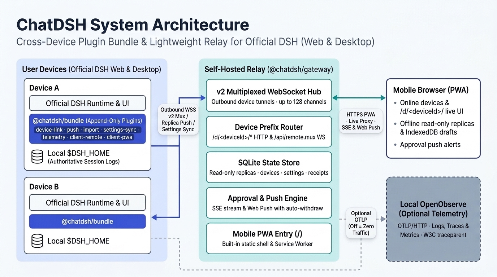

# ChatDSH

[中文](README.md) | English

ChatDSH is a cross-device plugin bundle and self-hosted lightweight relay server for the official DSH (DeepSeek Harness). Users run the official DSH runtime and official Web/Desktop clients directly, install the append-only plugin bundle `@chatdsh/bundle` via `dsh plugin add`, and pair devices with a self-hosted `@chatdsh/gateway` relay to enable remote device switching, offline read-only session replicas, local session resume and fork, allowlisted preference synchronization, approval push notifications, and a built-in mobile PWA.



## Key Capabilities

- **Append-Only Plugin Delivery**: `@chatdsh/bundle` adds ChatDSH host and client plugins exclusively through `insert` rules in `cordis.patch.yml`, leaving upstream DSH configuration untouched. All client plugins target the `platform: "web"` contract so the same build runs in both official DSH Web and official DSH Desktop clients.
- **Outbound Multiplexed Tunnel**: Devices behind NAT or firewalls initiate outbound WebSocket connections to the relay via `@chatdsh/host-device-link` (v2 framed protocol supporting up to 128 concurrent logical channels per link, window-based flow control, heartbeat timeouts, and generation replacement). Clients access live remote DSH sessions through `/d/<deviceId>/*` and `/d/<deviceId>/api/remote.mux`.
- **Loopback Same-Origin Relay Proxy**: When a browser connects to a cross-origin relay URL, `@chatdsh/host-device-link` exposes loopback-only allowlisted proxy endpoints that strip sensitive headers, enforce CSRF checks on pairing, and preserve trace propagation.
- **Offline Read-Only Replicas & Local Resume**: Each device's local `$DSH_HOME` remains the authoritative store for session logs. `@chatdsh/host-push` persists sync intents and streams full event envelopes to the relay SQLite database, allowing offline timeline browsing and local session resume or fork on another device via `@chatdsh/host-import`.
- **Allowlisted Preference Sync**: `@chatdsh/host-settings-sync` synchronizes only five portable preference namespaces (default model, locale, chat view, analytics toggle, and preset registry), keeping local paths and machine-specific parameters on each device.
- **Built-In Mobile PWA & Approval Alerts**: The relay serves an installable mobile PWA at `/` with online device status, aggregated sessions, structured read-only timelines, and IndexedDB offline drafts. Approval requests trigger notifications over SSE and Web Push and are automatically withdrawn once decided.
- **Integrated Observability**: Built on OpenTelemetry (targeting local OpenObserve by default) with W3C `traceparent` propagation across browser, relay, and device boundaries. Telemetry can be disabled immediately without restarting via environment variables, settings, CLI flags, or runtime toggles.

## Repository Structure

| Path | Description |
|---|---|
| [`dsh-adapter/`](dsh-adapter/) | `@chatdsh/adapter`: narrow compatibility boundary wrapping 7 direct DSH `peerDependencies` and 13 registered upstream package names |
| [`runtime/packages/core/`](runtime/packages/core/) | Shared core libraries: `@chatdsh/core-contracts`, `@chatdsh/core-diagnostics`, `@chatdsh/core-remote-client` |
| [`runtime/packages/host/`](runtime/packages/host/) | Device-side host plugins: `telemetry`, `device-link`, `push`, `import`, `settings-sync` |
| [`runtime/packages/client/`](runtime/packages/client/) | Client plugins (`platform: "web"`): `telemetry`, `pwa`, `remote` |
| [`runtime/packages/bundle/chatdsh/`](runtime/packages/bundle/chatdsh/) | `@chatdsh/bundle`: append-only bundle installing all ChatDSH host and client plugins in one command |
| [`runtime/gateway/`](runtime/gateway/) | `@chatdsh/gateway`: standalone lightweight relay server hosting device tunnels, prefix routing, replicas, push hub, settings sync, and the mobile PWA |
| [`runtime/docs/`](runtime/docs/) | Architecture, deployment, telemetry, compatibility, and secret-guard documentation |
| [`runtime/scripts/`](runtime/scripts/) | Build tooling, static checks, upstream upgrade verification, and end-to-end verification scripts |
| [`runtime/e2e/unit/`](runtime/e2e/unit/) | Unit and regression test suites |

## Quick Start

### Preferred: Manual CLI Setup

#### 1. Prerequisites

- Relay host: Docker & Docker Compose, Bash, and `curl` (no host Node.js required)
- Client devices: Node.js 22+, pnpm 11.21.0, Official DSH (`@deepseek-ai/dsh`, verified baseline `0.2.2-rc.3`)

#### 2. Start the Relay in One Command (Docker Compose)

```sh
bash scripts/relay-up.sh
```

On first run, the script prompts for the public relay domain (required, e.g. `relay.example.com` or `https://relay.example.com`), checks `.env` for `CHATDSH_PAIRING_CODE`, automatically generates and saves a random secret (`0600` permissions, reused on subsequent runs), and starts the relay container via [`docker-compose.yml`](docker-compose.yml). The host port binds to `127.0.0.1` by default (pass `--bind-host <tunnel-interface-ip>` for a specific VPN/tunnel interface; wildcard addresses `0.0.0.0` and `::` are rejected), and pairing approval is enabled by default (`CHATDSH_PAIRING_APPROVAL=required`).

Once `/healthz` is ready, the script checks public reachability (printing DNS and reverse-proxy forwarding instructions to `http://127.0.0.1:3170` if not yet configured) and outputs a copy-pasteable one-line device join command. To print that command again anytime, run on the relay host:

```sh
bash scripts/relay-up.sh --print-join-command
```

Terminate TLS in front of `127.0.0.1:3170` with a reverse proxy such as Nginx, Caddy, or Tailscale Serve with WebSocket upgrades enabled and response buffering disabled (for public exposure, enable `CHATDSH_ACCESS_MODE=required` or reverse-proxy authentication; see [`runtime/docs/deployment.md`](runtime/docs/deployment.md)).

#### 3. Install, Pair & Start DSH on a Device in One Command

If installing from a fresh source checkout, build once first:

```sh
cd dsh-adapter && pnpm install && node scripts/link-dsh-deps.mjs && pnpm build && cd ../runtime && pnpm install && node scripts/link-dsh-deps.mjs && pnpm build && pnpm build:client && cd ..
```

Then run the one-line command printed by `relay-up.sh` (prompts silently for the pairing secret so it never enters shell history):

```sh
bash scripts/device-join.sh --relay https://relay.example.com
```

The client submits a pending request and waits for approval. On the relay host, inspect and approve it:

```sh
bash scripts/relay-approve.sh list
bash scripts/relay-approve.sh approve <requestId>
```

Once approved, `device-join.sh` claims the one-time device token, saves credentials to `$DSH_HOME/chatdsh-device.env` (`0600`), and starts official DSH. Subsequent starts on the same device only require `bash scripts/device-join.sh`. After all devices are onboarded, run `bash scripts/relay-up.sh --disable-pairing` on the relay host to close the pairing endpoint.

Once connected, open `/` on the relay for the mobile PWA, open `/d/<deviceId>/` to interact with a live online device through the official DSH interface, or use the Remote panel in your local official DSH sidebar.

### Alternative: AI Agent Guided Deployment & Onboarding

> [!WARNING]
> Even with prompt constraints and redaction rules in place, granting an AI Agent terminal access still carries a risk of secret or domain leakage through unexpected command output, imperfect instruction adherence, or retained conversation context. Manual CLI Setup above is the preferred method; only use AI Agent guided deployment if you understand and accept this risk.

If you accept the risk above, you can let an AI Agent with terminal access (such as official DSH, Claude Code, or Codex) follow [`runtime/docs/agent-deploy-guide.md`](runtime/docs/agent-deploy-guide.md):

```text
Please read runtime/docs/agent-deploy-guide.md and follow its zero-leakage rules to deploy the ChatDSH relay server and connect my local DSH instance. Never print any secrets, tokens, pairing codes, .env contents, or real domains into the conversation context (avoid docker compose config / docker inspect / systemctl show / ps eww / curl -v); never bind the host port to 0.0.0.0; reference environment files/variables directly in services, and prompt me to print secrets or approve pairing requests manually.
```

The Agent follows a redacted, approval-gated workflow:

1. **Zero-Leakage Boundary & Network Inspection**: Never prints `.env`, device credential files, pairing secrets, or real domains into context; probes host network interface types, tunneling tools (Tailscale, Cloudflare Tunnel, FRP, WireGuard, ZeroTier), and active reverse proxies, then guides you to record your domain and bind address (never `0.0.0.0`; only `127.0.0.1` or a specific tunnel interface IP) locally and choose the connectivity mode.
2. **Redacted Relay Deployment & Pairing Approval**: Runs `bash scripts/relay-up.sh --redact-secrets` to start the Docker Compose relay (`CHATDSH_PAIRING_APPROVAL=required` by default, so pairing requests stay pending until explicitly approved on the relay host; auto-generating and persisting a random pairing secret with `0600` permissions without echoing secrets or domains), references environment files in reverse proxy/tunnel configs with your approval, and instructs you to run `bash scripts/relay-up.sh --print-join-command` manually when needed.
3. **Optional DSH Plugin Installation with Persistent-Service Gate**: Asks whether you want the Agent to install `@chatdsh/bundle` and pair your local DSH (using `--from-relay-env .env --redact-secrets` on the same host, or silent interactive code input across machines so secrets stay out of shell history). If you confirm, it first checks for persistent DSH services (`systemd` / `systemctl`, `launchd`, `pm2`, `supervisorctl`). Whenever a persistent service is found, the Agent must show the service file path, run user, proposed `EnvironmentFile` reference update, and restart impact, and obtain your explicit approval before editing or restarting the service. Once all devices are paired, run `bash scripts/relay-up.sh --disable-pairing` to close the pairing endpoint.

## Documentation

Detailed technical documentation is maintained in Chinese under `runtime/docs/`:

- Documentation Index & Baseline: [`runtime/docs/README.md`](runtime/docs/README.md)
- System Architecture: [`runtime/docs/architecture.md`](runtime/docs/architecture.md)
- Deployment, Environment Variables, VAPID, Backup & Upgrade: [`runtime/docs/deployment.md`](runtime/docs/deployment.md)
- AI Agent Deployment & Onboarding Guide: [`runtime/docs/agent-deploy-guide.md`](runtime/docs/agent-deploy-guide.md)
- Telemetry Specification & Signal Registry: [`runtime/docs/telemetry.md`](runtime/docs/telemetry.md)
- DSH Compatibility & Upgrade Verification: [`runtime/docs/compatibility.md`](runtime/docs/compatibility.md)
- Credential & Privacy Hooks: [`runtime/docs/secret-guard.md`](runtime/docs/secret-guard.md)
- Adapter Package Guide: [`dsh-adapter/README.md`](dsh-adapter/README.md)
- Runtime Workspace Guide: [`runtime/README.md`](runtime/README.md)

## Verification

Run the full build, static contract checks, unit tests, and end-to-end verification suite from `runtime/`:

```sh
cd runtime
node_modules/.bin/tsc -b tsconfig.build.json --force
pnpm --config.verify-deps-before-run=false build:client
pnpm --config.verify-deps-before-run=false check:telemetry
pnpm --config.verify-deps-before-run=false check:plugins
node scripts/check-upstream-names.mjs
pnpm --config.verify-deps-before-run=false check:layering
pnpm --config.verify-deps-before-run=false test
pnpm --config.verify-deps-before-run=false verify:plugin-install
pnpm --config.verify-deps-before-run=false verify:device-link
pnpm --config.verify-deps-before-run=false verify:routing
pnpm --config.verify-deps-before-run=false verify:settings-sync
pnpm --config.verify-deps-before-run=false verify:approval-notify
pnpm --config.verify-deps-before-run=false verify:import
pnpm --config.verify-deps-before-run=false verify:receipt-sync
pnpm --config.verify-deps-before-run=false verify:multi-client
pnpm --config.verify-deps-before-run=false verify:mobile-telemetry
```

Install the local Git privacy hooks after cloning:

```sh
cd runtime && bash scripts/install-hooks.sh
```

## References & Acknowledgements

### Upstream & Open-Source Foundations

We are grateful to the following open-source projects and tools that power ChatDSH:

- **[DeepSeek Harness (`@deepseek-ai/dsh`)](https://www.npmjs.com/package/@deepseek-ai/dsh)** & **Cordis**: Core agent runtime, session persistence, official Web/Desktop clients, and plugin architecture.
- **[OpenTelemetry](https://opentelemetry.io/)** & **[OpenObserve](https://openobserve.ai/)**: Standard OTLP logging, distributed tracing, metrics, and self-hosted observability backend.
- **[Zod](https://zod.dev/)** & **[esbuild](https://esbuild.github.io/)**: Schema validation for shared contracts and fast client plugin bundling.

### Ecosystem Reference Projects

Special thanks to the following DSH community and open-source projects whose designs informed ChatDSH's trade-offs across desktop integration, mobile UX, remote tunneling, and monorepo organization. Local snapshot metadata is registered in [`runtime/refer-repos.json`](runtime/refer-repos.json) (not committed to Git):

| Project | Repository | Contribution to Design Decisions |
|---|---|---|
| `dataelement_dsh-desktop` | [dataelement/dsh-desktop](https://github.com/dataelement/dsh-desktop) | Electron desktop packaging and permission model reference |
| `anywhere-labs_dsh-desktop` | [anywhere-labs/dsh-desktop](https://github.com/anywhere-labs/dsh-desktop) | Multi-package workspace layout and update channels |
| `Clarklevis1995_dsh-mobile` | [Clarklevis1995/dsh-mobile](https://github.com/Clarklevis1995/dsh-mobile) | Mobile client and runtime responsibility boundary |
| `Clarklevis1995_dsh-plugin-mobile-gateway` | [Clarklevis1995/dsh-plugin-mobile-gateway](https://github.com/Clarklevis1995/dsh-plugin-mobile-gateway) | Mobile gateway plugin integration pattern |
| `saya-ch_dsh-mobile` | [saya-ch/dsh-mobile](https://github.com/saya-ch/dsh-mobile) | Standalone browser-side npm package layout and narrow-screen drawer UI |
| `shaobeichen_dsh-pocket` | [shaobeichen/dsh-pocket](https://github.com/shaobeichen/dsh-pocket) | Lightweight client reverse proxy and UI slot registration |
| `kelai141_dsh-mobile-apk` | [kelai141/dsh-mobile-apk](https://github.com/kelai141/dsh-mobile-apk) | On-device mobile runtime packaging reference |
| `dsh-Go` | [ccch1mneyyy/dsh-Go](https://github.com/ccch1mneyyy/dsh-Go) | Remote connection protocol and plugin UI boundary reference |
| `ds-harness-remote` | [liguobao/ds-harness-remote](https://github.com/liguobao/ds-harness-remote) | Resident host remote tunnel, multiplexed streams, and E2E encryption comparison |
| `ZCode` | [zai-org/ZCode](https://github.com/zai-org/ZCode) | Multi-package repository structure |
| `rea_workbuddy` | Local snapshot (no remote) | Protocol and authentication reference material |
