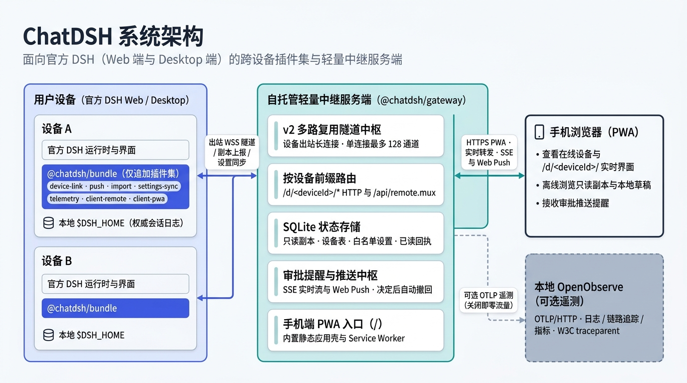

# ChatDSH

中文 | [English](README.EN.md)

ChatDSH 是面向官方 DSH（DeepSeek Harness）的跨设备互联插件集与自托管轻量中继服务端。用户直接使用官方 DSH 运行时与官方客户端（Web 端与 Desktop 端），通过标准插件命令安装仅追加的组合包 `@chatdsh/bundle`，配合自托管的轻量中继服务端 `@chatdsh/gateway`，即可实现公网跨设备访问、离线只读会话副本、本机恢复继续、白名单偏好设置同步、审批提醒推送与手机端 PWA 入口。



## 核心能力

- **仅追加插件交付**：`@chatdsh/bundle` 仅通过 `cordis.patch.yml` 的 `insert` 规则追加自有插件，保留上游 DSH 原生配置完整结构。全部客户端插件遵循 `platform: "web"` 契约，同一份产物同时运行在官方 Web 端与官方 Desktop 端。
- **出站多路复用隧道**：内网设备通过 `@chatdsh/host-device-link` 主动向中继服务端发起出站 WebSocket 连接（v2 帧协议，单连接最多 128 条并发逻辑通道，支持流量控制、心跳保活与代次替换），经 `/d/<deviceId>/*` 与 `/d/<deviceId>/api/remote.mux` 实时访问目标设备的官方 DSH 界面与流式接口。
- **本机同源中继代理**：浏览器跨来源访问中继时，由设备宿主侧回环白名单代理转发中继接口，自动剥离敏感头字段并校验 CSRF 标记，同时完整透传链路上下文。
- **离线只读副本与本机继续**：各设备本地 `$DSH_HOME` 始终保存权威会话日志。`@chatdsh/host-push` 持久化补传意图并按顺序上报完整事件信封至中继 SQLite；设备离线时可随时浏览只读时间线，并通过 `@chatdsh/host-import` 在当前设备恢复或分叉继续会话。
- **白名单偏好同步**：`@chatdsh/host-settings-sync` 仅同步 5 个通用偏好命名空间（默认模型、界面语言、聊天视图、分析开关、预设注册表），本机路径与设备运行参数留在各自设备上。
- **手机端 PWA 与审批推送**：中继根路径 `/` 内置可安装的移动端 PWA，聚合在线设备状态、会话列表、只读副本与 IndexedDB 离线草稿；副本出现审批请求时通过 SSE 与 Web Push 推送提醒，审批完成后自动撤回同键待投递提醒。
- **统一可观测性**：内置基于 OpenTelemetry 的遥测管道（默认对接本机 OpenObserve），支持 W3C `traceparent` 跨端链路传播，并提供环境变量、设置文件、启动参数与运行期热开关等多种即刻关闭入口。

## 项目结构

| 目录 | 说明 |
|---|---|
| [`dsh-adapter/`](dsh-adapter/) | 适配层 `@chatdsh/adapter`：聚合上游 DSH 7 个直接 `peerDependencies` 与 13 个登记包名，作为业务插件访问 DSH 内部 API 的唯一边界 |
| [`runtime/packages/core/`](runtime/packages/core/) | 共享核心包：`@chatdsh/core-contracts`、`@chatdsh/core-diagnostics`、`@chatdsh/core-remote-client` |
| [`runtime/packages/host/`](runtime/packages/host/) | 设备宿主插件：`telemetry`、`device-link`、`push`、`import`、`settings-sync` |
| [`runtime/packages/client/`](runtime/packages/client/) | 客户端插件：`telemetry`、`pwa`、`remote`（支持官方 Web 端与 Desktop 端） |
| [`runtime/packages/bundle/chatdsh/`](runtime/packages/bundle/chatdsh/) | 组合包 `@chatdsh/bundle`，供 `dsh plugin add` 一步装入全部宿主与客户端插件 |
| [`runtime/gateway/`](runtime/gateway/) | 独立运行的轻量中继服务端 `@chatdsh/gateway`，提供设备隧道、前缀转发、只读副本、推送中枢、白名单设置同步与手机端 PWA |
| [`runtime/docs/`](runtime/docs/) | 架构设计、部署运维、遥测规范、兼容性与隐私防护文档 |
| [`runtime/scripts/`](runtime/scripts/) | 构建脚本、静态检查、上游升级验证与端到端验收脚本 |
| [`runtime/e2e/unit/`](runtime/e2e/unit/) | 单元测试与回归测试 |

## 快速开始

<details>
<summary><strong>首选方式：手动命令行部署（免克隆仓库，直接复用 GitHub 预构建镜像与插件）</strong>（点击展开）</summary>

GitHub Actions 在每次主干更新与版本发布时自动构建并发布两项产物：
- **多架构中继镜像**：`ghcr.io/wenzetan/chatdsh-relay:latest`（支持 `linux/amd64` 与 `linux/arm64`）
- **预构建插件归档**：GitHub Releases 中的 `chatdsh-plugin-bundle.tar.gz` 与 `SHA256SUMS.txt`（包含 `@chatdsh/bundle` 与全部 12 个依赖包）

#### 1. 环境要求

- 中继宿主机：Docker 与 Docker Compose、Bash 与 `curl`（无需克隆源码，无需安装 Node.js）
- 接入设备：Node.js 22 及以上、官方 DSH（`@deepseek-ai/dsh`，当前验证基线 `0.2.2-rc.5`），Linux / macOS 使用 Bash 与 `curl`，Windows 使用 PowerShell 5.1 / 7+（无需克隆源码，无需本地编译）

#### 2. 一行远程命令启动中继服务端（Docker Compose + GHCR 镜像）

```sh
curl -fsSL https://raw.githubusercontent.com/wenzetan/chatdsh/main/scripts/relay-up.sh | bash
```

脚本自动在 `~/.chatdsh/relay`（可通过 `--dir` 自定义）拉取 [`docker-compose.yml`](docker-compose.yml) 与管理脚本，首次运行时询问中继对外域名（必填，例如 `relay.example.com` 或 `https://relay.example.com`），自动生成高熵随机配对口令并保存为 `0600` 权限，随后直接拉取 `ghcr.io/wenzetan/chatdsh-relay:latest` 启动中继容器。宿主机监听地址默认为 `127.0.0.1`（如需绑定特定内网穿透网卡 IP 可通过 `--bind-host <具体网卡 IP>` 指定，脚本强制禁止绑定 `0.0.0.0` 或 `::`），并默认开启配对审批（`CHATDSH_PAIRING_APPROVAL=required`）。

容器就绪后，脚本会自动探测公网域名连通性（尚未配置域名解析或反向代理时输出明确的 DNS 与反向代理指向 `http://127.0.0.1:3170` 指引），并打印设备接入命令。后续如需再次查看接入命令或更新镜像，在中继宿主机执行：

```sh
bash ~/.chatdsh/relay/relay-up.sh --print-join-command
# 拉取最新镜像并重启：bash ~/.chatdsh/relay/relay-up.sh
```

生产环境建议在宿主机通过 Nginx、Caddy 或 Tailscale Serve 等前置网关向 `127.0.0.1:3170` 转发流量并终止 TLS（公网暴露建议开启 `CHATDSH_ACCESS_MODE=required` 或反向代理身份认证，配置示例见 [`runtime/docs/deployment.md`](runtime/docs/deployment.md)）。

#### 3. 一行远程命令在设备安装插件、审批配对并启动 DSH

在任意安装了官方 DSH 的设备上执行（免克隆仓库，自动从 GitHub Releases 下载预构建插件归档并校验 SHA-256，在交互提示中静默输入配对口令不留历史）：

**Linux / macOS（Shell）：**

```sh
curl -fsSL https://raw.githubusercontent.com/wenzetan/chatdsh/main/scripts/device-join.sh | bash -s -- --relay https://relay.example.com
```

**Windows（PowerShell，专供 Windows 客户端使用）：**

```powershell
& ([scriptblock]::Create((irm https://raw.githubusercontent.com/wenzetan/chatdsh/main/scripts/device-join.ps1))) -Relay https://relay.example.com
```

客户端提交配对申请后会打印 `requestId` 并等待放行，在中继宿主机审批通过：

```sh
bash ~/.chatdsh/relay/relay-approve.sh list
bash ~/.chatdsh/relay/relay-approve.sh approve <requestId>
```

审批通过后，设备脚本自动领取一次性凭据保存到 `$DSH_HOME/chatdsh-device.env`（Linux / macOS 权限 `0600`，Windows 限制仅当前用户访问）并启动官方 DSH；同时在 `~/.dsh/` 保存可复用启动脚本，后续在同一设备重启只需执行：
- Linux / macOS：`bash ~/.dsh/chatdsh-device-join.sh`
- Windows（PowerShell）：`powershell -ExecutionPolicy Bypass -File "$env:USERPROFILE\.dsh\chatdsh-device-join.ps1"`

全部设备接入完成后，可在中继宿主机执行 `bash ~/.chatdsh/relay/relay-up.sh --disable-pairing` 关闭配对入口。

连接成功后，可通过中继地址 `/` 使用手机端 PWA，通过 `/d/<deviceId>/` 直接进入对应在线设备的官方 DSH 界面，或在本地官方客户端侧栏打开「远程设备」面板。

> [!TIP]
> 开发者如需在本地克隆的源码仓库内自构建镜像与插件，请先在 `dsh-adapter/` 与 `runtime/` 完成构建，再分别运行 `bash scripts/relay-up.sh --build` 与 `bash scripts/device-join.sh --from-local --relay <中继地址>`，详细步骤见 [`runtime/docs/deployment.md`](runtime/docs/deployment.md)。

</details>

<details>
<summary><strong>次选方式：由 AI Agent 协助完成部署与接入</strong>（点击展开）</summary>

> [!WARNING]
> 尽管提示词与操作指南已加入零泄露约束与命令限制，将宿主机终端权限交给 AI Agent 仍存在模型未完全遵守约束、命令异常输出带出敏感内容或上下文留存凭据的泄露风险。日常部署请优先使用上方的**手动命令行部署**；仅在你明确了解并可接受上述风险时，再尝试 AI Agent 辅助部署。

若确认接受上述风险，可将以下指令发送给具备终端执行能力的 AI Agent（如官方 DSH、Claude Code、Codex 等），按 [`runtime/docs/agent-deploy-guide.md`](runtime/docs/agent-deploy-guide.md) 逐步完成免克隆远程部署：

```text
请先阅读 https://raw.githubusercontent.com/wenzetan/chatdsh/main/runtime/docs/agent-deploy-guide.md（或本地 runtime/docs/agent-deploy-guide.md），严格遵守其中的零泄露红线，通过远程脚本与 GitHub 预构建镜像/插件帮我部署 ChatDSH 中继服务端并接入本机 DSH。启动或重建中继容器前，必须先根据本机网卡与反向代理/穿透架构向我明确确认宿主机监听地址（本机反代用 127.0.0.1，跨机反代或穿透回源用对应网卡具体 IP，禁止默认设为 127.0.0.1 且禁止放行 0.0.0.0）。若本机已存在中继容器或已安装插件，必须先用 --check-update 检查预构建镜像与插件归档是否存在更新并明确询问我是否更新重启，禁止直接跳过。严禁将任何密钥、令牌、配对口令、.env 内容或真实域名输出到上下文中（也不要执行 docker compose config / docker inspect / systemctl show / ps eww / curl -v）；其他服务使用密钥或域名时直接引用环境变量文件，需要查看口令或审批配对时提示我自己操作。
```

AI Agent 会严格按以下流程协作执行：

1. **零泄露约束、网络探测与监听地址确认**：不读取或打印 `.env`、凭据文件与真实域名；先只读检查宿主机网卡类型、Tailscale / Cloudflare Tunnel / FRP / WireGuard 等内网穿透工具、现有反向代理端口及已有容器绑定地址，**向你明确确认宿主机监听地址**（本机反向代理/穿透用 `127.0.0.1`，跨机网关或穿透对端回源用对应网卡具体单网卡 IP，禁止未经确认默认设为 `127.0.0.1` 且严禁 `0.0.0.0`），再引导你在自己的终端写入对外域名与已确认的监听地址。
2. **中继容器部署、版本更新检查与配对审批**：若宿主机已存在 `chatdsh-relay` 容器，先执行 `relay-up.sh --check-update` 对比本地运行镜像与 GHCR 远端最新预构建镜像摘要；存在更新时必须主动询问你是否拉取最新镜像并重建重启容器（保留 `.env` 与数据卷）。启动或更新均调用 `curl -fsSL https://raw.githubusercontent.com/wenzetan/chatdsh/main/scripts/relay-up.sh | bash -s -- --redact-secrets` 以脱敏模式执行（默认 `CHATDSH_PAIRING_APPROVAL=required`，客户端申请配对后需管理员审批放行；首次自动生成随机配对口令并按 `0600` 权限持久化复用）；反向代理或穿透配置通过环境变量引用，不展开明文，且修改前征得你的同意。查看完整接入命令时由你本人在宿主机终端手动执行 `bash ~/.chatdsh/relay/relay-up.sh --print-join-command`。
3. **代劳安装/升级 DSH 插件与持久服务确认门禁**：主动询问是否需要代劳在本机通过远程脚本下载 GitHub Releases 预构建插件归档安装 `@chatdsh/bundle` 并完成配对接入；若本机已安装插件，先执行 `device-join.sh --check-update` 检查远端最新归档，有新版本时询问你是否执行原地升级（`--remote --install-only`，保留原有配对凭据无需重新配对）。确认代劳后先检查是否存在由 `systemd`（`systemctl`）、`launchd`、`pm2`、`supervisord` 等托管的持久化 DSH 服务。发现持久服务时，必须先列出服务文件路径、运行用户、拟变更内容（添加 `EnvironmentFile` 引用或重启加载新版插件）及重启影响，取得你的明确同意后再修改服务文件与重启；全部设备接入完成后可运行 `bash ~/.chatdsh/relay/relay-up.sh --disable-pairing` 关闭配对入口。

</details>

<details>
<summary><strong>完全卸载与彻底移除本项目影响（手动命令行 / AI Agent 协助）</strong>（点击展开）</summary>

完全卸载仅移除 ChatDSH 的中继容器、镜像、部署文件、设备端 `@chatdsh/bundle` 插件、工作区 `overrides` 与配对凭据，保留官方 DSH 运行时本体与你的全部本地历史会话日志不受影响。

#### 方式一：手动命令行完全卸载（首选）

1. **在接入设备上移除插件与凭据**：

   Linux / macOS（Shell）：
   ```sh
   curl -fsSL https://raw.githubusercontent.com/wenzetan/chatdsh/main/scripts/uninstall.sh | bash -s -- --device
   # 如安装了多个 profile（例如 web 与 desktop）：
   # curl -fsSL https://raw.githubusercontent.com/wenzetan/chatdsh/main/scripts/uninstall.sh | bash -s -- --device --profile web --profile desktop
   ```

   Windows（PowerShell，专供 Windows 客户端使用）：
   ```powershell
   & ([scriptblock]::Create((irm https://raw.githubusercontent.com/wenzetan/chatdsh/main/scripts/uninstall.ps1))) -Device
   # 如安装了多个 profile（例如 web 与 desktop）：
   # & ([scriptblock]::Create((irm https://raw.githubusercontent.com/wenzetan/chatdsh/main/scripts/uninstall.ps1))) -Device -Profile web,desktop
   ```
   若本机通过 `systemd` 托管了官方 DSH，同时移除为 ChatDSH 添加的环境变量文件引用（例如 `/etc/systemd/system/dsh.service.d/chatdsh-device.conf`）并重启服务：
   ```sh
   sudo rm -f /etc/systemd/system/dsh.service.d/chatdsh-device.conf
   sudo systemctl daemon-reload && sudo systemctl restart dsh.service
   ```

2. **在中继宿主机移除容器、镜像、数据卷与部署目录**：
   ```sh
   # 彻底删除中继容器、本地镜像、~/.chatdsh/relay 及持久化数据卷（含只读副本、配对记录与 VAPID 密钥，不可恢复）
   curl -fsSL https://raw.githubusercontent.com/wenzetan/chatdsh/main/scripts/uninstall.sh | bash -s -- --relay --purge-relay-data
   # 如需同时保留中继数据卷以便日后恢复，去掉 --purge-relay-data 即可
   ```
   （若中继与设备在同一台机器上，可直接执行 `curl -fsSL https://raw.githubusercontent.com/wenzetan/chatdsh/main/scripts/uninstall.sh | bash -s -- --all --purge-relay-data` 一步清理。）

3. **清理外部网络规则**：如之前手动配置过 Nginx / Caddy / Tailscale Serve / Cloudflare Tunnel / FRP 指向中继端口，对应删除该转发规则即可。

#### 方式二：由 AI Agent 协助完全卸载（次选）

> [!WARNING]
> 与部署阶段相同，向 AI Agent 授予宿主机终端权限仍存在敏感信息泄露或误操作风险；仅在你明确了解并可接受上述风险时使用。

可将以下指令发送给具备终端执行能力的 AI Agent，按 [`runtime/docs/agent-deploy-guide.md`](runtime/docs/agent-deploy-guide.md) 第六阶段执行完全卸载：

```text
请阅读 https://raw.githubusercontent.com/wenzetan/chatdsh/main/runtime/docs/agent-deploy-guide.md 第六阶段，严格遵守零泄露红线（禁止输出任何密钥、.env 内容或真实域名），帮我完全卸载 ChatDSH 并彻底移除本项目对本机与官方 DSH 的影响。先向我确认卸载范围（设备插件 / 中继服务 / 是否删除中继数据卷），检查是否存在引用 chatdsh-device.env 的 systemd 等持久服务文件，展示具体路径与拟移除内容并征得我同意后再修改和重启服务，最后验证官方 DSH 配置正常且无 chatdsh 残留。
```

</details>

## 文档导航

- 文档总纲与构成基线：[`runtime/docs/README.md`](runtime/docs/README.md)
- 总体架构与模块边界：[`runtime/docs/architecture.md`](runtime/docs/architecture.md)
- 部署、环境变量、VAPID、备份与升级：[`runtime/docs/deployment.md`](runtime/docs/deployment.md)
- AI Agent 自动化部署与接入指南：[`runtime/docs/agent-deploy-guide.md`](runtime/docs/agent-deploy-guide.md)
- 遥测规范与信号登记清单：[`runtime/docs/telemetry.md`](runtime/docs/telemetry.md)
- 上游 DSH 兼容性与升级验证：[`runtime/docs/compatibility.md`](runtime/docs/compatibility.md)
- 凭据与隐私防护钩子：[`runtime/docs/secret-guard.md`](runtime/docs/secret-guard.md)
- 适配层包说明：[`dsh-adapter/README.md`](dsh-adapter/README.md)
- 运行时工作区说明：[`runtime/README.md`](runtime/README.md)

## 验证与开发注意事项

在 `runtime/` 目录下运行完整编译、静态检查、单元测试与九条端到端验收脚本：

```sh
cd runtime
node_modules/.bin/tsc -b tsconfig.build.json --force
pnpm --config.verify-deps-before-run=false build:client
pnpm --config.verify-deps-before-run=false check:telemetry
pnpm --config.verify-deps-before-run=false check:plugins
node scripts/check-upstream-names.mjs
pnpm --config.verify-deps-before-run=false check:layering
pnpm --config.verify-deps-before-run=false test
pnpm --config.verify-deps-before-run=false verify:plugin-install
pnpm --config.verify-deps-before-run=false verify:device-link
pnpm --config.verify-deps-before-run=false verify:routing
pnpm --config.verify-deps-before-run=false verify:settings-sync
pnpm --config.verify-deps-before-run=false verify:approval-notify
pnpm --config.verify-deps-before-run=false verify:import
pnpm --config.verify-deps-before-run=false verify:receipt-sync
pnpm --config.verify-deps-before-run=false verify:multi-client
pnpm --config.verify-deps-before-run=false verify:mobile-telemetry
```

环境注意事项：

- **依赖预装环境**：运行 `pnpm` 命令时可附加 `--config.verify-deps-before-run=false` 跳过锁文件校验。
- **`GIT_CONFIG_COUNT` 变量**：部分托管环境注入不完整的 `GIT_CONFIG_COUNT` 会导致 `git` 退出，执行命令时可使用 `env -u GIT_CONFIG_COUNT -u GIT_CONFIG_KEY_0 -u GIT_CONFIG_VALUE_0 git <子命令>`。
- **隐私防护钩子**：克隆仓库后在 `runtime/` 目录运行 `bash scripts/install-hooks.sh` 启用提交与推送前敏感信息检查。

## 参考项目与致谢

### 上游框架与开源基础

感谢以下开源项目与基础设施为 ChatDSH 提供底层运行时、插件系统、可观测性与构建能力：

- **[DeepSeek Harness (`@deepseek-ai/dsh`)](https://www.npmjs.com/package/@deepseek-ai/dsh)** 与 **Cordis 插件框架**：提供核心代理运行时、会话持久化、官方 Web/Desktop 客户端与插件加载机制。
- **[OpenTelemetry](https://opentelemetry.io/)** 与 **[OpenObserve](https://openobserve.ai/)**：提供标准 OTLP 日志、链路追踪、指标协议与轻量级本地观测存储。
- **[Zod](https://zod.dev/)** 与 **[esbuild](https://esbuild.github.io/)**：提供跨组件契约校验与客户端插件打包。

### 生态参考项目

感谢以下 DSH 生态与开源项目的探索与实践，它们在桌面端集成、移动端交互、远程隧道与多包工程组织等方面为 ChatDSH 的架构取舍提供了宝贵参考。本地参考快照登记于 [`runtime/refer-repos.json`](runtime/refer-repos.json)（不纳入版本管理）：

```sh
node runtime/scripts/clone-refer-repos.mjs               # 拉取清单中的全部参考仓库
node runtime/scripts/clone-refer-repos.mjs --only dsh-Go # 拉取指定仓库
node runtime/scripts/clone-refer-repos.mjs --list        # 查看清单
```

| 目录 | 上游 | 作用 |
|---|---|---|
| `dataelement_dsh-desktop` | [dataelement/dsh-desktop](https://github.com/dataelement/dsh-desktop) | Electron 桌面端构建与权限核对 |
| `anywhere-labs_dsh-desktop` | [anywhere-labs/dsh-desktop](https://github.com/anywhere-labs/dsh-desktop) | 多包工作区与通道更新核对 |
| `Clarklevis1995_dsh-mobile` | [Clarklevis1995/dsh-mobile](https://github.com/Clarklevis1995/dsh-mobile) | 移动端客户端与内核职责划分 |
| `Clarklevis1995_dsh-plugin-mobile-gateway` | [Clarklevis1995/dsh-plugin-mobile-gateway](https://github.com/Clarklevis1995/dsh-plugin-mobile-gateway) | 移动网关插件接入方式 |
| `saya-ch_dsh-mobile` | [saya-ch/dsh-mobile](https://github.com/saya-ch/dsh-mobile) | 浏览器侧独立 npm 包形态与窄屏抽屉布局 |
| `shaobeichen_dsh-pocket` | [shaobeichen/dsh-pocket](https://github.com/shaobeichen/dsh-pocket) | 轻量客户端反向代理与插槽注册 |
| `kelai141_dsh-mobile-apk` | [kelai141/dsh-mobile-apk](https://github.com/kelai141/dsh-mobile-apk) | 移动设备本地运行环境核对 |
| `dsh-Go` | [ccch1mneyyy/dsh-Go](https://github.com/ccch1mneyyy/dsh-Go) | 远程连接协议与插件界面边界核对 |
| `ds-harness-remote` | [liguobao/ds-harness-remote](https://github.com/liguobao/ds-harness-remote) | 主机常驻远程隧道、多路复用流与端到端加密对照 |
| `ZCode` | [zai-org/ZCode](https://github.com/zai-org/ZCode) | 多包仓库组织方式 |
