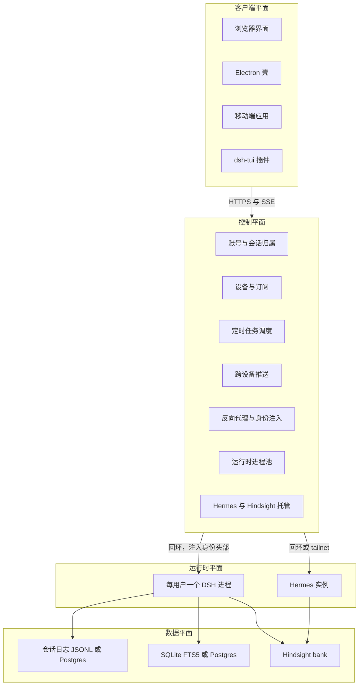

# ChatDSH 架构设计

以 DSH（deepseek-harness）为运行内核，覆盖 Web 端、命令行、Windows 桌面、移动端四种形态的开源自托管 ChatGPT 对应物。目标形态是单用户自托管；团队版与公网多租户版是同一套代码在更大规模下的部署。全部能力以插件、组合包、profile 补丁进入运行时。

本机实测基线：`@deepseek-ai/dsh` 0.2.1-rc.2，安装根 `/usr/local/nvm/versions/node/v24.19.0/lib/node_modules/@deepseek-ai/dsh`（下文记作 `$DSH`），内置包目录 `$DSH/node_modules/@deepseek-ai/`（305 个条目）。Hermes 0.21.7 装在 `/usr/local/lib/hermes-agent/`。

## 一、硬约束

deepseek-harness 的源码仓库不得修改。npm 安装的包产物可以打补丁：用包管理器的补丁机制（`patch-package` 或包管理器的补丁格式），补丁按上游版本各留一份，升级时逐项判断哪些已被上游修复并删除过时补丁。改动位置的优先顺序为 profile 与组合包的补丁层、树外插件、包产物补丁。

补丁层能表达的操作只有 `config`、`disabled`、`inject`、`intercept`、`isolate`、`group` 六项。条目上的 `name` 是匹配校验条件，写错则整条补丁被跳过并打印警告；未匹配到 `id` 的补丁同样只警告。因此**替换某个既有行的实现包必须禁用该行再插入等价行**，补丁层做不到改名替换。这条边界决定了哪些改动只能走包产物补丁。

每种形态一个 profile 目录，形态差异由 `dsh.profile.bundles` 的列表差异承担。

## 二、已核验的事实基座

### 2.1 插件与组合包契约

- 插件的 DSH 身份写在 `package.json` 的 `dsh` 字段，类型 `DshManifest`，键为 `manifestVersion`、`bundle`、`profile`、`client`。证据：`dsh-package-manifest/lib/types/types.d.ts:28`。
- 组合包声明 `dsh.bundle.patch`，取值为路径或有序数组，路径相对声明包自身解析。证据：同文件 `:66`。清单里没有「基础包」这个字段，组合包之间的叠加只能在 profile 的 `dsh.profile.bundles` 里按顺序列出。
- 插件模块遵循 cordis 契约，支持函数插件、类插件、对象插件三种形状，可带 `name`、`Config`、`inject`、`provide`、`intercept`。证据：`cordis/lib/types/registry.d.ts:48-79`。
- 版本兼容范围写在 `engines.dsh`。插件自带该字段时由它单独决定，否则检查每个 `@deepseek-ai/dsh*` peer。判定函数 `evaluatePluginCompatibility(manifest, exemptions?, runtimeVersion?)` 位于 `dsh-app-boot/lib/types/plugin-compatibility.d.ts:28`。

### 2.2 配置树与补丁语义

配置树由补丁层依次叠加：各组合包的 patch 按 `dsh.profile.bundles` 顺序展开，然后是 profile 自身的 `cordis.patch.yml`，然后是 `$DSH_HOME/cordis.patch.yml`，最后是 `--patch` 覆盖层与遥测开关。证据：`dsh-app-boot/lib/types/profile.d.ts:1-22` 与 `$DSH/lib/types/profile-boot.d.ts:2-5`。

补丁条目 schema 为 `PatchOptions`：`id`、`insert`、`name`、`config`、`group`、`disabled`、`inject`、`intercept`、`isolate`。证据：`cordis-plugin-include/lib/types/index.d.ts:27-38`。`applyEntryPatches` 的实现（`cordis-plugin-include/lib/index.js:56-105`）把 `name` 从待赋值字段中摘出，只用于匹配校验；`insert` 走数组 push，不做 id 去重，因此同一组合包里重复列出同一组合包会产生重复的 loader 条目 id。

补丁覆盖整行 `config`，每行必须重述它拥有的全部键。

### 2.3 服务注册与关键服务

服务通过 cordis 服务解析挂在 `ctx` 上，注册用 `ctx.provide(name, value)`，读取用 `ctx.get(name)`。证据：`cordis/lib/types/reflect.d.ts:43`。

| 需求 | 服务 | 声明位置 |
|---|---|---|
| 命令执行 | `ctx.shell` | `dsh-shell/lib/types/index.d.ts` |
| 文件读写 | `ctx.fs` | `dsh-fs/lib/types/index.d.ts` |
| 会话存储 | `ctx.sessionPersistence` | `dsh-session-persistence/lib/types/index.d.ts` |
| 会话检索 | `ctx.sessionQuery` | `dsh-session-query/lib/types` |
| 会话派生读模型 | `ctx.sessionProjections` | `dsh-session-projection/lib/types/index.d.ts` |
| 跨会话引用 | `ctx.sessionReferenceResolver` | `dsh-session-reference/lib/types/index.d.ts` |
| 模型调用 | `ctx.llm`，注册方法 `registerAdapter` | `dsh-llm/lib/types/index.d.ts:245` |
| 工具注册 | `ctx.tools.register` | `dsh-tools/lib/types/index.d.ts:637` |
| 命令注册 | `ctx.commands.register` | `dsh-commands/lib/types/index.d.ts:94` |
| HTTP 路由 | `ctx.webServer.register`／`registerUpgrade`／`registerFallback` | `dsh-host-webserver/lib/types/index.d.ts:129` |
| 审批 | `ctx.approval.request` | `dsh-user-approval/lib/types/index.d.ts:105` |
| 向用户提问 | `ctx.userQuestions.ask`／`askTimed`／`answer` | `dsh-user-questions/lib/types/index.d.ts:35` |
| 沙箱提供方 | `ctx.sandbox` | `dsh-sandbox/lib/types/index.d.ts` |
| 沙箱策略 | `ctx.sandboxPolicy` | `dsh-sandbox-policy` |
| 结构化存储 | `ctx.storage` 与 `ctx.storageDomain` | `dsh-storage`、`dsh-storage-domain` |
| 附件 | `ctx.attachments` | `dsh-attachment/lib/types/index.d.ts:13` |
| 客户端模块图 | `ctx.clientModules` | `dsh-client-modules/lib/types/index.d.ts` |
| 工作区注册表 | `ctx.workspaceRegistry` | `dsh-workspace/lib/types/index.d.ts` |
| 定时任务 | `ctx.schedule` | `dsh-schedule/lib/types/index.d.ts` |
| 凭据 | `ctx.credentials` | `dsh-credentials/lib/types/index.d.ts` |
| 凭据授权流程 | `ctx.authorization.registerFlow` | `dsh-authorization/lib/types/index.d.ts` |
| Remote 访问控制 | `ctx.remoteAccess` | `dsh-api-remote-access/lib/types/index.d.ts` |
| Remote 网关 | `ctx.typertGateway` | `dsh-api-gateway/lib/types/types.d.ts:140` |
| 技能目录 | `ctx.skills` | `dsh-skill/lib/types/index.d.ts` |
| 子智能体 | `ctx.subagents` | `dsh-subagent/lib/types/index.d.ts` |

`ctx.agents.setFactory(factory)` 可以替换整个 agent 循环驱动，契约只有 `createAgent` 与 `resume` 两个方法。证据：`dsh-agent/lib/types/index.d.ts:153-185`、`:266`。

### 2.4 工具的注册面

`ctx.tools.register(definition)` 的注释写明「Register globally or in the calling agent scope. Scoped tools shadow globals」，即不加作用域时注册落在全局层，**模型默认可见**。`ctx.tools.restrict(filter)` 只过滤某个作用域继承来的工具（全局层与祖先层），从不影响它自己那一层注册的工具。证据：`dsh-tools/lib/types/index.d.ts:632-637` 与 `:666-680`。

宿主平面注册的工具因此会出现在模型目录里。走 agent preset 行挂载工具的理由是按会话裁剪能力、隔离作用域服务、让能力随预设版本演进，而不是「宿主平面的工具模型看不到」。

工具定义包含 `parameters`、必需的 `output`（`schema` 与 `render`）、可选 `timeoutMs`（协作式预算，由工具调用超时策略作为 `tools/execute` 包装器执行，永不发给模型）、可选 `isConcurrencySafe`（只有精确 true 才并行）、`execute(args, exec)`、可选 `presentCall`／`presentResult`。审批在 `tools/execute` 的 waterfall 上以 guard 形式介入；缺少审批支持时 `ask` 视为拒绝。

工具执行上下文里没有会话历史字段也没有工作目录字段。读历史经 `exec.agent.session`，取工作目录经 `ctx.workingDirectory.ensure(exec.agent, exec.signal)`。

### 2.5 Web 客户端扩展

- 客户端插件在 `package.json` 里声明 `dsh.client`，类型 `DshClientManifest { platform, inject?, immediately?, external? }`。证据：`dsh-package-manifest/lib/types/types.d.ts:76`。
- 宿主侧的 `dsh-client-modules` 扫描 Loader 树中声明 `dsh.client` 的包，按模块图排序生成 `window.__DSH_BOOT__`，并通过 `/plugins/<id>/client.js` 供出浏览器产物。
- 浏览器侧启动协议由 `window.__DSH_BOOT__` 与 `window.__ModuleLoader__` 两个全局量构成，入口为 `createClientModuleSystem(target, bootstrapModule, options)`。证据：`dsh-client-modules/lib/types/client/index.d.ts:29`。
- 启动注入由宿主端生成：`bootInjections(graph)` 返回按执行顺序排列的头部注入行。
- 启动页内核已随 npm 公开发布：`@deepseek-ai/dsh-client-web@0.2.1-rc.2` 的 `publishConfig.access` 为 `public`，导出 `.`、`./injections`、`./src/*`。该包在 registry 上的 `latest` 标签仍停在 `0.0.1-rc.1`，取用需要指定版本或走 `next` 标签。
- 官方前端产物内含桌面启动分支：`dsh-web-frontend/dist/assets/index-CN7NIWNw.js` 读取 `globalThis.dshDesktopBoot`，存在时要求 `globalThis.__DSH_BOOT_READY__`，调用 `ready()` 取回 `{injections, streamBaseUrl}`，写入 `globalThis.__DSH_TRANSPORT__`，再逐个插入注入脚本。
- 可挂载的 UI 席位由 `dsh-web-app` 的行列表给出：`ui-sidebar`、`ui-sidebar-right`、`ui-chat`、`ui-conversation`、`ui-input-trigger`、`ui-model-selection`、`ui-settings`、`ui-plan`、`ui-brand-official`、`ui-plugin-market` 等。多个自建面板能否共用同一席位需要逐个核对属主规则，静态兜底席位明确只有一个属主。

### 2.6 接入协议

- `dsh --profile sdk` 走 JSON-RPC stdio，方法为 `initialize`、`session/prompt`、`session/resume`、`session/wait`、`session/working-directory/get`、`session/working-directory/set`、`shutdown`，通知为 `session.event`、`session.status`、`subagent.started`、`subagent.finished`。没有中断方法，没有审批应答方法。
- `dsh --profile acp` 走 ACP stdio，注册 `initialize`、`authenticate`、`session/new`、`session/list`、`session/resume`、`session/close`、`session/set_config_option`、`session/prompt`，通知 `session/cancel`，审批通过反向请求 `session/request_permission` 完成。证据：`$DSH/node_modules/@deepseek-ai/dsh-acp/lib/index.js:1362-1365` 与 `:1176`。
- DSH 没有 ACP 客户端实现，但 `@agentclientprotocol/sdk` 同时导出 client 侧 API（`client()`、`ClientApp`、`ClientSideConnection`）。

### 2.7 会话存储与落盘

- `SessionPersistence` 是抽象服务：`create(header, options)`、`open(id, access, options)`、`flush()`、`stat(id, options)`、`list(options)`；写句柄上是 `read`、`append`、`flush`、`close`。四项共享语义：事件序号从 0 连续且永不重写；撕烈的物理尾部永不返回给读者；读取路径只接受当前格式且对未知词汇关闭式拒绝；`append` 尽力而为而 `flush` 是耐久屏障。证据：`dsh-session-persistence/lib/types/index.d.ts:82-160`。
- 写句柄是单写者所有权，已有活跃所有者时以 `SessionAlreadyOwnedError` 拒绝，且锁无过期机制。证据：`dsh-session-persistence/lib/types/index.d.ts:113-124` 与 `dsh-session-persistence-jsonl/lib/types/lease.d.ts:1-30`。
- JSONL 后端落盘为 `<root>/<projectKey>/<sessionDir>/session.v<版本>.jsonl.zstd`，首行为 `type: 'session'` 头部，其后每行一个事件，写入采用不可变世代文件。证据：`dsh-session-persistence-jsonl/lib/types/format.d.ts`。
- `SessionStore` 的类注释写明持久化不在它里面实现，agent 生命周期把日志写入器挂到每个已发布会话的写句柄上；在该生命周期之外发布的会话不落任何内容。证据：`dsh-session/lib/types/index.d.ts:371-376`。

### 2.8 会话事件与投影

- `Session.append<T>(type, data, ...opts)` 是活体会话的追加入口，`opts` 只在 `T extends SurfaceEventType` 时必需。`seq` 与 `time` 由日志分配。
- 表面事件类型是 `'system/message' | 'developer/message' | 'user/message' | 'assistant/message' | 'tool/result'`，它们必须携带 `surfaceOp`；`assistant/message` 禁止携带 `sourceEventSeqs`。
- `KNOWN_SESSION_EVENT_TYPES` 是构建期生成的静态清单，追加路径不查它，读取路径查：`validateStoredEvents` 对不在清单内且没有 `ignorable: true` 的事件抛出 `SessionFormatUnsupportedError`。证据：`dsh-session-persistence/lib/index.js:182-189`。
- `appendPluginRecord(session, type, data)` 是公开导出的插件记录入口，写入的记录带 `ignorable: true`，类型名须匹配 `plugin:<小写段>` 语法，冷读路径放行、随 fork 与 resume 一起搬运，`pluginRecordOf` 可读回。上游仓库里有一条限制「只有 `packages/experimental/` 下的生产源码才可调用」的校验脚本，那是仓库内部的 lint 规则，已发布的 npm 包里没有该脚本，`exports` 直接给出该函数。随包先例是 `dsh-experimental-translator`。这类记录在会话格式迁移中可能被丢弃，因此只能承载可以丢失的状态。
- `SessionProjectionMap` 与 `SessionProjectionStateMap` 都是空的可合并接口，注释写明「The merge-extensible host-fold-state table」，值必须是纯 JSON 以便投影缓存持久化。证据：`dsh-session-projection/lib/types/types.d.ts:16-24`。追加投影键的随包先例有 `dsh-agent`、`dsh-agent-preset-registry`、`dsh-api-session-controller`、`dsh-experimental-agent-team`。

### 2.9 会话生成与分叉

- `ctx.agents.create` 接受 `sessionId`、`parentAgent`、`meta.{cwd, parentSession, isSeeded, origin, delegationDepth, agentPreset}`、`inheritedEventCount`、`seed`、`agentOptions`、`signal`、`setup`。
- `SessionStore.fork(source, boundary, childSessionId)` 与 `buildForkSeed(events, boundary)` 做带血缘分叉：复制含边界的前缀，在切点补一条 `inherited: true` 的 `session/end-seed`，并为开放尾部补合成的工具结果与步骤／回合闭合标记。合成闭合事件已占 `boundary + 1` 起的序号，因此第一条新事件的序号取持久化日志当前末端，不是 `boundary + 1`。证据：`dsh-session/lib/types/fork.d.ts:8-18`。
- `session/end-seed` 的继承标记只能由 `Session` 构造函数与 `buildForkSeed` 创建，历史必须整段作为前缀交给构造函数。
- `parentSession` 只做字符串类型检查，不校验存在性，血缘的唯一性与可解析性由调用方保证。
- `SessionController.fork` 的请求只有 `sessionId`、`atSeq`、`allowMigration` 三个字段，新会话的 `cwd` 继承源会话、工作区由 `forkWorkspace(source.header)` 解析，因此官方这条路径不能跨工作区。换目录要用 `buildForkSeed` 加 `ctx.agents.create` 自己组装，再调目标工作区的 `attachSession`。
- agent preset 只能在会话仍然空白时切换：`openTurnStartSeq !== null || lastTurn > 0` 即抛 `agent-preset/locked`。证据：`dsh-agent-preset-registry/lib/index.js:750-770`。

### 2.10 审批与向用户提问

`ctx.approval.request(req)` 要求该 agent 有已开启的回合，空闲时提问在写入任何东西之前就被拒绝。

`ctx.userQuestions.ask` 不检查回合，只校验传入的 agent 是注册表中的精确存活实例且为顶层根会话（`assertLiveRoot`）。但它的投影只折叠工具名恰为 `ask_user_question` 的调用，且要求生效的 `request/header` 把该工具声明为带 `timeout` 参数的定时形态；`continued` 状态只有「工具返回 pending 载荷」与「会话恢复补写 `TOOL_OUTCOME_UNKNOWN`」两种来源；应答入口 `answer()` 只对 `continued` 的问题有效。证据：`dsh-user-questions/lib/index.js:200`、`:531-535`、`:545-587`、`:613-615`，`lib/types/projection.d.ts:19`、`:47-50`。

结论：审批与提问卡片都要求真实回合或真实的工具执行。没有回合的场景要自建投影与事件，见第 6.3 节。

### 2.11 内置账号体系

DSH 自带一套绑定 DeepSeek 平台账号的登录、余额与充值接缝：`dsh-deepseek-account`（`ctx.deepseekAccount`，`AccountView`、`AccountWallet`）、`dsh-deepseek-account-platform`（`Config` 含 `embeddedPageDist`、`inferenceOrigin`、`rewriteBrowserOrigin`、`balanceTimeoutMs`）、`dsh-llm-deepseek-account`、`dsh-api-account-controller`（`static inject = ["deepseekAccount","agents"]`）、`dsh-client-ui-settings-account`。默认挂载位置：`dsh-base/cordis.patch.yml:120-121`、`:528-529` 与 `dsh-web-app/cordis.patch.yml:144-148`。

同一棵配置树里另有两个不依赖账号的模型供应方配置面：`dsh-llm-deepseek-api-key`（`apiKeyEnv` 默认 `DEEPSEEK_API_KEY`，另有 `baseURL`、`models`、`thinking`、`reasoningEffort`、`maxTokens`）与 `dsh-llm-pi-ai`（`providers` 字典的键就是路由名，每条含 `apiKeyEnv`、`api`、`baseURL`、`models`、`headers`、`reasoning`、`cacheRetention`、`transport`、`timeoutMs`）。

### 2.12 确认不存在的能力

多租户与租户体系、跨用户的账号绑定、计量计费、远程会话托管、系统推送，五项在 305 个内置包与全部类型声明中均无对应实现。MCP 只有客户端（`dsh-mcp-client`），没有服务端。语音只有识别方向，没有合成接缝。没有图像生成供应方接缝。

`PrincipalMap` 的当前声明只有 `owner: { kind: 'owner' }`，`registerPolicy` 的类型参数是 `Exclude<keyof PrincipalMap, 'owner'>`，在该声明下收成 `never`；HTTP 侧的两条 Peer 来源都硬编码 owner，非 owner 的 Peer 在共享通道上直接得到 403。证据：`dsh-typert-protocol/lib/types/types.d.ts:363-368`、`dsh-api-remote-access/lib/types/index.d.ts:46`、`dsh-client-connection/lib/index.js:714`、`:783`、`:830`。因此**运行时内的多用户授权没有接入点**，隔离只能落在进程边界。

### 2.13 `desktop` profile 名称裁定

`dsh` 的 CLI 在参数解析阶段拒绝该名称：`$DSH/lib/bin.js:35-37` 的 `rejectElectronProfile`，调用点在 `:112`（启动与配置导出）与 `:119`（插件管理，除非载体传入 `manageDesktopProfile`）。

`dsh-web-app` 的补丁里有三行以 `ctx.get('profileContext')?.name !== 'desktop'` 作为关闭条件：`desktop-product-telemetry`、`product-analytics`、`ui-sidebar-browser`。证据：`dsh-web-app/cordis.patch.yml:45-59` 与 `:297-298`。

`runProfile` 不包含名称白名单，传 `resolvedProfile` 时跳过按名初始化。

结论：走 `dsh` 命令行启动的载体必须避开该名称。ChatDSH 的桌面载体用 `chatdsh-desktop`；被跳过的三行里有两行本来就应当关闭，`ui-sidebar-browser` 由组合包按自有开关条件补回。

## 三、总体架构

三个平面加一个共享中枢。

**客户端平面**：浏览器界面、Electron 壳、移动端应用、命令行（`dsh-tui` 的插件）。全部经控制平面接入，不直连运行时。

**控制平面**：常驻的独立服务，持有账号、会话归属索引、设备与订阅、用量账本、分享记录，负责反向代理与身份注入、跨设备推送的中枢、定时任务的唯一调度者、Hermes 与 Hindsight 的生命周期托管、租户运行时的进程池。

**运行时平面**：每用户一个未修改的 DSH 进程，独立 `$DSH_HOME`，只绑回环，从控制平面注入的请求头部读取身份。普通聊天由 Hermes 承载；工作会话由 DSH 自己的 agent 执行。

**数据平面**：会话日志用 JSONL，工作区与检索索引用 SQLite FTS5，附件与制品走对象存储（单机是本地目录），记忆用 Hindsight 的 bank，Hermes 的会话在其 `state.db`。



隔离分两层。租户与账号的隔离由进程边界承担：每用户一个运行时进程，独立 `$DSH_HOME`，进程内的授权层恒为 owner。工作区的隔离由目录与归属判定承担：同一运行时内每个工作区一个根目录，会话创建时把该目录作为 `cwd`，会话日志按 `cwd` 的项目键分目录存放，因此工作区之间的会话在落盘层面已经分开；跨工作区的访问由控制平面的归属判定与运行时的 Remote 前置检查共同限制。

## 四、仓库与包结构

```
/workspace/ChatDSH
  packages/contracts/          @chatdsh/contracts
  packages/plugins/            @chatdsh/plugin-*
  packages/presets/            @chatdsh/preset-* 与 @chatdsh/tool-*
  packages/clients/            @chatdsh/client-*
  packages/bundles/            @chatdsh/bundle-*
  packages/gateway/            @chatdsh/gateway
  packages/desktop/            @chatdsh/desktop-shell
  packages/mobile/             @chatdsh/mobile
  packages/cli/                @chatdsh/cli（dsh-tui 插件）
  profiles/                    各 profile 的 package.json 与 cordis.patch.yml
  e2e/                         验收测试
```

依赖方向单向：`contracts` 无依赖；`plugin-*`、`tool-*`、`client-*` 依赖 `contracts` 与 DSH 内置包；`bundle-*` 依赖插件；profile 的 `dsh.profile.bundles` 列出组合包。插件之间通过 `ctx` 服务名互相发现，不互相 import 实现。

### 4.1 契约包

`@chatdsh/contracts` 只含类型与校验 schema：Remote 方法名与参数、会话事件扩展字段、审批记录的 `plugin:` 类型与载荷、附件与制品元数据、错误码、身份头部名。版本按主版本号发布。

### 4.2 控制平面

`@chatdsh/gateway` 是独立 Node 服务，承担：

- 账号、会话归属索引、工作区与成员、设备与订阅、分享记录、用量账本；
- 扩展包的安装记录与分发：哪个用户装了哪个版本、来源、权限声明与安装时间；
- 会话日志副本：执行节点推送的事件按 `seq` 追加成只读镜像并记录同步水位，供跨设备浏览、会话导入与设备离线时读取；
- 分享快照渲染：按分享记录从会话副本读出到指定序号的事件，服务端直接渲染只读页面，不经运行时、不受运行时的鉴权约束；
- 反向代理与身份注入：客户端的 `/api` 请求经它转发到对应租户的运行时，注入身份头部并改写 Host 与 Origin；
- 跨设备推送的中枢：按设备订阅决定投给谁，应用在前台走长连接，后台由 Android 前台服务发本地通知；
- 定时任务的唯一调度者：持有任务表与到期判定，动作分「唤醒运行时并投递消息」与「直接推送」两类；
- Hermes 与 Hindsight 的生命周期托管：Hindsight 是全局单例，Hermes 是每租户一个实例，控制平面负责两者的启动、探活、降级与回收；
- 租户运行时进程池：按需启动、空闲回收、预热层分配。

数据访问走接口，单机实现落在 SQLite，团队版换 Postgres。

**分享是控制平面自己渲染的只读快照。** 分享不经过运行时，原因有两条：运行时的鉴权以 authority 绑定的 cookie 为前提，而分享要发给 tailnet 之外的人；快照只需要读，不需要 agent 参与。

创建分享时记录 `sessionId`、`upToSeq`、`expiresAt`、`revokedAt`、创建者与访问计数。访问 `/s/<token>` 时控制平面校验令牌、从会话副本读出 `seq` 不超过 `upToSeq` 的事件、服务端渲染页面。令牌是签名随机值，不要求 tailnet 身份；撤销即删记录，链接立刻失效。

快照是静态的：分享创建之后源会话继续增长不会出现在链接里，这一点由 `upToSeq` 固定，复制链接的人看到的内容不会因为对方继续对话而变化。

附件默认不进快照，因为它与日志同步是两个开关。创建分享时给出两种选择：只分享文字，或者把这个范围内的附件打包成一份不可变的分享包随链接提供。后者让链接自包含，代价是复制一份附件并计入分享用量。

### 4.3 宿主平面插件

| 包 | 职责 | 注册点 |
|---|---|---|
| `@chatdsh/plugin-identity` | 从控制平面注入的头部取身份，供运行时的分派与审计使用 | `ctx.provide` |
| `@chatdsh/plugin-session-index` | 注册会话读模型投影，供列表、检索、用量视图 | `ctx.sessionProjections` |
| `@chatdsh/plugin-llm-router` | 模型适配器，转发到控制平面的模型入口，在 `stream()` 入口做额度检查 | `ctx.llm.registerAdapter` |
| `@chatdsh/plugin-projects` | 在工作区注册表之上扩展标题、指令、模型默认值 | `ctx.storageDomain`、`dsh-agent-instructions` |
| `@chatdsh/plugin-artifacts` | 制品存储与版本，制品虚拟文件系统 | `ctx.storageDomain`、`ctx.attachments` |
| `@chatdsh/plugin-memory` | 向 Hindsight 召回并注入，按工作区与会话类型决定召回哪些 bank | `agent/pre-step` |
| `@chatdsh/plugin-assistants` | 自定义助手写入 preset 声明并注册 | `dsh-agent-preset-registry` |
| `@chatdsh/plugin-connectors` | 按用户生成 MCP 服务器配置与凭据 | MCP 客户端行、`ctx.authorization.registerFlow` |
| `@chatdsh/plugin-approval-bridge` | 把 Hermes 的审批请求写成 `plugin:` 记录，接收应答并回传 | `appendPluginRecord`、自建 Remote 方法 |
| `@chatdsh/plugin-usage` | 取每轮用量并上报控制平面 | `ctx.sessionProjections` |
| `@chatdsh/plugin-push` | 把会话事件（回合结束、待审批）上报控制平面 | `ctx.schedule` 之外的自建上报 |
| `@chatdsh/plugin-voice` | 语音识别，复用内置实验性接口 | `dsh-experimental-api-speech-to-text` 行 |
| `@chatdsh/plugin-images` | 图像生成与编辑工具的服务端部分 | `ctx.tools`、`ctx.attachments` |
| `@chatdsh/mcp-server` | 把工具目录暴露为 MCP 服务端 | 独立子系统，见 4.4 |
| `@chatdsh/plugin-metrics` | 遥测导出端点 | `dsh-session-telemetry-otel` 行 |

### 4.4 MCP 服务端

`@chatdsh/mcp-server` 是独立子系统，不是一行路由注册。它要自建协议会话初始化、能力协商、`tools/list`、`tools/call`、错误码与流式响应，并定义鉴权模型：新开的协议入口不经过 `remoteAccess.decide()`，工具目录的可见性要按控制平面的会话归属过滤后再生效。

### 4.5 会话平面插件

agent preset `chatdsh` 由 `@chatdsh/preset-chat` 声明，`plugins` 列出会话要挂载的行：`tool-bash`、`tool-pwsh`（按平台二选一）、`tool-fs`、`tool-fs-search`、`tool-skill`、`tool-jobs`、`tool-todo`、`tool-web`，加上自建工具行 `@chatdsh/tool-artifact`、`@chatdsh/tool-project`、`@chatdsh/tool-image`、`@chatdsh/tool-research`、`@chatdsh/tool-connector`、`@chatdsh/tool-share`、`@chatdsh/tool-browser`。末项是浏览器操作，默认不挂进 preset，由工作区或会话的设置按需加上，原因见第 7.8 节。

桌面控制不进会话 preset。`@deepseek-ai/dsh-computer-use` 的注册位是整棵运行时共用的单例，同一运行时第二次注册会直接抛出异常；提供方又把工具注册进宿主工具表，不随会话销毁。会话级挂载的后果是第二个会话启用时注册冲突、或者每个会话各起一套原生驱动，两种都不可接受。这两行放在宿主平面（桌面壳的组合包）里随进程加载一次，会话平面只做可见范围收敛，见第 7.8 节。

聊天会话的 preset 是一个不含工具行的空组合，仅安装模型选择。

### 4.6 客户端插件

`@chatdsh/client-projects`、`client-artifacts`、`client-memory`、`client-assistants`、`client-connectors`、`client-account`、`client-share`、`client-approval`。每个包声明 `dsh.client = { platform: "web", inject: [...] }`，导出 `./client` 子路径，产物落在 `lib/client.js`，构建用 esbuild。

`client-approval` 按自建投影键渲染审批卡片，卡片跟随对应会话出现，选项是 `once`／`session`／`always`／`deny`。

### 4.7 组合包

| 包 | 内容 |
|---|---|
| `@chatdsh/bundle-hosted` | 宿主平面插件行、会话平面 preset 行、客户端插件行 |
| `@chatdsh/bundle-storage-jsonl` | 会话日志 JSONL 后端与控制平面的 SQLite 实现 |
| `@chatdsh/bundle-storage-postgres` | 会话日志 Postgres 后端与控制平面的 Postgres 实现 |
| `@chatdsh/bundle-desktop` | 桌面原生桥行、本地审批呈现、`ui-sidebar-browser` 补回 |
| `@chatdsh/bundle-cli` | 终端交互、命令行审批应答方 |
| `@chatdsh/bundle-worker` | 长任务与后台执行行 |

存储实现独立成组合包，由 profile 的 bundles 列表选择，单机与桌面取 JSONL，团队版取 Postgres。组合包之间不表达「基础」关系，叠加顺序由 profile 决定，同一组合包在列表里只出现一次。

### 4.8 扩展包

扩展包是「一组 cordis 插件加 agent preset 加 MCP 配置加界面面板」的分发单元。它在 DSH 侧就是一个组合包，加上控制平面侧的元数据与安装流程。运行时不引入第二套插件机制。

**形态。** 一个 npm 包，`package.json` 里声明标准的 `dsh.bundle.patch`，另加一段 `chatdsh` 字段描述组成：

```json
{
  "name": "chatdsh-extension-example",
  "dsh": { "bundle": { "patch": ["./cordis.patch.yml", "./presets.patch.yml", "./client.patch.yml"] } },
  "chatdsh": {
    "extensionApiVersion": 1,
    "displayName": "示例扩展",
    "presets": ["example-assistant"],
    "mcpServers": [{ "name": "example", "transport": "stdio", "command": "example-mcp" }],
    "panels": ["example-panel"],
    "permissions": ["shell", "fs:workspace"]
  }
}
```

三个补丁文件分别负责宿主平面的服务与配置行、agent preset 声明、客户端面板行。

**安装。** 控制平面读取 `chatdsh` 字段与安装记录，把包写进用户 profile 的 `dependencies` 与 `dsh.profile.bundles`，把 preset 声明写进补丁层，把 MCP 服务器配置写成 MCP 客户端行，把面板行插进客户端名册。安装动作走 `dsh plugin --profile <name> add`，依赖记录与兼容性判定由它承担。

**分发与重建。** 安装记录在控制平面（哪个用户装了哪个版本、何时、来源），profile 目录是可重建的产物：重建时按安装记录重新生成 bundles 与补丁层。这与「存储访问走接口、profile 目录可重建」的原则一致。

**权限声明。** 声明的权限在安装时告知用户并写入审计记录，运行时不依赖扩展包自我约束：工具执行仍经 `tools/execute` 的 guard 与沙箱策略，文件访问仍受工作区根目录限制，网络出站仍由沙箱策略决定。声明的作用是告知与审计，不构成授权机制。

**卸载。** 从 bundles 与 dependencies 移除，删除它插入的行，清理安装记录。卸载不删该扩展创建的会话与记忆，那些属于用户数据。

**版本与兼容。** 扩展包同时声明 `engines.dsh` 与 `chatdsh.extensionApiVersion`。前者由 `dsh plugin` 在安装前判定，后者由控制平面判定，两者都满足才允许安装。

## 五、profile

| profile | bundles | 用途 |
|---|---|---|
| `chatdsh-web` | `dsh-base`、`dsh-web-app`、`bundle-hosted`、`bundle-storage-jsonl` | 单机 Web 与执行节点 |
| `chatdsh-desktop` | `dsh-base`、`dsh-web-app`、`bundle-hosted`、`bundle-storage-jsonl`、`bundle-desktop` | Electron 载体持有的本机 profile |
| `chatdsh-cli` | `dsh-base`、`@deepseek-harness-tui/dsh-tui`、`bundle-cli` | 命令行交互 |
| `chatdsh-worker` | `dsh-headless`、`bundle-worker` | 长任务 |

每个 profile 的 `cordis.patch.yml` 负责本部署的差异：会话存储 `root`、`session-query` 打开检索、`connection` 行补 `trustedHosts`、按形态禁用不需要的宿主行。

禁用的内置行包括账号链六行（`deepseek-account`、`llm-deepseek-account`、`account-controller`、`ui-settings-account`、`web-deepseek-api`、`web-search-deepseek`），`deepseekAccount` 被六个包引用，禁用时必须整链处理，否则会留下失败的 fiber。`llm-deepseek` 是否保留取决于是否允许用户直接配 DeepSeek API key。

模型供应方的配置面是 `dsh-llm-pi-ai` 的 `providers` 与 `dsh-llm-deepseek-api-key` 的 `apiKeyEnv`。单机形态下默认配一条指向本机 OmniRoute 的路由；多租户形态下这两条配置面必须锁住，约束来自运行时文件系统对租户只读或运行时禁止直连外网。

## 六、四种客户端形态

四种形态各自有哪些模块、模块如何分层、界面席位从哪里来，见[客户端模块构成确认](client-modules.md)。本节只定各形态的运行边界。

### 6.1 Web 端

浏览器界面复用 `dsh-web-frontend` 的既有外壳，自建能力以客户端插件挂进既有席位。会话列表、Projects、Artifacts、分享、账号、助手、连接器各有对应插件。请求经控制平面反代，控制平面注入身份并把 Host 与 Origin 改写成运行时接受的形态，这样 DSH 的 authority 绑定 cookie 在 Tailscale 的稳定域名下保持一致。

### 6.2 命令行

`@chatdsh/cli` 做成 `@deepseek-harness-tui/dsh-tui`（0.12.0，Ink 实现）的插件，不提供独立可执行文件。

dsh-tui 自带一套准入协议：`@dsh-std/*` 提供公共定义（`Command`、`LocalStorage`、`MessageObserver`、`Presentation`、`Workspace`），`tui.dsh/*` 是它的私有命名空间，已有 `Channel`（`API_VERSION` 为 `tui.dsh/v1alpha1`，`wireRevision` 为 6）、`DecisionEvents`、`SettingsSection`、`Scene`、`WorkspaceProvider` 五个契约。definition 集合记在 `dsh-ecosystem-spec/registry/registry-0.15.json`，权限清单在 `registry/permissions-0.1.json`。目录收录本身不产生实际支持，协议支持与权限授予分开判断。

接入方式是提供 `tui.dsh/v1alpha1` 的 definition。实现 `Channel` 契约把控制平面作为一个渠道接进去：`open`、`subscribe`、`invoke`、`close` 四种操作，快照是 `TuiChannelSnapshot { wireRevision, channelId, version, state }`。用 `SettingsSection` 与 `Scene` 两个贡献点扩展设置页与场景，需要时再用 `WorkspaceProvider` 提供工作区列表。

非交互模式转发到 `dsh --profile headless "<任务>"` 并按行输出 JSON。仓库内自主编辑沿用 `tool-bash`、`tool-fs`。编辑器集成走 `dsh --profile acp`。

### 6.3 桌面

Electron 主进程承担原生能力与运行时编排，控制平面、运行时与渲染进程各自独立。启动顺序为取单实例锁、建立中立的 `launch-root`、启动控制平面、由控制平面拉起运行时、等回环端口就绪、把窗口指向控制平面分配的地址。桌面特有能力的落点：托盘、系统通知、原生目录选择、更新与运行时编排留在 Electron 主进程；本地文件与命令沿用 `dsh-fs-local` 与 `dsh-pwsh-local`；路径沙箱用 `dsh-sandbox-windows-acl`。首期只做 Windows x64。

审批在桌面与手机上走同一条链路：运行时插件把审批写成 `plugin:` 记录，控制平面按设备订阅决定投给桌面界面还是手机通知，应答方向相反。

### 6.4 移动端

应用连控制平面，不直连运行时。会话列表与内容走控制平面的冷读接口，实时更新走 WebSocket；发消息与回答审批两类动作经控制平面转给对应运行时。语音上传到 `plugin-voice` 暴露的转写接口，拍照与相册走附件上传。送达分三档：应用在前台走长连接，后台由 Android 前台服务发本地通知，应用被系统回收后的送达需要厂商推送通道，排在后续。首期只做 Android。

离线队列只接受发消息，审批在离线时明确拒绝并保留卡片，因为审批的应答时窗由 Hermes 决定。

### 6.5 跨端连续

会话编号是跨端主键，会话日志是唯一事实来源。客户端保存的游标是 `(sessionId, fork 标识, seq)` 三元组，因为分叉出的会话 `seq` 从 0 重新开始而 `inheritedEventCount` 记录被复制的源事件条数，只用 `sessionId` 与 `seq` 会在转工作后把两个会话的区间混淆。

### 6.6 多客户端共存

同一个账号可以同时在多台设备、多个窗口打开同一批会话。运行时的 `/api` 通道本来就支持多个 Peer 同时订阅，事件流向所有订阅者广播，读侧天然多路。写侧与状态侧需要额外约定。

**订阅与游标。** 每个客户端独立维护 `(sessionId, fork 标识, seq)` 三元组，各自按自己的游标追赶事件流。会话日志是只追加的单一事实来源，两端不会看到不同的顺序；断线重连按游标补齐区间，不依赖推送是否送达。

**写入串行化。** 会话日志是单写者所有权，两个客户端同时提交消息时由运行时按到达顺序串行写入，两条都保留。用户消息带 `requestId` 幂等键，同一键重复提交不会产生两条记录，因此客户端在超时后重试是安全的。客户端本地先显示「已发送」属于乐观展示，收到对应事件后转为确认状态。

**审批的并发与广播。** 卡片由投影渲染，多个客户端会同时看到同一张。应答路径只有一个写入者：客户端只发 Remote 请求，宿主插件为每个 `(run_id, request_id)` 维护一个状态机，第一个应答进入处理中并回传 Hermes，其余并发应答直接返回「已被处理」。处理结果写成一条 `plugin:` 记录，作为会话事件广播给所有订阅者，各端卡片据此收敛为已处理；回传 Hermes 收到 409 时按已失效落定，同样广播。

**已读位置与未读计数放在服务端。** 若每个客户端各自维护未读，换设备就不同步。控制平面为每个 `(accountId, sessionId)` 存储已读位置，客户端上报已读时更新并广播给该账号的其他在线端，未读计数由服务端算出后随会话列表下发。

**通知形式可选，三种模式。** 配置项 `notifyMode` 取三种值，默认 `two-stage`。

`all-at-once` 在审批请求产生时立即推给全部在线设备，不分级。适合设备少、希望任何一台都能第一时间看到的场景。

`two-stage` 第一级只推最近活跃的一台，等待阈值后推全部在线设备。

`two-stage-with-phone` 第一级推最近活跃的设备加该账号的全部手机，第二级推全部在线设备。它对应「在电脑前但不一定看得到通知、手机上兜底」的习惯。

**两段时长由用户设置，总时长就是 Hermes 的审批超时。** 默认 120 秒加 180 秒，合计 300 秒。界面把这个总时长显示出来并标注它的来源：值由 Hermes 的 `approvals.timeout` 决定，ChatDSH 调整它时要同步写 Hermes 的配置。两边不一致时以 Hermes 为准，界面给出提示而不静默采用本地值。

第一级设备在等待期间离线时直接进入第二级，不等满第一段。第二级窗口不小于 15 秒，Hermes 的超时被改得很短时按剩余时间收缩。回合结束的通知走同一套模式与阈值。

任一端处理之后，控制平面撤回其余设备上的对应通知：Android 用通知标识取消，桌面关闭对应气泡，避免用户点开一条已经失效的提醒。同一设备由单实例锁保证只有一个进程。

**设备注册与在线状态。** 控制平面持有设备列表（精确 Origin、平台、令牌摘要、最后在线时间、送达档位）与该账号的在线端集合。第一级按模式选取目标（最近活跃的一台，或最近活跃设备加全部手机），第二级取全部在线端并排除已上报已读的。

**桌面多开。** Electron 单实例锁保证一台机器只有一个桌面进程；需要多窗口时在同一进程内开多个窗口，共享同一个控制平面连接与同一份本地状态，避免两份缓存各自演化。

## 七、身份、隔离与托管

### 7.1 隔离以进程为单位

租户与账号的隔离由进程边界承担：每账号一个 DSH 进程，`$DSH_HOME` 指向该账号的目录，进程只绑 `127.0.0.1`，控制平面反向代理并把身份写入请求头部。会话日志、附件、作业记录、终端记录、缓存的落点都由 `$DSH_HOME` 派生，因此按账号天然分开。同一台物理设备上登录两个账号时，它们各自一个运行时进程、各自的 `$DSH_HOME`，设备记录也按账号分开。运行时内的授权层恒为 owner，不做跨账号判定。

工作区隔离在同一进程内由目录与归属判定承担：每个工作区一个根目录，会话创建时把该目录作为 `cwd`，会话日志按 `cwd` 的项目键分目录存放。控制平面的归属表记录 `{accountId, workspaceId}`，跨工作区的访问由控制平面在路由层判定。`SessionPersistence.list` 与 `open` 都不带作用域，运行时内的工作区可见性靠界面与控制器自觉，这一点在单机下可接受，在团队版由进程边界补足。

### 7.2 控制平面

控制平面是唯一常驻的进程，职责见 4.2。它不承载 agent 执行，不写权威会话日志；它持有执行节点推送来的只读副本，用于跨设备浏览、会话导入与移动端冷读。权威日志仍由运行时写入，两份数据的写入者各自单一，不构成单写者所有权的冲突。

### 7.3 额度与用量

模型调用统一经控制平面的模型入口，额度检查在 `@chatdsh/plugin-llm-router` 的 `stream()` 入口完成。额度拒绝使用独立错误码并禁止进入请求失败的恢复路径，否则会被当作可恢复失败触发重试与压缩。

单机形态下用户也可以用 `llm-pi-ai` 的 `providers` 或 `llm-deepseek-api-key` 直接配模型路由，那条路径的额度是事后统计而非事前拦截，账本仍然记录。

### 7.4 部署形态

目标形态是单用户自托管：控制平面、运行时、以及可选的 Hermes 与 Hindsight 在同一台机器上，运行时只绑回环，控制平面开两个 TLS 监听（回环供 Serve 转发、EasyTier 接口供反代以 mTLS 接入），数据根下只有 `tenants/default` 一个租户，存储用 SQLite 与本地文件，不需要任何外部服务。

团队版与公网多租户版是同一套代码在更大规模下的部署：控制平面存储换 Postgres、会话日志换 Postgres 后端、附件换对象存储、登录增加 OIDC、运行时从每用户一个进程扩到进程池、公网形态追加容器隔离与配额强制。调用方与数据模型不变。

必须从第一天就按最终形态实现的接缝，以及单机下可以简化掉的部分，见[部署形态与兼容接缝](deployment.md)。

### 7.5 远程执行节点

单机形态下控制平面与运行时同机，工作区是本地目录。多设备形态下账号可以把其他设备注册为执行节点，工作区落在那些设备上，从任意客户端继续会话。

**两种角色。** 控制宿主承载控制平面，默认也是执行节点；执行节点只跑运行时，不对外提供服务。一台设备可以同时是两者。判断依据由设备表记录，不靠推断。

**连接方向。** 执行节点上的 ChatDSH 以执行节点模式启动，主动向控制平面建立一条长连接，因为它在 NAT 之后无法被直连。控制平面通过这条连接下发指令、接收事件，这条链路同时取代了 relay 的作用。

**工作区与设备绑定，且不可修改。** 工作区记录增加 `deviceId`，会话归属记录同样带 `deviceId`。会话创建时确定 `cwd` 与 `deviceId`：`cwd` 是会话头字段，写入后不可变；`deviceId` 由控制平面在创建后不再提供修改接口。界面把它呈现为只读状态。

**选目录。** 聊天转工作时用户选择目标设备与其上的目录。执行节点通过原生目录选择器回传路径，控制平面把它记成工作区、创建会话并把 `deviceId` 指向该节点。控制平面自身的目录作为默认选项。

**路由。** 请求按会话的 `deviceId` 路由到对应节点的连接，节点内部执行 DSH 运行时的 Remote 方法。设备不在线时明确失败并返回设备离线状态，不改路由、不排队、不回退到宿主机执行——工作区在那台设备上，回退会得到错误的文件视图。

**事件同步与副本。** 会话日志由执行节点写入本地并作为权威，同时按同步策略把事件流推给控制平面；控制平面按 `seq` 追加到自己的持久副本，并广播给所有订阅该会话的客户端。副本是只读镜像，用于跨设备浏览、会话导入与移动端冷读，权威仍是执行节点的日志，两者以「最后同步的 seq」为水位，节点重连后从该游标补发。执行节点的磁盘损毁时，控制平面的副本是唯一的恢复来源。

**同步粒度下到会话。** 设备记录里的 `syncScope` 给默认策略，取三种值：全部会话、仅带工作区的会话、不同步，默认全部会话。每条会话另有 `syncOverride` 覆盖设备默认，取三种值：继承设备默认、强制同步、强制不同步。改变标记即时生效：从不同步改为同步时，执行节点从副本当前水位补全该会话的全部历史；从同步改为不同步时停止推送，已有副本按用户选择保留或清理。

界面在每个会话上显示同步状态，取四种值：已同步（副本与权威一致）、同步中（队列里有待推事件）、落后（给出落后条数，通常是节点断线）、仅本地（未启用同步）。状态由控制平面按水位与队列计算，不靠客户端推断。

开启同步要向用户声明代价：控制平面的存储随会话量线性增长，单机下接近磁盘占用翻倍，多租户下它是对象存储的主要成本项。关闭的代价是这台设备的会话不能被其他设备浏览或导入，设备损毁时没有备份。

**用量可见。** 控制平面在每次追加副本时累计字节数，按会话、工作区、设备三个维度聚合，界面显示总量与按工作区分组的占用，并提供清理入口。清理只删副本，不影响执行节点上的权威日志；清理之后该段会话回到「仅在本地」的状态，跨设备浏览与导入不可用。单机形态下这份统计同样显示，因为同机冗余时磁盘占用翻倍对用户是可见的成本。

**跨设备继续。** 客户端 B 打开会话时，控制平面从执行节点 A 转发事件流；客户端 B 发消息经控制平面路由到 A 执行；审批在 A 产生，控制平面推给该账号的所有在线端。客户端不需要知道执行节点在哪里。

**离线语义。** 执行节点离线时，该节点上工作区的会话只读且不能发消息，界面显示设备状态。聊天会话不受影响，它由 Hermes 承载而不依赖执行节点。

**安全。** 执行节点与控制平面的连接双向认证：控制平面签发节点令牌，节点启动时携带，连接建立后按令牌确定归属账号与节点身份。不同账号的执行节点互不可见。执行节点不监听任何对外端口。

**安装形态按平台分。** Windows 的执行节点必须安装 Electron 壳：原生目录选择器、进程树终止、路径沙箱都依赖它，Windows 的命令行在路径处理与进程管理上不如 Linux 稳定。Linux 的执行节点可以只装命令行组件（`chatdsh node`），它以执行节点模式启动并连接控制平面，目录选择走远程列举加手输路径。两种形态在控制平面侧是同一个注册流程，差别只在节点能力声明与目录选择方式；Linux 节点不声明 `computer` 能力，桌面控制在 Linux 上不可用。

### 7.6 跨设备会话

其他设备上的会话是只读的，不提供接续。它们出现在会话列表里（控制平面持有投影缓存），打开后可以浏览完整对话，但没有输入框——接续意味着写操作发生在文件不在本机的设备上，一旦那台设备离线就变成写不进去的会话。

要在另一台设备上继续同一件事，用导入加本地 fork：

1. 在会话列表里勾选要导入的会话，可以多选；
2. 控制平面从会话副本读取被选中会话的事件序列；
3. 在本地运行时逐条创建新会话，`cwd` 指向本地工作区的目录，`deviceId` 是本地设备，`parentSession` 指向各自的源会话；
4. 新会话正常执行，与源会话之间只有追溯关系。

导入对话框逐条列出事件条数、字符数、副本同步水位，以及本地是否已有来自同一源的导入副本，避免重复导入。

导入读的是控制平面持有的会话副本，因此源设备离线时仍可导入。副本是执行节点推送来的持久镜像，最终一致；若节点在断线期间产生了新事件，副本会落后于权威，导入前要显示副本的同步水位（已同步到哪个 `seq`、落后多少），由用户决定是否等待节点重连补齐。执行节点永久失联时，副本是这段会话唯一还在的内容。

导入的粒度有两种，由用户选择，界面在导入前声明各自的代价。

**完整事件前缀**忠实复制源会话的表面事件与工具调用记录，种子按 `buildForkSeed` 的形态构造（继承前缀加合成闭合标记）。代价是这批历史成为新会话的既有上下文，此后每一轮模型请求都携带它：首轮不享受上游提示词缓存，后续轮次在同一会话内可以命中缓存，但输入长度仍然更大，直到压缩把它们压掉。界面要给出预估规模（事件条数与字符数）并说明这项 token 代价。

**压缩导入**把工具结果的大段内容替换成摘要后再构造事件序列。代价是新会话里看不到工具输出的原文，只在摘要里保留结论。这条路径要在新会话里写一条声明说明来源与有损，与对话转工作的声明同一个位置、同一种承载方式。

导入确认框同时列出两项事实：源会话的事件条数与字符数，以及所选粒度是否会压缩工具结果。预估规模由控制平面在读取事件后计算。用户的选择结果写进新会话的那条声明，后续回看能知道这次导入是否完整。

只取消息对而丢掉工具调用记录的导入不采用：`assistant/message` 里的工具调用是「做过什么」的主要证据，丢掉之后 agent 只能看到结论看不到过程，而这条功能的目的正是让它知道做过什么。

导入的目标工作区与源会话所在工作区可以是同一个（同一项目的另一份检出），也可以不同。记忆共享由工作区关联决定，与会话导入是两件事：导入拿的是完整对话内容，记忆共享的是从对话中抽取的事实。

**导入链与副本清理的关系。** 导入是复制：生成的新会话有自己独立的权威日志，源会话的副本被清理不影响它。因此历史可以沿链传递——设备 A 上的会话经控制平面的副本导入到设备 C，清理该副本之后 C 上那份仍然完整；需要回到 A 时，以 C 的会话为源再导入一次，产生 A 上的新会话。每个会话的 `parentSession` 指向它的来源，界面据此展示导入链。

代价是内容随导入次数重复存储：A 的历史会在 C 的会话与 A 之后那份会话里各存一份完整副本。这条成本由 fork 的语义决定，用引用代替会让源被清理后内容消失。

清理副本时的确认框要区分两类会话：在别处已有导入副本的，清理不丢内容；只存在于源设备上的，清理后不可导入直到源设备重新在线并补齐副本。只显示可释放空间是不够的，用户要知道哪些历史会因此变成「只在那台机器上」。

**删除是软删除，落在一个收件箱里。** 用户删除会话时，执行节点删掉本地日志，控制平面把归属记录标记为已删除并保留副本。已删除的会话进入收件箱视图，列出删除时间、剩余保留天数、副本占用，并允许撤销。

撤销把控制平面副本重新写成执行节点上的日志，会话编号不变，恢复后与删除前一致。若执行节点离线，删除指令与撤销请求都排队；撤销先到就取消尚未执行的删除。

保留期 30 天，到期后控制平面删除副本与归属记录，此时无法恢复。收件箱里的会话仍计入副本用量，因为它们确实占着空间。

**附件同步是独立开关，默认关闭。** 会话日志的副本不含附件与制品——它们体积远大于日志，图片与 PDF 会让副本膨胀数倍。默认情况下跨设备浏览一个会话时，附件按需向执行节点请求，节点离线则该附件不可查看，界面标注「需源设备在线」。需要离线也能看图的会话，可以为该会话开启附件同步，开启时声明代价：副本按附件总量增长，且这部分增长通常比日志本身大一个数量级。

附件是否同步与日志是否同步是两个独立标记，因为它们的成本量级差别很大，合在一起会让用户只能整段接受或整段放弃。

### 7.7 应用级登录与两步验证

内网穿透只能证明设备属于网络，不能证明操作者是谁。共享 tailnet 或 EasyTier 网络的场景下这一层由应用自己补上，作为可选项。

三个档位，配置项 `authMode`。

`tailscale` 是默认档：只认 Serve 注入的 `tailscale-user-login`，首次出现时建账号。单机自托管、网络里只有自己的设备时够用。

`local` 在 Tailscale 身份之外要求应用登录：密码或通行密钥。适合网络里有他人设备的场景。

`tailscale+local` 两者都要：Tailscale 身份确定设备归属，应用登录确定使用者。

两步验证是登录之上的独立开关 `twoFactor`，取 `off`、`totp`、`webauthn` 三种。`totp` 用标准时间型一次性密码，离线可用，注册时同时生成一次性恢复码。`webauthn` 用通行密钥，抗钓鱼，绑定域名作为 RP ID，换域名后需要重新注册——这与域名固定的原则一致，定下域名之后再启用。

存储：账号表增加 `passwordHash`（argon2id）、`totpSecret`（加密存储）、`webauthnCredentials`（凭据标识与公钥）、`recoveryCodes`（哈希存储、一次性使用）。

会话按设备签发，有效期 30 天。到期前 7 天进入续期窗口：窗口内任一请求把有效期顺延到「该次操作时间加 30 天」。窗口内没有任何操作则到期失效，要求重新登录；单台设备失效不影响其他设备。控制平面在反代时校验会话，通过后才转发给运行时。

由此产生的使用节奏是：某台设备的操作间隔不超过 23 天（30 天减去 7 天窗口）就永不过期，超过 23 天则在 30 天到期时失效。要让「任意一次操作都续期」，把窗口判断去掉即可，两者的差别在于会话寿命是否随使用频率伸缩。

会话凭据与 DSH 的 authority 绑定 cookie 分开：客户端只持有应用会话，DSH 的 cookie 只在控制平面与运行时之间有，意义不对外。

高危操作（分享创建、扩展包安装、工作区删除、设备撤销）默认与普通操作走同一个 7 天规则，不要求额外的近期认证。需要更强保护时可以开启 step-up 开关，要求最近若干分钟内完成过一次认证；默认关闭，因为它与「7 天无操作才再认证」的体验目标冲突。

启用登录层之后，Tailscale 身份从「访问权」降级为「设备归属信息」，访问权由应用会话决定。这是它与「网络成员资格即可信」共存的方式：网络层决定谁能到达控制平面，应用层决定到达之后能做什么。

### 7.8 浏览器操作与桌面控制

两类能力分属不同节点，风险等级也不同。

**浏览器操作。** 通过 CDP 控制 Chromium，读取页面的可访问性树并把元素压成短引用，模型据此点击、填表、导航、截图、提取内容。实现放在执行节点上，作为会话平面的工具 `@chatdsh/tool-browser`，内部调用一个 CLI 或直接使用 CDP。本机已有可用实现（`agent-browser` skill 的 CLI，支持 Chrome/Chromium，也能驱动 Electron 应用）。无头节点同样可用，只要该节点装了 Chromium。

节点能力声明里记 `browser` 一项。工作区绑定节点时据此提示「该节点不能执行浏览器操作」，避免会话创建之后才发现工具不可用。

**桌面控制（computer use）。** 需要屏幕采集与输入注入，只有带图形界面的执行节点能提供。设计覆盖 macOS 与 Windows，交付顺序跟随桌面壳（首期为 Windows x64），Linux 的图形界面操作不提供；平台范围与接入方式见本节末。能力经 DSH 内置的电脑操作服务与提供方注册，工具集合由提供方自带。

**工具面。** 浏览器操作每个域只暴露一个工具，方法作为参数：`@chatdsh/tool-browser` 接收 `{ method, args }`，方法是导航、列出标签页、读取可访问性树、点击元素、填表、截图、提取内容。桌面控制复用内置提供方自带的工具集合，形状跟随上游 SDK，产品侧用工具限制收敛可见范围，见本节末。工具目录的容量有限，几十个细粒度工具会挤占模型的选择空间，收敛的理由在这一点。

[ZCode](https://github.com/zai-org/ZCode) 用同一思路：一个 `node_repl` MCP 服务器只暴露单个 `js` 工具，模型在每次全新执行的 JS kernel 里操作 `agent.browsers` 与 `cua` 两个对象面。它的浏览器后端分 `iab`（桌面内嵌浏览器）、`extension`、`cdp`（CLI 管理的无头 Chromium）三种，未声明的后端一律视为不可用。

**每次调用状态不跨调用。** ZCode 的 `js` kernel 每次都是全新的，全局变量活不到下一次，页签连续性由宿主持有。ChatDSH 沿用这条：工具调用不携带跨调用的隐式状态，需要延续的东西由节点侧的会话状态保存。桌面控制这一块驱动自己维护会话：一个隐式会话在 SDK 传输层建立并复用，直到关闭、显式结束或闲置五分钟；元素令牌属于它所在的那次窗口快照，快照一更新就作废。节点侧不另外缓存元素令牌，需要延续的应用与窗口标识也从驱动重新查询。

**应用身份与信任边界。** 每次桌面操作要记录的稳定标识（macOS 的 bundle id、Windows 的 AUMID 或可执行文件路径）与显示名，由宿主侧在 `tools/pre-execute` 环节写入：那里能拿到调用参数里的 `pid`、`window_id` 与元素令牌，再向驱动查一次应用信息，把这份身份记进审计。上游工具返回值里本身带有应用名与进程号，模型也看得到，界面展示与审计不采信模型回合里回传的身份字段，否则模型能伪造「我正在操作某个应用」。ZCode 把这条写成明确的信任边界：只有宿主侧的 CUA bridge 在收到权限代理响应时记录的身份才生效，经模型可见的 sandbox 全局量到达的一律不参与展示。

**五条安全语义要保留。** ZCode 的 CUA SDK 把安全语义列成只藏不删：状态标识强校验（防止对已过期的界面状态下手）、截图帧的精确栅格（坐标与帧一一对应）、可能已下发的防重放（动作抛出错误时带 `actionSent` 标记，不能当作确定失败重试）、控制租约（同一时刻只有一个控制者）、以及中止开关。前三项中的状态标识与截图栅格由驱动承担：元素令牌在窗口快照更新后失效，`zoom` 与 `from_zoom` 保证坐标与帧一一对应；中止也由驱动支持。防重放与租约要产品侧补。驱动没有 `actionSent` 这样的结构化标记，它的物理事实只是「取消后已发出的输入不回滚」，所以产品侧要在工具包装层自己判定：调用异常且可能已下发时，标记该动作不可盲重试并要求先重读状态，这个判定逻辑参考 ZCode 的 `computer-use-client.mjs`，不依赖上游字段。租约驱动明确写「不为某个会话预留窗口或工作流，也不协调并发会话」，因此由产品侧补：宿主侧维护一个进程级的控制租约，第一个会话取得后其他会话的桌面调用被拒绝，会话结束或连接断开时释放，进程退出时整体失效，避免会话崩溃后永久占住。这五条与「动作后重读状态确认」是同一层的东西，缺一条就会在长会话里出现错点或重复操作。

**坐标与缩放。** 截图的像素尺寸不一定等于屏幕逻辑尺寸，受缩放、多显示器与 DPI 影响。这块由驱动处理，但要求调用方显式声明坐标系：`zoom` 取回局部截图后，带指针坐标的动作（`click`、`double_click`、`right_click`、`drag`、`mouse_button_down`、`mouse_drag`、`mouse_button_up`）必须带 `from_zoom=true`，驱动才会把 `x`、`y` 按该 `pid` 最近一次 `zoom` 图像的像素坐标解释并换算回整个窗口的坐标；不带这个参数就按窗口坐标处理。实测只有这七个工具声明了 `from_zoom`，`type_text` 没有这个参数，文本输入按元素令牌定位或直接传窗口坐标。`get_screen_size` 返回主显示的逻辑尺寸与 backing scale factor。产品侧要保证界面上的坐标与那一次 `zoom` 的坐标系一致，跨调用复用旧截图坐标会点错位置。ZCode 的 `frame-pixel-zoom` 记录过这类回归。

**动作与状态一致。** 每次点击或输入之后重新读取状态，用新状态确认动作是否生效，不假设成功。驱动为此提供 `verify_state`，对同一个窗口按有界谓词确定性判定；比起再截一张图让模型自己看，谓词判定更省上下文也更可靠。可访问性树优先于像素坐标：能按元素语义定位时用元素令牌，坐标是后备手段，驱动自己的工具描述也是这个顺序。这一条决定自动化能否从错误中恢复，ZCode 的 `ax-action-state-consistency` 专门讨论它。

**权限与可见指示器。** 桌面控制需要操作系统级权限（macOS 的辅助功能与屏幕录制、Windows 的相应权限）。提供方的 `check_permissions` 只报告状态，权限不足时由节点侧返回可操作的错误，不静默失败。macOS 的授权按 responsible process 归属：以签名应用包启动时记在应用自身，从终端直接启动开发版时记到该终端，调试时不要把终端已授权当成应用已授权。控制进行中要有用户可见的指示，让人知道机器正在被操作，并能一键中断；提供方的光标覆盖层在 macOS 无界面宿主上可能返回 `facility_unavailable`，可见指示不能只依赖它，另在界面层呈现。ZCode 单独有一份 Windows 指示器的修复记录，说明这条容易被忽视。

**子智能体不能调用桌面控制。** 只允许顶层会话使用，并发控制同一个桌面会产生互相干扰的点击。ZCode 的规格里同样把子智能体排除在外。

**不支持的环境要提前说明。** Linux 节点、无图形界面的节点、没装 Chromium 的节点、缺系统权限的节点，在工具调用前给出明确的不可用原因，不等到执行时失败。

**能力边界在开启前就要可见。** 三条限制不能只写在架构文档里，必须在三处同时呈现：节点能力声明、首次开启桌面控制的确认弹窗、以及每次会话开始时的确认。三条是：Linux 与无图形界面节点不提供；macOS 需要 14 及以上；Windows 上向以管理员身份运行的程序发送操作会失败，目标程序要用普通权限启动。文案写成用户能照做的说法，不出现 `background_uipi_blocked`、`facility_unavailable` 这类内部错误码。

**用户可见的能力缺口要交代。** 白名单排除了剪贴板与录制回放，模型无法读写系统剪贴板，复制类请求要靠 `type_text` 在目标窗口输入或由用户手动完成；模型无法录制屏幕。这两点作为「桌面控制不能做什么」在开启时列出，避免用户按「能操作桌面」的预期去要求复制和录屏。`get_window_state`、`zoom`、`get_accessibility_tree` 会读到窗口内容，敏感程度等同屏幕共享，开启时必须明确提示模型能看到当前屏幕上的内容。

**截图依赖模型的图像输入。** 截图经附件交给模型，形状是图像。模型路由不支持图像输入时，桌面控制退化为只能靠可访问性树做纯文本操作。会话开启桌面控制前要判断当前模型是否声明图像输入，不支持就提示该会话能力受限，不静默退化。

**风险等级与开关。** 两类能力默认关闭，不挂进默认 preset。浏览器操作开启后按普通工具执行，作用域限于浏览器进程。桌面控制的作用域是整个桌面，它绕过文件与进程沙箱，本质上属于 `danger-full-access` 的一种形态，因此开启要求显式确认，且每次会话开始时重新确认。会话级确认的做法是：会话内第一次调用桌面工具时，`tools/pre-execute` 先返回 `{ kind: 'ask' }` 触发一次会话级确认，用户同意后本次会话记下该状态，后续调用按既定审批路径逐次授权；这份状态只活在会话内存里，会话结束即失效，下一个会话重新确认。审批走已定的两条路径：工作会话用 `ctx.approval`，渠道会话用自建的审批记录。

**平台范围。** 设计覆盖 macOS 与 Windows，交付顺序跟随桌面壳，首期随 Windows x64 提供，macOS 随 macOS 桌面壳提供。Linux 的图形界面操作不提供：Linux 节点不声明 `computer` 能力，宿主平面不加载桌面控制这两行，打包时也不随 Linux 节点分发 Linux 原生包。

**接入方式。** 在宿主平面挂载 DSH 内置的两行：`@deepseek-ai/dsh-computer-use` 提供整棵运行时独占的注册位，`@deepseek-ai/dsh-experimental-computer-use-cua-driver-native` 作为提供方占用它并注册自己的工具。两行随宿主进程加载一次，不随会话创建或销毁；会话级重复加载会撞上注册位的排他检查。该提供方在宿主进程内加载 `@trycua/cua-driver`，全平台预编译原生包齐备：Windows 侧后台输入用 UIA 与 PostMessage，前台升级用 `SetForegroundWindow`、`SendInput` 与 `AttachThreadInput`；macOS 侧用 AXUIElement、CGEvent 与 ScreenCaptureKit。本设计不另写输入模块，采集、注入、应用与窗口发现、元素树读取都由这一套承担。

**工具目录按白名单收敛。** 提供方会把它列出的全部工具注册进来，实测 59 个，注册名统一加前缀 `cua_driver_native__`，最长 43 字符。白名单里写带前缀的完整名。用 `ctx.tools.restrict({ allow })` 按会话收敛，`browser_*`、`page`、`get_browser_state` 拒绝，避免与 `@chatdsh/tool-browser` 形成两套浏览器控制；`clipboard_read`、`clipboard_write`、`start_recording`、`install_ffmpeg` 拒绝，前两个绕过文件与进程沙箱，后两个会写入文件或调用系统包管理器；`set_config`、`get_config` 与其他未列名的工具按 allow 语义天然排除。`restrict` 遇到未知工具名会直接抛出异常，这一点有利：提供方升级后若工具改名，白名单会立即失败，不会静默漏掉，因此白名单必须与锁定版本的实测目录一起复核。提供方会校验工具名是否符合函数名规则（字母数字、下划线、连字符，最长 64），实测全部通过，不需要额外改名映射。工具名带 18 字符前缀会削弱模型对名称的辨识，白名单内的工具统一补一句中文描述来补偿。

**权限档位由用户选择。** 白名单分成三档，工作区或会话的设置里选定一档，默认第二档。分档依据是动作对用户机器的破坏半径。

| 档位 | 名称 | 包含的工具 | 破坏半径 |
|---|---|---|---|
| 一 | 浏览与输入 | `list_apps`、`list_windows`、`get_window_state`、`get_accessibility_tree`、`get_desktop_state`、`get_screen_size`、`zoom`、`verify_state`、`check_permissions`、`click`、`double_click`、`right_click`、`drag`、`scroll`、`type_text`、`press_key`、`hotkey`、`set_value`、`bring_to_front` | 只动指针、键盘与焦点，不改窗口几何、不启停进程 |
| 二 | 窗口管理（默认） | 第一档加 `set_window_frame`、`invoke_menu` | 能改窗口大小位置、触发应用菜单命令，仍在已存在的窗口与进程内 |
| 三 | 完全控制 | 第二档加 `launch_app`、`kill_app` | 能启动任意程序、强制终止进程，越过当前窗口集合 |

档位一与档位二的区别是「只操作已有窗口」与「能改变窗口本身」；档位三与档位二的区别是「在既有进程内」与「能启停任意进程」。`kill_app` 属于档位三，停止控制需要终止手段这条理由只支持把它放在档位三，不支持默认开启。切换档位走工作区或会话设置，取较弱的一侧生效：工作区设了第一档而会话设第三档时按第一档运行。提高档位要重新做一次显式确认，降低档位立即生效。

**审批与子智能体隔离走 DSH 既有机制，不重复实现。** 提供方内部没有任何审批代码。审批走 `tools/pre-execute` 瀑布：这个环节返回 Promise，返回 `{ kind: 'ask', reason }` 后由工具运行时调 `ctx.approval.request`，`allowed-once` 才放行。`ctx.tools.guard` 是同步函数、只能返回拒绝理由，承载不了异步审批，因此不用它做审批。子智能体隔离用 `ctx.tools.restrict({ deny })` 在子智能体的作用域里把这批工具名挡掉，顶层会话不受影响。

**macOS 权限的查询位置与归属。** 权限查询与引导授权在 Electron 主进程里做，`@trycua/cua-driver/electron` 的注释就写明「Call after Electron's app.whenReady(), from the Electron main process」。主进程调 `requestMacOSPermissions()` 取得 `MacOSPermissionStatus`，再用 `hasRequiredMacOSPermissions(status)` 判定，为真才允许启动桌面操作，结果通过进程间通信告知运行时。不在 macOS 的 utility process 里直接调这套权限函数：那个子进程没有渲染循环，TCC 弹窗可能弹不出来。归属上，TCC 沿 responsible process 链记到签名应用本身，前提是启动链上不经由终端、`open` 或 `NSWorkspace`，那会把归属改到启动者。权限变更后要销毁驱动客户端、重启运行时并重新连接，因为每次重启都换连接代次。

**macOS 最低版本是 14。** 驱动主包 README 只承诺「macOS 13 及以上」，原生包的 `package.json` 又只声明 `os: darwin` 与 `cpu: arm64`，没有 `engines` 字段，安装时不会拦截。产品把门槛定在 14：13 上 ScreenCaptureKit 的能力不完整，采集路径存在可用性风险，与其在 13 上带一个不可靠的采集再逐台排查，不如把下限抬到 14。桌面壳启动时读系统版本，低于 14 就声明节点不具备 `computer` 能力，界面说明不可提供的原因与处理方式。

**关闭失败与原生崩溃按上游行为处理。** 驱动原生层关闭失败时注册位会一直占用，换提供方之前必须重启宿主进程。原生运行时与宿主共享进程，原生库段错误会连带终止整个运行时进程，影响该用户的全部会话，不是单个会话的故障。这两类失败都要按桌面壳既定的崩溃证据采集：退出码、存活时长、stderr 尾部有界文本，再附上提供方名称与驱动版本，否则无法定位。取消的调用可能已经发出输入，重试前必须重新读取状态。界面上的文案要是可操作的：「已取消后续操作，但已发出的动作可能仍然生效，请检查当前屏幕状态」；注册位被占用时给「重启桌面控制」或「重启应用」的入口，不要让用户自己理解宿主是什么。

**分发形态。** 原生库不能从 ASAR 内加载，必须解包到 `app.asar.unpacked` 并保留可执行位。实测体积：Windows `cua_driver_sdk.dll` 约 25.3MB 加 `cua_driver_node_runtime.node` 约 0.6MB，macOS `libcua_driver_sdk.dylib` 约 51.5MB 加 `.node` 约 1.7MB，Linux `libcua_driver_sdk.so` 约 42MB；安装包增量按平台分别计算。构建必须在各自的系统上产出，`os`/`cpu` 门控的可选依赖不会在别的平台构建时被下载。macOS 要对 dylib 与 `.node` 逐个签名，再对整包公证；Windows 按现有更新流程重新签名并更新 blockmap。Linux 节点不装桌面控制，打包时裁掉 Linux 原生包。

**许可与 ESM 约束。** `@trycua/cua-driver` 是 MIT；运行时依赖 `@ubjs/*` 与原生包内的 `cua_driver_node_runtime.node` 是 MPL-2.0，属文件级 copyleft，义务只覆盖这些文件，应用其余代码不受影响。分发时要随安装包附上这两个包自带的 LICENSE 与 NOTICE，并在关于页给出源码位置（Cua 仓库对应 release tag 与 `scripts/build-node-runtime.mjs`）。`@trycua/cua-driver` 是纯 ESM，`exports` 只有 `import` 条件，`require` 会报 `No "exports" main defined`，加载路径只能用动态 `import`。

**Electron 兼容是升级门槛。** `@ubjs` 上游 0.31.0-3 用 external ArrayBuffer 返回 Rust 内存，Electron 20 及以上因 V8 memory cage 拒绝；现在靠 @trycua 平台包内自带的 copy-mode 构建绕开，这个修复不在 `@ubjs` 上游。因此不得把这个运行时替换回上游 `@ubjs/node`，并且每次 Electron 大版本升级都要重新验证 copy-mode 在 memory cage 下可加载，列入桌面壳升级清单。

**上游版本与退出策略。** 提供方把 `@trycua/cua-driver` 锁在精确版本，升级权在 DeepSeek 是否重新发布提供方，产品不能独立升级，也不得用补丁把提供方依赖的驱动版本改掉。因此固定三项做法：preset 依赖写精确版本；每次升级提供方之前拉一次 `listToolsJson`，比对工具数与白名单命中，数字变化就重走一遍工具面复核；把「不挂载这两行即完全不提供桌面控制」保留为随时可用的开关，出问题时先关能力再定位，不靠改代码回滚。桌面控制是可选能力，关掉它不影响浏览器操作与其余工具，这是这套高风险能力的退出口。

**Windows 的 UIPI 限制要写进产品说明。** 向以高完整性级别运行的窗口注入会失败，驱动为此定义了 `background_uipi_blocked` 错误码。`requireAdministrator` 清单的 Win32 程序（Program Files 下的 Notepad++、系统范围安装的 VS Code 等）这段说明在驱动的错误返回信息里，不在工具描述里，模型未触发错误前看不到。产品侧要在开启桌面控制时就把这条作为能力边界告知用户，并把该错误码转成可操作提示：以管理员身份运行驱动，或改用非提权的目标副本。驱动不自带提权，产品也不做。

**与桌面端承诺的关系。** 默认不采集，computer use 开启后才采集。采集由模型的工具调用触发，一次调用结束就停止，不在后台持续；提供方不得在桌面控制未启用时采集屏幕，这条要写成验收项，不能停留在口头承诺。

本节的设计经过一次独立评审，五位评审角色的结论、实测基座与逐项处置见[桌面控制设计评审记录](computer-use-design-review.md)。

## 八、会话与工作区模型

会话分两类。工作会话带 `workspaceId`，`cwd` 指向工作区根目录，agent preset 为 `chatdsh`。聊天会话不带工作区，`cwd` 指向一个专用的聊天目录，归属表里 `workspaceId` 留空，agent preset 是空组合，执行由 Hermes 承载。

工作区的私有与共享是一个标记，只影响记忆召回规则，不影响数据布局。

**工作区之间的记忆共享靠手动关联。** 默认每个工作区独立，记忆写入并召回 `ws:<workspaceId>`。用户可以把两个工作区关联成一个记忆组，关联后两者共用 `ws:<memoryGroupId>`，在一台设备的工作区里积累的记忆可以在另一台设备的关联工作区里召回。关联是双向的，一个工作区同时只属于一个组；它只影响记忆的写入与召回目标，不改变会话归属、项目指令、会话列表与助手设置，这些仍按各自的工作区记录。

关联入口只在记忆能力开启时出现：`@chatdsh/plugin-memory` 未启用或 Hindsight 不可达时，界面不展示关联操作，因为它不产生任何效果。解除关联后两个工作区各自回到自己的 `ws:<workspaceId>`，此前写入组 bank 的记忆留在原处不迁移。

## 九、ChatGPT 能力映射

| 能力 | 实现位置 |
|---|---|
| 对话与流式输出 | 内置会话与 `/api` 通道，自建客户端插件呈现 |
| 会话历史与检索 | `plugin-session-index` 的投影加 `session-query` |
| Projects | 内置 `ctx.workspaceRegistry` 之上扩展标题、指令与模型默认值 |
| 自定义助手 | `plugin-assistants` 写 preset 声明并注册 |
| Artifacts 与 Canvas | `plugin-artifacts` 存储与制品文件系统，`client-artifacts` 挂在右侧停靠席位 |
| Deep Research | `bundle-worker` 上的长任务，用 `ctx.subagents` 展开并行检索 |
| 语音输入 | `plugin-voice` 启用内置实验性转写接口 |
| 语音输出 | 自建合成工具与客户端播放，凭据经控制平面 |
| 图像生成与编辑 | `plugin-images` 连接外部供应方，凭据经控制平面 |
| 分享链接 | 控制平面按会话副本渲染只读快照，签名令牌、匿名可访问 |
| 记忆 | Hindsight 的 bank，见[记忆设计](hermes-integration.md) |
| Connectors | `plugin-connectors` 生成 MCP 条目，凭据走 `ctx.authorization` |
| 助手与插件市场 | `dsh-plugin-market` 与 `dsh-plugin-market-index` 的索引格式 |
| 团队与工作区 | 控制平面的成员表与进程边界 |
| 定时任务 | 控制平面统一调度，动作分唤醒运行时与直接推送 |
| 移动端推送 | 控制平面按设备订阅投递，前台走长连接、后台走本地通知 |
| 外部程序接入工具 | `@chatdsh/mcp-server` |

## 十、与 ChatGPT 的差距

托管式账号与计费：控制平面的账号自建，没有支付通道与发票体系。官方模型：回答由所选供应方产生。实时语音对话：内置只有转写方向。图像生成质量与审核：取决于所选外部供应方。Canvas 协同编辑：内置的文档预览是只读渲染，协同编辑、光标同步、版本合并需要自建。公开分享的滥用防护：签名令牌与顺序渲染可以自建，防盗链、限流、内容审核需要额外设施。企业管理面：单点登录、审计、数据驻留策略需要自建。应用商店与助手分成：没有审核、分发与结算。联网检索质量：取决于所选检索供应方。移动端原生体验：推送、后台唤醒、系统级分享入口需要自建。合规认证：开源交付无法继承。

## 十一、风险与取舍

**对 0.2.1-rc.2 的强绑定。** 自建插件依赖 Remote 方法契约、`ctx` 服务名与补丁行 id，升级会带来回归。取舍是在每个插件的 `engines.dsh` 与 profile 依赖里固定范围，升级走人工回归。

**整行 config 覆盖与静默跳过。** 补丁覆盖整行配置，遗漏键会落到未定义；`name` 写错或 `id` 未匹配只打印警告。取舍是每次改动后用 `--dump-config` 与 `--dump-config-schema` 校验并要求警告输出为空。

**每用户一个进程的内存开销。** 每个运行时装载整套插件树，`Node` 无法跨进程共享堆。取舍是接受按用户数线性增长，用空闲回收与预热层控制峰值。128 个用户与 3 个客户端的规模下，进程数是活跃用户数而不是连接数，容量模型见 deployment.md。

**空闲回收与写句柄归属。** 回收后重新打开会话必须有 agent 或走持久化句柄，`SessionStore` 不承担持久化。取舍是冷读恢复走持久化句柄，并明确它由哪个组件负责。

**分享不经过运行时。** 运行时的鉴权以 authority 绑定的 cookie 为前提，而分享要发给 tailnet 之外的人。取舍是把分享做成控制平面的只读快照渲染，运行时不参与，因此分享不提供交互，也不受 agent 工具与审批的影响；快照依赖会话副本，副本被清理后旧分享仍可读（渲染在创建时已固定内容），新建分享则要求副本存在。

**跨执行体的历史导入。** 转工作把 Hermes 产生的内容记成 DSH 侧的事件，来源要写成可辨识的值（`provider: 'hermes'`、`model: 'hermes-0.21.7'`），否则会污染用量账本与轨迹呈现。

**桌面端平台差异。** 路径沙箱、进程树终止、控制台交互在 Windows 与 Linux 上实现不同，需要分开验证。

## 十二、验收方式

组合成立性：`dsh --dump-config --profile chatdsh-web` 与 `--dump-config-schema` 通过，**警告输出为空**，且同一 loader 条目 id 在整个组合里只出现一次。

插件契约：自建插件包声明 `engines.dsh` 与 `dsh.client`，`dsh plugin --profile chatdsh-web add` 能安装，兼容性判定按声明范围执行。

工具可见性：宿主平面注册的工具出现在模型目录里；该会话的 `ctx.tools.restrict` 或预设差异能把它从目录里移除。

桌面控制，可在 Linux 上复现的一层：宿主平面挂载 `@deepseek-ai/dsh-computer-use` 与 native 提供方后，`listToolsJson` 返回 59 个工具；选第一档时会话目录里出现第一档的 19 个工具，选第二档时多出 `set_window_frame` 与 `invoke_menu`，选第三档时再多出 `launch_app` 与 `kill_app`，每档都按带前缀的完整名比对；`browser_*`、`page`、`get_browser_state`、`clipboard_read`、`clipboard_write`、`start_recording`、`install_ffmpeg` 在任何档位都不在目录里；子智能体调用这批工具被拒绝；同一运行时第二次挂载提供方按排他注册位拒绝；Linux 节点不加载这两行且打包内无 Linux 原生包；把白名单里任一工具名改成一个不存在的名字，`ctx.tools.restrict` 抛出未知工具错误。

桌面控制，需真机的一层：Windows x64 上 `click` 之后 `verify_state` 返回目标状态已变化；对 Program Files 下以管理员运行的程序发起注入返回 `background_uipi_blocked`；macOS 14 及以上授权后 `hasRequiredMacOSPermissions(requestMacOSPermissions())` 为真、截图返回图像、`from_zoom` 坐标映射正确、`type_text` 传 `from_zoom` 被 schema 拒绝；两平台的安装包里原生库位于 `app.asar.unpacked`、签名与公证通过；关闭桌面控制后不再有屏幕采集。

客户端插件：`/plugins/<id>/client.js` 可取回产物，`window.__DSH_BOOT__` 的条目图包含自建包，界面席位出现自建面板。

存储替换：把会话日志切到 Postgres 后端后，创建会话、重启运行时、按编号恢复并继续追加，事件序号连续。

协议接入：用 ACP 客户端驱动 `dsh --profile acp`，完成创建会话、发消息、接收流式事件、取消、回答审批请求五项。

身份与隔离：两个账号各自一个运行时进程，控制平面按归属表拒绝跨账号的会话访问；运行时侧始终以 owner 身份运行。

定时与推送：控制平面登记一个到期任务，动作是唤醒休眠租户的运行时并投递消息，进程被回收后仍能按期触发；审批请求产生后，按设备订阅投递到在线设备。

多客户端共存：同一账号在两个客户端打开同一会话，两端事件流顺序一致；在一端应答审批后，另一端的卡片收敛为已处理且该审批的通知被撤回；在一端上报已读后，另一端的未读计数同步下降；两端同时提交消息时两条都保留且不重复。通知先只到最近活跃的一台，超过阈值仍未处理才推给全部在线设备。

远程执行节点：从客户端 B 把聊天转成落在客户端 A 目录上的工作会话，`deviceId` 与 `cwd` 写入后不可改；在 B 发消息由 A 执行并写 A 本地的会话日志，事件流回到 B；A 离线时该会话只读且明确报设备离线。

跨设备会话：在 B 打开 A 上的会话只读且没有输入框；选择在本地继续后，B 生成新会话，`cwd` 是 B 的工作区、`deviceId` 是 B、`parentSession` 指向源会话，且能在 B 上正常执行；A 离线时导入仍可用，读取的是控制平面的会话副本，并显示副本的同步水位。

会话副本：执行节点产生的事件在控制平面形成按 `seq` 连续的只读镜像；节点断线期间副本落后，重连后从水位补齐；副本用于跨设备浏览、会话导入与设备离线时的读取。

扩展包：安装一个含 cordis 插件、preset、MCP 配置与面板的扩展包后，profile 的 bundles 与补丁层出现对应行，界面出现面板，MCP 工具以 `mcp__` 前缀进入目录；卸载后这些行被移除，而该扩展创建的会话与记忆仍在。

登录与两步验证：`authMode` 为 `local` 时，未经应用登录的请求在反代前被拒绝且不进入运行时；注册通行密钥后换域名需要重新注册；`twoFactor` 为 `totp` 时，错误验证码连续失败达到阈值后锁定；设备会话有效期 30 天，到期前 7 天的窗口内任一操作顺延 30 天，窗口内无操作则失效，单台设备失效不影响其他设备。

端到端：Playwright 驱动 Web 与桌面壳，`node --test` 驱动命令行与协议层。
