# 设计架构图

本文件把[架构设计](architecture.md)的文字设计画成图。每一节一幅图，图的节点与连线对应架构文档里的实体名、注册点与服务名，事实基线与架构文档同一份：`@deepseek-ai/dsh` 0.2.1-rc.2，Hermes 0.21.7，Hindsight 独立服务。

图的分工：架构文档说明设计与取舍，本文件说明结构与次序；每个专题的原论述留在架构文档与它引用的专题文档里，本文件不重复展开。

## 一、总体平面

四个平面。客户端平面只与控制平面对话，运行时平面只绑回环，数据平面分权威日志与只读副本两份。

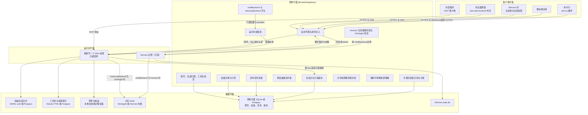

隔离分两层。账号与租户落在进程边界上，每账号一个 DSH 进程、一份 `$DSH_HOME`，进程内的授权层恒为 owner。工作区落在目录与归属判定上，会话创建时把工作区根目录写进 `cwd`，会话日志按 `cwd` 的项目键分目录存放。

## 二、控制平面的模块构成

`@chatdsh/gateway` 是独立 Node 服务，模块之间只经接口通信，存储访问走接口，单机落 SQLite。

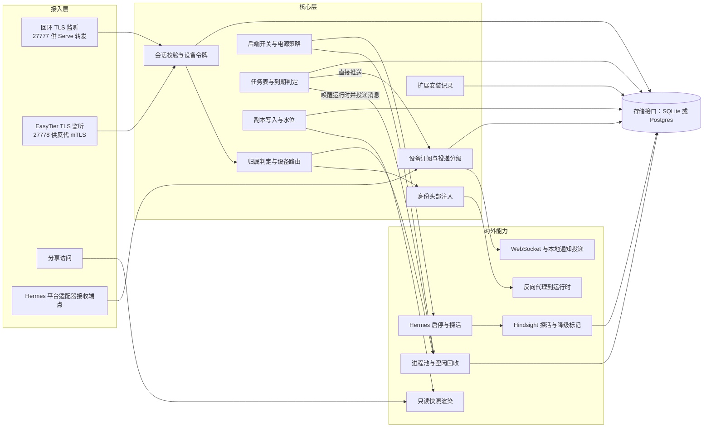

控制平面不承载 agent 执行，也不写权威会话日志。它持有执行节点推送来的只读副本，承担跨设备浏览、会话导入与移动端冷读。

## 三、配置树的叠加顺序

配置树按固定顺序叠加，后写的层胜出。补丁覆盖整行 `config`，每行必须重述它拥有的全部键。

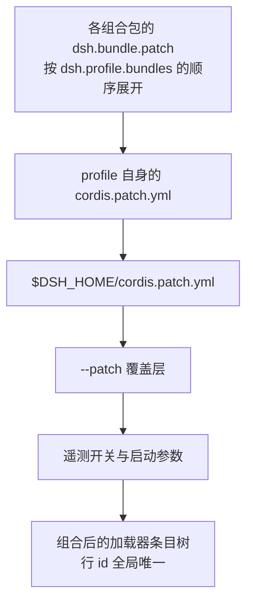

条目上的操作只有 `config`、`disabled`、`inject`、`intercept`、`isolate` 六项。`name` 是匹配校验条件，写错或 `id` 未匹配只打印警告，因此替换某个既有行的实现包要禁用该行再插入等价行。

## 四、三个平面的装配点

同一批自建包分别在三个平面各挂一次，依赖方向单向，插件之间经 `ctx` 服务名互相发现。

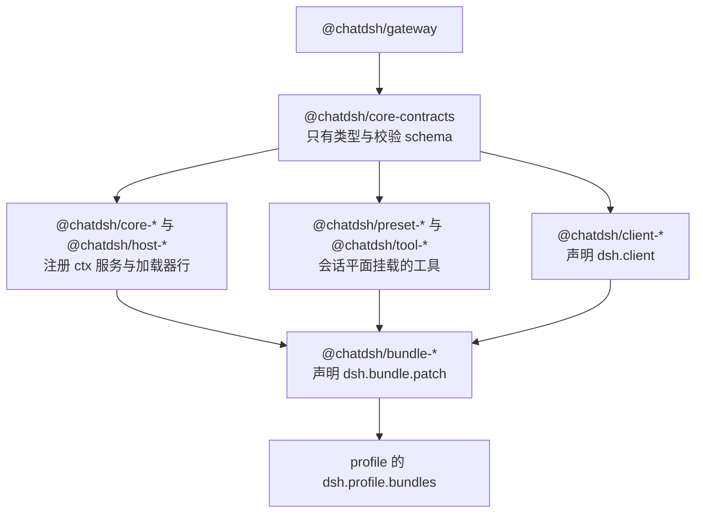

三个平面对应的加载时机与注册点如下。

```mermaid
flowchart TB
  subgraph HOST["宿主平面：随进程加载一次"]
    H1["core-identity 注册 ctx.provide，取身份供分派与审计"]
    H2["core-telemetry 注册 ctx.chatdshTelemetry，唯一遥测出口"]
    H3["core-session-index 写 ctx.sessionProjections"]
    H4["host-projects 扩展 ctx.storageDomain"]
    H5["host-artifacts 用 ctx.storageDomain 与 ctx.attachments"]
    H6["host-assistants 写 dsh-agent-preset-registry"]
    H7["host-connectors 生成 MCP 客户端行并注册授权流"]
    H8["host-push 上报会话事件"]
    H9["host-usage 取每轮用量"]
    H10["host-approval 折叠审批投影，写 plugin 记录并回传应答"]
    H11["host-import 提供导入恢复的远端方法"]
    H12["host-memory 在 agent/pre-step 召回与写入"]
  end
  subgraph SESS["会话平面：随会话挂载 preset"]
    S1["tool-bash 或 tool-pwsh，按平台二选一"]
    S2["tool-fs、tool-fs-search、tool-skill"]
    S3["tool-jobs、tool-todo、tool-web"]
    S4["自建工具行 artifact、project、image、research、connector、share"]
    S5["tool-browser 默认不挂进 preset"]
    S6["chatBackend 为 hermes 时聊天会话用空 preset"]
  end
  subgraph CLI["客户端平面：浏览器产物"]
    C1["client-projects、client-artifacts、client-memory"]
    C2["client-assistants、client-connectors"]
    C3["client-account、client-share、client-approval"]
    C4["client-telemetry"]
  end
  HOST --> SESS
  SESS --> CLI
```

桌面控制的两行留在宿主平面，因为 `dsh-computer-use` 的注册位是整棵运行时共用的单例，同一运行时第二次注册直接抛出异常，提供方又把工具注册进宿主工具表。

## 五、组合包的组合方式

存储、聊天后端、记忆后端、桌面壳与命令行各自成组合包，由 profile 的 bundles 列表选择。组合包之间不表达「基础」关系，同一组合包在列表里只出现一次。

当前实现的组合包六个：`bundle-hosted`、`bundle-worker`、`bundle-desktop`、`bundle-storage-jsonl`、`bundle-memory-hindsight`、`preset-chat`。图中 `bundle-storage-postgres` 与 `bundle-chat-hermes` 尚未实现。

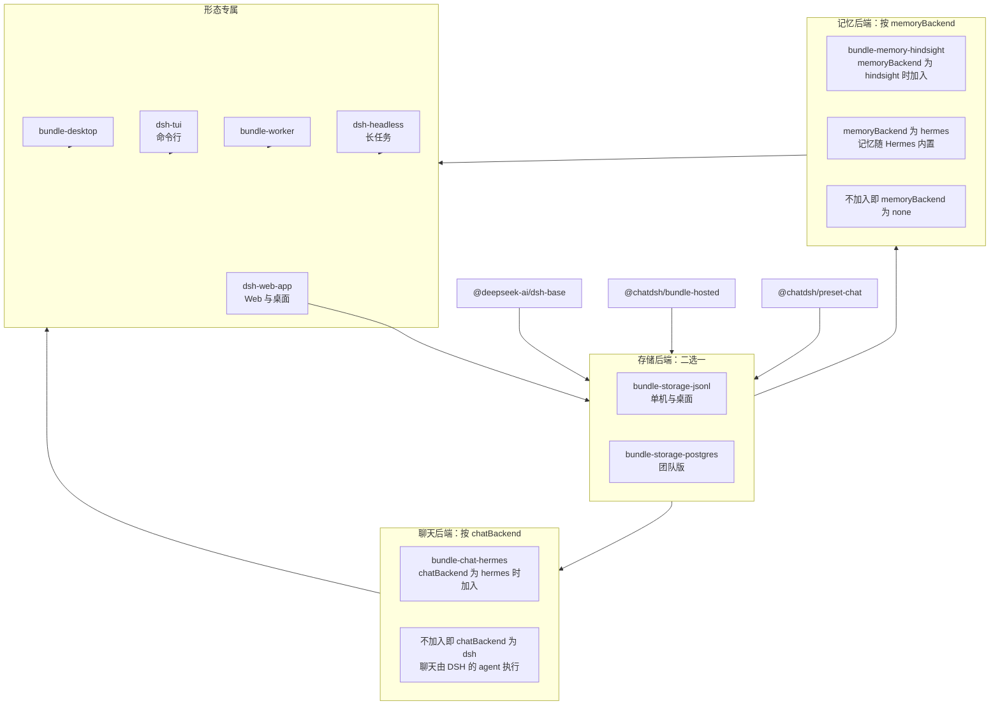

四个 profile 的实际 bundles 如下。

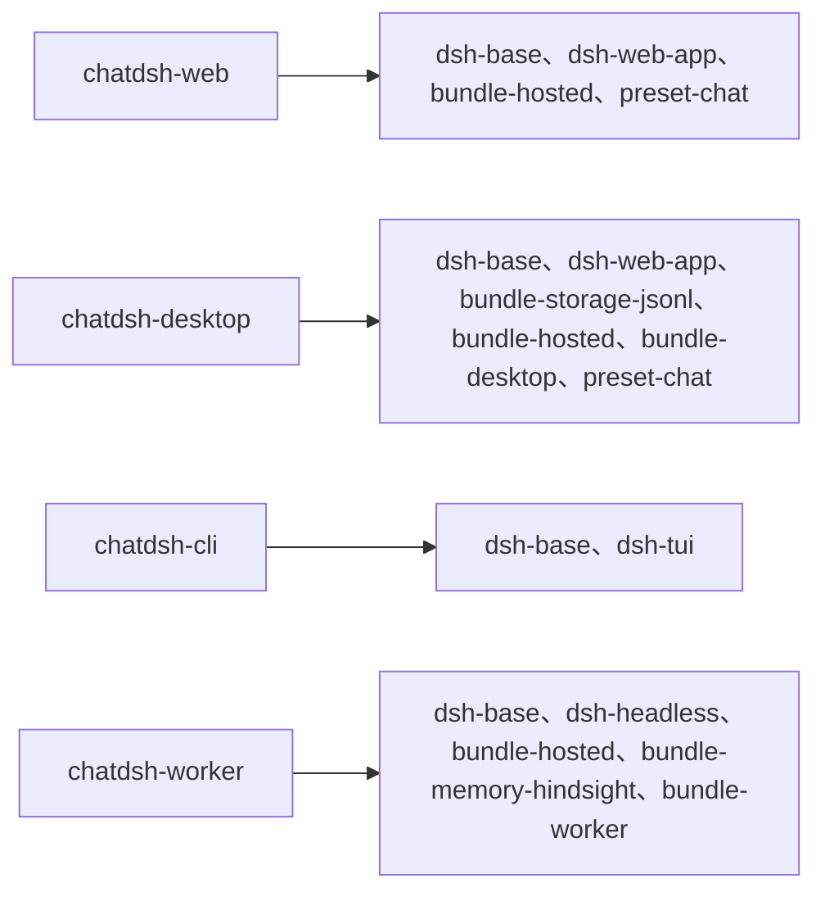

## 六、客户端模块加载次序

浏览器侧的启动协议由 `window.__DSH_BOOT__` 与 `window.__ModuleLoader__` 两个全局量构成。引导顺序是硬约束：注册队列先于 bootstrap 脚本，bootstrap 注册先于模块系统创建。

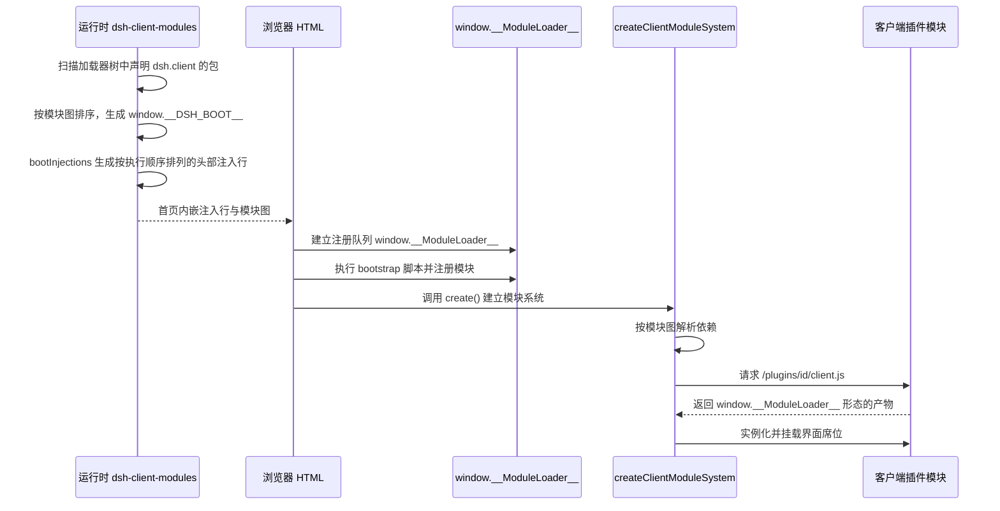

自建的九行客户端条目必须落在 profile 自己的补丁层：模块图按加载器条目的来源目录解析包元数据，组合包插入的行会以组合包所在目录为基准，自建包只安装在 profile 的 `node_modules` 里。

## 七、一次会话回合

消息进入运行时，经 agent 循环、工具执行与模型调用，事件写进权威日志，同时按 `seq` 推给控制平面形成只读副本。

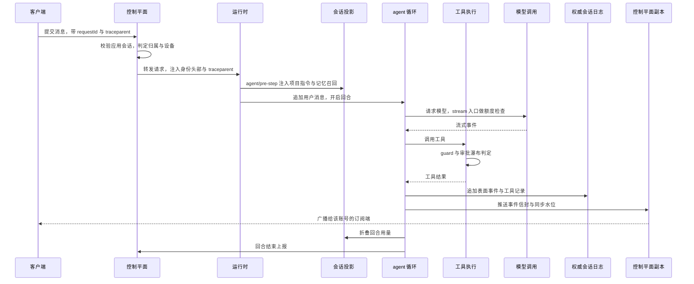

会话日志的写入语义固定：事件序号从 0 连续且永不重写，撕裂的物理尾部不返回给读者，读取路径对未知词汇关闭式拒绝，`append` 尽力而为而 `flush` 是耐久屏障。写句柄是单写者所有权，已有活跃所有者时以 `SessionAlreadyOwnedError` 拒绝。

分叉的语义也在这一层。`SessionStore.fork` 复制含边界的前缀，在切点补一条 `inherited: true` 的 `session/end-seed`，合成闭合事件占用切点之后的序号，因此新会话的第一条事件序号取持久化日志当前末端。客户端保存的游标因此是 `(sessionId, fork 标识, seq)` 三元组。

## 八、数据落盘布局

数据根下先分租户，再分账号，每账号一份 `$DSH_HOME`。租户目录从第一天就存在，单机下只有一个 `default`。

当前实现的落盘只有三处：控制平面的 SQLite 库（图中 `gateway` 那一支）、各账号的 `$DSH_HOME`（含 `profiles` 与 `sessions`）、以及 `logs`。租户目录、`objects`、`hermes` 与 `chat` 四个子目录尚未实现——附件与制品走存储域，不落在文件系统里。

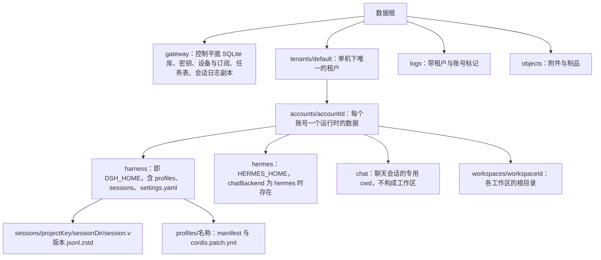

## 九、聊天后端与记忆后端的四种组合

两个开关互相独立，不互相推导。`chatBackend` 为 `dsh` 时 `memoryBackend` 只能是 `hindsight` 或 `none`。

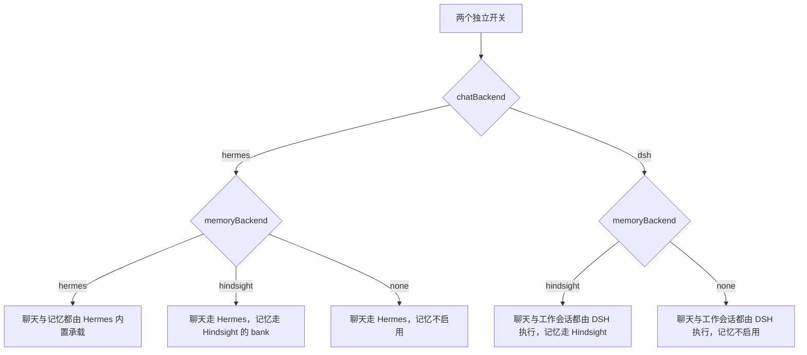

工作会话始终由 DSH 的 agent 执行，不随这两个开关变化。关闭某个后端属于正常配置，不留下失败的服务、不产生告警日志、不占端口。

## 十、四种形态的进程模型

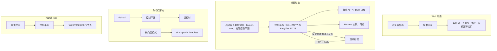

四种形态的客户端都只与控制平面对话。移动端的三条路线里，设备本地跑完整运行时的形态在 iOS 上不允许存在，手机直连同一台电脑上运行时的形态承载不了互不信任的多个人，因此产品主线是原生应用连控制平面。

## 十一、远程执行节点

执行节点在 NAT 之后无法被直连，因此它主动向控制平面建立长连接，这条连接同时承担指令下发、事件接收与路由。

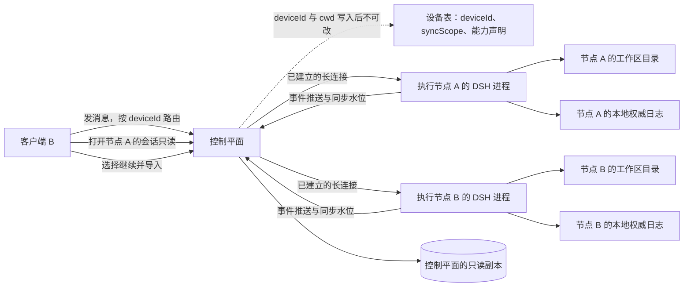

设备离线时该节点上工作区的会话只读并明确报设备离线，不改路由、不排队、不回退到宿主机执行。导入读的是控制平面持有的副本，因此源设备离线时仍可导入。

## 十二、审批与通知分级

应答路径只有一个写入者，处理结果作为会话事件广播，各端卡片据此收敛。

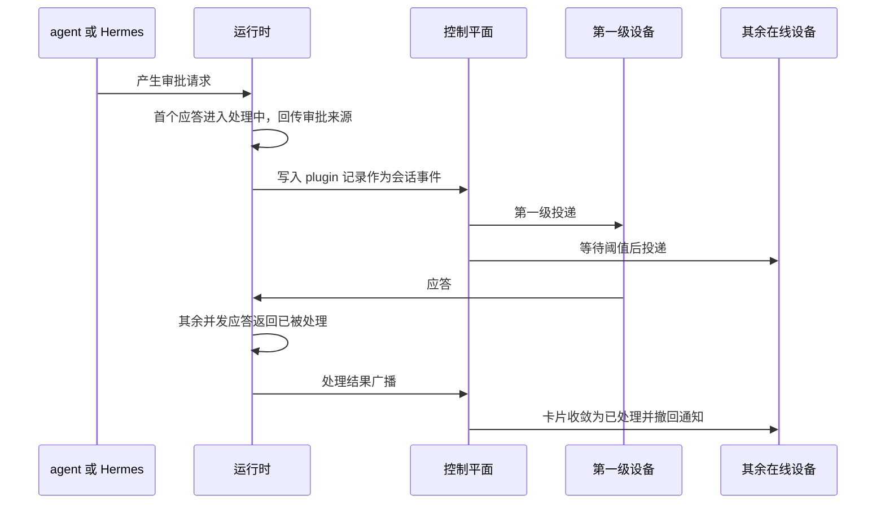

审批与提问卡片都要求真实回合或真实的工具执行。没有回合的场景自建投影与事件。

## 十三、遥测管道与上下文传播

宿主进程、桌面主进程、命令行与移动端各自在进程内建立 exporter 直发 OTLP/HTTP；浏览器不持有凭据，经运行时同源端点上报。

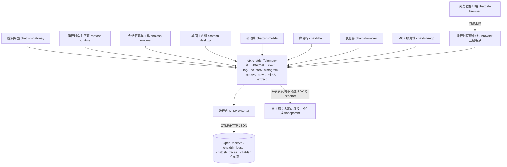

跨组件边界的上下文载体如下。缺一项就会出现断链。

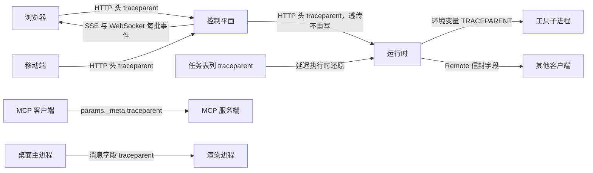

## 十四、构建与验收的对应关系

每一张图对应一组可执行的检查。

```mermaid
flowchart TB
  G1["第三节 配置树"] --> V1["check-composition：退出码、警告为空、条目 id 唯一"]
  G2b["第四节 装配点"] --> V2["check-plugin-contract：engines.dsh、dsh.client、dsh.bundle.patch、dsh.profile.bundles"]
  G2b --> V3["check-profile-deps：profile 依赖覆盖组合包插入的全部自建插件"]
  G3["第六节 客户端加载"] --> V4["verify-client-asset：产物可取回、条目图包含自建包"]
  G3 --> V5["verify-client-ui：真实 Chrome 走完首次进入流程"]
  G4["第七节 会话回合"] --> V6["verify-acp：创建会话、恢复会话、核对投影落盘"]
  G5["第九节 开关组合"] --> V7["verify-memory：对 Hindsight 做写入与召回"]
  G6["第十一节 执行节点"] --> V8["verify-routing 与 verify-routing-live：反代落到各自运行时"]
  G6 --> V9["verify-import：带 parentSession 的导入与跨账号拒绝"]
  G6 --> V10["verify-isolation：归属隔离与跨账号拒绝"]
  G6 --> V11["verify-multi-client 与 verify-receipt-sync：序列一致与已读水位"]
  G7["第十三节 遥测"] --> V12["check-telemetry：包内声明、源码与文档清单三处一致"]
  G7 --> V13["verify-telemetry-sync：连接器同步与导出核对"]
  G8["第十二节 审批与推送"] --> V14["verify-schedule：到期任务执行与定时推送"]
```

各项验收的当前状态与所缺条件记在[验收状态](acceptance.md)与[后续清单](next-steps.md)。

上游的引用面不在这些图里，它由架构文档第四节的适配层承担。上游包名、事件名与服务名的取值都收在 `@chatdsh/adapter`，`check-upstream-names` 核对本仓库各处出现的上游包名都在适配层的登记处出现过。上游发版时改适配层一处，检查脚本指出其余需要跟着改的位置。