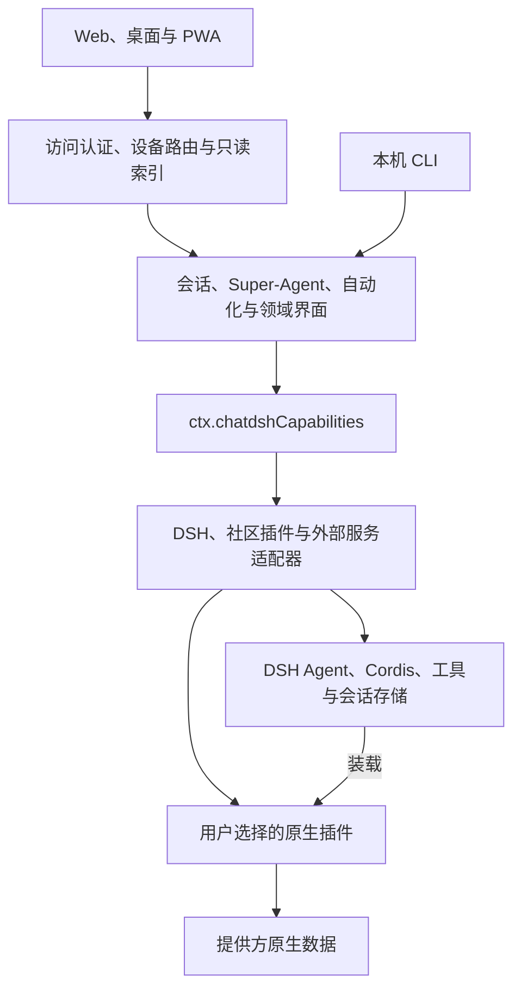
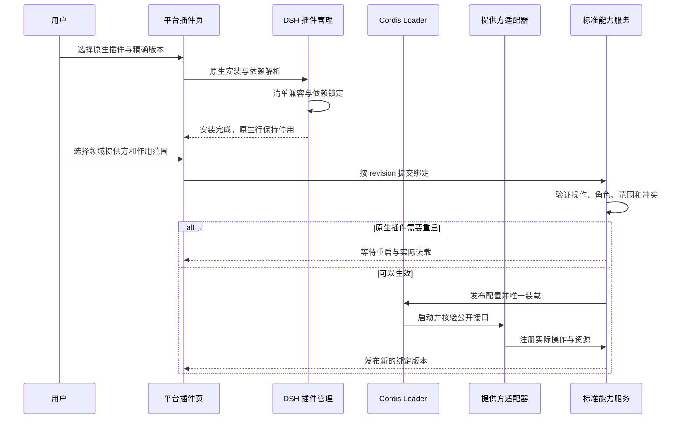
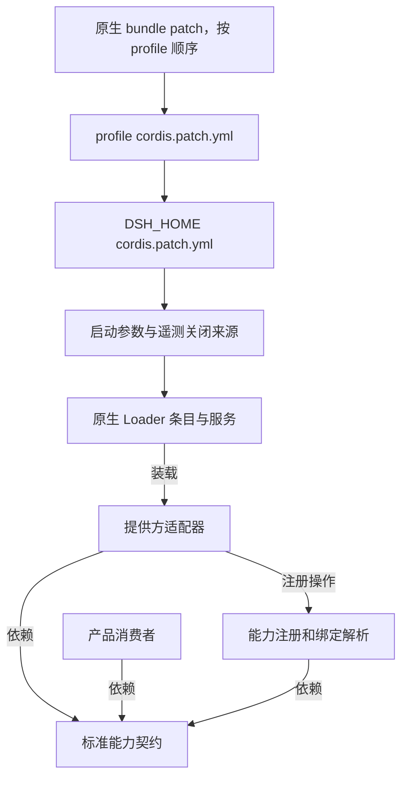
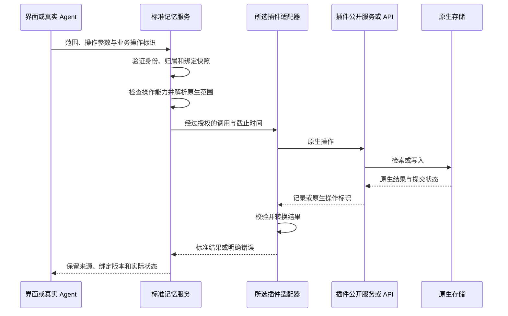
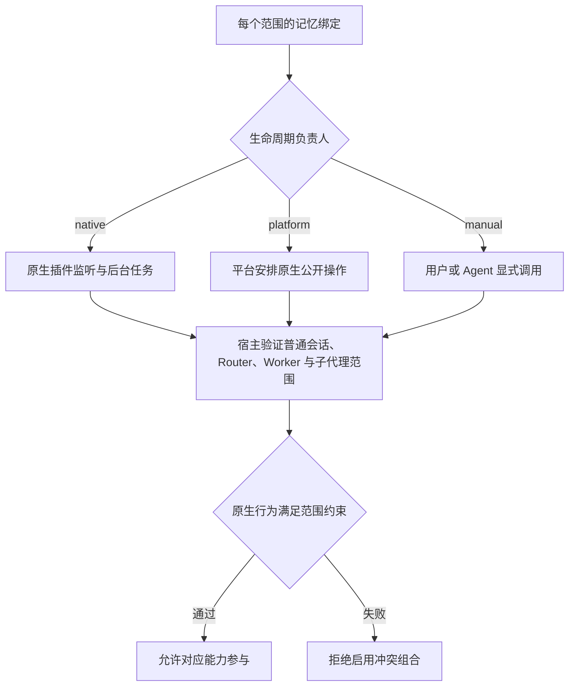
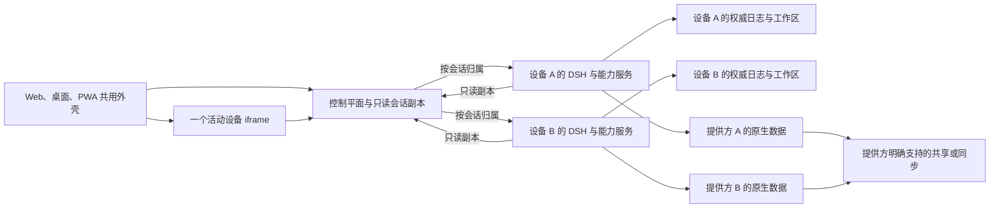
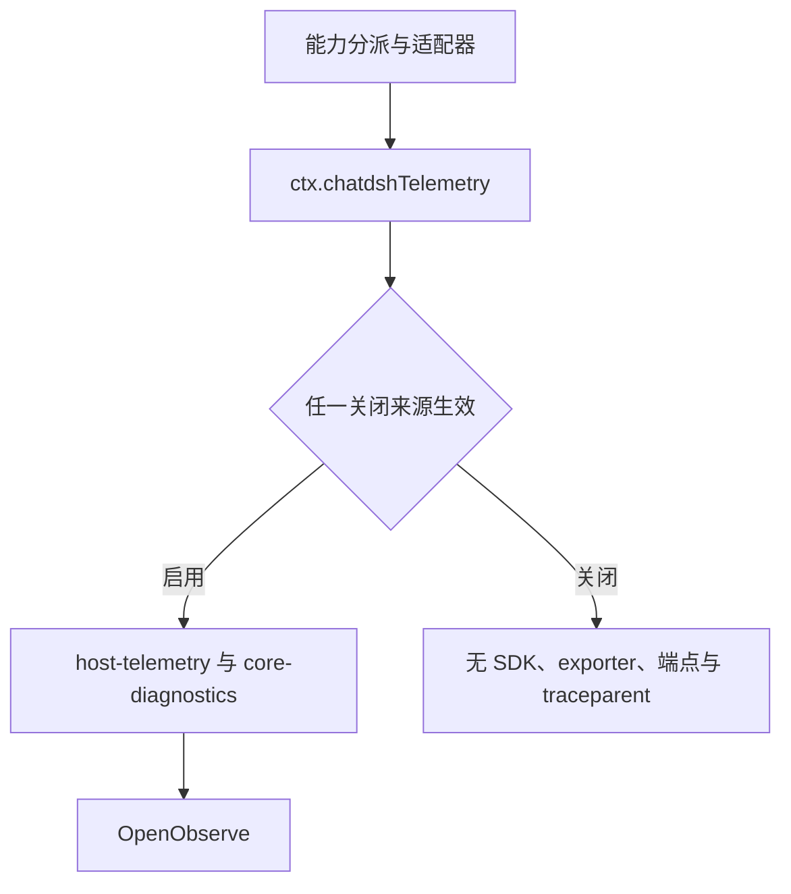
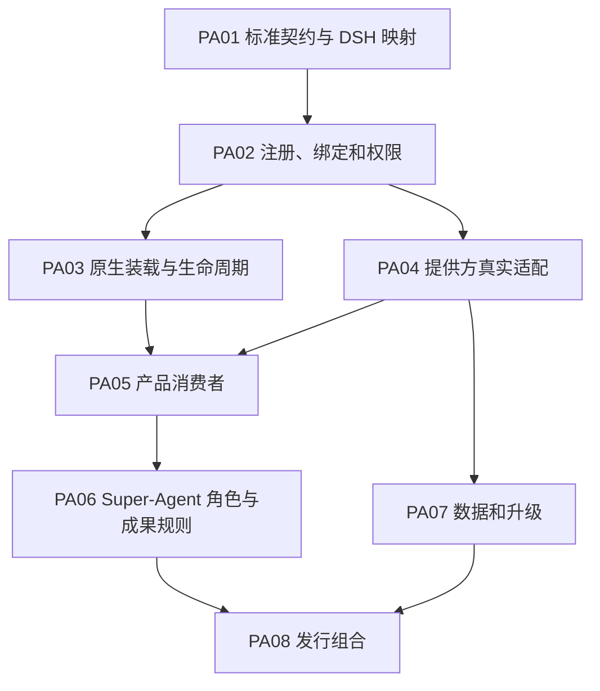

# 设计架构图

本文件表达[插件平台架构](plugin-platform.md)的结构与调用次序。提供方职责和接口语义使用平台契约，DSH 装载事实使用[架构设计](architecture.md)，设备与数据行为使用[系统完成设计](system-completion-design.md)。这些图表示目标结构，真实状态使用[验收记录](acceptance.md)。

## 一、产品与标准能力

## 二、安装与能力绑定

## 三、配置与依赖

## 四、标准记忆调用

受理状态未知时查询原操作。插件不支持原生幂等或取消时显示限制，不自动重放写入。

## 五、自动生命周期与项目范围

平台安排或显式模式要求对应原生自动行为已经关闭。未应用成果保持在任务记录和成果数据中，经过人工决定后才可以进入共享记忆。

## 六、设备、数据与客户端

项目关联只保存原生范围映射，实际共享依赖提供方。离线输入保留草稿，已受理任务在所属设备执行，绑定切换不自动迁移原生数据。

## 七、遥测与关闭

提供方内部不支持上下文传播时标明追踪边界。插件自身遥测必须遵守部署关闭和内容限制，标准调用日志不记录记忆、提示词与结果正文。

## 八、验收依赖

原生清单、真实装载、标准操作和真实模型服务分别提供证据。每个提供方的完成条件使用[平台实施契约](plugin-platform.md#12-实施与验收)，结构检查使用现有组合、插件、依赖和遥测检查脚本。
