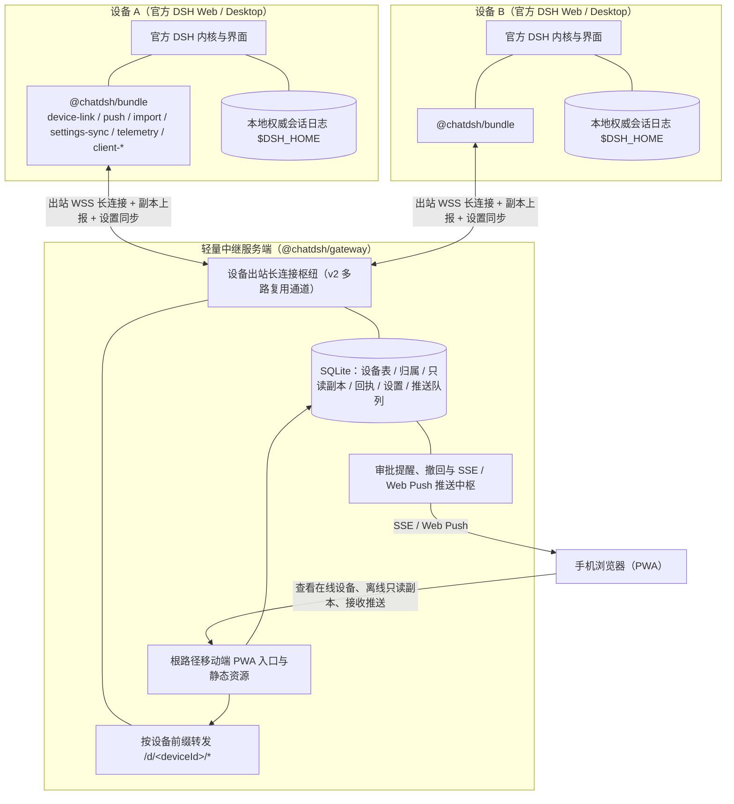
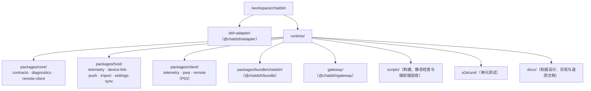

# ChatDSH 架构设计

ChatDSH 是面向官方 DSH（deepseek-harness）的跨设备互联插件集与轻量中继服务端。用户直接使用官方 DSH 运行时与官方客户端（Web 端与 Desktop 端），通过标准插件命令安装 `@chatdsh/bundle`，搭配自托管的轻量中继服务端，获得公网跨设备切换、离线只读会话副本、本机恢复继续、白名单设置同步、审批通知推送与移动端 PWA 入口。

## 一、核心设计原则

1. **官方主体与纯附加插件**：直接面向官方 `dsh web` 与官方 Desktop 客户端运行。`@chatdsh/bundle` 的 `cordis.patch.yml` 仅使用 `insert` 追加 ChatDSH 自有条目，零禁用、零覆写任何 DSH 上游内部行，消除上游版本迭代导致的补丁断裂。
2. **Web 端与 Desktop 端统一产物**：官方 Web 端与官方 Desktop 端渲染进程共用 `dsh-web-app` 与 `dsh.client`（`platform: "web"`）模块系统。全部客户端插件遵循 `platform: "web"` 契约，通过 DSH 官方传输层通信，复用官方样式变量，同一份构建产物同时运行在官方 Web 端与 Desktop 端。
3. **极窄的上游依赖接触面**：业务插件禁止直接引入 `@deepseek-ai/*` 内部包，全部经由 `@chatdsh/adapter` 访问。`@chatdsh/adapter` 仅转出 7 个顶层稳定包（`cordis`、`schemastery`、`dsh-client-connection`、`dsh-host-webserver`、`dsh-session`、`dsh-session-persistence`、`dsh-typert-protocol`），peer 依赖使用开放 semver 区间 `>=0.2.0-0`，升级 DSH 时无需批量修改清单。
4. **原生能力与生态解耦**：
   - 自定义模型网关与多模型管理直接使用 DSH 内置 `@deepseek-ai/dsh-llm-pi-ai` 与官方模型设置页。
   - 记忆、外部执行体与其他领域扩展直接使用 DSH 社区原生插件（如 `dsh-hindsight` 等），由用户通过 `dsh plugin add` 自由装卸。
   - 项目指令、文件管理、终端、技能目录、定时任务与子代理直接使用 DSH 原生能力。
   - 若需要在手机端使用 `dsh-Go` 原生客户端，用户在电脑端按需独立安装 `ds-harness-remote` 插件与对应中继，与 ChatDSH 体系完全解耦。

## 二、总体结构

### 2.1 数据所有权

| 数据类型 | 权威位置 | 中继服务端角色 |
|---|---|---|
| 会话日志 | 各设备本地 `$DSH_HOME` | 按 `seq` 保存只读副本镜像与水位，用于设备离线浏览与异机导入继续 |
| 工作区文件与命令执行 | 所属设备本地 | 经 `/d/<deviceId>/*` 沿出站长连接实时转发，目标设备离线时明确返回 `409 device-offline` |
| 设备配对与节点令牌 | 中继服务端 SQLite | 仅保存令牌 SHA-256 摘要，吊销立即生效 |
| 审批提醒与已读回执 | 中继服务端 SQLite | 副本出现 `approval/asked` 时触发提醒，出现 `approval/decided` 时自动撤回未投递提醒 |
| 白名单通用偏好设置 | 中继服务端 SQLite + 各设备 `$DSH_HOME/cordis.patch.yml` | 仅同步 5 个通用偏好命名空间（模型默认、语言、视图、分析开关、默认预设），路径与设备运行参数留在本机 |

## 三、仓库与包结构

唯一 Git 仓库根目录为 `/workspace/chatdsh`，代码分为顶层适配层与运行时工作区两部分：

### 3.1 包职责与依赖方向

| 包名 | 路径 | 职责 | 允许依赖 |
|---|---|---|---|
| `@chatdsh/adapter` | [dsh-adapter/](../../dsh-adapter/) | DSH 顶层服务、会话类型、事件名与上游配置包名唯一出口 | 仅 7 个 DSH peer 依赖 |
| `@chatdsh/core-contracts` | [packages/core/contracts/](../packages/core/contracts/) | 共享错误码、数据 schema、请求/响应与遥测契约类型 | 仅 `zod` |
| `@chatdsh/core-diagnostics` | [packages/core/diagnostics/](../packages/core/diagnostics/) | 各端共享的遥测客户端、脱敏器、W3C 链路上下文、环形缓冲与 OTLP 导出管道 | `@chatdsh/core-contracts` |
| `@chatdsh/core-remote-client` | [packages/core/remote-client/](../packages/core/remote-client/) | 浏览器侧 Remote 方法贡献构造器 | 无内部依赖 |
| `@chatdsh/host-telemetry` | [packages/host/telemetry/](../packages/host/telemetry/) | 注册 `ctx.chatdshTelemetry`、状态/自检/诊断/热开关与浏览器上报中继端点 | `@chatdsh/adapter`、`core-contracts`、`core-diagnostics` |
| `@chatdsh/host-device-link` | [packages/host/device-link/](../packages/host/device-link/) | 设备出站长连接至中继服务端，将转发来的 HTTP 与 WebSocket 通道路由至本机运行时 | `@chatdsh/adapter`、`core-contracts` |
| `@chatdsh/host-push` | [packages/host/push/](../packages/host/push/) | 监听 `session/created` 与 `session/event`，持久化补传意图并成批上报只读副本 | `@chatdsh/adapter`、`core-contracts` |
| `@chatdsh/host-import` | [packages/host/import/](../packages/host/import/) | 将中继副本记录构造为合法会话种子，支持「在本机继续」恢复与分叉 | `@chatdsh/adapter` |
| `@chatdsh/host-settings-sync` | [packages/host/settings-sync/](../packages/host/settings-sync/) | 监听白名单设置变更上报中继，接收中继下发并写入本机 `$DSH_HOME/cordis.patch.yml` | `@chatdsh/adapter`、`core-contracts` |
| `@chatdsh/client-telemetry` | [packages/client/telemetry/](../packages/client/telemetry/) | 浏览器与官方桌面渲染进程错误采集与同源遥测上报 | `core-contracts`、`core-diagnostics` |
| `@chatdsh/client-pwa` | [packages/client/pwa/](../packages/client/pwa/) | PWA 清单、Service Worker、离线草稿、安全凭据与窄屏样式 | 无内部依赖 |
| `@chatdsh/client-remote`（P03） | `packages/client/remote/` | 注入官方客户端侧栏与对话顶部状态条，提供设备切换、离线副本浏览与本机继续入口 | `core-contracts`、`core-remote-client` |
| `@chatdsh/bundle` | [packages/bundle/chatdsh/](../packages/bundle/chatdsh/) | 纯 `insert` 组合包，在 `dependencies` 声明全部宿主与客户端插件供 `dsh plugin add` 一步装入 | 上述全部宿主与客户端插件 |
| `@chatdsh/gateway` | [gateway/](../gateway/) | 独立运行的轻量中继服务端进程，承载设备长连接、转发、副本、推送、设置同步与 PWA 静态入口 | `core-contracts`、`core-diagnostics` |

## 四、设备长连接与按设备转发协议

设备通常位于家庭或办公内网防火墙之后，因此连接方向固定为**设备主动向中继服务端发起出站 WebSocket 升级**（路径 `/chatdsh/gateway/device-link`，请求头携带 `Authorization: Bearer <nodeToken>`）。

- **版本 2 多路复用帧协议**（定义于 [gateway/src/device-link.ts](../gateway/src/device-link.ts)）：单条长连接同时承载最多 128 条逻辑通道，通道类型涵盖 `http`、`events`、`websocket`。具备每通道独立序号校验、窗口流控（`credit`）、连接级发送缓冲上限（8 MiB）、心跳超时断链（30s 心跳 / 75s 失联判定）、取消确认与同设备重连代次替换（旧连接通道以 `device-replaced` 明确终止）。
- **按设备路由规则**：客户端访问 `/d/<deviceId>/<rest>` 时，中继服务端校验设备存在性与在线状态，沿该设备的出站长连接转发 HTTP 请求与 `/api/remote.mux` WebSocket 升级。目标设备离线时返回 `409 device-offline`，不排队也不回退至其他设备。
- **凭据补发隔离**：设备侧 `host-device-link` 在本地转发至回环运行时时，按路径为 `/` 与 `/api/` 自动换取并附带本机运行时凭据 cookie，浏览器侧不直接持有各台远程设备的启动口令。

## 五、移动端 PWA 与跨客户端边界

- **中继根路径 PWA**：手机浏览器访问中继服务端根地址即可浏览全部设备在线状态、全部设备的聚合会话与离线只读副本；点击在线设备通过 `/d/<deviceId>/` 直接使用对应设备的官方 DSH Web 界面；离线设备仅允许查看只读副本与编辑本地草稿，禁止自动排队重发写入。
- **审批通知与撤回**：副本上报出现 `approval/asked` 事件后，推送中枢按配置策略（`all-at-once` 或 `two-stage`）经 SSE 与 Web Push 推送提醒；出现 `approval/decided` 后自动撤回尚未投递的同键提醒。Web Push 送达受浏览器与推送服务制约，界面如实展示订阅状态与边界。
- **官方 Desktop 与 Web 共存**：客户端插件全部通过 `dsh.client`（`platform: "web"`）注册，官方客户端通过模块图自动发现与加载，无需修改或重打包官方前端产物。

## 六、遥测架构

所有宿主插件通过 `ctx.chatdshTelemetry` 输出日志、span 与指标，中继服务端与浏览器侧复用 `@chatdsh/core-diagnostics` 提供的同名客户端与脱敏管道。跨组件边界传播 W3C `traceparent` 与 `tracestate`（浏览器 -> 中继 -> 设备长连接帧头 -> 设备本地运行时）。关闭遥测的任一入口（`CHATDSH_TELEMETRY=off`、`DSH_TELEMETRY_DISABLED`、设置文件、`--no-telemetry`、运行期开关）生效时，零 SDK 构造、零出站连接、零 `traceparent` 传播，详见 [telemetry.md](telemetry.md)。
