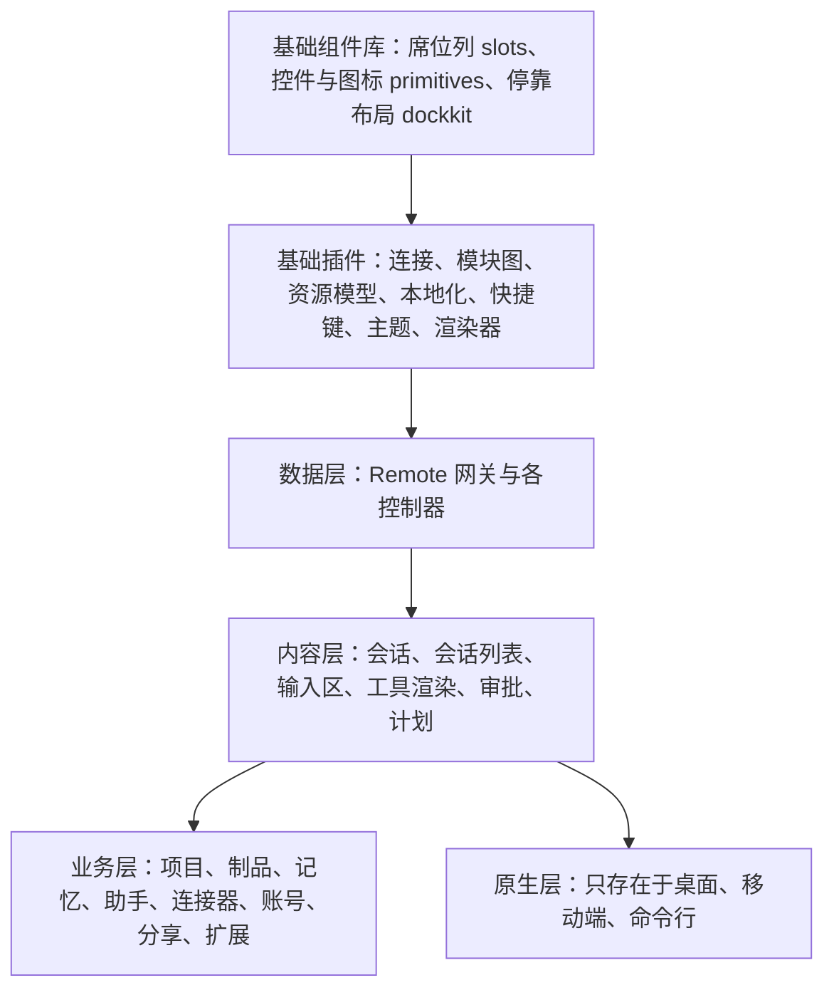

# 客户端模块构成确认

完整页面和行为使用[交互规格](<client-complete-spec.md>)与[设计稿](<ui-design/complete.html>)，模块实施范围使用[工作包](<implementation-work-packages.md>)。图形客户端使用控制平面外壳与单个活动设备 iframe；CLI 连接本机运行时。离线仅保留草稿，在线执行队列失联后暂停并等待用户处理。下文席位与依赖事实继续作为扩展实现依据。

本文件承接[总体架构](architecture.md)，在 UI 概要设计之前确定四种客户端分别有哪些模块、模块之间如何分层、各自的界面席位从哪里来。所有条目以本机实测为准：`@deepseek-ai/dsh` 0.2.1-rc.2（下文记作 `$DSH`），`$DSH/node_modules/@deepseek-ai/` 共 305 个条目；`@deepseek-harness-tui/dsh-tui` 0.16.1；参考仓库快照位于 `../refer_repos/`。

## 一、模块分层

四个客户端共用同一套分层。层次决定一个模块放在哪个包、依赖谁、由谁加载。

- React 基础组件库是零 cordis 的纯 React 包，被 `ui-*` 插件引用。
- 基础插件是每一端都需要的运行时骨架，没有对应业务语义。
- 数据层通过领域 Remote 调用[标准能力接口](plugin-platform.md)，保持范围、绑定版本和实际提供方来源。插件原生扩展使用明确登记的入口。
- 内容层是与对话直接相关的界面。Web、移动端、桌面渲染进程全部复用 `dsh-client-ui-*`；命令行在 `dsh-tui` 贡献点里重建。
- 业务层承载 ChatDSH 自建能力，Web、移动端、桌面通过 `client-*` 插件接入既有席位。
- 原生层只承担该端独有的能力，不进 Web 与移动端。

依赖方向固定：基础组件库与基础插件不依赖数据层以上的任何东西；数据层不依赖内容层与业务层；内容层不依赖业务层；业务层可以调用内容层提供的席位。

## 二、Web 端

Web 端的运行形态是 `dsh-web-frontend` 的既有外壳加 `dsh-web-app` 的行表。本机实测 `dsh-web-app/cordis.patch.yml` 共 90 行 `id`，其中 `ui-` 前缀的席位 51 行。`dsh-client-ui-*` 包共 54 个，分布是：51 个由 `dsh-web-app` 的 `ui-` 行加载；`dsh-client-ui-directory-picker-browse` 与 `dsh-client-ui-directory-picker-native` 由 `dsh-host-directory-picker-auto` 在启动时按宿主情况择一加载；`dsh-client-ui-plugin-market` 由 `dsh-experimental-plugin-market-bundle` 补入。

### 2.1 宿主的既有模块

Web 端的界面外壳与内容界面由以下模块提供，ChatDSH 直接复用，不重写。

| 层 | 模块 | 职责 |
|---|---|---|
| 基础组件库 | `dsh-client-ui-slots` | 席位列纯核心：typed Slots、组件工厂、派生的 props、Store seat、渲染器安装 |
| 基础组件库 | `dsh-client-ui-primitives` | 纯 React 原子：控件、图标、Markdown、JSON 查看 |
| 基础组件库 | `dsh-client-ui-dockkit` | 停靠布局：可逆的拆分树与驱动它的 React 组件 |
| 基础 | `dsh-client-connection` | 认证后的 RPC 传输与代次生命周期 |
| 基础 | `dsh-client-modules` | 组装 `__DSH_BOOT__` 入口图，按 `/plugins/<id>/client.js` 供出产物 |
| 基础 | `dsh-client-resources` | 统一资源模型，`useResource` 全局钩子 |
| 基础 | `dsh-client-locale` | 本地化，宿主偏好加扩展语言目录 |
| 基础 | `dsh-client-shortcuts` | 键盘命令注册与物理按键路由 |
| 基础 | `dsh-client-ui-theme` | 主题令牌与明暗状态 |
| 基础 | `dsh-client-ui-renderer` | React 席位绑定 `ctx.uiRenderer`，装配应用根 |
| 基础 | `dsh-cordis-client-runner` | 双半插件的浏览器侧执行 |
| 数据 | `dsh-api-gateway` | Remote 分发与客户端 API 端点 |
| 数据 | `dsh-api-remotes` | 应用选定宿主能力的 Remote 装配 |
| 数据 | `dsh-api-session-controller` | 会话命令、冷读、实时控制 |
| 数据 | `dsh-api-workspace-controller` | 工作区命令与重连安全状态 |
| 数据 | `dsh-api-job-controller`、`dsh-api-terminal-controller`、`dsh-api-workspace-files` | 作业观察流、会话终端、工作区文件服务 |
| 数据 | `dsh-api-remote-access` | 非 owner 对端的按方法访问控制 |
| 内容 | `dsh-client-ui-layout` | 三栏 `AppFrame` 与 `ctx.layout` 观察状态服务 |
| 内容 | `dsh-client-ui-session` | 会话控制器的 React 适配与会话席位 |
| 内容 | `dsh-client-ui-sidebar`、`ui-sidebar-right` | 左侧会话树；右侧停靠面与页签注册表 |
| 内容 | `dsh-client-ui-conversation`、`ui-chat` | 会话组装、外壳、输入区、队列；Chat 目标与渲染器 |
| 内容 | `dsh-client-ui-tool`、`ui-trajectory`、`ui-attachment`、`ui-deliverables` | 工具调用树、事件台账、附件呈现、回合尾卡片 |
| 内容 | `dsh-client-ui-approval`、`ui-user-questions`、`ui-plan`、`ui-goal` | 审批接管、提问接管、计划模式、目标条 |
| 内容 | `dsh-client-ui-input-trigger`、`ui-commands`、`ui-skill`、`ui-reference`、`ui-subagent`、`ui-workflow-run` | `/` 与 `@` 触发管线、命令面、技能与引用源、子会话目录、工作流节点 |
| 内容 | `dsh-client-ui-model-selection`、`ui-permission-presets`、`ui-agent-preset`、`ui-secret-mask`、`ui-message-feedback`、`ui-open-in-app` | 模型选择、权限档位、agent preset、凭据掩码、消息反馈、外部程序打开 |
| 内容 | `directory-picker` 席位（宿主 `dsh-host-directory-picker-auto`） | 目录选择：启动时探测宿主情况，加载 `dsh-client-ui-directory-picker-native` 或 `dsh-client-ui-directory-picker-browse` 其中一个 |

右栏的页签类型各自独立注册：`ui-sidebar-documentpreview`（文档与代码预览）、`ui-sidebar-files`（工作区文件树）、`ui-sidebar-terminal`（交互终端）、`ui-sidebar-browser`（受沙箱的网页页签）。

设置面按命名空间拆分：`ui-settings` 是域基础插件与席位类型契约，`ui-settings-general`、`ui-settings-models`、`ui-settings-plugins`、`ui-settings-plugin-inventory`、`ui-settings-shell`、`ui-settings-agent-loop`、`ui-settings-subagent`、`ui-settings-web-search`、`ui-settings-session-log` 各占一页。

`ui-plugin-manager` 是插件管理页（安装、启用、停用、组合），`ui-plugin-market` 由 `dsh-experimental-plugin-market-bundle` 补入，作为插件页的发现标签。

### 2.2 席位的基数与属主规则

席位的基数由 `dsh-client-ui-slots` 的 `SlotKind` 决定，取 `single`、`list`、`keyed`、`chain` 四种；`single` 与 `keyed` 同键再注册要在不同 `priority` 上共存，同优先级第二次注册会抛出异常并指出占用者。另有若干席位由专属注册表承接，不走 `SlotMap`。本机实测的基数如下：

| 席位 | 基数 | 属主或注册方式 |
|---|---|---|
| `main` | `keyed`（按面板 id） | `ui-layout`，主面板切换 |
| `sidebar` | `single` | `ui-layout` |
| `sidebar.brand.mark`、`sidebar.brand.name` | `single` | `ui-sidebar` 声明，`ui-brand-official` 占位 |
| `sidebar.panellist` | `list` | `ui-sidebar` |
| `sidebar.workspaces` | `single` | `ui-sidebar` 声明，`ui-workspace` 注册 |
| `sidebar.settings` | `single` | `ui-sidebar` 声明，`ui-settings` 注册 |
| `sidebar.footer.action` | `list` | `ui-sidebar` |
| `settings.section` | `list` | `ui-settings` |
| `settings.plugins.tab` | `list` | `ui-settings-plugins` |
| `settings.general.item` | `list` | `ui-settings-general` |
| `conversation.composer` | `chain` | `ui-conversation` 声明；审批、提问、计划按优先级选举接管，竞争同一接管时用 `priority` |
| `conversation.view` | `list` | `ui-conversation` |
| `conversation.session.header.actions` | `list` | `ui-conversation` |
| `conversation.hero.options` | `list` | `ui-conversation` |
| `conversation.input.dock` | `list` | `ui-conversation` |
| 右侧栏页签 | `keyed`（`sidebar.right.pane.tab` 按页签类型） | `ui-sidebar-right` 的 `SidebarRightTabRegistry` |

结论：业务层需要的每一个位置都有可多方注册的席位，全部可以用客户端插件接入，不需要包产物补丁，也不需要禁用占位行再插入自己的行。`conversation.hero.options`（`list`）与右栏页签（`keyed` 按页签类型）两处注册时要自带 `id` 或 `key`；放进右栏的入口通过注册页签类型接入。

### 2.3 ChatDSH 自建的客户端插件

自建能力以客户端插件接入既有席位。每个包声明 `dsh.client = { platform: "web", inject: [...] }`，导出 `./client` 子路径，产物输出到 `lib/client.js`，构建用 esbuild。下表是[架构设计](architecture.md) 4.6 节确定的八个包，附上各自接入的席位与席位基数。

| 包 | 接入席位（基数） | 内部模块 |
|---|---|---|
| `@chatdsh/client-projects` | `sidebar.panellist`（`list`） | 项目列表、标题与指令表单、模型默认值 |
| `@chatdsh/client-artifacts` | `settings.section`（`list`） | 制品列表、版本选择、制品文件预览 |
| `@chatdsh/client-memory` | `settings.section`（`list`） | 提供方选择、实际操作、范围映射、检索来源与写入回执，未配置时显示选择入口 |
| `@chatdsh/client-assistants` | `settings.section`（`list`） | 助手目录、preset 声明编辑 |
| `@chatdsh/client-connectors` | `settings.section`（`list`） | MCP 服务器条目、凭据录入与授权 |
| `@chatdsh/client-account` | `settings.section`（`list`） | 设备列表与在线状态 |
| `@chatdsh/client-share` | `settings.section`（`list`） | 创建分享、快照参数、撤销与用量 |
| `@chatdsh/client-approval` | `settings.section`（`list`） | 审批记录查看与人工接管，按 `chatdshApprovals` 投影渲染 |

八个包里有七个挂 `settings.section`，`client-projects` 改挂 `sidebar.panellist` 作为侧栏面板入口。审批卡片展示在设置区段里，会话输入区的审批由宿主自带的 `ui-approval` 承担，两者不共用席位。

自建客户端插件引用 `dsh-client-ui-slots`、`dsh-client-ui-primitives` 的组件时，要在自身 `dependencies` 里显式声明这两个零 cordis 包的精确版本。它们不在 `$DSH` 顶层 305 个条目的导出名单内，靠 profile 的依赖图解析；参考仓库 `anywhere-labs_dsh-desktop/dsh-plugin-desktop` 的 `package.json` 实测就把这两个包固定为 `0.2.1-rc.2`。

面板的界面元素来自本仓库的共享组件包 `@chatdsh/core-ui-kit`（`packages/core/ui-kit`，纯 React，依赖 `react` 作为 peer）。它提供面板外壳、列表行、徽标、按钮、进度条、骨架与空/失败状态，全部只引用界面基础设计的令牌（`var(--chatdsh-*)`、`var(--cdh-*)`）。样式文本 `UI_KIT_CSS` 由主题插件 `@chatdsh/client-theme` 与令牌一起注入文档，组件本身不注入 CSS、不写颜色字面值。各客户端插件从本包取组件，因此面板与四端主页面共用同一套规格。

### 2.4 Web 形态的行表差异

Web 形态的 profile 补丁层按以下方式收敛宿主行，属于本端模块构成的组成部分：

- 禁用账号链六行，`ui-settings-account`（`dsh-web-app` 第 144 行）随之关闭。
- `ui-sidebar-browser` 在 `dsh-web-app` 里以 `ctx.get('profileContext')?.name !== 'desktop'` 为关闭条件，Web 形态不提供受沙箱网页页签，浏览器操作改用会话工具 `@chatdsh/tool-browser`（执行节点侧，见[架构设计](architecture.md) 7.8 节）。
- 桌面控制的两行 `@deepseek-ai/dsh-computer-use`（0.1.6-alpha.1）与 `@deepseek-ai/dsh-experimental-computer-use-cua-driver-native`（0.1.6-alpha.1）只在桌面宿主的组合包中加载，Web 运行时不加载，因此不进入 Web 端模块表。这两个包不属于 `$DSH` 基线的 305 个条目，随桌面壳的依赖引入。

## 三、移动端

移动端的布局骨架采用 `dsh-client-ui-responsive`，它在 `ui-layout` 框架之上加手机适配：窄屏（小于 768 CSS 像素）把左侧栏改为抽屉，中栏占满，右栏沿用上游自身的全屏滑出，补上安全区、输入法内边距、原生“打开方式”接线。参考仓库 `kelai141_dsh-mobile-apk/plugins/dsh-client-ui-responsive`（0.3.3）实测其 `dsh.client` 的 `inject` 为 `ui-theme`、`ui-layout`、`api-workspace-controller`、`ui-workspace` 四项。

移动端是 PWA，不存在独立的宿主侧进程：外壳与控制平面同源，右栏 iframe 加载 `/d/<deviceId>/` 的完整页面；协议走 `fetch` 与 `WebSocket`，能力桥由浏览器 API 承担。客户端只与控制平面通信，不直连运行时。

### 3.1 外壳侧模块

| 模块 | 职责 |
|---|---|
| 运行时接入 | 连接控制平面，转发会话冷读、WebSocket 实时更新、发消息与审批动作 |
| 应用会话与登录 | 应用登录、设备会话、续期窗口 |
| 设备注册 | 设备标识、平台、送达档位、离线队列 |
| 通知投递 | 前台长连接、后台 Service Worker 收到 Web Push 后展示本地通知 |
| 附件上传 | 拍照、相册、文件的附件上传 |
| 语音上传 | 把录音上传到 `host-voice` 暴露的转写接口 |
| 目录选择 | 没有原生目录选择器，走远程列举加手输路径 |
| 文件打开 | 工作区文件、压缩包、二进制经下载后交给系统打开方式 |
| 安全区与显示缩放 | 系统栏与输入法内边距、字体与显示缩放 |

现状的 Android 原生实现在这一层另有原生能力桥与前台服务通知；PWA 改造后由浏览器 API 与 Service Worker 取代。

### 3.2 浏览器侧模块

浏览器侧复用 Web 的 `dsh-client-ui-*` 内容层、`dsh-client-ui-primitives` 组件、数据层，额外接入以下模块：

| 模块 | 来源 | 职责 |
|---|---|---|
| `dsh-client-ui-responsive` | 参考仓库 `kelai141` 的实现 | 窄屏抽屉、安全区、原生打开接线 |
| `@chatdsh/client-projects`、`client-artifacts`、`client-memory`、`client-assistants`、`client-connectors`、`client-account` | 与 Web 同一份包 | 业务层，席位随响应式骨架重排 |
| `@chatdsh/client-approval` | 与 Web 同一份包 | 审批卡片，移动端与桌面走同一链路 |

会话列表与内容走控制平面的冷读接口，实时更新走 WebSocket，发消息与回答审批经控制平面转给对应运行时。离线队列只接受发消息，审批在离线时明确拒绝并保留卡片。形态是 PWA，复用 Web 的同一份内容层与基础组件库，加移动布局；iOS 不纳入范围。

## 四、桌面端

桌面端是 Electron 主进程、控制平面、运行时、渲染进程四者相互独立。渲染进程加载 `dsh-web-frontend` 产物，与 Web 端共享全部 `dsh-client-ui-*` 内容层、基础组件库与数据层；差异集中在 Electron 主进程的原生能力与 `bundle-desktop` 补回的界面席位。桌面自带 client 插件，参考仓库 `dsh-plugin-desktop`（2.0.18）的 `dsh.client.inject` 为 `api-remotes`、`client-connection`、`client-locale`、`ui-renderer`、`ui-settings`、`ui-theme`、`ui-workspace` 七项，形态与本端一致。

### 4.1 Electron 主进程模块

参考桌面仓库 `anywhere-labs_dsh-desktop/dsh-plugin-desktop/src` 实测 147 个源文件，按职责归并如下。ChatDSH 不照搬其全部文件，只确定本端需要的模块。

| 模块 | 职责 | 参考文件 |
|---|---|---|
| 生命周期与单实例 | 取单实例锁、启动顺序、代次管理 | `main`、`lifecycle-events`、`startup-generation` |
| 运行时编排 | 启动控制平面、由控制平面拉起运行时、等回环端口就绪 | `host-bootstrap`、`runtime`、`host-process` |
| profile 管理 | profile 的创建、选择、物化、检查点 | `profile-manager`、`profile-materializer`、`profile-checkpoint`、`profile-service` |
| 原生目录选择 | 主进程承载 OS 选择器并回传路径 | `directory-picker-contract`、`directory-picker-route`、`native-dialog-copy` |
| 窗口与菜单 | 原生菜单、窗口外观、窗口状态恢复 | `native-menu`、`window-chrome`、`main-window-state` |
| 托盘与通知 | 托盘图标、系统通知、托盘常驻与退出 | `tray-icons`、`notifications` |
| 保活与电源 | 开机自启、`powerSaveBlocker` 阻止睡眠与屏幕关闭、托盘状态显示 | `keepalive`、`power-blocker` |
| 更新 | 检查、下载、生命周期、签名与 blockmap | `update-checker`、`update-download`、`update-lifecycle` |
| 恢复与安全模式 | 安全模式、启动失败路由、恢复窗口 | `safe-mode`、`startup-failure-routing`、`startup-recovery-window` |
| 崩溃证据 | 退出码、存活时长、stderr 尾部有界文本 | `crash-evidence`、`diagnostic-export` |
| 路径沙箱 | Windows ACL 沙箱、控制台宿主 | `windows-acl-runner`、`windows-console-host`、`windows-pwsh-sandbox` |
| 网络与证书 | 局域网 HTTPS、证书、代理 | `lan-https-runtime`、`lan-https-certificate`、`system-proxy` |
| 桌面控制权限 | macOS 权限查询与 Electron 主进程归属 | 随 `@trycua/cua-driver/electron` |
| 作业与日志桥 | 把运行时作业、警告与错误接到桌面 | `jobs-bridge`、`desktop-logger`、`log-files` |

运行时由控制平面拉起这一点在[架构设计](architecture.md) 6.3 节已经确定，桌面主进程只负责把窗口指向控制平面分配的地址。

### 4.2 界面模块

桌面端在 Web 内容层之上补两处：

- 原生目录选择：`directory-picker` 这一行由 `dsh-host-directory-picker-auto` 在启动时探测到桌面宿主后加载 `dsh-host-directory-picker-native` 与 `dsh-client-ui-directory-picker-native`，取代 Web 形态的浏览式后端 `dsh-host-directory-picker-browse` 与 `dsh-client-ui-directory-picker-browse`。同一个 `directory-picker` 行按后端切换：`dsh-host-directory-picker-auto` 的 `lib/index.js:107-119` 实测把 `native` 与 `browse` 两套宿主端与客户端包各列一条，按平台择一。
- `ui-sidebar-browser` 补回：`bundle-desktop` 按自有开关条件重新加入受沙箱网页页签。上游该行以 `!== 'desktop'` 关闭，桌面形态需要它。

桌面控制（computer use）的两行 `@deepseek-ai/dsh-computer-use` 与 native 提供方由 `bundle-desktop` 在宿主进程加载一次，会话平面只做 `ctx.tools.restrict` 可见范围收敛。它们不进入渲染进程模块表，属于宿主平面。

### 4.3 桌面形态不可省略的事实

- 桌面 profile 名必须是 `chatdsh-desktop`，不能用 `desktop`：`$DSH/lib/bin.js:35-37` 的 `rejectElectronProfile` 在参数解析阶段拒绝该名称。
- 首期只做 Windows x64；macOS 随 macOS 桌面壳；Linux 节点只装命令行组件，不加载桌面控制两行。

## 五、命令行

命令行做成 `@deepseek-harness-tui/dsh-tui` 0.16.1 的插件，不提供独立可执行文件。它复用 `dsh-tui` 的准入协议与贡献点，把控制平面作为一个渠道接进去。

dsh-tui 的版本不能独立指定，由 DSH 内核版本决定。`dsh-tui` 内部有一份 `UPSTREAM_VALIDATED_VERSIONS` 清单，只有安装的 DSH 内核版本落在清单内才算验证支持；`package.json` 的 peer 范围比清单宽，安装通过不代表验证支持，落在清单外会在启动页报告版本漂移。本机实测的对应关系如下（peer 满足数按 `semver` 对 `0.2.1-rc.2` 逐项判定）：

| DSH 内核 | dsh-tui | `UPSTREAM_VALIDATED_VERSION` | 是否覆盖 0.2.1-rc.2 | dsh peer 满足 |
|---|---|---|---|---|
| 0.2.1-rc.2 | 0.12.0 | 0.2.0-rc.2 | 否 | 0 / 31 |
| 0.2.1-rc.2 | 0.15.0 | 0.2.0-rc.2 | 否 | 0 / 37 |
| 0.2.1-rc.2 | 0.16.0 | 0.2.1-rc.2 | 是 | 36 / 36 |
| 0.2.1-rc.2 | 0.16.1 | 0.2.1-rc.2 | 是 | 36 / 36 |

版本链固定为三步：全局 DSH 版本确定后，选验证清单覆盖该版本的 dsh-tui，再按该 dsh-tui 的贡献点编写 `@chatdsh/cli`。四端共用同一个全局 DSH 版本，dsh-tui 与 CLI 插件都跟随它；DSH 升级到 0.2.1-rc.2 之后的版本时，要重新核对新 dsh-tui 的清单与 `preset-patch`、`panels` 等新增贡献点。

### 5.1 复用 dsh-tui 的模块

`dsh-tui` 0.16.1 自带 `@dsh-std/*` 公共定义（`Command`、`LocalStorage`、`MessageObserver`、`Presentation`、`Workspace`）与 `tui.dsh/*` 私有命名空间。本端实测可用的贡献点导出如下（`package.json` 的 `exports` 与 `lib/types`）：

| 贡献点 | 子路径 | 本端用途 |
|---|---|---|
| `Channel` | `tui.dsh/v1alpha1` | 把控制平面接成渠道，`open`／`subscribe`／`invoke`／`close` 四操作 |
| `Scenes` | `./scenes` | 全屏场景注册，插件用自己的命令按 id 打开 |
| `SettingsSections` | `./settings-sections` | 设置页分段 |
| `Workspaces` | `./workspaces` | 工作区提供方与本地工作区运行时 |
| `CommandTrees` | `./command-trees` | 命令树提供方 |
| `PluginHost` | `./plugin-host` | 契约协商、权限清单、插件存储、消息观察、效果账本 |
| `Panels` | `./panels` | 侧栏面板：`register`／`list`／`open`／`close`／`badge`／`subscribe`／`compact`，每插件至多 4 个、全局至多 32 个 |
| `PresetPatch` | `./preset-patch` | 按 preset id 与行 id 改写 agent preset 内某行的 `config` |
| `Extensions` | `./extensions` | 决策事件、对话框、状态栏、快捷键、渲染器、提示条、主题 |

`TuiSceneProps` 实测带 `React`、`ui`、`channel`、`close` 四项，其中 `React` 与 `ui` 必须用宿主注入的实例，不能用插件自带副本。这条约束决定命令行模块的渲染都经宿主运行时。

### 5.2 ChatDSH 命令行的模块

| 模块 | 职责 |
|---|---|
| 渠道接入 | 实现 `Channel` 契约，把 `open`／`subscribe`／`invoke`／`close` 映射到控制平面的 Remote |
| 会话与消息 | 会话列表、打开、发消息、流式事件呈现，走 `MessageObserver` |
| 审批应答 | 命令行审批应答方，接 `DecisionEvents` 与自建审批记录 |
| 工作区选择 | 用 `WorkspaceProvider` 提供工作区列表；远程节点走远程列举加手输路径 |
| 设置面 | 用 `SettingsSection` 扩展设置页，模型、供应方、登录状态 |
| 非交互模式 | 转发到 `dsh --profile headless "<任务>"` 并按行输出 JSON |
| 编辑器集成 | 通过 `dsh --profile acp` 接入 ACP 客户端 |

命令行不引入业务层的制品、记忆、分享面板；这些能力在命令行以命令形式暴露，不建独立界面。命令行不声明 `computer` 能力，Linux 节点上桌面控制不可用。

## 六、跨端共享与差异

同一份 `@chatdsh/client-*` 包同时供 Web、移动端、桌面渲染进程使用。差异只在三处：响应式骨架（移动端用 `dsh-client-ui-responsive`）、目录选择后端（桌面自动加载 native 后端，Web 与移动端加载 browse 后端或远程列举）、受沙箱网页页签（桌面补回）。其余内容层、基础组件库与业务层模块三端一致。

| 能力 | Web | 移动端 | 桌面 | 命令行 |
|---|---|---|---|---|
| 会话与流式对话 | 宿主 `ui-conversation`／`ui-chat` | 同 Web，响应式骨架 | 同 Web | `dsh-tui` 渠道与 `MessageObserver` |
| 会话列表与检索 | `ui-sidebar` | 同 Web | 同 Web | 命令树 |
| Projects | `client-projects` | `client-projects` | `client-projects` | 命令形式 |
| Artifacts | `client-artifacts` | `client-artifacts` | `client-artifacts` | 不提供面板 |
| 记忆 | `client-memory` | `client-memory` | `client-memory` | 命令形式 |
| 助手 | `client-assistants` | `client-assistants` | `client-assistants` | 命令形式 |
| 连接器 | `client-connectors` | `client-connectors` | `client-connectors` | 命令形式 |
| 账号与登录 | `client-account` | `client-account` | `client-account` | 设置分段 |
| 分享 | `client-share` | `client-share` | `client-share` | 命令形式 |
| 审批卡片 | `client-approval` | `client-approval` | `client-approval` | 命令行应答方 |
| 浏览器操作 | `tool-browser`（执行节点） | `tool-browser`（执行节点） | `tool-browser`（执行节点） | `tool-browser`（执行节点） |
| 桌面控制 | 不提供 | 不提供 | 宿主平面两行 | 不提供 |
| 目录选择 | browse 后端 | 远程列举加手输 | native 后端 | 远程列举加手输 |
| 受沙箱网页页签 | 关闭 | 关闭 | 补回 | 不提供 |

## 七、不能缺少的模块与刻意省略的模块

**不能缺少。** 基础组件库三件（slots、primitives、dockkit）是 `ui-*` 插件渲染的底座；基础插件六件（连接、模块图、资源、本地化、快捷键、主题）缺任何一件，内容层无法装配；数据层缺任一个控制器，对应界面拿不到数据；`client-approval` 与 `client-share` 缺任何一件，渠道会话审批或分享链接直接不可用。

**刻意省略。** Web 不加载桌面控制两行；Linux 节点不加载桌面控制两行也不打包 Linux 原生包；命令行不建制品、记忆、分享面板；移动端不接厂商原生推送与 iOS。这些省略在界面上表现为能力不可见，并在依赖它们的入口给出可操作的说明，不静默失败。
