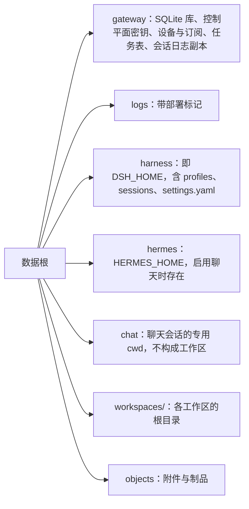
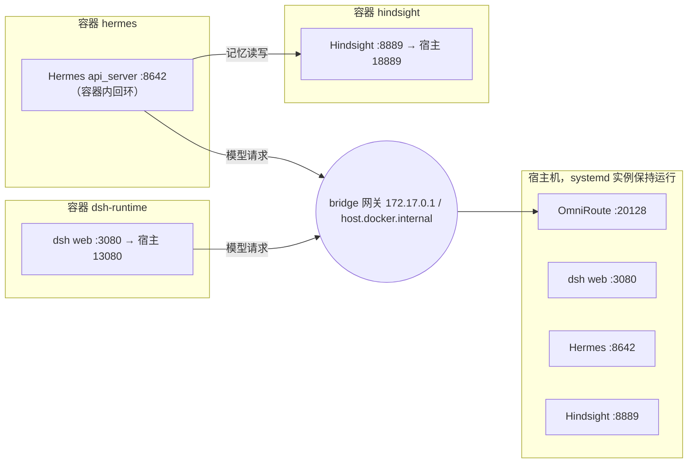

# 部署形态与兼容接缝

完整部署目标与安全、迁移、备份恢复、可选依赖和容量约束使用[系统完成设计](<system-completion-design.md>)；实施依赖使用[SYS01–SYS08](<implementation-work-packages.md>)。Hermes 支持外部服务或可选托管单实例；运行时按设备部署。下文的数据与兼容接缝继续适用，涉及运行期分派与安全细节时使用完整系统契约。

目标形态是单用户自托管：一个人在自己的机器上装一套 ChatDSH，在自己的多台设备与多种客户端上使用。没有账号体系，没有租户维度，数据根下只有一份部署。本文件定下部署的组件、数据布局，以及必须从第一天就做对、事后无法补的那些接缝。

## 一、组件与启动

必需组件为启动器、控制平面和设备运行时。DSH 原生插件与平台适配器在设备运行时装载，外部执行体和记忆服务按用户选择加入。提供方、依赖和数据范围采用[平台架构](plugin-platform.md)。运行时只绑定回环，控制平面入口遵循本节传输规则。

**启动器**取单实例锁、初始化数据目录、生成或读取控制平面密钥、拉起控制平面、等待就绪、打开浏览器。它本身不承载业务。

**控制平面**常驻，开两个 TLS 监听，没有明文端口。

回环监听 `https://127.0.0.1:27777`，不要求客户端证书，只由 Tailscale Serve 转发进来。Serve 侧的上游写 `https+insecure://127.0.0.1:27777`，跳过上游证书校验；回环内跳过可以接受，流量不出机器，对端就是本机的 tailscaled 进程。

EasyTier 监听 `https://192.0.2.10:27778`（形如该地址），`requestCert: true` 且 `rejectUnauthorized: true`，只接受内部 CA 签发、CN 为约定值的客户端证书。EasyTier 网段内的反向代理指向这里。
反代只监听私有网络接口或回环，不得绑定 `0.0.0.0` 或公网网卡，也不得在路由器上为该端口做端口映射。公网域名解析到私有地址，对公网而言目标不可路由，这条约束是它的前提。控制平面在启动时按本地地址表校验自己的绑定值，命中公网地址段即拒绝启动并报出具体地址。详见[域名解析与反代约束](reachability.md)。

**反代是 Caddy 时的配置。** Caddy 终止公网 TLS，再连控制平面的 EasyTier 监听。它需要信任控制平面的证书并带上自己的客户端证书：

```caddy
chatdsh.example.com {
    reverse_proxy https://192.0.2.11:27778 {
        transport http {
            tls
            tls_trusted_ca_certs /etc/caddy/chatdsh-ca.pem
            tls_client_auth /etc/caddy/proxy-client.crt /etc/caddy/proxy-client.key
        }
    }
}
```

省掉内部 CA 时，把 `tls_trusted_ca_certs` 换成 `tls_insecure_skip_verify`，控制平面侧改为校验证书指纹。两种配法下控制平面都要求客户端证书，区别只在它是否信任对面那张服务端证书。

两个端口都选在 10000 以上，避开常见服务端口与系统临时端口范围（本机为 32768 至 60999），也避开 DSH 自身 web 使用的 `3080`。控制平面持有设备、会话归属、额度账本、分享记录，并作为反向代理与跨设备推送的中枢，同时维护一张本地自签证书。

两条入口的认证机制分开：Serve 侧靠网络成员资格与 TLS，反代侧靠 TLS 握手。

**Serve 侧只做传输。** 来自 tailnet 的请求由 Serve 终止 TLS 并转发到回环端口，控制平面不读它注入的来源身份头，也不据它建立记录。这个端口只绑回环，外部无法绕过 Serve 直连。

**EasyTier 侧不依赖任何头部。** 连接能不能建立由证书决定，未持证的请求在 TLS 握手阶段就被拒绝，不进入应用层。这条规则不能省，否则同网段的任何设备都能无凭据直连控制平面并自称为任意用户。

若不想维护内部 CA，可以退化为单张自签证书加指纹固定：控制平面校验对端证书的 SHA-256 指纹，换证书时两处同时更新。

**运行时**是一个 DSH 进程，端口由控制平面分配（随机回环端口），`$DSH_HOME` 指向数据根下的运行时目录。

Hermes 作为可选执行体，可以使用外部实例或托管单实例，`HERMES_HOME` 在托管时纳入部署数据根。记忆提供方的数据位置由插件声明，本地存储与外部服务分别登记，Hindsight 等外部服务不成为默认必需组件。

启动顺序为取得锁、初始化数据目录、读取密钥、启动控制平面和配置中明确托管的服务、启动设备 DSH、装载原生插件与适配器、核验能力绑定、打开客户端。关闭之前停止接受新调用，处理在途操作并释放插件资源，最后停止所托管进程与控制平面。外部服务不随平台关闭。

能力未启用时不创建相应连接和后台任务。已启用提供方的不可达、配置错误和不支持操作分别展示，禁止将失败显示为空查询。可选记忆的继续策略由用户明确配置，写入和执行体受理结果未知时查询原操作，禁止自动更换提供方重放。

## 二、数据布局

Super-Agent 目标数据增加设备本地 `superagent/state.sqlite`、`objects`、`work` 和 `git` 目录，布局和权限使用[存储契约](superagent/storage.md)与[执行契约](superagent/execution.md)。这些目录位于项目和参考目录之外。共享参考内容仍保存在用户登记的原始位置。当前运行时尚未创建这组业务数据。



数据根下只有一份部署：控制平面的库、运行时的数据与日志都放在这里，没有账号这一层目录。

每个工作区一个根目录，会话创建时把该目录作为 `cwd`；DSH 的会话日志本来按 `cwd` 的项目键分目录，落盘形式是 `<root>/<projectKey>/<sessionDir>/session.v<版本>.jsonl.zstd`，所以工作区隔离在落盘层面自然成立，不需要每个工作区一份 `$DSH_HOME`。

`gateway/` 下另存一份会话日志副本：执行节点把事件流推给控制平面，控制平面按 `seq` 追加成持久镜像，单机下也照此运行（同机冗余），因为这份副本承担跨设备浏览、会话导入与设备离线时的读取。权威日志仍由运行时写入，副本只读，两者以最后同步的 `seq` 作为水位。

聊天不构成工作区，它的会话带一个专用 `cwd`（`chat` 目录），归属表里 `workspaceId` 留空。

控制平面的 SQLite 库放在 `gateway/` 下，单机不需要任何外部服务。

## 三、必须从第一天就做对的接缝

这一节列的每一条，事后补做都要迁移既有数据或拆开既有进程，因此部署形态下也要按最终形态实现。

**隔离以进程边界与设备归属承担。** 运行时只绑回环，外部只能经控制平面进入；控制平面按 `node_devices` 与长连接表决定请求落到哪台设备。运行时内的授权层恒为 owner——`PrincipalMap` 只有 `owner` 一个成员，`registerPolicy` 的类型参数在现有声明下收成 `never`，HTTP 侧的 Peer 来源都硬编码 owner。

**控制平面是唯一入口且常驻。** 所有客户端的请求经它反向代理。Host 由 Serve 保留为用户访问的原始域名，控制平面不改写它，因此 DSH 的 authority 绑定 cookie 与用户看到的域名一致。这条同时解决了 authority 的稳定性：用户看到的域名是固定的 service 名。

控制平面不读来源身份头部，也不建立账号记录。访问权来自网络成员资格，可选的登录层见[应用级登录与两步验证](architecture.md)。实测细节见[可达性](reachability.md)第四节。

**设备归属判定在控制平面的路由层。** `/d/<deviceId>/` 前缀按设备转发，未登记的设备按不存在处理；归属写在 `sessions.device_id` 上，写入后不可修改。

**存储访问走接口，单机实现用本地后端。** 控制平面的设备、会话归属、额度、任务各是接口，单机实现落在 SQLite；会话日志走 `ctx.sessionPersistence` 抽象，单机用 JSONL 后端；检索走 `ctx.sessionQuery`，单机用 SQLite FTS5。

**登录凭据属于部署本身。** 启用 `authMode` 为 `local` 时，控制平面的数据根下保存一份登录配置：`passwordHash`（argon2id）、`totpSecret`（加密存储）、`webauthnCredentials`（凭据标识与公钥）、`recoveryCodes`（哈希存储、一次性）、`twoFactor`、`lastAuthenticatedAt`。默认 `authMode` 为 `tailscale`、`twoFactor` 为 `off`，单机自托管下不需要额外配置；启用登录层时由控制平面在反代前校验应用会话，未通过不转发给运行时。详见[应用级登录与两步验证](architecture.md)。

**会话日志副本由控制平面持有。** 执行节点把事件流推给控制平面，控制平面按 `seq` 追加成只读镜像，并记录「最后同步的 seq」作为水位。副本用于跨设备浏览、会话导入与设备离线时的读取，权威日志仍由运行时写入，两者不争同一个写入者。节点重连后从水位补发；副本落后时导入界面要显示落后多少条。这份副本在单用户部署下也启用，因为它是设备损毁时唯一的恢复来源。

**长期不活跃的副本按 90 天回收。** 一个会话或工作区连续 90 天没有新事件时，控制平面删除它的副本并把状态标为「仅本地」。这与软删除的 30 天保留期是两个不同的期限：30 天管已删除的会话还能不能撤销，90 天管从不活跃的会话还占不占控制平面空间。回收只删副本，执行节点上的权威日志不动；回收之后那段会话的跨设备浏览与导入不可用，直到所属设备重新在线并补齐。

换 Postgres 时替换的是这三处的实现，调用方与数据模型不动。让那次替换停留在实现层的五条约定要现在守住：主键用 UUID 或 ULID 字符串，不用自增整数；时间戳统一用 UTC ISO 8601 文本；只用 SQLite 与 Postgres 都支持的 SQL 子集；工作区维度本来就落在持久键里，不在应用层拼条件；附件与制品走对象存储，不进数据库。

会话日志换后端时要保持的语义有四项：事件序号从 0 起连续且永不重写；读取路径只接受当前格式，遇到不认识的必需事件就拒绝重建整个日志；追加是尽力而为而 `flush` 是耐久屏障；写句柄是单写者所有权，已有活跃所有者时拒绝。Postgres 后端要表达的是「会话头加不可变的事件序列」，不是可变的行更新，并且要自行解决跨进程的单写者语义（数据库级锁或租约），JSONL 用的文件锁在跨进程场景不适用。从 JSONL 迁到 Postgres 需要一次性导入：按会话读世代文件，按 `seq` 顺序写入。

**模型凭据留在运行时。** 允许凭据以环境变量或本地文件形式留在运行时，因为只有一个人用这套部署，凭据就是他自己的；`dsh-llm-pi-ai` 的 `providers` 与 `dsh-llm-deepseek-api-key` 的 `apiKeyEnv` 都走这条路。

**运行时编排走统一接口。** 控制平面通过一个接口启动、健康检查、停止运行时，当前实现是启动一个子进程，调用方在换实现时不动。运行时端口取 `--port 0` 由操作系统分配，再从启动输出或环境变量取回实际端口。

**执行节点与工作区绑定。** 设备表记录角色（控制宿主、执行节点，可以同时是两者）、平台、`capabilities`（`browser` 表示该节点装了 Chromium，`computer` 表示它有图形界面并能注入输入，只由 macOS 14 及以上与 Windows 节点声明）与节点令牌摘要。工作区记录带 `deviceId`，会话归属记录同样带 `deviceId`，另有 `kind`（工作会话或聊天）、`syncWatermark`（副本最后同步到的 `seq`）、`lastSyncedAt`，以及软删除用的 `deletedAt` 与 `deletedBy`。会话创建时确定 `cwd` 与 `deviceId` 且之后不可修改；执行节点主动向控制平面建立长连接，请求按会话的 `deviceId` 路由，节点离线时明确失败而不回退到宿主机执行。Windows 的执行节点必须是 Electron 壳，Linux 的可以只装命令行组件。绑定工作区时按 `capabilities` 提示能力缺口，例如把一个要在真实浏览器里操作的会话绑到没有 Chromium 的节点，或把需要桌面控制的会话绑到 Linux 节点。详见[远程执行节点](architecture.md)与[浏览器操作与桌面控制](architecture.md)。

**软删除与回收。** 删除会话时执行节点删本地日志、控制平面写 `deletedAt` 并保留副本，会话进入收件箱，30 天内可撤销。撤销从副本把日志写回执行节点，会话编号不变。控制平面有一个清理任务扫描超过保留期的软删除记录，硬删副本与归属记录；收件箱里的会话在删除前仍计入副本用量。

**用量从第一天就累加。** 每一轮的 token 与轮次写进账本，字段含工作区、会话、轮次、模型、provider、四类 token 计数与记录时间，并以「会话编号加轮次」作为唯一约束，避免跨进程上报重传导致重复计账。

记忆范围由标准标识映射到提供方的原生范围。跨设备共享必须具有真实的远程存储或同步机制，项目关联不自动创建复制任务。凭据保留在所属设备，数据备份遵循提供方一致性要求，详细契约使用[记忆标准接口](plugin-platform.md#6-记忆标准接口)。

**设备与订阅表从第一天就有。** 每条记录含精确 Origin（协议、主机、端口逐字相同）、平台、角色、令牌摘要与签发时间、最后使用时间、最后在线时间、送达档位。跨设备推送按送达档位决定投给谁，会话同步覆盖全部会话。

**副本用量按三个维度累计。** 控制平面在追加副本时累加字节数，记录键为工作区、会话、设备三者，值为字节数与最后更新时刻。界面显示总量与按工作区分组的占用，并提供按工作区或按设备的清理入口。清理只删副本，不影响执行节点上的权威日志，清理后该段会话在跨设备浏览与导入上不可用。

进程回收同时检查会话、后台任务、插件原生整理和已受理外部运行。存在有效操作时不能仅按客户端空闲回收运行时。托管服务的启停由明确的进程所有者执行，使用外部地址的服务只查询状态，不操作其进程。

## 四、将来作为增量加入的部分

应用级登录的第二种方式：登录配置层已经规划了本地密码与通行密钥，接 OIDC 是增加一种登录方式。系统推送：PWA 上走 Web Push 加 Service Worker，由控制平面持有 VAPID 密钥并经推送服务下发；应用被系统回收后的送达由推送服务决定。对象存储：附件写入位置由配置决定，从本地目录换到 S3 或 MinIO 是替换存储实现。TLS 与公网入口：控制平面已绑 EasyTier 接口，公网入口由前置反向代理追加。

## 五、部署的默认配置

控制平面开两个 TLS 监听：回环上的 `27777` 供 Tailscale Serve 转发，EasyTier 接口上的 `27778` 供反代以 mTLS 接入。运行时由控制平面分配随机回环端口。数据根在用户数据目录下，可用启动参数改到别处。

模型供应默认配一条指向本机 OmniRoute 的路由（OpenAI 兼容，`http://127.0.0.1:20128/v1`，`baseURL` 带 `/v1` 前缀），经 `dsh-llm-pi-ai` 的 `providers` 写入；密钥以环境变量名引用，不作为配置值。Hermes 侧的模型同样指向该网关。

账号链六行默认禁用：`deepseek-account`、`llm-deepseek-account`、`account-controller`、`ui-settings-account`、`web-deepseek-api`、`web-search-deepseek`。`deepseekAccount` 被六个包引用，整链禁用才能避免失败的 fiber。

默认执行体为 DSH，记忆由用户选择插件后绑定。执行体与记忆的组合采用[接入契约](hermes-integration.md)，任何组合都要验证原生自动行为、实际范围和操作支持。

平台不预装所有候选提供方。用户选择的原生插件、适配器和传递依赖写入精确锁文件，提供方要求外部服务时明确展示部署要求与实际状态。本文件第六节的测量只代表所列测试环境，其他插件组合需要记录自己的资源占用。

## 六、资源占用与内存预算

运行时进程的占用必须实测，用来给部署定内存预算与冷启动预期。当前形态是每台设备一个运行时进程，这里只关心单进程的占用。全部测量都在隔离的 Docker 容器里进行，宿主机上由 systemd 承载的 dsh、Hermes、Hindsight 实例保持运行，测量过程不写它们的数据目录、不占用它们的端口。

**测量在隔离容器里进行。** 本机宿主的事实基线：dsh 由 `dsh.service` 与 `dsh-web.service` 运行，`DSH_HOME=/root/.dsh`，`dsh web` 监听 `3080`；Hermes 由 `hermes-gateway.service` 运行，`HERMES_HOME=/root/.hermes`，api_server 在 `:8642`；Hindsight 容器把 `8889` 绑在 `127.0.0.1`；OmniRoute 监听 `0.0.0.0:20128`。测量另起三个独立容器：`dsh-runtime`、`hermes`、`hindsight`。三者的数据目录、端口、镜像都独立，互不共享，宿主实例全程不受触碰。容器内 `$DSH_HOME` 必须可写；宿主上的会话沙箱把 `/root` 挂成只读（`dsh --dump-config` 会报 `EROFS`），因此测量一律放在容器可写目录里进行。



**网络与端口。** 容器访问宿主服务统一写 `host.docker.internal`，由 `extra_hosts` 的 `host.docker.internal:host-gateway` 映射到 bridge 网关 `172.17.0.1`。实测：容器内访问 `127.0.0.1:20128` 连接失败，访问 `172.17.0.1:20128` 返回 401（已到达，仅缺认证），因此指向宿主的地址一律写 `host.docker.internal:20128`。端口改到不冲突的回环端口：dsh-runtime 把 `3080` 映射到 `127.0.0.1:13080`，hindsight 把 `8889` 映射到 `127.0.0.1:18889`。Hermes 的 api_server 绑在容器内 `127.0.0.1:8642`，宿主的端口映射到不了它，因此 Hermes 的往返验收在容器内完成，不依赖宿主映射。宿主机 `3080`、`8642`、`8889`、`20128` 一概不映射、不复用。

**配置从宿主实例复制进容器。** 宿主目录以只读方式挂进容器，入口脚本按白名单复制，复制后容器内写入只落在可写层与命名卷。

dsh-runtime 容器直接使用宿主挂入的 node 与 dsh：把宿主 node 根目录 `/usr/local/nvm/versions/node/v24.19.0`（v24.19.0、dsh 0.2.1-rc.2）与 `/root/.dsh` 都只读挂进容器，在容器内调用同一绝对路径的 `node` 与 `dsh/lib/bin.js`。原因是宿主的 `profiles/web/node_modules` 里大量包是指向 `/usr/local/nvm/.../node_modules/@deepseek-ai/...` 与 `/workspace/oh-my-dsh-slim` 的绝对符号链接，只有保持同一绝对路径才能解析，因此 `$DSH_HOME` 重建在 `/root/.dsh`。入口脚本从 `/host-dsh-home` 复制 `.credentials.yaml`（`chmod 600`，credentials-local 拒绝 owner 之外可读的文件）、`profiles/`（含已装依赖）、`skills/` 到容器内 `/root/.dsh`，不复制 `sessions/`、`logs/`、`backups/`、`browser-sessions/`、`change-ledger/`。这样组合与宿主逐字一致，不依赖容器内联网安装依赖。

hermes 容器把 `$HERMES_HOME_HOST`（默认 `/root/.hermes`）只读挂到 `/host-hermes-home`，复制 `config.yaml`、`auth.json`、`models_dev_cache.json`、`provider_models_cache.json` 到容器内 `/opt/data`，不复制 `state.db`（运行态账本）、`sessions/`、`logs/`、`backups/`、`processes.json`、`gateway_state.json`。镜像用本机已有的 `nousresearch/hermes-agent:latest`（容器内 `HERMES_HOME=/opt/data`）。复制的 `config.yaml` 必须关掉全部真实消息平台（Telegram、Discord 等）：宿主机上的同一批机器人账号已在运行，第二个实例用同一份 `auth.json` 登录会与宿主抢同一个 bot，这会直接影响宿主；同时清空 `mcp_servers`（`nas:8123` 与 `127.0.0.1:20128` 的 MCP 入口在容器内不通），只保留 `api_server` 通道。

复制之后，把指向宿主 OmniRoute 的地址统一改写为 `host.docker.internal:20128`：dsh 侧 `dsh-omniroute` 的 `127.0.0.1:20128`、`dsh-llm-omniroute` 的 `198.51.100.11:20128`、`llm-newapi` 的 `203.0.113.1:20128`（这三条在有对应 bundle 时才插入），以及 Hermes 侧的 `model.base_url`。

**默认模型指向 `opencode-go/longcat-2.5-preview-free`。** 两侧都经宿主 OmniRoute（`http://host.docker.internal:20128/v1`）提供该模型，实测一次补全返回 200。dsh 侧用一份 `--patch` 覆盖层文件改默认模型，覆盖层给出 `agent-default-model` 的完整 config（`provider: omniroute`、`model: opencode-go/longcat-2.5-preview-free`、`reasoningEffort: max`），整行覆盖时缺键会落到未定义，因此键必须给全；`dsh-llm-omniroute` 的模型目录已声明该条目（contextWindow 1000000、maxTokens 131072，含 vision 与 toolCalling），无需新增条目；密钥沿用 `.credentials.yaml` 里的固定引用 `omniroute`。Hermes 侧把 `model.default` 写成 `opencode-go/longcat-2.5-preview-free`、`model.provider: custom`、`model.base_url: http://host.docker.internal:20128/v1`，`model.api_key` 只保留环境变量名（`${HERMES_CUSTOM_127_0_0_1_20128_API_KEY}`）。两侧的密钥值都经容器环境变量注入，配置文件里只出现环境变量名。承袭宿主 profile 的两条 `patch: entry "omniroute"/"llm-newapi" not found` 告警来自该 profile 自身未安装对应 bundle，与容器构建无关，加不加覆盖层都相同；真正衡量容器组合正确性的是「dsh 能启动并就绪」。

**dsh-runtime 容器的启动与就绪。** 启动命令为 `dsh web --no-open --host <容器内网卡地址> --port 3080`，`--host` 只接受具体的 IPv4/IPv6 字面量，传 `0.0.0.0` 会被拒绝（通配地址等于把远程代码执行暴露到网络）。就绪判定：从容器日志取一次性 `token=`，`GET http://<容器地址>:3080/?token=<token>` 换取会话 cookie，再带 cookie `GET /` 返回 200 即视为可响应，这就是「冷启动到可响应」的终点。常驻内存读容器内 `/proc/<pid>/status` 的 `VmRSS`。

**hermes 容器的启动与验收。** 入口以 `/opt/hermes/bin/hermes gateway run` 在容器内置后台启动（容器主命令用 `sleep infinity` 保活）。api_server 绑定容器内 `127.0.0.1:8642`，因此宿主的端口映射到不了它，验收在容器内做一次往返：`POST http://127.0.0.1:8642/v1/chat/completions`，`Authorization: Bearer <容器内生成的 API_SERVER_KEY>`，`model` 用 `opencode-go/longcat-2.5-preview-free`，收到完成回复即算可用；同时记录 gateway 进程的 `VmRSS`。实测该往返返回 200 与「你好」。

**hindsight 容器要配一个 vchord 数据库。** Hindsight 服务镜像 `ghcr.nju.edu.cn/vectorize-io/hindsight:0.9.2` 单独起容器，映射到 `127.0.0.1:18889`，与宿主机的 `8889` 无关。嵌入模型经 OmniRoute 用 `sfc/Qwen/Qwen3-Embedding-8B`（4096 维），超过了 pgvector 的 HNSW 上界 2000，镜像内嵌的 pg0 不含 `vchord` 扩展，会以「extension vchord is not available」启动失败；因此另起一个 `tensorchord/vchord-postgres:pg18-v1.1.1` 容器（本机已有）作为数据库，`shared_preload_libraries=vchord,vector`，用 `HINDSIGHT_API_DATABASE_URL` 指向它并设 `HINDSIGHT_API_VECTOR_EXTENSION=vchord`。就绪判定用 `GET http://127.0.0.1:18889/version` 返回 200（实测 `api_version` 为 0.9.2）。记忆按 bank 分区，测试写入不会进宿主机的记忆库。

**宿主实例不受影响的判定。** 开始测量前记录宿主机 `3080`、`8642`、`8889`、`20128` 的响应码与这些端口的监听归属；测量结束后逐项复测，响应码与监听归属都不变即证明宿主实例未被触碰。宿主数据目录只以只读方式挂进容器，任何写入只落在容器可写层与命名卷。测量结束执行 `docker compose down -v` 删除容器与命名卷，日志与结果先拷出到工作区下被 `.gitignore` 排除的 `.verify/measure/` 目录。

**实测结果。**

| 指标 | 实测值 | 采样 |
|---|---|---|
| 运行时空载常驻内存 | 402 MB | 三次 392 至 398 MB |
| 每空会话增量 | 212 KB | 0、10、50、100 个会话四档 |
| 冷启动到可响应 | 3.7 秒 | 三次 3.6 至 3.9 秒 |
| 并发 8 个全部就绪 | 4.8 秒，合计 3.1 GB | 平均每进程 397 MB |
| 并发 16 个全部就绪 | 6.3 秒，合计 6.2 GB | 平均每进程 399 MB |
| Hermes 单实例 | 334 MB | 一次采样 |
| Hindsight worker | 844 MB | 单例 |

四条结论。

**进程数是成本，会话数不是。** 每空会话只增加 212 KB，一百个会话不到 21 MB。一个运行时进程承载该设备的全部会话因此成立，会话数量本身不是瓶颈。

**Hermes 与运行时同量级。** 启用聊天时同一台机器上的 Hermes 再占 334 MB，两者合计约 736 MB。启用聊天后端时要把 Hermes 的内存一起算进这台机器的预算。

**多设备部署按每台设备一份运行时计。** 一台设备一个运行时进程约占 402 MB，启用聊天再加一台 Hermes。设备数受每台设备自身可用内存约束，与单机上开了多少会话无关；单机自托管下通常只有一两台常驻设备。

**并发启动在秒级。** 8 个进程并发 4.8 秒、16 个并发 6.3 秒，全部就绪时间随并发数上升；一次拉起多台设备或做端到端测试时，预热规模不宜超过 16，否则启动本身成为瓶颈。

**未完成的四项测量。** 会话长度对内存的影响（需要真实模型轮次，有 token 成本）、冷读一千条事件的长会话、SSE 订阅者数量对内存的影响、并发 32（宿主可用内存 18 GB，32 × 0.4 GB 约 13 GB，有 OOM 风险可能危及宿主，未执行）。前三项影响数值精度但不改变上述四条结论，第四项需要在更大内存的机器上补测。

单机内存预算按实际运行时数量、所选插件、外部服务和操作系统余量计算。本节测量值只适用于所列组合，未启用的外部服务不计入必需资源。增加提供方或改变依赖版本后，重新测量该组合的运行占用与冷启动时间。

**测量的可重复性。** 每档重复三次取中位数，记录 node 与 dsh 版本、Hermes 与 Hindsight 镜像的 digest，以及 profile 的组合结果、插件数量、容器的 CPU 与内存上限。DSH 升级之后这几条曲线会变，要重测；把测量脚本（Dockerfile、compose、入口脚本、探针）与结果一起放进仓库，作为升级回归的一部分。
