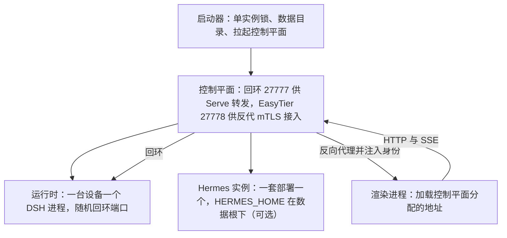
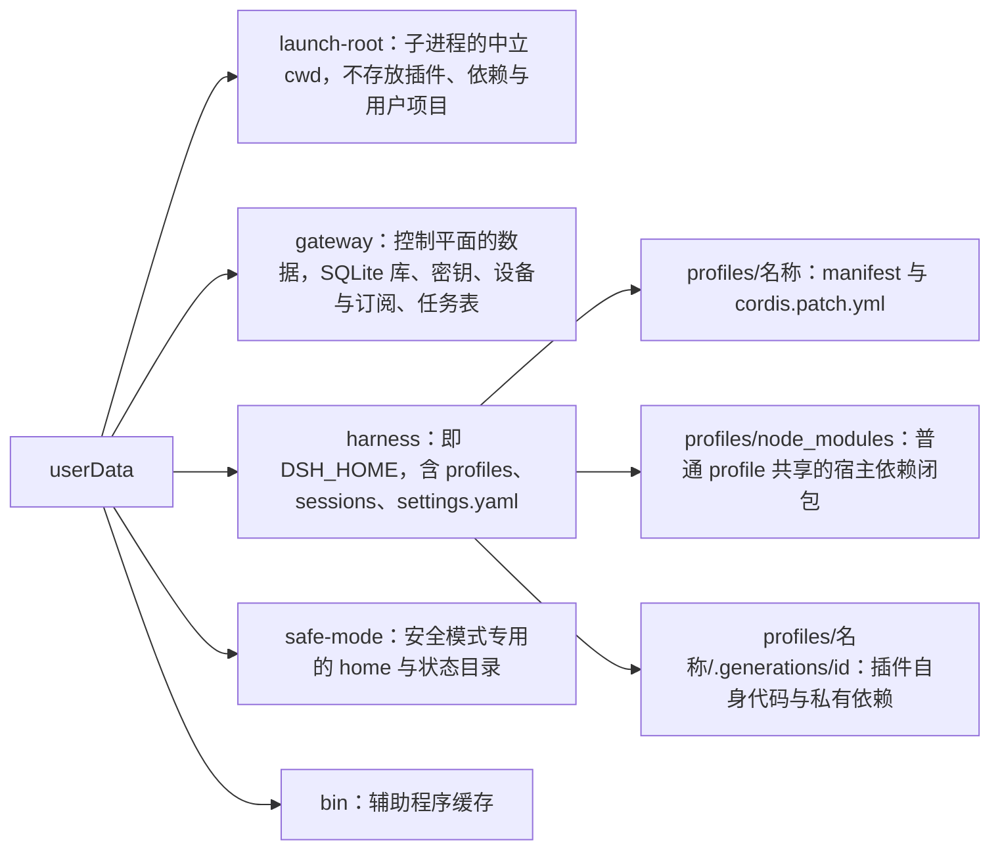
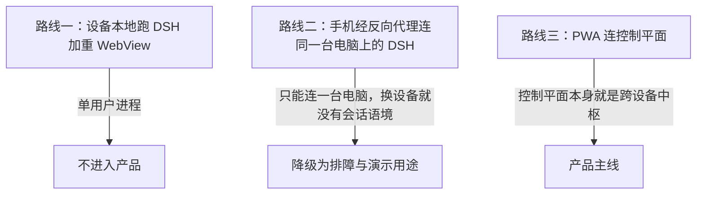

# 桌面与移动端载体

完整客户端目标使用[交互规格](<client-complete-spec.md>)与[UI 设计稿](<ui-design/complete.html>)，原生安全和部署使用[系统完成设计](<system-completion-design.md>)，实施分工使用[工作包](<implementation-work-packages.md>)。移动端采用 PWA，所有图形载体加载控制平面的同一份外壳，每个窗口只保留一个活动设备 iframe。离线仅保存草稿，重新连接后由用户手动提交。

本文件承接[总体架构](architecture.md)，把桌面与移动端两种形态的设计写实。结论来自本机 DSH 0.2.1-rc.2 的实测与 `../refer_repos/` 下参考实现的核验，参考路径以仓库名开头。文中引用参考实现只用于核对取舍，结论本身以本机实测与 `runtime/docs/` 的规定为准。

## 一、从参考实现得到的结论

**补丁允许使用，但按层优先。** deepseek-harness 的源码仓库不得修改，npm 安装的包产物可以打补丁。两个参考实现都停在这一层：`anywhere-labs` 用 Yarn 补丁格式维护 186 个文件（同一上游包按版本各留一份，`dsh-client-modules` 从 `0.1.5-rc.2` 到 `0.2.1-rc.2` 共 9 份），`dataelement` 用 `patch-package` 维护 28 个 `.patch` 文件并在 `postinstall` 里重放，此外还改写官方前端产物的内容（`scripts/install-brand-assets.mjs` 写入 `dist/index.html` 与 `manifest.webmanifest`）。

改动位置的优先顺序是 profile 与组合包的补丁层、树外插件、包产物补丁。前两者能表达的不打补丁。包产物补丁换来的能力包括：客户端 UI 的内部行为（`dsh-client-ui-*`）、模块图与激活行为（`dsh-client-modules`）、peer 兼容性降级（`dsh-app-boot`）、插件停用状态的读取、打包后的 Cordis HMR（`dataelement` 为此专门加了 `dsh-desktop-hmr-fallback` 包）、品牌资源写入前端 dist、以及扩充已知会话事件类型清单。

这些补丁在每次上游升级时逐项核对：已被上游修复的删除，仍然需要的按新版本重新生成。

**启动页内核与前端产物都是公开可用的。** 官方前端产物 `dsh-web-frontend/dist/assets/index-CN7NIWNw.js` 内含桌面分支：读取 `globalThis.dshDesktopBoot`，存在时要求 `globalThis.__DSH_BOOT_READY__`，调用 `ready()` 取回 `{injections, streamBaseUrl}`，写入 `globalThis.__DSH_TRANSPORT__`，再逐个插入注入行。`@deepseek-ai/dsh-client-web@0.2.1-rc.2` 已公开发布，导出 `./injections`；启用的注入行由宿主端的 `bootInjections(graph)` 生成。自建载体只需要在 bootstrap 脚本执行之前提供那两个全局量。

**两个参考实现对屏幕采集与全局快捷键的处理不同。** `dataelement` 的权限处理器只放行 `clipboard-sanitized-write` 与 `notifications`，没有采集实现。`anywhere-labs` 的 Stable 与 Beta 变体在登录窗口里显式拒绝采集，而 Next 变体已经实现了带系统选择器的采集（`dsh-desktop-next/src/electron-permissions.ts:80-92` 调用 `chooseScreen`，在用户手势、主框架、聚焦、来自应用页等条件满足时回传真实的视频源，同文件 `:65` 与 `:77` 按 `mediaType` 放行音频）。两者都没有全局快捷键。

桌面端默认不采集屏幕，也不注册全局快捷键。屏幕采集只在 computer use 开启后被使用，且每次会话开始都要重新确认；采集到的帧作为附件进入会话，这一点在启用时向用户说明。全局快捷键不做，因为它在 Windows 上要占用系统级热键，与输入法和其他常驻程序的冲突难以完全避免。

## 二、进程模型

桌面是四个进程：启动器、控制平面、运行时、渲染进程。

控制平面常驻，是唯一入口。它承担跨设备推送，这条职责要求它比运行时活得更久：手机上收到的审批提醒依赖它。`chatBackend` 为 `dsh` 时没有 Hermes 进程，聊天与工作会话都由运行时里的 DSH agent 执行；`chatBackend` 为 `hermes` 时控制平面另外拉起 Hermes 实例。

Electron 主进程承担原生能力与运行时编排：取单实例锁、建立中立的 `launch-root`、启动控制平面、由控制平面拉起运行时、等回环端口就绪、把窗口指向控制平面分配的地址。第二次启动取锁失败后聚焦既有窗口，并把命令行参数转交给它。

子进程的启动方式按平台选择：Windows 用打包后的 Electron 可执行文件加 `ELECTRON_RUN_AS_NODE=1`，macOS 用 Electron 的 utility process，两条路都不依赖用户机器上装有 Node。`dataelement` 的 `src/main/runtime/electron-node-executable.ts` 给出了可执行文件路径的解析方式。

首期目标平台是 Windows x64，开发环境是 Linux，两者必须分开验证。`dataelement` 的 `AGENTS.md` 要求「Windows 路径、进程与安装行为必须有 Windows 验证，其他平台通过不能代替」；tailnet 内已有的 Windows 设备可用作验证通道。Windows 侧的进程终止要用 `taskkill /pid <pid> /t /f` 处理进程树，其他平台用进程组信号。

Windows 上这个壳同时承担执行节点角色：系统目录选择器、进程树终止、路径沙箱都依赖它，因此 Windows 机器要作为远程执行节点就必须安装这个壳。Linux 机器可以只装命令行组件（`chatdsh node`），它以执行节点模式启动并连接控制平面，目录选择走远程列举加手输路径。

停止与崩溃：先向子进程发终止请求并等待有界时间，再升级为强制终止；崩溃证据固定保留退出码、存活时长、stderr 尾部有界文本三项（`anywhere-labs` 的 `dsh-plugin-desktop/src/host-process.ts:39` 的 `HOST_STDERR_TAIL_CHARS = 16 * 1024`）。`dataelement` 记录了一条不能照抄上游错误的经验：优雅终止可能被报告为 exit 0，让它覆盖真实失败会淹没根因（`src/main/runtime/harness-runtime.ts:596-611`）。

## 三、数据布局与依赖解析

`launch-root` 的必要性来自 `dataelement` 的实测约束：应用进程的默认 `cwd` 会影响会话默认目录的推断。桌面载体让运行时子进程在 `launch-root` 下启动，隔断从启动目录继承的上下文。

依赖解析顺序为插件自身与正常 Node 解析优先，只有在得到 `ERR_MODULE_NOT_FOUND` 或 `ERR_PACKAGE_PATH_NOT_EXPORTED` 时才回退到宿主依赖，回退范围限定在约定的宿主命名空间，锚点取当前运行安装目录的绝对路径。`dataelement` 的 `build/host-module-fallback.mjs` 给出了这套规则的实现，并明确禁止通过 `NODE_PATH`、改变 `cwd` 或把安装目录当作任意包的兜底；失败时保留第一次错误的插件归属，把宿主回退的错误追加在同一消息里。打包后 `app.asar` 是虚拟文件系统，操作系统的符号链接进不去，需要被 Node 直接加载的依赖要落在 `app.asar.unpacked`。

安全模式：`dataelement` 用同一 `DSH_HOME` 内的独立 profile（`desktop-safe-mode`，只含 `dsh-base` 与 `dsh-web-app`，`nodeLinker: hoisted`，只保留模型相关补丁行），共享设置、凭据、会话与工作区。`anywhere-labs` 用一次性独立环境（固定的 `safe-mode` 目录，市场关闭、通知全关、仅回环）。ChatDSH 取前者的形态，因为共享数据才是用户期望的「安全模式下数据还在」；两者的共同点是安全模式只加载安装包自带的包，且都不是破坏性操作。

## 四、启动五阶段

每一阶段单独判定，前一阶段的成功不能替代后一阶段的验收。这份划分来自 `dataelement/AGENTS.md` 的「后端与客户端启动协议」一节，代码里各阶段都有对应的证据提取实现。

| 阶段 | 成立条件 | 失败证据 |
|---|---|---|
| 应用身份与单实例 | 数据根与 profile 目录确定，单实例锁已取得 | 锁冲突记录、既有窗口句柄 |
| 控制平面就绪 | 控制平面进程健康，Hindsight 与 Hermes 的探活结果已知 | 控制平面端口、探活状态与降级标记 |
| Profile 组合 | manifest、补丁层、启用状态与活动插件入口一致 | profile 名称、组合来源、插件归属与实际路径 |
| 后端加载 | 插件入口可导入，依赖可解析，所需服务满足并完成激活 | import 与 apply 阶段状态及原始 cause |
| 客户端发现与引导 | 从同一解析基准读出 `dsh.client` 生成模块图，注册队列先于 bootstrap 脚本、bootstrap 注册先于模块系统创建 | 包名、client 入口、解析锚点、模块图条目与 revision、脚本响应状态 |
| 界面激活 | 模块系统按依赖图实例化插件并挂载席位 | 模块注册记录、服务状态、界面截图 |

第四阶段的失败证据在 `dataelement` 里对应 `extractDshEntryFailureCause`、`extractPluginFailureReferences`、`extractOffendingPlugins`、`extractDuplicateLoaderEntryId`、`extractSlotConflictName` 五个提取函数。第五阶段最容易误判：`HTML did not preload ...` 只表明调用 `create()` 时缺少 bootstrap 注册，根因可能是模块图漏项、HTML 漏标签、请求失败、执行异常或顺序错误。

引导顺序是硬约束：创建 `window.__ModuleLoader__` 注册队列，执行 bootstrap 脚本并注册模块，在壳消费之前提供 `__DSH_BOOT__` 模块图，调用 `create()` 建立模块系统，按模块图加载并激活。

## 五、桌面界面承载

窗口内容整体复用官方前端产物。自建能力以客户端插件进入：包内声明 `dsh.client`，导出 `./client` 子路径，产物落在 `lib/client.js`，由宿主端扫描进模块图。

席位基数与属主规则已在[客户端模块构成确认](client-modules.md) 2.2 节逐项实测列出。结论是自建插件需要的位置全部落在 `list`、`keyed`、`chain` 三类可多方注册的席位上，接入不需要包产物补丁，也不需要禁用占位行再插入自己的行；`single` 席位整块归一个注册者（如 `sidebar.workspaces` 归 `ui-workspace`、`sidebar.settings` 归 `ui-settings`），`keyed` 席位按 `id` 或 `key` 区分注册者（如 `main` 的面板 id、右栏页签类型）。

桌面形态的呈现方式只保留兼容模式：在官方页面之外加一条自有 frame，官方 layout、sidebar、conversation 保持原有归属。扩展模式与增强模式所需的席位覆盖能力依赖 `anywhere-labs` 维护的那批补丁，不在首期范围。

需要重新考虑整体布局时有一条已验证的替换路径：`kelai141_dsh-mobile-apk` 的 `dsh-client-ui-responsive` 在 0.1.14 之前替换上游 `ui-layout`，上游把该行改成布局服务枢纽之后改为在上游框架之上叠加 CSS。复刻上游布局容器意味着每次上游发布重新跟做。

## 六、移动端路线裁定

三条路线在本机与参考实现里的成立条件各不相同。

路线一（`kelai141_dsh-mobile-apk`）把完整运行时装进设备：约 154MB 的 `snapshot.tar.xz` 解压后约 740MB，首启耗时二至四分钟，引擎在 `127.0.0.1:3080` 监听。它在完全离线、需要真实 bash 与本地文件访问的场景成立，作为手机的日常入口不成立：手机上装一整套运行时，占用与首启都不合算，`PrincipalMap` 内置只有 `owner`，工作区与设备归属没有落点。

路线二（`saya-ch_dsh-mobile` 与 `shaobeichen_dsh-pocket`）让手机连接电脑上的同一个运行时。`saya-ch` 的插件以 `inject: [webServer, connection]` 注册独立 HTTPS 监听，`pocket` 自带反向代理监听 3081 并把回环权威写进 Host、Origin 与 `sec-fetch-site`。两者的鉴权各自成立，缺点是入口只绑到那一台电脑：换一台设备开会话就没有连续语境，一台电脑离线手机也连不上。

路线三让客户端连独立网关，业务状态与投影全部在控制平面的共享层重建。

ChatDSH 的移动端取路线三，形态是 PWA。多设备是这套部署的常态，控制平面记录设备归属与会话副本，手机作为其中一块屏接入同一个中枢，换到另一台设备时看到的是同一批会话。PWA 复用官方前端产物与控制平面托管的外壳，官方出移动端时替换的是外壳这一层。

## 七、移动端接入与鉴权

首期用 Tailscale 身份，不做应用级配对。手机加入同一个 tailnet，打开 `https://chatdsh.example.ts.net` 即进入；访问权等同于 tailnet 成员资格，撤销通过移除节点实现。

配对流程排在后续，服务 tailnet 之外的访问。届时恢复的做法取自 `dataelement/docs/mobile-pairing-pin-design.zh.md`：局域网模式签发 5 分钟有效的一次性令牌并用二维码携带；隧道模式额外要求配对窗口展示的 6 位数字，服务端用常数时间比较并按来源地址限流。6 位数字只用于授权，绝不能作为加密密钥，`10^6` 的空间可被离线穷举；长期数字默认不生成，必须由用户显式同意后才落盘，同意状态与该数字一次写入。

凭据链路：手机侧把设备令牌用 WebCrypto 加密后存 IndexedDB；服务端只保存令牌摘要；令牌绑定签发时的精确 Origin，协议、主机、端口三者逐字相同才算匹配。设备表从第一天就按这个形状设计。

## 八、移动端数据来源与界面

移动端不直接读会话日志。日志按 `<root>/<projectKey>/<sessionDir>/session.v<版本>.jsonl.zstd` 组织，复现项目键算法、世代推进与事件校验任何一处与内核版本不一致都会读到错误区间。控制平面持有投影与游标，按序号返回事件区间，移动端保存 `(sessionId, fork 标识, seq)` 三元组作为游标——分叉出的会话 `seq` 从 0 重新开始，只用 `sessionId` 与 `seq` 会在转工作后把两个会话的区间混淆。

增量语义参照 `Clarklevis1995_dsh-mobile/ARCHITECTURE.md`：状态载荷与副作用描述符共享同一事务标识，平台侧在执行副作用之前完成状态校验与发布；历史分页用快照替换当前窗口，实时尾部用追加，重复增量与迟到帧按标识丢弃。

界面承载：窄屏抽屉、会话全宽、状态栏安全区、工具详情、输入栏以客户端插件形式注入，做法与 `saya-ch` 的 `MobileAppFrame`（宽屏阈值 900 像素，抽屉展开宽度 `min(88vw, 340px)`，选择项与页脚按钮的最小高度 44 至 48 像素）和 `pocket` 的三个插槽注册一致。扫码走 `BarcodeDetector`，安全存储走 WebCrypto 加 IndexedDB，安装入口由 `manifest` 提供。

流式渲染按三项处理：事件按帧批次合并，每个批次只重新解析尾部未闭合的 Markdown 块；文本增量追加到单一属性字符串；大响应启用压缩，`pocket` 记录长会话从 17MB 降到约 1MB。

## 九、推送与后台

推送的产出与控制权都在控制平面，这是它与运行时进程分离的直接结果：运行时会被空闲回收，控制平面常驻。

链路是：运行时插件把会话事件里的两类信号（回合结束、待审批）上报控制平面 → 控制平面按设备订阅决定投给谁 → 应用在前台走已建立的长连接，后台由 Service Worker 收到 Web Push 后展示本地通知 → 应用被系统回收后的送达依赖推送服务。

Web Push 需要一个推送服务（VAPID 密钥由控制平面持有）。通知的可达性由浏览器厂商的推送服务决定，应用侧无法保证系统回收后立即送达；这一条与原生前台服务不同，开启通知时如实说明。iOS 不纳入范围。

投递语义参照 Hermes 的持久账本：记录待投递、投递中、已投递、失败四态与尝试次数，进程重启时按状态决定是否重投，可能已送达的重投要带可见标记，避免静默重复。推送不作为会话状态来源，重连按游标补齐；去重键用会话编号加事件序号。

离线队列只接受发消息。审批在离线时明确拒绝并保留卡片。`chatBackend` 为 `hermes` 时应答时窗由 Hermes 决定（默认 300 秒），离线期间的应答在恢复投递时大概率已经超时，回传会得到 409；`chatBackend` 为 `dsh` 时审批由 DSH 自带的审批服务产生与裁决，卡片按同一套设备订阅投递。

## 十、发布与更新

桌面端的应用内更新按通道工作，服务端必须回显请求携带的通道与目标版本，否则客户端拒绝安装（`anywhere-labs` 的更新插件默认初始延迟 60 秒、间隔 6 小时、请求超时 15 秒）。签名之后要重新生成 Windows 的 blockmap 与更新元数据。灰度通过通道内的分批发布实现。

`anywhere-labs` 的两个长期做法值得照搬：用户数据目录做成可整体迁移的指针（`DesktopDataDirectoryStateV1` 含 `version`、`activeHome`、`previousHome`、`generation`、`updatedAt` 五个字段，切换只改指针，从不复制或改写旧目录内容）；健康快照限制成声明式文件集合，恢复时不运行包管理器、不复制 `node_modules`，并用一次性跳过标记避免恢复后立刻覆盖新的健康状态。

该仓库还记录了一条与通道直接相关的故障：Stable 与 Beta 两个发行通道曾共用 `~/.dsh`，共享 `profiles/node_modules` 会在两次核心代际重写之间被扫描到半修复的索引并误报插件缺失。多通道发行必须各自持有 home。

移动端：PWA 由控制平面托管，随控制平面一起分发，没有独立的应用商店通道与签名密钥；版本与控制平面一致，兼容由 Service Worker 的缓存版本与握手时的能力清单承担。

## 十一、必须避免的做法

**桌面侧。**

- 把静态兜底席位的属主当成可并列。`dsh-host-webserver` 的 `registerFallback` 注释写明只有一个属主，第二次注册抛出。
- 宿主与客户端的模块解析基准不一致。安全模式的宿主锚点必须同时传给客户端发现与 preset，否则后端日志显示就绪而浏览器拿不到模块图。
- 用开发仓库里导入成功推断安装包可用。打包后路径、归档与解包布局都已改变。
- 打包归档内的路径被当作可读。native 模块、可执行文件、`node-pty`、包管理器、需要 `bigint` 统计的目录都要解包。
- Windows 上让子进程与主进程共享控制台：子进程调用 `os.kill(pid, 0)` 会向整个控制台广播 Ctrl+C 并让桌面主进程静默退出（`dataelement` 的 `harness-runtime.ts:333-339`）。
- 把 `process.env` 展开成普通对象丢失 PATH 的大小写不敏感行为，导致以空 PATH 启动运行时（同文件 `:270-299`）。
- 回环端口返回 200 就判为就绪。端口打开不等于鉴权通过，缺少每进程启动令牌时导航会进入鉴权错误页（同文件 `:423-437`）。
- 强制终止渲染进程后在同一轮立即重新加载：该次加载会被取消，恢复预算被空耗。
- 在渲染进程的预加载脚本里用 `MutationObserver` 观察整个文档，会被流式输出打到每秒数十次。

**移动侧。**

- 让手机直接访问运行时的 `/api`。该通道的每个请求与升级都要过回环、监听绑定地址与 `trustedHosts` 判定，广告出来的公网地址对该判定没有贡献。
- 以为 PWA 的后台通知等同于原生前台服务。Web Push 由推送服务唤起 Service Worker，系统回收后的送达不可保证，界面要如实交代。
- 以为手机上看到的就是同一屏。界面由模块图拼接，依赖原生布局容器的皮肤会挂载失败，第三方 WebSocket 路径默认被拦截。
- 局域网凭匿名重连路径自动放行。
- 隧道进程退出后自动重启，快速隧道重启必换随机域名。
- 不剥离代理环境变量就启动隧道进程，代理变量会把边缘连接绕进本地代理。
- 让两套移动访问插件同时接管页面。
- 把热推结论当成发布证据。
- 快照替换不做单事务。

## 十二、保活与强制不休眠

桌面载体承载控制平面与运行时，通知与聊天都依赖它存活。窗口关闭、系统睡眠、系统休眠、关机这四种情形对存活的影响不同，必须分开处理。

**窗口关闭。** 默认托盘常驻：关闭窗口只隐藏窗口，不退出进程，控制平面、运行时与 Hermes 继续运行，通知照常。用户可以在托盘菜单里选择「退出」显式结束进程。保活设置另有一档「关闭窗口即退出」，供不需要后台常驻的用户选择。

**系统睡眠与休眠。** 操作系统进入睡眠或休眠会让全部进程停止，这是「强制不休眠」这项设置要解决的问题。开启后，程序在存活期间阻止系统进入睡眠与休眠，直到用户关闭该设置或退出程序。

**开机自启。** 保活设置含「开机自启」一项，开启后随用户登录启动并托盘常驻，使程序在用户不手动打开时也在运行。

三项设置组合成保活策略，由用户显式选择，默认「托盘常驻 + 不开机自启 + 不阻止睡眠」。每一项的代价在设置页写明：托盘常驻占内存，开机自启延长程序运行时间，阻止睡眠让机器在空闲时也耗电、屏幕可能不熄灭。

**强制不休眠的平台实现。** 阻止睡眠由 Electron 主进程调用 `powerSaveBlocker` 承担：需要阻止系统睡眠与屏幕关闭时取 `prevent-display-sleep` 类型，只阻止系统睡眠而允许屏幕关闭时取 `prevent-app-suspension` 类型；保活设置提供这两种子档，默认取 `prevent-display-sleep`，因为它同时覆盖「系统睡眠」与「屏幕休眠」两种会让用户以为程序停了的表象。`powerSaveBlocker.start()` 返回的标识要在关闭设置或退出程序时用 `powerSaveBlocker.stop()` 释放，释放后系统恢复正常电源策略。这条走 Electron 原生能力，不引入第三方电源库。

**与控制平面的关系。** 电源策略由 Electron 主进程执行，因为它是唯一能调用系统电源接口的进程；策略的开关值存在控制平面的设置里，随配置下发给桌面主进程。这样做的原因是同一个部署可能在多台设备上启用，设置以部署为准，执行落在各自的桌面壳。运行在无图形界面的 Linux 执行节点上时没有桌面壳，也就没有强制不休眠能力，界面在该节点上显示为不可用并说明原因。

**状态可见。** 托盘图标与设置页都要显示当前是否在保活、是否在阻止睡眠、阻止的是哪一种。系统电源策略可能被操作系统或企业策略覆盖，程序无法保证一定阻止成功，因此阻止失败时要在托盘与设置页明确提示「系统仍可能进入睡眠」，不静默假装成功。

**验收。** 开启强制不休眠后，在 Windows 上让机器空闲超过系统睡眠阈值，`powercfg /requests` 的输出里出现本程序的 `SYSTEM` 与 `DISPLAY` 请求，机器不进入睡眠；关闭设置后这两条请求消失，系统按原策略睡眠。托盘常驻下关闭窗口，进程仍在进程表里、通知照常；选择「退出」后进程消失、通知停止。

## 十三、承诺边界

桌面端承诺：本机单用户、运行时只绑回环、控制平面绑 EasyTier 接口并对其上直连的请求要求应用级认证、界面复用官方发布的前端产物、插件与 profile 由 DSH 自身的机制管理、安全模式与恢复入口在界面不可用时仍可展示、托盘常驻与强制不休眠入口可用。首期只做 Windows x64，含签名安装程序与自动更新；ARM64 与 macOS 排在后续。

桌面端默认不做：账号体系、屏幕采集、全局快捷键、局域网免鉴权开放。computer use 开启后按[浏览器操作与桌面控制](architecture.md)第 7.8 节采集屏幕并注入输入，每次会话重新确认。图形界面操作只随 macOS 14 及以上与 Windows 桌面壳提供，Linux 执行节点不提供。桌面控制依赖模型声明图像输入，否则只能退化为可访问性树的纯文本操作。

移动端承诺：与桌面同一份会话的第二块屏、Tailscale 内免配对访问、应用存活期间的任务完成与待审批通知、按精确路径放行的第三方 WebSocket、可选的隧道与反向代理入口（后续）。形态是 PWA，iOS 不纳入范围。

移动端不做：多个人共享同一套运行时（一套部署只有一个 owner，隔离只能靠设备各自一份运行时）、服务端权威推送（推送是尽力投递，状态以会话日志为准）、后台无限期实时连接、双向实时语音、图像生成与内容审核、设备本地跑运行时、离线写入审批。
