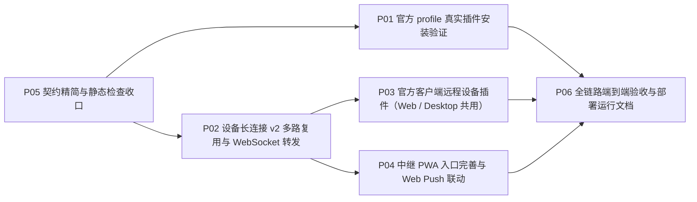

# 实现说明与工作包交付清单（P01–P06）

本文件面向执行具体开发的 agent，规定当前基线现状、六个可独立委派的工作包（P01–P06）的依赖顺序、精确修改文件范围、接口契约、遥测要求与可复现验收命令。

执行任何工作包时必须严格遵守 [AGENTS.md](../../AGENTS.md) 全部规则：代码追求 fast-fail、禁止使用 mock 或假实现绕过验收、禁止写入 `/tmp`、禁止用 Git 回滚代码、禁止以脚本程序化编辑源码、所有功能与对应遥测必须在同一次交付中完成并通过真实运行验证。

---

## 一、当前代码基线现状

仓库已完成第一阶段结构裁剪，废弃的多代模块（`hermes-adapter`、`hindsight-adapter`、`forge-bridge`、`desktop`、`mobile`、`profiles`、`packages/tool/*`、`packages/preset/*`、业务管理面板及控制平面非中继模块）已整体移除。

当前保留并作为本轮开发起点的模块地图：

| 区域 | 路径 | 当前状态 |
|---|---|---|
| 顶层适配层 | [dsh-adapter/](../../dsh-adapter/) | 已收窄至 7 个 DSH peer 依赖，6 项单元测试通过 |
| 核心基础包 | [runtime/packages/core/](../packages/core/) | `diagnostics` 与 `remote-client` 精简完备；`contracts` 待 P05 清理废弃领域类型文件 |
| 宿主插件 | [runtime/packages/host/](../packages/host/) | `telemetry`、`push`、`import`、`settings-sync` 已就位；`device-link` 目前实现 v1 单次帧转发，待 P02 补齐 v2 多路复用通道与 WebSocket 升级 |
| 客户端插件 | [runtime/packages/client/](../packages/client/) | `telemetry` 与 `pwa` 已就位；官方客户端远程设备侧栏与状态条插件 `remote` 待 P03 实现 |
| 纯附加组合包 | [runtime/packages/bundle/chatdsh/](../packages/bundle/chatdsh/) | 已声明纯 `insert` 补丁层与完整依赖，待 P01 在官方 profile 下完成真实 `dsh plugin add` 验收 |
| 轻量中继服务端 | [runtime/gateway/](../gateway/) | 已剥离所有非中继模块，保留设备长连接枢纽（v2 通道协议已在 [device-link.ts](../gateway/src/device-link.ts) 实现）、副本、回执、导入、设置同步、通知推送、访问认证与 PWA 静态入口；`/d/<deviceId>/*` 的 WebSocket 隧道转发待 P02 接通 |

---

## 二、工作包总览与依赖顺序



建议并行方式：先完成 **P05**，随后 **P01** 与 **P02** 并行推进，**P02** 完成后 **P03** 与 **P04** 并行推进，最后由 **P06** 完成全链路联调与交付验收。

---

## 三、逐工作包详细交付规范

### P05：核心契约精简与静态检查全绿

**目标**：清理 `@chatdsh/core-contracts` 中已裁撤领域的废弃类型文件，修复所有静态检查脚本，使精简后的工作区在构建、类型检查、单元测试与四项静态检查下全部退出码为 0。

**涉及文件**：
- [runtime/packages/core/contracts/src/](../packages/core/contracts/src/)：保留被留存包实际引用的文件（`errors.ts`、`primitives.ts`、`operations.ts`、`client-state.ts`、`pagination.ts`、`content-scope.ts`、`drafts.ts`、`fork.ts`、`access.ts`、`notifications.ts`、`devices.ts`、`settings.ts`、`navigation.ts`、`node.ts`、`telemetry.ts`、`session-events.ts`），删除废弃领域文件（`memory-backend.ts`、`memory-groups.ts`、`chat-backend.ts`、`model-backend.ts`、`mcp.ts`、`artifacts.ts`、`artifact-versions.ts`、`automation.ts`、`automation-delivery.ts`、`data-management.ts`、`exports.ts`、`shares.ts`、`tool-tiers.ts`、`questions.ts`、`approvals.ts`、`approval.ts`、`assembly.ts`、`services.ts`、`coverage.ts`、`message-sources.ts`——删除前先 grep 确认留存源码无引用，若有少量共用常量则迁入 `primitives.ts` 或 `errors.ts`）并同步更新 `index.ts`。
- [runtime/scripts/check-telemetry.mjs](../scripts/check-telemetry.mjs)
- [runtime/scripts/check-plugin-contract.mjs](../scripts/check-plugin-contract.mjs)
- [runtime/scripts/check-upstream-names.mjs](../scripts/check-upstream-names.mjs)
- [runtime/scripts/check-layering.mjs](../scripts/check-layering.mjs)
- [runtime/scripts/build-client.mjs](../scripts/build-client.mjs)
- [runtime/e2e/unit/](../e2e/unit/)：修复因 `gateway` 去除 `runtimeUrl`、`llmGateway`、`backupRoot` 字段或契约精简导致的测试导入适配，不删除有效断言。

**遥测要求**：确保留存的全部包源码、`package.json` 的 `chatdsh.telemetry` 与 [telemetry.md](telemetry.md) 第六节三处完全一致。

**验收命令**：
```bash
cd /workspace/chatdsh/runtime
pnpm build && pnpm build:client
pnpm check:telemetry && pnpm check:plugins && pnpm check:upstream-names && pnpm check:layering
pnpm test
```
全部命令退出码为 0。

---

### P01：官方 profile 真实插件安装验证与极简升级脚本

**目标**：验证 `@chatdsh/bundle` 在完全干净的官方默认 `web` profile 中，通过真实的 `dsh plugin --profile web add` 命令一键安装、零补丁警告加载、全部宿主插件与客户端插件真实激活，并提供极简的 `upgrade-dsh.mjs` 升级验证入口。

**涉及文件**：
- 新建 `runtime/scripts/verify-plugin-install.mjs`
- 更新 [runtime/scripts/upgrade-dsh.mjs](../scripts/upgrade-dsh.mjs)
- 检查并按实测修正 [runtime/packages/bundle/chatdsh/package.json](../packages/bundle/chatdsh/package.json) 与 [runtime/packages/bundle/chatdsh/cordis.patch.yml](../packages/bundle/chatdsh/cordis.patch.yml)

**关键实现要求**：
1. 在临时隔离目录（`runtime/.run/` 下由 `scripts/lib/cleanup.mjs` 的 `tempHome` 创建，严禁使用 `/tmp`）设置 `DSH_HOME`，初始化官方默认 `web` profile。
2. 真实调用 `dsh plugin --profile web add <@chatdsh/bundle 绝对路径>` 安装组合包。若发现 `workspace:*` 在 `dsh plugin add` 指向本地目录时无法被独立 profile 的 pnpm 解析，先将 `@chatdsh/bundle` 及其 workspace 依赖打成临时本地 tarball（`pnpm pack`）或通过本地 registry / file 依赖验证，确保**最终发布到 npm 或本地 tarball 安装时一步成功且无需任何仓库内硬编码符号链接**。
3. 运行 `dsh --profile web --dump-config` 核对：退出码 0、标准错误无未匹配补丁警告、展开的配置树包含 `@chatdsh/bundle` 插入的全部 7 个条目，且不包含任何 `disabled: true` 覆盖上游行。
4. 启动真实 `dsh --profile web --no-open` 实例：
   - 核对 `GET /chatdsh/telemetry/status` 返回 200 且 `enabled` 符合环境配置；
   - 核对首页 `window.__DSH_BOOT__` 模块图包含 `@chatdsh/client-telemetry` 与 `@chatdsh/client-pwa`，且按其 `/plugins/<id>/client.js` 地址请求均返回 200；
   - 以 `CHATDSH_TELEMETRY=off` 再次启动同一 profile，核对 `GET /chatdsh/telemetry/status` 返回 `enabled: false` 与 `reason: "env"`，且 `POST /chatdsh/telemetry/browser` 返回 404。
5. 重写 [runtime/scripts/upgrade-dsh.mjs](../scripts/upgrade-dsh.mjs)，移除所有旧 `profiles/chatdsh-*` 更新逻辑，改为顺序执行：读取 `dsh --version` -> 投影并构建 `dsh-adapter` -> 投影并构建 `runtime` 与客户端产物 -> 执行四项静态检查、单元测试与 `verify-plugin-install.mjs`。

**验收命令**：
```bash
cd /workspace/chatdsh/runtime
pnpm verify:plugin-install
node scripts/upgrade-dsh.mjs
```

---

### P02：设备出站长连接 v2 多路复用通道与 WebSocket 转发补齐

**目标**：打通设备端 `@chatdsh/host-device-link` 与中继端 `@chatdsh/gateway` 之间的版本 2 多路复用通道协议，同时支持 `/d/<deviceId>/*` 的流式 HTTP 与 `/d/<deviceId>/api/remote.mux` WebSocket 双向隧道转发，使浏览器或 PWA 通过中继访问远程设备官方 DSH 页面时能够实时建立 Remote 会话流、发送消息与应答审批。

**涉及文件**：
- [runtime/packages/host/device-link/src/index.ts](../packages/host/device-link/src/index.ts)（可拆分 `v2-channel.ts` 保持单文件简洁）
- [runtime/gateway/src/device-link.ts](../gateway/src/device-link.ts)（已包含 v2 帧类型、窗口流控与通道管理，需核对 WebSocket 隧道对外 API）
- [runtime/gateway/src/server.ts](../gateway/src/server.ts)（替换 `upgrade` 事件中 `DEVICE_PREFIX_PATH` 的 501 拒绝分支为真实 v2 `websocket` 通道桥接）
- 补充单元与端到端测试：[runtime/e2e/unit/device-link.test.mjs](../e2e/unit/device-link.test.mjs)、[runtime/scripts/verify-device-link.mjs](../scripts/verify-device-link.mjs)、[runtime/scripts/verify-routing.mjs](../scripts/verify-routing.mjs)

**关键契约与实现细节**：
1. **握手升级**：`host-device-link` 建链后发送 `{ type: 'hello', version: 2, deviceId, capabilities: ['http', 'websocket'] }`，接收并响应 `ping`/`pong` 心跳。
2. **HTTP 通道（`kind: 'http'`）**：按 `open` -> `accepted` -> 分块 `data`（单片上限 32 KiB，受 `credit` 窗口约束）-> `end` 执行，支持请求与响应流式传输、客户端断开时发送 `cancel` 并回传 `cancelled`，沿帧头透传 `traceparent` 与 `tracestate`。
3. **WebSocket 通道（`kind: 'websocket'`）**：
   - 中继收到 `/d/<deviceId>/<rest>` 的 `upgrade` 请求时，校验路径位于白名单 `DEVICE_UPGRADE_PATHS`（`/api/remote.mux`）且设备在线（离线回 `409 device-offline`，路径越界回 `403 path-invalid`）。
   - 沿 v2 通道下发 `open`（`kind: 'websocket'`），设备端向本机运行时 `http://127.0.0.1:<port>/api/remote.mux` 发起真实 WebSocket 升级（自动补发 `credentialFor(credential, '/api/remote.mux')` 的 `dsh-auth-*` cookie 与改写后的 `Host`/`Origin`）。
   - 升级成功后设备端回复 `accepted`（含 101 状态与响应头），中继向浏览器回写 101 握手并双向按 `data` 帧转发原始 WebSocket 帧字节；任一侧关闭或超时时通过 `end`/`reset` 干净释放双方套接字，不泄漏连接句柄。
4. **遥测要求**：复用已有信号 `chatdsh.gateway.device.proxy`、`chatdsh.runtime.device.forward`、`chatdsh.gateway.device.rejected`、`chatdsh.runtime.device.forward.failed`、`chatdsh_gateway_device_proxies_total`、`chatdsh_runtime_device_forwards_total`，区分 `outcome: "upgraded" | "forwarded" | "device-offline" | "path-invalid" | "upgrade-rejected"`，禁止记录帧内载荷与凭据。

**验收命令**：
```bash
cd /workspace/chatdsh/runtime
pnpm build
node --test e2e/unit/device-link.test.mjs e2e/unit/device-routing.test.mjs e2e/unit/client-complete-wp04-*.test.mjs
pnpm verify:device-link && pnpm verify:routing
```
必须包含真实浏览器或 WebSocket 客户端经中继 `/d/<deviceId>/api/remote.mux` 穿过设备长连接连通本地回环 WebSocket 服务端并完成双向收发与断开清理的断言。

---

### P03：官方客户端远程设备插件（`@chatdsh/client-remote`，Web 与 Desktop 共用）

**目标**：交付面向官方 DSH Web 端与官方 Desktop 端的浏览器侧插件 `@chatdsh/client-remote`，在不修改官方布局结构的前提下，通过官方客户端席位提供多设备状态感知、远程设备切换、离线只读副本查阅、本机继续导入以及中继配对设置区段。

**涉及文件**：
- 新建 `runtime/packages/client/remote/`（`package.json`、`tsconfig.json`、`src/index.ts`、`src/client/index.ts` 及子模块）
- 将 `@chatdsh/client-remote` 纳入 [runtime/packages/bundle/chatdsh/package.json](../packages/bundle/chatdsh/package.json)、[runtime/packages/bundle/chatdsh/cordis.patch.yml](../packages/bundle/chatdsh/cordis.patch.yml) 与 [runtime/tsconfig.build.json](../tsconfig.build.json)
- 在 [runtime/docs/telemetry.md](telemetry.md) 第六节登记新增信号（若有）并在包内 `chatdsh.telemetry` 声明
- 编写对应单元测试与构建验证

**关键设计约束（确保 Web 端与 Desktop 端同时生效）**：
1. **声明契约**：`package.json` 声明 `"dsh": { "client": { "platform": "web", "inject": ["@deepseek-ai/dsh-client-ui-renderer", "@deepseek-ai/dsh-client-ui-sidebar", "@deepseek-ai/dsh-client-ui-settings"] } }`（实施前通过本机 `$DSH/node_modules/@deepseek-ai/dsh-web-app/cordis.patch.yml` 核对精确席位名与注入包名，并将引用的上游界面包名同步登记至 [dsh-adapter/src/upstream.ts](../../dsh-adapter/src/upstream.ts)）。
2. **禁止假设浏览器 `window.location.origin`**：在官方 Desktop 客户端中页面可能运行在自定义协议或本机随机回环端口，插件通过本机宿主插件暴露的同源接口（或设置中配置的 `controlUrl`）与中继服务端通信，不硬编码相对根路径。
3. **复用官方样式语言**：全部颜色、字号、边框与圆角直接使用官方 DSH 客户端的 CSS 变量，不引入独立样式库，不覆盖官方类名。
4. **核心界面功能**：
   - **侧栏「设备」面板入口**：列出中继登记的全部设备（名称、平台、在线/离线状态点、最近活动时间）与各设备聚合会话；
   - **远程继续动作**：点击在线远程设备或其会话时，在当前界面打开该设备的 `/d/<deviceId>/` 入口或切换远程目标；
   - **离线副本只读视图**：点击离线设备的会话时，调用 `GET /chatdsh/gateway/replica?sessionId=<id>` 渲染只读对话历史，明确标出「设备离线 · 只读副本」，提供「在本机继续」按钮调用本机 `chatdshImport.fork` 创建继承 `parentSession` 的新本地会话；
   - **对话顶部远程状态提示条**：当页面经 `/d/<deviceId>/` 打开时显示当前执行设备名称与「返回本机」入口；
   - **设置区段**：展示当前中继连接状态、设备标识、配对接入入口（输入中继地址与一次性配对码）与遥测开关状态。
5. **遥测要求**：复用 `chatdsh.client.remote.call`、`chatdsh.client.ui.action`、`chatdsh.client.error`、`chatdsh_client_errors_total`，上报经同源 `POST /chatdsh/telemetry/browser`，不记录节点令牌与配对码原文。

**验收命令**：
```bash
cd /workspace/chatdsh/runtime
pnpm build && pnpm build:client
pnpm check:telemetry && pnpm check:plugins && pnpm check:upstream-names && pnpm check:layering
pnpm verify:plugin-install
```
核对 `@chatdsh/client-remote` 出现在官方 `web` profile 的 `window.__DSH_BOOT__` 模块图中且 `/plugins/<id>/client.js` 可取回执行无控制台错误。

---

### P04：中继服务端 PWA 入口完善与 Web Push 通知联动

**目标**：完善轻量中继服务端根路径 `/` 提供的移动端 PWA 体验，将其打造成独立的手机端浏览器与主屏幕入口，实现设备在线状态展示、点击在线设备进入 `/d/<deviceId>/` 官方 DSH 界面、点击离线设备查看结构化只读对话历史、离线本地草稿保存以及审批提醒的 Web Push 订阅与自动撤回联动。

**涉及文件**：
- [runtime/gateway/src/server.ts](../gateway/src/server.ts)（将根路径 PWA 页面抽离至 `runtime/gateway/src/pwa-page.ts`，完善移动端窄屏布局、会话只读渲染与 SSE 实时刷新）
- [runtime/packages/client/pwa/](../packages/client/pwa/)（核对并衔接 `pwaStaticContent`、`manifest.ts`、`service-worker.ts`、`drafts.ts`、`mobile-layout.ts`）
- [runtime/gateway/src/notifications/](../gateway/src/notifications/)（核对 Web Push 订阅注册、验证通知与 `approval/decided` 撤回链路）
- 端到端验收脚本：[runtime/scripts/verify-approval-notify.mjs](../scripts/verify-approval-notify.mjs)、[runtime/scripts/verify-receipt-sync.mjs](../scripts/verify-receipt-sync.mjs)、[runtime/scripts/verify-multi-client.mjs](../scripts/verify-multi-client.mjs)

**关键实现要求**：
1. **结构化离线副本渲染**：PWA 副本视图解析 `user/message`、`assistant/message`、`tool/call`、`tool/result`、`approval/asked`、`approval/decided` 事件，按时间顺序清晰展示对话内容与工具状态，严禁直接倾倒原始 JSON。
2. **离线只存草稿、不自动重发**：设备离线或网络中断时，输入框内容保存在 IndexedDB 草稿区，发送按钮禁用并明确提示「设备离线，恢复连接后由你手动发送」。
3. **审批通知实时联动**：PWA 订阅 `/chatdsh/gateway/events` SSE 与可选 Web Push 订阅端点；收到 `kind: "approval"` 通知时高亮展示待审批会话并一键跳往对应在线设备 `/d/<deviceId>/`；收到撤回通知时立即清除待审批红点。
4. **窄屏适配注入**：当手机浏览器经 `/d/<deviceId>/` 打开远程设备官方 DSH 页面时，目标设备上安装的 `@chatdsh/client-pwa` 生效并应用窄屏抽屉布局与安全区适配。
5. **遥测要求**：延续 `chatdsh.gateway.notification.*`、`chatdsh.push.*`、`chatdsh.client.boot`、`chatdsh.client.ui.action` 与 `chatdsh_push_*` 指标，保持内容边界不记录消息正文与订阅密钥。

**验收命令**：
```bash
cd /workspace/chatdsh/runtime
pnpm build && pnpm build:client
node --test e2e/unit/client-complete-wp21-notifications.test.mjs e2e/unit/client-complete-wp22-notifications.test.mjs e2e/unit/client-complete-wp31-logic.test.mjs e2e/unit/gateway-push-escalation.test.mjs
pnpm verify:approval-notify && pnpm verify:receipt-sync && pnpm verify:multi-client
```

---

### P06：全链路端到端联调验收与部署运行文档

**目标**：完成多台设备（模拟两台独立官方 DSH 运行时）连接同一个轻量中继服务端的全链路真实验收，核对遥测开启与关闭双态，补充面向最终用户的单机/家庭服务器一键部署与配对指南。

**涉及文件**：
- 核对并更新全部保留验收脚本：[verify-device-link.mjs](../scripts/verify-device-link.mjs)、[verify-routing.mjs](../scripts/verify-routing.mjs)、[verify-settings-sync.mjs](../scripts/verify-settings-sync.mjs)、[verify-approval-notify.mjs](../scripts/verify-approval-notify.mjs)、[verify-import.mjs](../scripts/verify-import.mjs)、[verify-receipt-sync.mjs](../scripts/verify-receipt-sync.mjs)、[verify-multi-client.mjs](../scripts/verify-multi-client.mjs)、[verify-mobile-telemetry.mjs](../scripts/verify-mobile-telemetry.mjs)、[verify-plugin-install.mjs](../scripts/verify-plugin-install.mjs)
- 同步更新根 [README.md](../../README.md) 与 [runtime/README.md](../README.md) 的实测运行步骤与环境变量清单

**全链路验收场景清单（每条均需真实进程与可复现命令证据）**：
1. **真实官方 profile 安装**：官方 `web` profile 经 `dsh plugin add` 装入 `@chatdsh/bundle`，无警告启动，客户端插件产物加载正常。
2. **双设备配对与远程转发**：设备 A 与设备 B 配对获取节点令牌并建立 v2 出站长连接，通过中继 `/d/<A>/` 与 `/d/<B>/` 分别完成 HTTP 与 `/api/remote.mux` WebSocket 转发；断开设备 B 后 `/d/<B>/` 返回 `409 device-offline`。
3. **副本上报、离线浏览与本机继续**：设备 A 产生会话事件并上报副本至中继，断开设备 A 后从 PWA 查询副本完整可读，调用设备 B 的 `chatdshImport.fork` 成功在设备 B 创建带 `parentSession` 的新会话。
4. **白名单设置跨设备同步**：在设备 A 修改白名单设置（如语言或默认模型），中继落库并推送至设备 B 写入其 `$DSH_HOME/cordis.patch.yml`，非白名单设置（如工作目录）不跨设备传播。
5. **审批提醒与自动撤回**：副本上报 `approval/asked` 触发通知推送，随后上报 `approval/decided` 自动撤回尚未投递的提醒。
6. **遥测双态验收**：开启时 `node scripts/telemetry-probe.mjs` 通过且跨中继-设备链路的 `traceparent` 贯通；以 `CHATDSH_TELEMETRY=off` 启动时零 SDK 构造、上报端点返回 404。

---

## 四、通用禁止事项（所有工作包共同遵守）

- 禁止重新引入自定义 `profiles/chatdsh-*`、自建 Electron 桌面壳、自建 iframe 外壳、自建模型路由或自建记忆/业务管理面板。
- 禁止在 `@chatdsh/bundle/cordis.patch.yml` 中使用 `disabled: true` 禁用任何 DSH 上游条目，禁止覆写上游既有配置行。
- 禁止在业务包中直接 `import` `@deepseek-ai/*` 内部包或 `@opentelemetry/sdk-*`。
- 禁止把节点令牌、配对码、Cookie、提示词、会话正文或工具原文写入遥测属性或配置树。
- 禁止用 mock 对象替代真实中继进程、真实 SQLite 或真实 `dsh` 命令通过验收。
