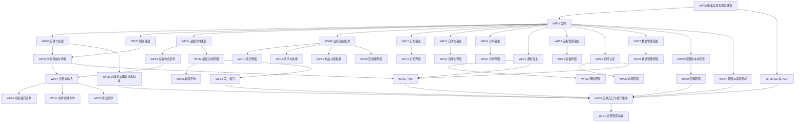

# 客户端实施工作包与验收标准

## 1. 委派契约

每个工作包以[完整交互规格](<client-complete-spec.md>)中的场景和 AC 编号为输入，以真实实现、测试、遥测及复现证据为输出。[完整设计稿](<ui-design/complete.html>)提供 S01–S32 多场景入口；画板中的示例数据与交互不能作为业务成功证据。实现程度基线见[功能清单](<ui-feature-inventory.md>)与[验收状态](<acceptance.md>)。

任务领取遵循读取任务、使用当前 revision 认领、实施、验证、完成的顺序。每个任务登记预期写入范围；修改前读取文件并保留用户已有修改。普通工作包只修改自己的目录、新建测试文件和自己的包清单。公共入口、统一契约导出、构建配置、profile 与遥测总清单由指定集成工作包顺序修改。测试只写项目内独立且已忽略的数据根，不读取参考目录，不主动使用视觉功能，不使用替身代替真实系统通过验收。

所有工作包共同完成条件：

1. 满足对应场景全部字段、动作和适用状态，以及 AC-G01–G12；错误分支有真实服务条件和可复现断言。
2. 写入携带版本及操作标识；返回失败保留用户输入，结果不确定时查询实际结果；重试不重复写入。
3. 离线仅保留草稿，目标离线写入明确失败，不自动重发。在线执行队列在失联时暂停，恢复后由用户显式处理。
4. 无账号表；访问认证、访问客户端和执行节点各自使用对应契约。不显示副本水位和同步档位。
5. 每个对外动作具备 span、失败事件和 `_total` 指标，通过统一遥测客户端生成；登记名称与包声明同步，关闭行为完整。遥测内容遵循[遥测规范](<telemetry.md>)。
6. 自动化输出包含环境版本、命令、退出码、断言、实际数据来源、清理结果和未满足条件；缺失条件明确保留，不能声明验收通过。

## 2. 基线与任务输入

已核验的实际实现包括[外壳](<../packages/client/shell/src/client/index.ts>)、[控制平面页面](<../gateway/src/shell.ts>)、[聚合会话](<../gateway/src/sessions.ts>)、[控制平面路由](<../gateway/src/server.ts>)、[共享组件](<../packages/core/ui-kit/src/components.tsx>)、[桌面主进程](<../desktop/electron/main.mjs>)及[预加载桥](<../desktop/electron/preload.cjs>)。

业务域已有[项目](<../packages/host/projects/src/domain.ts>)、[助手](<../packages/host/assistants/src/domain.ts>)、[制品](<../packages/host/artifacts/src/domain.ts>)、[连接器](<../packages/host/connectors/src/domain.ts>)的数据声明。[自动化界面](<../packages/client/automation/src/client/index.tsx>)直接调用控制平面且支持 PATCH 启停；完整 CRUD、目标设备、投递结果仍须实施。[记忆界面](<../packages/client/memory/src/client/index.tsx>)当前只有状态入口；[会话恢复](<../packages/host/import/src/index.ts>)已有种子转换与 `parentSession` 创建。[设置同步](<../packages/host/settings-sync/src/index.ts>)已有白名单上报和 home 层写入。

版本和 profile 组合须使用[文档总纲](<README.md>)的统一取法，兼容判定遵循[兼容性设计](<compatibility.md>)。运行时、适配层和 TUI 版本不一致时，版本任务完成前不得宣告 CLI 验收通过。

## 3. 依赖与解锁



图中业务界面同时依赖 WP02、WP03 的公共能力。所有 WP05–WP38 都是 WP39 的验收前置；WP38 对已完成业务执行增量验证，全部业务完成后执行完整检查。每个工作包必须读取本节和对应工作包的具体依赖，禁止仅依靠图中省略的连线领取未解锁任务。

WP39 建立按领域编号的集成子任务，领域实现可独立编译并通过服务层检查后，提交对应集成子任务接入入口；真实界面验收依赖该子任务完成。公共文件由单个集成执行者顺序处理，下一项集成子任务依赖前一项完成。领域工作包的“实现完成”与“真实验收完成”分别登记；领域任务在自身集成子任务和真实验收结束后才能关闭。WP39 总任务负责最终发行与全量检查，其依赖指向领域任务，避免将公共入口接入延迟到全部真实验收结束之后。

### 3.1 新增目录与文件分配

以下路径是目标新增范围，创建前检查实际工作区；已经存在时先读取并重新登记任务范围。每个新增包的清单、源码和测试由相同工作包负责，统一工作区配置由 WP39 修改。

| 工作包 | 目标新增范围 |
|---|---|
| WP03 | `gateway/src/client-http.ts`、`gateway/src/client-errors.ts`、`gateway/src/client-security.ts` |
| WP06 | `packages/client/session-bridge/` |
| WP07 | `packages/client/conversation/`，内部按 `messages`、`composer`、`queue`、`commands`、`references` 分模块 |
| WP08 | `packages/client/approval/src/client/takeovers.tsx`，审批目录其余文件保持本任务范围 |
| WP14 | `packages/client/workspace-tools/`、`packages/host/attachments/`、`packages/host/voice/` |
| WP17 | `gateway/src/automation-routes.ts`、`packages/host/schedule-ui/` |
| WP19 | `gateway/src/shares.ts`、`gateway/src/share-routes.ts` |
| WP21 | `gateway/src/notifications.ts`、`gateway/src/web-push.ts`、`gateway/src/notification-routes.ts` |
| WP22 | `packages/client/notifications/`、`desktop/electron/notifications.mjs` |
| WP23 | `gateway/src/device-lifecycle.ts`、`gateway/src/device-routes.ts` |
| WP25 | `gateway/src/access/`，分别承载策略、会话、WebAuthn、TOTP 与恢复码 |
| WP26 | `packages/client/access/` |
| WP27 | `gateway/src/data-management.ts`、`gateway/src/data-routes.ts`、`gateway/src/replica-retention.ts` |
| WP28 | `packages/client/data-management/` |
| WP29 | `gateway/src/settings-revisions.ts` |
| WP30 | `packages/client/settings-enhancements/` |
| WP31 | `packages/client/pwa/`、`packages/client/responsive/` |
| WP33 | `packages/client/computer-permissions/`、`desktop/electron/computer-permissions.mjs` |
| WP34 | `packages/client/window-layout/`、`desktop/electron/windows.mjs` |
| WP35 | `packages/client/exports/`、`packages/host/exports/` |
| WP36 | `packages/client/cli/` |
| WP37 | `packages/client/diagnostics/` |
| WP38 | `e2e/client-complete/`，覆盖场景、键盘、布局和真实辅助技术证据 |

WP32 的桌面目录范围明确排除 WP22、WP33、WP34 的新增文件；对应入口接入由 WP39 在 WP32 完成后处理。各工作包新增测试统一命名 `e2e/unit/client-complete-wpNN-*.test.mjs`，只修改自己的编号；全量运行器和公共测试辅助接口由 WP00、WP38、WP39 按范围负责。

## 4. 基础与会话工作包

### WP00 版本、真实测试环境与证据目录

- 依赖：无。
- 写入范围：[运行测试辅助目录](<../e2e/lib/>)、新增环境检查测试；版本变更涉及[适配层](<../../dsh-adapter/>)和[CLI profile](<../profiles/chatdsh-cli/>)时，单独登记范围并与 WP39 顺序执行。
- 输入：当前 Node、DSH、TUI、浏览器、操作系统和真实外部服务实测结果；[兼容性设计](<compatibility.md>)。
- 输出：已验证版本组合、两个真实执行设备、独立数据根、真实模型/Hindsight/MCP/Web Push 的连接检查和可复制启动命令。测试目录权限、退出清理、用户数据隔离必须有断言。
- 验收：AC-G12、AC-S32 的版本条件；环境检查失败立即停止对应验证，输出缺失的服务或平台。现有清理工具参考[测试数据根辅助实现](<../scripts/lib/cleanup.mjs>)，新脚本检查真实绝对目标后执行清理。

### WP01 客户端领域契约

- 依赖：WP00。
- 写入范围：[统一契约目录](<../packages/core/contracts/src/>)；本任务独占该目录直至接口批准。后续需要扩展时建立契约子任务并暂停依赖方修改该目录。
- 输入：完整交互规格全部字段与错误语义，既有[会话契约](<../packages/core/contracts/src/session-events.ts>)和[自动化契约](<../packages/core/contracts/src/automation.ts>)。
- 输出：schema/类型、操作幂等、`revision`、分页、内容范围、访问认证、通知、设备撤销、记忆组、导出、设置与导航消息契约。定义成功、失败、冲突、未确认和具体错误码；内部游标与 UI DTO 分离，禁止 UI DTO 暴露副本水位。
- 验收：AC-G10；客户端/宿主共享 schema 往返验证，未知枚举和缺少关联键直接拒绝；成熟 JSON/YAML/cron 解析依赖明确。提供字段到 S01–S32 的契约清单，所有未来扩展字段标记为待实施。

### WP02 组件、主题、高对比度与响应式

- 依赖：WP01。
- 写入范围：[共享 UI 包](<../packages/core/ui-kit/>)、[主题客户端](<../packages/client/theme/>)；新增该领域测试。
- 输出：字段、错误摘要、按钮、列表、表格、对话框、抽屉、菜单、命令面、页签、树、进度、Toast 与错误边界；暗色/亮色/高对比度、`forced-colors`、减少动态效果、焦点和响应式令牌。
- 验收：AC-G01–G07；计算样式验证正文 4.5:1、重要标题 7:1、图形和焦点 3:1；每种组件键盘操作、焦点恢复、触控尺寸、320–1440 宽度重排。既有[令牌检查](<../scripts/check-ui-kit-tokens.mjs>)、[对比度检查](<../scripts/check-ui-contrast.mjs>)和[动效检查](<../scripts/check-ui-motion.mjs>)均须保持通过。

### WP03 控制平面客户端 HTTP 基础

- 依赖：WP01。
- 写入范围：新建网关客户端路由/错误/认证中间模块和领域测试；允许定向修改[网关页面模块](<../gateway/src/shell.ts>)及[会话聚合模块](<../gateway/src/sessions.ts>)。禁止修改公共路由主文件，由 WP39 接入。
- 输出：分页检索、准确标题/未读/归属 DTO、统一错误结构、请求标识、CSRF、同源和对象访问验证、无缓存头；私有内容与静态壳资源分离。
- 验收：AC-S01、AC-S02、AC-G10；真实 HTTP 读取两个设备数据、未认证/越权/未知对象拒绝、设备离线不转交宿主执行；DTO 无副本水位。

### WP04 设备实时通道与前缀路由

- 依赖：WP01、WP03；WP03 完成后修改共同边界。
- 写入范围：[设备长连接](<../gateway/src/device-link.ts>)、[WebSocket 模块](<../gateway/src/websocket.ts>)、[设备插件查询](<../gateway/src/device-plugins.ts>)、[设备宿主插件](<../packages/host/device-link/>)及对应测试。
- 输出：按设备的实时帧多路复用、断线关闭、背压、请求取消、代次、事件去重与前缀资源路径；禁止设备离线时退回默认运行时。对带前缀的 `remote.mux` 提供完整升级及错误状态。
- 验收：AC-S01–S04、AC-G09；两台真实运行时各自产生事件与调用，断开其一不污染另一设备；关闭连接释放订阅，撤销后拒绝升级；trace 跨边界可查询。

### WP05 聚合外壳、导航、创建、继续与草稿

- 依赖：WP02、WP03、WP04、WP01 的 fork/草稿契约。
- 写入范围：[外壳客户端](<../packages/client/shell/>)；新增外壳集成测试。WP34 只新增窗口能力模块，公共入口修改在本任务完成后由 WP39 接入。
- 输出：逻辑路由、历史导航、同名工作区、检索、设备状态、准确选择、创建向导、远程/本机继续、fork 预估与离线只读入口；安全的本地草稿存储和失效状态。
- 验收：AC-S01–S03、AC-S06、AC-S27；真实双设备创建与跳转指定会话，离线发送失败且没有待发任务，恢复无自动发送；换设备和未保存离开保护草稿，旧响应不能污染新设备。

### WP06 设备内导航与内容席位桥

- 依赖：WP01、WP02、WP04。
- 写入范围：新建独立客户端桥包与对应测试，向[客户端插件目录](<../packages/client/>)追加包；新增包接入由 WP39 修改 profile。
- 输出：iframe 与外壳握手、准确选中会话确认、设备/会话标题、焦点跨 iframe 跳转、能力清单、只读与离线状态传递；通过上游席位追加能力，禁止改写安装产物。
- 验收：AC-S01、AC-S06、AC-G01、AC-G02、AC-G10；错误 `origin/source/schema` 消息拒绝，切换同设备会话不展示错误会话，导航确认超时可重试且不写入会话。

### WP07 会话呈现、输入、命令、引用与在线队列

- 依赖：WP02、WP05、WP06；Hermes 实时与历史验收依赖 SYS05、SYS06 的对应运行子能力，普通 DSH 会话可独立实施。
- 写入范围：新建会话增强客户端包与测试；输入、流式、队列、引用和命令实现拆分独立源模块。
- 输出：S01、S05、S06、S07 的文本/消息/工具/轨迹/反馈、命令面板、触发面板、IME、引用对象、在线队列、准确停止、来源标记与长会话呈现。
- 验收：AC-S01、AC-S05–S07；真实模型流式、输入法组合、消息反馈、命令执行及引用失效。断线后队列暂停，恢复不自动发送；已确认消息按标识查询而不重复提交。工具截断存在完整读取入口，读屏无 token 级连续打断。

### WP08 审批、提问与计划接管

- 依赖：WP01、WP02、WP06、WP07。
- 写入范围：[审批客户端](<../packages/client/approval/>)、[审批宿主](<../packages/host/approval/>)；提问/计划增强的独立新增模块及测试。
- 输出：单次决定、会话策略确认、全局待处理、统计、竞争终态、失效卡片、输入接管与草稿恢复。
- 验收：AC-S04、AC-S05；两个真实客户端竞争同一 `callId` 只成功一次，离线和过期拒绝应答，接管只显示一处编辑区域；拒绝决定到达真实工具等待者。

## 5. 业务能力工作包

### WP09 项目、助手、制品与连接器宿主扩展

- 依赖：WP01。
- 写入范围：[项目宿主](<../packages/host/projects/>)、[助手宿主](<../packages/host/assistants/>)、[制品宿主](<../packages/host/artifacts/>)、[连接器宿主](<../packages/host/connectors/>)、[技能宿主](<../packages/host/skills/>)、[模型提供方宿主](<../packages/host/model-provider/>)、[模型路由宿主](<../packages/host/llm-router/>)、[上下文占用宿主](<../packages/host/context-insights/>)；每个目录可再分配独立子任务。Hermes 适配、全历史和实时运行桥由 SYS05 独占，运行期后端分支由 SYS06 负责，WP09 只消费其统一状态与来源。
- 输出：完整字段校验、版本/并发控制、原子助手装配、项目默认助手扩展、制品安全读取/版本、技能启停真实状态、MCP 运行状态与测试权限、模型清单/额度/固定会话模型、Hermes 发送时判断与来源记录、全会话上下文查询；明确读取失败与未启用差异。
- 验收：AC-S01、AC-S09–S11、AC-S13、AC-S20；真实持久化、重启恢复、过期 revision 拒绝、装配失败保留原定义；MCP 停用后工具移除、同步失败可以查询；真实模型额度和 Hermes 不可达条件产生正确业务结果与“本地执行”来源。依赖只用本包范围修改，公共契约扩展交 WP01 子任务。

### WP10 项目完整界面

- 依赖：WP02、WP03、WP09。
- 写入范围：[项目客户端](<../packages/client/projects/>)及项目界面测试。
- 输出：列表、搜索、详情、新建/编辑/删除、默认模型/助手、从项目开始会话、未保存和冲突保护。
- 验收：AC-S10；真实 CRUD 与目录存在性检查，名称为空按目录末段显示，删除只影响配置；S10 场景的加载、空、错误、离线、冲突与危险动作逐项覆盖。

### WP11 助手和技能完整界面

- 依赖：WP02、WP03、WP09。
- 写入范围：[助手客户端](<../packages/client/assistants/>)、[技能客户端](<../packages/client/skills/>)及各自测试，可按目录分别委派。
- 输出：助手详情/CRUD/工具装配说明和技能来源搜索/启停；进行中会话定义固定，删除不破坏已运行会话。
- 验收：AC-S11、AC-S07 技能部分；真实装配失败、重名、超限、启停失败及重启恢复；引用面板从服务器读取技能状态。

### WP12 制品、图片和 PDF 查看器

- 依赖：WP02、WP03、WP09。
- 写入范围：[制品客户端](<../packages/client/artifacts/>)及查看器测试。
- 输出：过滤、版本、安全 HTML、图片工具栏、成熟 PDF 查看器、完整下载/外部打开与全部版本删除确认。
- 验收：AC-S09；真实多版本字节校验，HTML/SVG 无宿主访问，PDF 中文选择/搜索/翻页和图片键盘缩放；二进制、超限、损坏、加密和离线缺失均有实际结果。

### WP13 连接器与 MCP 完整界面

- 依赖：WP02、WP03、WP09。
- 写入范围：[连接器客户端](<../packages/client/connectors/>)及 MCP 界面测试。
- 输出：条件表单、CRUD、配置与运行状态、注册表、工具 schema 参数、真实测试与审批、凭据说明及同步修复。
- 验收：AC-S13；真实 MCP 列举/调用、停用和删除后检查工具目录，参数非法不会调用工具；配置保存成功而同步失败时保留正确的双重状态。

### WP14 工作区文件、终端、附件与录音接入

- 依赖：WP02、WP04、WP06、WP07；图片/PDF 预览依赖 WP12。
- 写入范围：新增独立工作区增强客户端包、附件/语音能力宿主模块及独立测试；不修改 WP07 的入口文件，由 WP39 接入。
- 输出：S08 文件/终端动作与 S07 附件/录音生命周期，目录浏览、原生选择桥调用、外部打开、上传限制及取消。既有上游功能保留席位归属。
- 验收：AC-S07、AC-S08；真实文件/目录、真实 PTY、真实麦克风和转写服务。断线不重放终端输入，未完成附件阻止发送，取消释放资源；远程目录不可映射本机选择器。

### WP15 记忆查询、记忆组与失败管理宿主

- 依赖：WP01。
- 写入范围：[记忆宿主](<../packages/host/memory/>)及记忆真实服务测试。
- 输出：状态、bank 目录、搜索、工作区关联/解除、稳定标识、并发保护、待写入与废弃记录的脱敏查询；保持既有回合召回与写入规则。
- 验收：AC-S12；真实 Hindsight 写入/召回，两个设备工作区关联后使用同一召回 bank，写入保持 `acct`；服务失败不伪造空查询成功，不缓存内容到客户端。

### WP16 记忆完整界面

- 依赖：WP02、WP03、WP15，运行期记忆开关与配置快照验收依赖 SYS06。
- 写入范围：[记忆客户端](<../packages/client/memory/>)及界面测试。
- 输出：未启用/不可达/读取失败分别呈现，bank 浏览、检索、关联与解除确认、召回来源、写入失败状态。
- 验收：AC-S12；真实结果和数量一致，查询仅页面内存保存；关闭后检查浏览器持久化中没有记忆内容。

### WP17 自动化与设备定时任务宿主

- 依赖：WP01、WP03、WP04。
- 写入范围：[自动化模块](<../gateway/src/automation.ts>)、新增自动化路由模块、设备 `ctx.schedule` Remote 适配包与测试。公共路由与数据库入口由 WP39 接入。
- 输出：自动化 CRUD/revision、目标设备/工作区/preset、完整投递结果与幂等；目标离线拒绝。定时接口只连接原运行时 `ctx.schedule`，不增加控制平面定时器。
- 验收：AC-S14；真实签名 webhook、重复事件、密钥缺失、离线目标、权限拒绝，检查实际目标日志；真实一次/间隔/每日/每周/cron 与时区规则，恢复只补最近一次。

### WP18 自动化与定时任务界面

- 依赖：WP02、WP03、WP17。
- 写入范围：[自动化客户端](<../packages/client/automation/>)及界面测试。
- 输出：条件表单、CRUD、地址复制、签名说明、投递分页、结果与会话跳转、原会话定时任务入口/管理。
- 验收：AC-S14；表单互斥时间方式正确，夏令时与目标离线说明可见；真实执行结果可追溯，无控制平面 cron 任务被隐式创建。

### WP19 分享过滤、安全快照与生命周期宿主

- 依赖：WP01、WP03。
- 写入范围：新增分享领域模块、定向修改[快照渲染模块](<../gateway/src/render.ts>)及测试；存储迁移由 WP39 接入。
- 输出：完整回合范围、默认内容过滤、附件逐项授权、有效期、空间统计、预览与公开页、撤销与失效处理；响应不暴露内部序号。
- 验收：AC-S15、AC-G10；真实固定快照、后续消息隔离、匿名令牌权限和私有附件拒绝；撤销/到期真实返回失效结果，过滤规则服务端强制执行。

### WP20 分享完整界面

- 依赖：WP02、WP03、WP19。
- 写入范围：[分享客户端](<../packages/client/share/>)及界面测试。
- 输出：创建范围/附件/有效期、完整预览、列表状态、复制替代操作、撤销确认、统计与窄屏公开阅读。
- 验收：AC-S15；真实预览与公开结果一致，复制权限拒绝保留可选择链接，副本缺失和失效不产生可访问链接，页面无副本水位。

### WP21 通知、已读与 Web Push 宿主

- 依赖：WP01、WP03、WP04、SYS02 的已提交副本事件子能力；安全订阅依赖 SYS07 的传输子能力。
- 写入范围：[推送模块](<../gateway/src/push.ts>)、[事件流模块](<../gateway/src/stream.ts>)、新增 Web Push/通知记录模块与测试。会话事件连续上报的[宿主插件](<../packages/host/push/>)由 SYS02 独占，WP21 订阅其已提交副本事件并维护通知生命周期。
- 输出：通知中心分页、业务已处理与已读分离、两种模式/阈值、隐私设置、推送订阅/过期清理、审批同键撤回与验证通知。
- 验收：AC-S16；真实 SSE 与推送服务发送，两个客户端已读同步，审批决定撤回待投递与可撤回系统通知；通知内容默认不含命令或消息原文。

### WP22 通知中心与客户端提醒

- 依赖：WP02、WP03、WP21。
- 写入范围：新建通知客户端包与界面测试；桌面通知桥新增模块与 WP32 约定接口，入口由 WP39 接入。
- 输出：过滤、未读/已处理、导航、设置、权限、订阅失效与验证反馈；点击通知仅打开业务页面。
- 验收：AC-S16；真实权限允许/拒绝、焦点静默、打开通知与撤回；阅读通知不自动通过审批，服务受理与系统实际接收清楚区分。

### WP23 设备配对、撤销与客户端登记宿主

- 依赖：WP01、WP03、WP04。
- 写入范围：新增设备生命周期路由模块、定向修改[移动 HTTP 接入](<../gateway/src/mobile-http.ts>)和[移动通道](<../gateway/src/mobile-channel.ts>)及测试。
- 输出：配对码一次使用/有效期/限流、节点与访问客户端分组、当前标记、撤销即刻关闭所有通道、链路检查及令牌安全存储契约。
- 验收：AC-S17；真实配对、重用拒绝、撤销后 HTTP/WebSocket/SSE 拒绝、会话和副本保留；普通设备标识头不能当作认证凭据。

### WP24 设备完整界面

- 依赖：WP02、WP03、WP23。
- 写入范围：[设备客户端](<../packages/client/account/>)及设备界面测试。
- 输出：设备列表/详情、当前标记、配对码与扫码、目标地址确认、在线/链路检查、撤销确认；界面名称使用设备和访问，不增加账号信息页。
- 验收：AC-S17；真实扫码不支持时手动输入仍可用，令牌不回显；撤销后状态和会话入口实时变化，离线列表继续可读。

### WP25 单用户访问认证与双因素宿主

- 依赖：WP01、WP03；设备会话撤销依赖 WP23。
- 写入范围：新增访问认证、密码/通行密钥、TOTP/恢复码与会话模块及安全测试；公共路由/数据库/配置由 WP39 接入。
- 输出：单用户访问策略、安全 Cookie、限流、再认证、WebAuthn/TOTP/恢复码、会话续期与撤销；密码学使用成熟依赖，无账号表与身份头部体系。
- 验收：AC-S18、AC-G10；真实浏览器 WebAuthn 与 TOTP、一次性恢复码、锁定和过期、跨站拒绝；私有 HTTP/WebSocket/SSE 全覆盖，公开分享保持独立规则。

### WP26 访问、双因素与恢复界面

- 依赖：WP02、WP03、WP25。
- 写入范围：新增访问客户端包与真实认证界面测试。
- 输出：密码/通行密钥、双因素、TOTP 绑定、恢复码下载/打印、再认证与访问会话列表；草稿和安全返回目标保留。
- 验收：AC-S18；密码管理器、粘贴、键盘与读屏可用；敏感字段不进入持久草稿、诊断和遥测；访问恢复后不重发业务动作。

### WP27 用量、副本维护、血缘与删除宿主

- 依赖：WP01、WP03、WP04。
- 写入范围：[导入宿主](<../packages/host/import/>)、[用量宿主](<../packages/host/usage/>)、新增数据维护/保留策略/收件箱模块与测试；存储主入口由 WP39 接入。
- 输出：真实字节统计、按维度清理预估与执行、保留周期、软删除/恢复/永久删除、依赖检查、fork 结果与完整血缘。所有 UI DTO 不暴露内部副本水位。
- 验收：AC-S03、AC-S24；真实持久化字节与统计一致，副本清理不影响设备权威日志和文件；恢复/到期/分享依赖均有可复现结果，fork 不重放工具或定时任务。

### WP28 数据管理完整界面

- 依赖：WP02、WP03、WP27、SYS02、SYS03；涉及存储迁移的状态读取依赖 SYS01、SYS04。
- 写入范围：新建数据管理客户端包与界面测试。
- 输出：三维用量、清理预估/确认/实际结果、保留期、只读副本、血缘、导入范围与损失、删除收件箱。
- 验收：AC-S24、AC-S03；真实空间释放和阅读结果匹配，错误不显示零值，危险动作影响清楚；所有内容和导出默认视图无水位。

### WP29 设置版本、作用范围与同步

- 依赖：WP01、WP03。
- 写入范围：[设置同步宿主](<../packages/host/settings-sync/>)、新增设置冲突/校验模块及测试；公共网关存储由 WP39 接入。
- 输出：表单 revision、来源/有效值/作用设备、白名单字段过滤、最新版本读取、冲突比较、按控制平面接收时刻合并。路径、电源、超时和平台字段保留设备范围。
- 验收：AC-S23；两个真实设备和客户端竞争写入拒绝过期版本，新设备继承白名单，非白名单不上报；冲突和写入失败有真实可查询错误。

### WP30 通用、模型、插件与运行设置界面

- 依赖：WP02、WP03、WP29；模型真实状态依赖 WP09 的提供方补充子任务和 SYS05、SYS06；插件清单与安装依赖 WP04、SYS07；存储切换入口依赖 SYS01、SYS03、SYS04。
- 写入范围：[模型提供方客户端](<../packages/client/model-provider/>)、[上下文客户端](<../packages/client/context-insights/>)、新增独立设置增强包与测试。原有上游设置页通过席位补充，不修改安装产物。
- 输出：S19–S23 的全部字段、快捷键冲突、默认模型/额度、插件安装清单、外部程序、Agent/子代理/检索/日志、保存栏与冲突逐字段处理。
- 验收：AC-S19–S23；真实配置写入/重启/白名单同步、真实模型额度拒绝、真实插件安装启停卸载；快捷键录入不执行命令，模型/preset 锁定规则保持。

## 6. 平台、导出与集成工作包

### WP31 PWA、移动布局与浏览器权限

- 依赖：WP02、WP05、WP14、WP21、WP23、WP25；通知界面依赖 WP22。
- 写入范围：新增 PWA manifest/Service Worker/权限/安全存储模块和移动响应式包及测试；静态资源路由、构建和删除旧载体由 WP39 接入。
- 输出：可安装壳、静态资源缓存、受控更新、安全令牌、离线草稿、扫码/相机/麦克风/通知能力、窄屏导航与输入法安全区。
- 验收：AC-S26、AC-S27；真实 Android 安装、后台 Web Push、权限拒绝和撤销、断网重启及更新。私有 API 和敏感内容不进入缓存，网络恢复无业务发送，触控目标与文字缩放合格。

### WP32 桌面生命周期、原生桥与更新

- 依赖：WP01、WP04、WP23、WP25；通知桥依赖 WP21。
- 写入范围：[桌面 Electron 目录](<../desktop/electron/>)，排除第 3.1 节分配给 WP22、WP33、WP34 的新增文件；现有[主进程](<../desktop/electron/main.mjs>)和[预加载桥](<../desktop/electron/preload.cjs>)由本任务独占。安装配置变更与 WP39 顺序执行。
- 输出：菜单、窗口恢复、托盘、原生目录/外部打开、安全 IPC、通知、电源、开机启动、更新签名、启动恢复/安全模式与脱敏证据。
- 验收：AC-S29；真实 Windows 构建安装运行、退出回收、错误启动阶段、签名失败与运行中更新确认；渲染进程无 Node 和任意 IPC 权限。支持的 macOS 权限与窗口行为独立验证。

### WP33 桌面控制授权与运行指示

- 依赖：WP02、WP08、WP32。
- 写入范围：新建桌面控制客户端包、独立桌面权限/租约模块和测试；WP32 的公共主进程入口完成后由 WP39 接入，禁止并发编辑。
- 输出：权限向导、作用范围/期限确认、系统设置入口、持续指示、一键中断和审计。
- 验收：AC-S28；真实支持平台和真实控制提供方验证授权/拒绝/撤销/中断；其他平台不声明能力，租约失效后没有新动作，状态在各窗口一致。

### WP34 第二窗口与分屏

- 依赖：WP02、WP05、WP06、WP32。
- 写入范围：新建窗口管理与分屏独立模块和测试；不得同时修改 WP05/WP32 的入口文件。
- 输出：新窗口/标签深链接、共用运行时、每窗口选择与草稿、分隔条键盘操作、最后窗口/托盘行为、并发冲突展示。
- 验收：AC-S30；两个真实窗口读取/发送/审批/配置及关闭，检查运行时数量不增加、当前回合不中断、同键操作不重复、各窗口草稿不覆盖。

### WP35 打印与导出

- 依赖：WP02、WP07、WP12、WP19、WP27；访问权限依赖 WP25。
- 写入范围：新建导出/打印客户端包、导出宿主模块与标准解析/查看器测试。
- 输出：Markdown/JSONL/HTML/PDF、完整回合范围、工具阅读记录开关、附件清单与缺失确认、脱敏、取消、下载、公开页打印和分页样式。
- 验收：AC-S31；真实多页中文文档、附件字节和权威内容范围核对，标准解析器打开各格式；默认导出无水位和敏感元数据，完整业务记录导出单独确认权限与范围。

### WP36 CLI、非交互与 ACP

- 依赖：WP00、WP01；业务命令依赖对应 WP09/WP15/WP17/WP19，访问和遥测依赖 WP25/WP37。
- 写入范围：新增本机 CLI 插件包和 PTY/ACP/headless 测试；公共 profile 接入由 WP39 修改。
- 输出：本机 Channel、Scenes/Settings/CommandTrees/Extensions、会话/审批/工作区/状态栏、业务命令、无颜色主题、JSON 行协议、退出码、信号与断管道清理。
- 验收：AC-S32；真实终端、本机运行时和 ACP 客户端创建/恢复/发送/审批，stdout 标准 JSON 解析；不出现跨设备执行入口，无人应答审批明确拒绝，断线恢复不重发。

### WP37 诊断、遥测管道与登记集成

- 依赖：WP01、WP03；持续接收各工作包已完成的遥测声明。
- 写入范围：[统一诊断包](<../packages/core/diagnostics/>)、[浏览器遥测插件](<../packages/client/telemetry/>)、[遥测宿主](<../packages/host/telemetry/>)、新增诊断客户端及测试；本任务独占[遥测文档](<telemetry.md>)的统一名称清单修改。
- 输出：统一客户端、诊断状态/导出、关闭原因、热切换、trace 边界和内容白名单。业务任务各自修改自己的包声明与调用，本任务汇入统一清单并检查三处一致。
- 验收：AC-S25、AC-G09；真实 OpenObserve 可查询动作/失败/span/计数，逐个关闭来源验证零构造/零出网/零 trace，重新开启不影响当前回合；故意停止遥测出口不会改变业务结果。

### WP38 全场景非视觉与辅助技术验证

- 依赖：WP02；对业务完成部分增量执行，结束依赖 WP05–WP37 的全部场景实现。
- 写入范围：新增全场景 DOM/可访问树/计算样式验证测试与[界面验证记录](<ui-verification.md>)。本任务独占该记录，业务任务将自己的证据发送给此任务汇入。
- 输出：S01–S32 × 主题 × 尺寸 × 适用状态的覆盖清单，键盘路径与 NVDA/TalkBack/VoiceOver 的人工辅助技术结果；只读断言用户服务和对象状态。
- 验收：AC-G01–G08、AC-G11；真实触发离线、权限拒绝、revision 冲突、服务退出及内容超限，检查所有主动作可达、焦点可恢复、无横向页面溢出。禁止使用截图和视觉识别代替测量；缺少辅助技术真机明确记录未完成条件。

### WP39 公共入口、数据库、构建、profile 与发行集成

- 依赖：所有已完成领域工作包；最终完成依赖 WP05–WP38 与 SYS01–SYS08 全部输出。按第 3 节为每项系统能力建立顺序执行的集成子任务，真实系统验收只依赖自身已接入的子任务。
- 独占写入范围：[公共网关路由](<../gateway/src/server.ts>)、[存储主模块](<../gateway/src/store.ts>)、[网关主入口](<../gateway/src/main.ts>)、[网关导出](<../gateway/src/index.ts>)、[运行包配置](<../package.json>)、[构建配置](<../tsconfig.build.json>)、[profiles](<../profiles/>)、[组合包](<../packages/bundle/>)、[构建脚本目录](<../scripts/>)与必要锁文件。涉及外壳/桌面已有入口时，等待原属任务完成后逐项接入并记录审查。
- 输出：领域路由/迁移/导出接入、独立客户端包注册、权限策略、静态 PWA 与产物路径、准确版本依赖及各平台发行。移除目标形态删除项时逐项核实用户当前修改和目录绝对路径，禁止覆盖用户变更。
- 删除事项包括目标形态已规定的旧 Android 构建与分发、无用 profile/worker 代码及控制平面定时调度；保留配对、移动通道、内部副本和本机 fork。删除范围以[目标形态](<target-shape.md>)核对，删除操作建立明确子任务。
- 验收：全部构建和契约检查通过，真实控制平面根路径和设备路径提供正确产物。任何配置失败立即报告具体行与依赖；所有领域可通过标准入口打开，不存在孤立实现或静态画板替代功能。

### WP40 完整真实验收与文档收尾

- 依赖：WP39，全部场景功能、SYS01–SYS08 的真实系统验收与 WP38 辅助技术验证。
- 写入范围：[验收状态](<acceptance.md>)、[功能清单](<ui-feature-inventory.md>)、[文档总纲](<README.md>)、[下一步顺序](<next-steps.md>)、必要[模块设计](<client-modules.md>)与[基础设计](<ui-baseline-design.md>)的目标/实现关系。领取前重新读取，保留其他用户变更。
- 输出：每项 AC 对应实际代码、命令、真实环境、结果、遥测查询和剩余外部条件；功能清单状态遵循既有词表。设计稿导航与最终实现入口各自检查，不把两者混为证据。
- 验收：第 7 节覆盖映射无缺项；没有仅接口完成却标为完整功能的项目；新文档和设计场景链接可访问，全部文档使用相对 Markdown 链接。

## 7. 场景、责任包与验收索引

| 设计入口 | 实施责任 | 业务验收 |
|---|---|---|
| [S01 工作会话](<ui-design/complete.html#S01>) | WP03–WP07、WP30 | AC-S01 |
| [S02 新建与目录](<ui-design/complete.html#S02>) | WP05、WP09、WP14 | AC-S02 |
| [S03 跨设备继续](<ui-design/complete.html#S03>) | WP04、WP05、WP27、WP28 | AC-S03 |
| [S04 审批](<ui-design/complete.html#S04>) | WP08、WP21、WP22 | AC-S04 |
| [S05 执行轨迹](<ui-design/complete.html#S05>) | WP07、WP08 | AC-S05 |
| [S06 命令面板](<ui-design/complete.html#S06>) | WP05–WP07 | AC-S06 |
| [S07 输入引用附件](<ui-design/complete.html#S07>) | WP07、WP11、WP14 | AC-S07 |
| [S08 右侧停靠栏](<ui-design/complete.html#S08>) | WP12、WP14、WP32 | AC-S08 |
| [S09 制品查看器](<ui-design/complete.html#S09>) | WP09、WP12 | AC-S09 |
| [S10 项目](<ui-design/complete.html#S10>) | WP09、WP10 | AC-S10 |
| [S11 助手与技能](<ui-design/complete.html#S11>) | WP09、WP11 | AC-S11 |
| [S12 记忆](<ui-design/complete.html#S12>) | WP15、WP16 | AC-S12 |
| [S13 连接器](<ui-design/complete.html#S13>) | WP09、WP13 | AC-S13 |
| [S14 自动化](<ui-design/complete.html#S14>) | WP17、WP18 | AC-S14 |
| [S15 分享](<ui-design/complete.html#S15>) | WP19、WP20 | AC-S15 |
| [S16 通知](<ui-design/complete.html#S16>) | WP21、WP22、WP31、WP32 | AC-S16 |
| [S17 设备](<ui-design/complete.html#S17>) | WP23、WP24 | AC-S17 |
| [S18 访问](<ui-design/complete.html#S18>) | WP25、WP26 | AC-S18 |
| [S19 外观与快捷键](<ui-design/complete.html#S19>) | WP02、WP29、WP30 | AC-S19 |
| [S20 模型与额度](<ui-design/complete.html#S20>) | WP09 提供方子任务、WP30 | AC-S20 |
| [S21 插件](<ui-design/complete.html#S21>) | WP04、WP30、WP39 | AC-S21 |
| [S22 运行参数](<ui-design/complete.html#S22>) | WP29、WP30 | AC-S22 |
| [S23 设置冲突](<ui-design/complete.html#S23>) | WP29、WP30 | AC-S23 |
| [S24 数据管理](<ui-design/complete.html#S24>) | WP27、WP28 | AC-S24 |
| [S25 诊断](<ui-design/complete.html#S25>) | WP37 | AC-S25 |
| [S26 PWA](<ui-design/complete.html#S26>) | WP31 | AC-S26 |
| [S27 移动导航](<ui-design/complete.html#S27>) | WP05、WP31 | AC-S27 |
| [S28 桌面控制](<ui-design/complete.html#S28>) | WP33 | AC-S28 |
| [S29 桌面生命周期](<ui-design/complete.html#S29>) | WP32、WP39 | AC-S29 |
| [S30 第二窗口](<ui-design/complete.html#S30>) | WP34 | AC-S30 |
| [S31 打印导出](<ui-design/complete.html#S31>) | WP35 | AC-S31 |
| [S32 CLI](<ui-design/complete.html#S32>) | WP00、WP36 | AC-S32 |

全部场景同时适用 AC-G01–G12；WP38 负责跨场景测量，领域工作包负责修正本目录缺陷。WP37 负责统一遥测检查，各领域工作包负责自身事件、span 和计数的实现。公共目录的新缺陷分派给相应独占任务，不能在多个任务中并发覆盖。

## 8. 真实验证命令与证据要求

### 8.1 已有命令入口

命令在运行目录执行；前置准备与现状结果以[验收状态](<acceptance.md>)为准。执行前读取脚本，确认使用项目内数据根、真实服务和允许的操作，不对用户运行数据执行清理。

```sh
pnpm typecheck
pnpm build
pnpm build:client
pnpm check:plugins
pnpm check:upstream-names
pnpm check:layering
pnpm check:profiles
pnpm check:capabilities
pnpm check:composition
pnpm check:telemetry
pnpm check:ui-kit
pnpm check:ui-contrast
pnpm check:ui-motion
```

真实链路回归复用已存在入口，并为新增断言扩展专用测试：

```sh
node scripts/verify-shell.mjs
node scripts/verify-shell-interactions.mjs
node scripts/verify-device-link.mjs
node scripts/verify-device-routing.mjs
node scripts/verify-import.mjs
node scripts/verify-settings-sync.mjs
node scripts/verify-approval-notify.mjs
node scripts/verify-receipt-sync.mjs
node scripts/verify-remote-namespaces.mjs
node scripts/verify-memory.mjs
node scripts/verify-mcp-registry.mjs
node scripts/verify-llm-router-live.mjs
node scripts/verify-desktop-shell-win.mjs
node scripts/verify-acp.mjs --profile chatdsh-acp --cwd .
```

涉及真实外部服务的命令必须检查所需环境变量名称和可达性，禁止打印凭据。既有脚本中使用替代模型或额外测试服务的部分，不能计入本文件要求的真实模型、真实设备与真实推送验收；相应工作包补充直连实际服务的证据。

### 8.2 新增验证输出

各工作包新建自己的测试文件，命名应能定位领域和 AC 编号。公共运行器由 WP39 接入包脚本。新增完整验证运行器必须接受场景编号、设备标识和证据目录，支持选择主题/宽度/状态，失败输出具体断言，不能吞掉失败继续报告全部通过。

每份业务证据包含：

- 场景和验收编号、实现包、代码版本、服务/浏览器/平台版本。
- 前置真实设备和对象、执行命令、开始/结束时间、退出码。
- 用户动作、实际 HTTP/事件/存储/文件/进程结果，脱敏后的操作关联标识。
- 正常与失败分支、重复/取消/断线/冲突处理，设备离线时实际发送次数和恢复后的次数。
- span、错误事件与计数的登记名称及查询结果；遥测关闭时的无出网证据。
- DOM、可访问树、焦点序列、计算样式、对比度、触控尺寸与横向溢出断言；辅助技术人工操作记录。
- 清理的绝对目标确认、子进程回收与用户数据未改动的结果；外部条件缺失时列出具体未执行编号。

### 8.3 完成检查

WP40 只有在所有业务 AC、跨场景 AC、SYS01–SYS08、构建/契约/遥测检查及真实支持平台验证均满足后，才记录客户端实施完成。文档与设计稿的交付仅表明规格和审阅入口完成；当前产品的实现状态继续由[验收状态](<acceptance.md>)和[功能清单](<ui-feature-inventory.md>)按真实证据登记。

## 9. 系统实施工作包

系统工作包为客户端交互提供持久性、历史连续性、可恢复性和运行安全。场景编号保留 S01–S32；系统验收使用 AC-SYS01–AC-SYS08，客户端验收继续引用 AC-Sxx。每项系统任务包含自己的日志事件、span、计数、失败路径与关闭行为；包声明由属主维护，统一名称由 WP37 汇入。所有数据操作只在独立测试根和真实服务上执行，涉及用户数据的迁移、恢复及删除在执行前确认具体对象与影响。

系统契约采用[系统完整设计](<system-completion-design.md>)、[目标形态](<target-shape.md>)和[部署接缝](<deployment.md>)；运行期聊天完整历史采用目标形态第十一节的实测结论。系统完整设计负责协议、数据与安全语义，本文件负责实施范围、依赖和真实验收。第 9.3 节列出系统领域与工作包的逐项映射。

### 9.1 系统范围分配与集成顺序

以下为目标新增范围，实施前检查路径是否已存在；存在时读取实际内容并登记变更。已有文件全部使用相对链接说明。

| 工作包 | 目标新增范围 | 既有范围归属 |
|---|---|---|
| SYS01 | `gateway/src/storage/`、`gateway/src/migrations/`、`packages/core/persistence-migrations/`、`packages/host/storage-migration/` | [网关存储主文件](<../gateway/src/store.ts>)由 WP39 按迁移子任务接入 |
| SYS02 | `gateway/src/replica-continuity.ts`、`packages/core/replica-journal/` | [会话上报宿主](<../packages/host/push/>)由 SYS02 独占，通知投递仍由 WP21 负责 |
| SYS03 | `gateway/src/backup/`、`packages/host/backup/` | 新增备份与恢复模块；公共命令和路由由 WP39 接入 |
| SYS04 | `packages/core/gateway-store-postgres/`、`packages/core/session-query-postgres/` | [Postgres 会话后端](<../packages/core/session-persistence-postgres/>)由 SYS04 独占；[Postgres 组合包](<../packages/bundle/storage-postgres/>)由 WP39 按 SYS04 设计接入 |
| SYS05 | `hermes-adapter/src/history.ts`、`hermes-adapter/src/run-stream.ts`、`hermes-adapter/src/history-run.ts` | [Hermes 适配器](<../../hermes-adapter/src/>)、[Hermes 聊天宿主](<../packages/host/chat-hermes/>)由 SYS05 独占 |
| SYS06 | `packages/host/backend-router/`、`gateway/src/backend-settings.ts`、`gateway/src/dependency-supervisor.ts` | [后端注册库](<../packages/core/backends/>)、[运行时编排](<../gateway/src/runtime.ts>)由 SYS06 独占 |
| SYS07 | `gateway/src/transport-security.ts`、`gateway/src/deployment-manifest.ts`、`packages/bundle/mobile-pwa/`、`packages/bundle/memory-hermes/` | [记忆组合包](<../packages/bundle/memory-hindsight/>)与[托管组合包](<../packages/bundle/hosted/>)通过 WP39 顺序接入；桌面发行交 WP32、WP39 |
| SYS08 | `packages/core/resource-policy/`、`gateway/src/resource-policy.ts`、`e2e/performance/` | 各领域已有边界由原属任务修改，公共路由与构建由 WP39 接入 |

SYS05 的适配器入口由本任务统一维护，新增文件只表示内部模块分工。Hermes 上游协议确有缺项时，SYS05 输出扩展契约、受维护的部署产物与精确构建版本；部署构建配置由 SYS07 和 WP39 接入，禁止直接改写已安装进程的运行文件。

SYS01 决定存储接口与迁移顺序，SYS02、SYS03、SYS04 消费该接口；连续副本与备份策略可以并行实施不同目录。SYS05 提供完整历史运行接口，SYS06 消费该接口作发送时分支；WP07、WP08、WP30 随后验收真实聊天和审批。SYS07 在各能力包接口确定后接入部署与装卸，SYS08 对已接入链路执行受控负载和限制验证。所有公共文件接入仍使用 WP39 的顺序集成子任务，SYS01–SYS08 不并发编辑公共主文件。

任务板必须将交叉依赖拆为可完成子任务：SYS01-A 只定义存储接口与迁移预检查，SYS03-A 在该接口上完成一致备份，SYS01-B 随后执行实际迁移，SYS03-B 再执行迁移后的恢复演练；SYS04 依赖 SYS01-B 和 SYS03-A。SYS07-A 先完成传输与安全启动，SYS06 再完成运行期分支，SYS07-B 随后完成可选包装卸与发行。WP09 的通用模型子任务先结束，SYS06 不依赖 WP09 的 Hermes 验收；WP07/WP08 的普通 DSH 子任务先结束，SYS05 再联调 Hermes 接管，最后关闭各自端到端子任务。父任务的完成条件不得反向作为这些基础子任务的领取前置。

### SYS01 持久化接口、schema 迁移与数据切换

- 依赖：WP00、WP01；使用 WP37 的统一遥测客户端；存储变更前的快照操作依赖 SYS03 已验收的备份子能力。
- 写入范围：第 9.1 节指定的新目录和本任务编号测试；[现有存储](<../gateway/src/store.ts>)仅由 WP39 集成子任务修改。不得占用 SYS04 的 Postgres 实现目录。
- 输入：现有 SQLite/JSONL 数据形状、真实旧数据副本、目标契约版本、设备和会话归属、额度账本、分享、通知、设置、自动化、MCP、对象清单及加密配置。
- 输出：版本化 schema 迁移登记、顺序/校验和/执行状态、迁移锁、预检查、备份引用、分批复制检查点、验证报告与显式切换。时间值和主键按统一契约转换，所有调用经存储接口；未知较新 schema 拒绝写入。旧数据源在确认验证通过前保持只读留存。
- 中断语义：迁移前检查磁盘空间、权限、格式与活动写者；迁移采用[系统完成设计](<system-completion-design.md>)规定的维护窗口，停止新写入并等待进行中事务结束。失败或进程终止留下可判定阶段和可重复执行检查点；重启继续前重新检查源/目标标识与摘要，拒绝覆盖不匹配目标。恢复旧配置使用文件编辑与经验证快照，不使用 Git 恢复数据。
- AC-SYS01：用真实 SQLite 与 JSONL 建立包含所有领域、父会话及多版附件的数据，执行版本迁移后逐项核对数量、主键、时间、事件与对象摘要；重复执行无重复记录。分别在复制、验证、切换阶段终止真实进程，再启动能继续或明确停止且源数据未损坏；未知版本、权限不足、磁盘空间不足、校验失败直接拒绝切换。
- 场景映射：[S22 存储设置](<ui-design/complete.html#S22>)、[S24 数据管理](<ui-design/complete.html#S24>)、[S25 诊断](<ui-design/complete.html#S25>)。WP27、WP28、WP30、SYS04 的迁移入口消费本任务状态，界面不提供未经预检查的直接后端切换。

### SYS02 连续副本、持久补传与已提交事件

- 依赖：WP00、WP01、WP04、SYS01 的存储接口；通知和清理在本任务完成后分别接 WP21、WP27。
- 写入范围：[上报宿主](<../packages/host/push/>)、第 9.1 节新增模块与测试。既有[通知模块](<../gateway/src/push.ts>)保持 WP21 范围，副本存储和公共路由由 WP39 接入。
- 输入：设备权威日志、会话归属、已确认内部连续游标、设备令牌、断线/重启与保留策略。
- 输出：持久化补传意图、已确认连续前缀、节点重连和启动时冷会话扫描、按序批次与幂等确认。内存通知仅唤醒扫描，事件正文可从权威日志重新读取；缓冲超限保留补传缺口，不把内容丢弃当作副本完成。重复相同内容可确认，同序号不同内容、非法归属和中间缺口必须拒绝或请求缺失区间。
- 接收端在事务中同时追加事件、更新连续前缀与真实字节用量；提交后才广播通知、更新聚合和确认。清理与补传使用会话保留策略标识，避免已清理副本被无意自动重建或永久无法手动重新获取。副本重试只复制已提交日志，与用户离线消息发送完全分离。
- AC-SYS02：真实设备离线期间产生超过现有内存上限的事件，终止宿主进程后重启，不打开冷会话也能补齐连续日志；控制平面在写入后确认前终止，重传不增加事件和空间计数。注入真实请求的乱序、重复和冲突序号，内部连续前缀不跨过缺口；通知只观察已提交事件。令牌撤销后拒绝上报，用户界面和导出默认视图无内部水位。
- 场景映射：[S03 离线副本](<ui-design/complete.html#S03>)、[S15 分享](<ui-design/complete.html#S15>)、[S16 通知](<ui-design/complete.html#S16>)、[S24 用量与恢复](<ui-design/complete.html#S24>)；WP05、WP19、WP21、WP27 的完整验收依赖连续副本测试通过。

### SYS03 备份、校验与隔离恢复演练

- 依赖：WP00、WP01、SYS01 已确定的数据清单与 schema；可在独立真实数据根先完成备份子能力，再解锁 SYS01 的迁移执行。持续副本一致性检查依赖 SYS02。
- 写入范围：第 9.1 节备份新目录和本任务测试。数据管理 UI 由 WP28 实施，命令、路由与配置接入由 WP39 负责。
- 输入：控制平面库、每台设备权威日志和设置、对象/制品、访问凭据加密材料、可选 Hermes 数据、外部 Hindsight 备份边界及当前版本。
- 输出：备份 manifest、对象摘要、版本/时间、包含与排除清单、外部数据边界、加密与密钥恢复说明、保留策略、失败告警和恢复计划。SQLite 使用成熟一致性备份接口，Postgres 使用原生工具或一致性快照，文件/对象采用受控检查点；禁止直接复制活动数据库宣称一致。
- 恢复先写入全新隔离目录，校验归属、事件连续、附件字节、加密配置可解密与软件兼容；凭据不可解密则停止并给出重新配置条件。用户确认切换前不覆盖现有根；恢复端默认关闭外部自动化/通知发送，需确认设备令牌与推送订阅处置，再恢复对外服务。
- AC-SYS03：在独立真实环境创建多设备会话、附件和分享，备份后销毁测试源，再仅用备份恢复到不同目录并继续指定会话；校验文件字节和业务关系，记录实际恢复点与耗时。备份缺对象、损坏、密钥缺失、空间不足、外部服务数据未包含均明确失败或要求补齐；演练不向真实 webhook、通知订阅或外部账号发送消息。
- 场景映射：[S24 备份与恢复](<ui-design/complete.html#S24>)、[S25 备份诊断](<ui-design/complete.html#S25>)、[S29 启动恢复](<ui-design/complete.html#S29>)。恢复会话与本机 fork 是独立动作，原编号恢复和新编号继承各自验证。

### SYS04 Postgres 持久化、跨进程写所有权与替换

- 依赖：WP00、WP01、SYS01、SYS03；控制平面副本契约依赖 SYS02。
- 写入范围：[Postgres 会话后端](<../packages/core/session-persistence-postgres/>)、第 9.1 节新增 Postgres 控制平面/检索后端及测试。组合包、数据库配置和初始化入口交 WP39；本任务不修改默认 SQLite 实现。
- 输入：[部署接缝](<deployment.md>)规定的会话存储契约、真实 Postgres 实例、JSONL 世代日志、旧 SQLite 数据、对象存储引用及 schema 版本。
- 输出：会话创建、种子/继承数量、列表过滤/分页、按序冷读、不可变事件追加、删除/恢复、关闭和耐久屏障；数据库级锁或有 fencing token 的租约表达跨进程单写者。租约失效后旧持有者不能再提交，连接终止回收资源；数据库错误不退回本地写入。
- Postgres 控制平面和检索按存储接口替换，保留唯一约束、事务边界、FTS 等价查询和用量幂等；连接串仅经安全配置传入。JSONL/SQLite 导入按 SYS01 检查点复制和校验，源保持只读，附件不进入数据库。默认本地部署继续提供 SQLite/JSONL，无外部数据库时不构造 Postgres 连接池。
- AC-SYS04：真实 Postgres 上创建带种子与父关系会话、重启恢复后继续追加，事件从 0 连续；两个真实运行时争取同一写会话只有一个成功。终止持有者和断开数据库连接后恢复，旧句柄追加被拒绝，已确认 `flush` 的数据仍在。迁移前后全日志/索引/用量摘要一致，无账号表和重复计账；所有适用现有存储契约测试在两种后端均通过。
- 场景映射：[S22 存储后端](<ui-design/complete.html#S22>)、[S24 迁移与血缘](<ui-design/complete.html#S24>)、[S25 存储诊断](<ui-design/complete.html#S25>)；WP30 不得把选择框更改当作迁移完成。

### SYS05 Hermes 全历史、实时事件、审批与取消桥接

- 依赖：WP00、WP01、WP04；会话种子/归属读取依赖 SYS01，界面接管与权限接 WP08。
- 写入范围：[Hermes 适配器源码](<../../hermes-adapter/src/>)、[Hermes 聊天宿主](<../packages/host/chat-hermes/>)、第 9.1 节内部新增模块及各自测试。WP09 只消费本任务状态，SYS06 只调用本任务统一运行接口。
- 输入：DSH 权威历史、稳定 system/第一条 user、模型元数据、Hermes 真实 API/事件契约、运行标识、审批标识及业务操作标识。
- 输出：完整历史规范化与分页读取、完整回合选择、撤销/压缩记录处理、跨执行体只继承支持的文本、损失声明、按会话串行与幂等写入。DSH 承载过的历史后续每一轮均携带完整消息，保持所需 fingerprint，不能假定一次请求会补写 Hermes 的历史库。
- 必须提供同时支持完整历史输入、实时事件、`run_id`、精确审批关联、停止/取消和确定终态的真实运行通路；若既有 Hermes API 无法同时满足，扩展受维护运行网关契约与部署产物，并验证完整组合。接口能力缺失时在执行前明确拒绝，禁止用只有最终文本的请求宣称实时审批通路可用。
- 宿主在接收事件时增量追加/投影，审批事件到达立即展示并接受 `run_id/request_id` 决定；不得等运行完成后才显示审批。SSE 使用成熟解析器处理分片、换行和事件边界；未知必需事件/缺终态明确失败。取消传播到真实运行并等待确认；可能已受理的请求不自动转交其他执行体。
- AC-SYS05：真实 Hermes 与模型连续执行“Hermes 轮次→DSH 轮次→Hermes 两个后续轮次”，检查后两次请求都携带完整有效历史且回答能引用 DSH 轮次事实；重启和 fork 后相同行为成立。超过默认分页上限的历史、撤销和压缩记录不遗漏且不复活无效消息。真实工具产生审批时在 run 完成前可见并可允许/拒绝；取消终止同一 run，客户端断线重连和宿主写入后终止不重复写入同一运行事件。无终态、授权过期和部分写入结果可查询，遥测无消息正文。
- 场景映射：[S01 流式与来源](<ui-design/complete.html#S01>)、[S03 继续](<ui-design/complete.html#S03>)、[S04 审批](<ui-design/complete.html#S04>)、[S20 后端配置](<ui-design/complete.html#S20>)；WP07、WP08、WP30 与 SYS06 的真实 Hermes 验收依赖本任务。

### SYS06 聊天与记忆后端运行期分支及可选托管

- 依赖：WP01、WP09 的模型服务、WP15、WP29、SYS05；安全进程启动依赖 SYS07 对应子能力。
- 写入范围：[后端注册库](<../packages/core/backends/>)、[运行时编排](<../gateway/src/runtime.ts>)、第 9.1 节新增路由与编排模块及测试。既有聊天、记忆实现分别由 SYS05、WP15 修改，配置公共入口交 WP39。
- 输入：`chatBackend`、`memoryBackend`、服务地址/凭据环境变量、是否托管、会话类型与活动回合的配置快照。
- 输出：运行期配置 revision、合法组合校验、每次发送时后端选择、活动回合固定选择、新回合采用新配置；Hermes 在受理前明确不可达时同一会话使用 DSH，记录执行来源与完整历史桥需求；超时且受理状态不确定时查询结果，禁止直接在另一执行体重复执行。
- 不建立周期性 Hermes 健康轮询，诊断显示最近发送的实际判断。聊天和记忆开关独立；`memoryBackend: hermes` 仅在有效 Hermes 聊天组合下允许。DSH 工作会话始终在原设备执行；Hindsight 不可达时仅当前召回降级，持久待写与 `operation_id` 由记忆宿主保证。
- 托管 Hermes 时控制平面管理单实例、就绪、退出和回收；使用外部地址时不启动、不停止外部进程。`none` 或关闭能力时卸载相应插件与资源；配置改变不重启进行中的会话。环境变量地址和凭据不写入静态补丁常量。
- AC-SYS06：在真实进程中热切换全部合法聊天/记忆组合，活动回合不被改变，下一回合采用新值；非法组合拒绝保存。关闭/启动真实 Hermes 验证受理前 DSH 承载、恢复后的全历史、来源标记和不重复回合；目标设备离线始终返回离线失败。外部 Hermes 模式没有被管理子进程，关闭未启用记忆后没有残留读写或错误轮询。
- 场景映射：[S12 记忆配置](<ui-design/complete.html#S12>)、[S20 聊天后端](<ui-design/complete.html#S20>)、[S23 配置冲突](<ui-design/complete.html#S23>)、[S25 依赖诊断](<ui-design/complete.html#S25>)；WP16、WP30 消费实际配置与状态，不自行选择执行体。

### SYS07 部署传输安全、能力拆包与发行组合

- 依赖：WP00、WP01、WP04、WP23、WP25、SYS06；可先完成 SYS06 依赖的安全启动子能力。PWA 拆包依赖 WP31，记忆插件接口依赖 WP15。
- 写入范围：第 9.1 节安全/部署新模块及测试。已有[网关配置模块](<../gateway/src/store.ts>)的传输 schema、[组合包目录](<../packages/bundle/>)、[profile 目录](<../profiles/>)与脚本由 WP39 的 SYS07 子任务顺序编辑；桌面主进程只由 WP32 修改。
- 输入：[可达性设计](<reachability.md>)的具体绑定规则、TLS/mTLS 与受信任代理约束、版本组合、独立记忆/PWA 模块、默认关闭能力及平台条件。
- 输出：启动前绑定地址检查、TLS/mTLS 身份验证、证书/密钥生命周期与权限、精确 Origin/Host/代理信任、同源资源及长连接验证；禁止通配公网监听和未经验证的身份头。运行时仅本机可达，控制平面是客户端唯一入口。
- 记忆与 PWA 独立组合包装卸，默认最轻组合不构造其后端连接、扫描、订阅及推送资源；平台能力按真实加载结果声明。删除旧 Android/worker/Hermes 专属 profile 与控制平面调度器时，按目标删除清单核对依赖，保留配对和移动协议、本机 fork、内部副本。发行包含所需依赖、manifest/SW 和前缀静态资源。
- AC-SYS07：真实 TLS/mTLS 客户端验证无证书/错误证书拒绝、正确证书放行；变更绑定到禁止地址启动失败；跨 Origin 的 HTTP/WebSocket、伪造身份头、代理链错误均拒绝。逐个装卸记忆/PWA 组合包检查服务、菜单、端点和资源释放，默认组合可独立运行；Windows 安装包和 Android PWA 都只经控制平面访问，旧载体入口不残留可调用构建项。
- 场景映射：[S17 设备](<ui-design/complete.html#S17>)、[S18 访问](<ui-design/complete.html#S18>)、[S21 插件](<ui-design/complete.html#S21>)、[S26 PWA](<ui-design/complete.html#S26>)、[S29 桌面发行](<ui-design/complete.html#S29>)；WP21、WP25、WP31、WP32 的端到端安全验收依赖相应部署子能力。

### SYS08 全链路资源限制、背压与性能验收

- 依赖：WP00、WP01、WP04、WP07、WP14、WP21、WP31、WP32、WP37，SYS01–SYS07 已接入的待测子能力。
- 写入范围：第 9.1 节资源策略与性能新目录及编号测试；各领域现有实现的资源守卫由原属任务维护，本任务提出精确接口/断言，通过 WP39 接入公共边界。
- 输入：真实硬件/版本/服务配置，HTTP/事件/文件/终端/模型/副本/备份链路、用户选择的容量限制及代表性长会话。
- 输出：有单位的请求体/帧/事件/附件/录音/预览大小限制、并发/队列深度/缓存/连接数限制、超时/背压/取消/清理策略、最大资源预算与容量报告。限制在分配大内存前检查，超限显式返回错误及允许处理入口；跨设备响应受公平调度，单设备慢消费不能拖住其他设备。
- 报告覆盖冷启动、静态壳与业务激活、长会话分页、同时流式会话、SSE/WS 订阅、超限上传、慢消费、断线重连、队列恢复、连续副本追赶、导出与备份。资源预算和性能门槛固定采用[系统完成设计](<system-completion-design.md>)第九节；测试前登记对应硬件与服务版本，异环境结果单独记录且不能替代固定基准验收。原始采样、p50/p95/p99、内存峰值、文件描述符、子进程与订阅计数一起保留，禁止运行后调整阈值掩盖超标。
- AC-SYS08：受控真实负载下全部预登记阈值满足；HTTP/WS/上传/录音/预览逐项在允许边界和超限处验证明确拒绝，终止任务后内存、文件描述符、连接与订阅回到登记容差内。背压不损坏权威事件，控制平面或遥测出口停止时业务失败语义保持，目标恢复不自动发送用户草稿。负载超过安全资源预算时停止验证并报告条件，不影响用户现有实例。
- 场景映射：[S01 长会话](<ui-design/complete.html#S01>)、[S07 上传与队列](<ui-design/complete.html#S07>)、[S08 终端](<ui-design/complete.html#S08>)、[S24 副本](<ui-design/complete.html#S24>)、[S25 诊断](<ui-design/complete.html#S25>)、[S26 后台与恢复](<ui-design/complete.html#S26>)、[S31 导出](<ui-design/complete.html#S31>)。WP38 使用资源失败的实际状态检查界面，WP40 汇入环境与容量证据。

### 9.2 真实系统验证入口

新增测试按 `e2e/unit/client-complete-sysNN-*.test.mjs` 分配；跨进程/重启/数据库/真实 Hermes/备份演练放在独立系统验证目录，脚本由 WP39 注册。每个入口必须指定独立数据根、真实服务和容量限制，拒绝误用当前用户数据根。SYS05 的适配器测试在[适配器目录](<../../hermes-adapter/>)执行并同时回归运行时真实链路；SYS04 必须使用真实 Postgres，SYS03 必须执行销毁独立源后的恢复验证。

系统证据沿用第 8.2 节，并增加：迁移 schema 与 manifest 标识、源/目标数据摘要、已确认耐久边界、真实进程中断位置、恢复后的连续性与幂等结果、资源基线和测试后回收状态。内部游标可用于受权限保护的测试断言，产品页面与默认导出不显示。备份密钥、访问凭据及业务正文不能写入测试报告。

### 9.3 系统验收与客户端解锁索引

| 系统验收 | 必须交付的系统语义 | 解锁客户端工作包与场景 |
|---|---|---|
| AC-SYS01 | schema 迁移、检查点、校验后切换 | WP27、WP28、WP30；S22/S24/S25 |
| AC-SYS02 | 连续副本、持久补传、事务提交后通知 | WP05、WP19、WP21、WP27；S03/S15/S16/S24 |
| AC-SYS03 | 一致备份、完整清单、隔离恢复演练 | WP28、WP32；S24/S25/S29 |
| AC-SYS04 | Postgres 替换、跨进程单写者与耐久 | WP28、WP30；S22/S24/S25 |
| AC-SYS05 | 全历史、实时审批/流式/取消、幂等写入 | WP07、WP08、WP30；S01/S03/S04/S20 |
| AC-SYS06 | 发送时分支、热配置、可选依赖托管 | WP16、WP30；S12/S20/S23/S25 |
| AC-SYS07 | TLS/mTLS、安全部署、插件独立装卸 | WP21、WP25、WP31、WP32；S17/S18/S21/S26/S29 |
| AC-SYS08 | 全链路限制、背压、容量与资源回收 | WP38、WP40；S01/S07/S08/S24/S25/S26/S31 |

系统能力和客户端入口须同时完成对应验收。备份状态、Postgres 选择、完整历史、资源限额和插件开关均以真实系统返回结果为准；没有实现的系统能力不能通过静态说明或保存一个配置值宣称完成。
