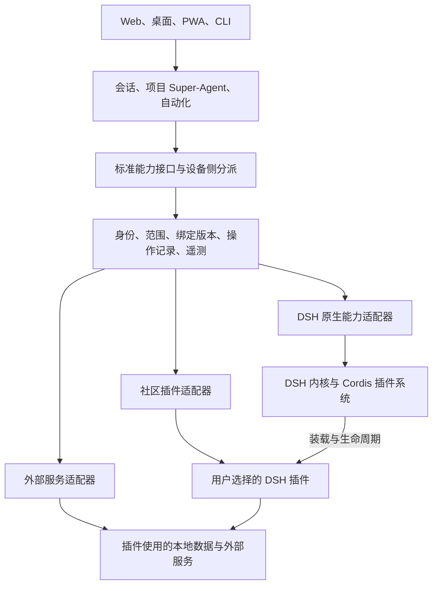

# 插件平台与标准能力接口

## 1. 产品职责

ChatDSH 是以 DSH 为内核的插件集成平台。用户选择插件和使用范围，平台通过适配器调用插件，将能力提供给会话、Super-Agent、自动化和各端界面。DSH 负责插件装载与 Agent 执行，能力提供方负责算法、数据和自身业务流程，ChatDSH 负责标准接口、能力绑定、访问规则、设备路由与产品交互。

本文件是目标架构的权威文档，规定能力归属与新增开发范围。[接口附件](plugin-platform/contracts.ts)提供可检查的记忆接口和公共类型。现有业务包、profile 和真实验收记录仍按源码及[验收文档](acceptance.md)登记。接口附件属于设计交付，运行时注册服务和社区插件适配器尚待实现。

## 2. 调用结构

标准能力接口运行在会话所属设备的 DSH 宿主中，通过 `ctx.chatdshCapabilities` 提供。宿主内调用直接使用类型接口。客户端通过领域 Remote 方法调用同一服务，控制平面验证访问身份与设备归属后转发。控制平面保存安装意向、绑定配置和只读状态，插件业务数据留在提供方。

DSH 插件可以独立安装使用。加入平台标准能力需要一个已登记的适配器。安装成功、插件已启用、能力已绑定和能力可用分别呈现，界面不得将其中一个状态推导为其余状态。

## 3. 能力边界

| 标准能力 | 标准操作范围 | 实现来源 |
|---|---|---|
| `execution` | 创建、继续、发送、观察、取消、审批 | DSH Agent、会话与审批服务，外部执行体使用独立适配器 |
| `memory` | 召回、列举、读取、写入、删除、导入、导出、查询异步操作 | 用户选择的记忆插件 |
| `skills` | 列举、读取、启用、安装和版本操作 | DSH 技能服务与用户选择的技能管理插件 |
| `retrieval` | 文件、文档、会话检索及来源引用 | DSH 检索服务、文档插件与外部检索工具 |
| `scheduling` | 建立、查询、暂停和取消定时任务 | DSH `ctx.schedule`，插件补充渠道或触发源 |
| `orchestration` | 分派任务、观察执行、发送输入、取消和读取成果 | DSH 子代理、目标与工作流能力，具备项目契约的协调插件 |
| `artifacts` | 登记、读取、版本引用和导出 | DSH 附件、文件与制品插件 |
| `tools` | 按执行身份列举和调用获准工具 | DSH 工具服务与 MCP 客户端 |

模型注册、流式响应与用量继续使用 DSH 的 `ctx.llm`，平台的模型选择与额度规则接在现有接口。标准能力的设计以具体消费者为依据，各领域保留自身参数与结果类型。禁止使用一个任意方法名加任意 JSON 的公共调用入口代替领域契约。

一个插件可以提供多个领域。每个领域分别登记操作与限制，用户单独绑定。安装了记忆与调度功能合并的插件，不会自动将它选为调度提供方。

## 4. 适配器契约

### 4.1 注册内容

每个适配器登记稳定 `integrationId`、自身版本、插件包名与精确版本、产物摘要、源码提交、接口主版本、实际提供的操作、原生作用范围、数据位置类别、生命周期方式、热变更能力，以及可复现的验收证据。源码安装同时核查提交与产物摘要，不能用重复的包版本标识不同代码。

每个操作单独声明取消、幂等、异步结果查询和条件写入能力。没有声明的操作返回 `capability/unsupported`。插件原生功能尚未完成接口映射时，只能在原生入口使用，标准能力界面显示具体限制。图谱、记忆整理、技能演化等扩展通过带命名空间和版本的专用接口呈现。

追加与替换、归档与删除、导入导出的格式和版本也分别声明。注册时验证描述符与实际方法一致，替换操作必须具有记录引用和对应的条件写入语义。标准消费者提交项目或会话范围，宿主解析原生范围和绑定，不能让消费者自行指定 bank 或数据目录。

适配器负责参数映射、结果校验、错误翻译、范围映射和资源释放。记忆抽取、语义检索、排序、遗忘、存储格式、冲突合并和技能演化继续使用插件实现。

### 4.2 接入方式

| 入口 | 使用规则 |
|---|---|
| 插件公开的 Cordis 服务或 SDK | 直接调用公开接口，依赖和兼容范围只进入对应适配器 |
| 插件公开的 Remote 或 HTTP API | 通过 DSH 已认证的传输访问登记端点，校验完整请求与结果 |
| 插件的 MCP 服务 | 复用 DSH MCP 客户端，适配器映射已登记操作与 schema |
| 插件原生模型工具 | 保留真实 Agent 执行身份，逐次经过可见性、审批与执行限制检查，仅支持验收过的操作 |
| 仅提供内部函数或私有数据文件 | 需要插件提供公开入口，完成之前不登记对应标准操作 |

不得直接读取插件私有数据库以实现统一界面。不得调用浏览器 DOM、拼接斜杠命令或创建伪造 Agent 作为业务调用通道。标准 API 不通过额外一轮模型对话解释插件结果。适配器调用出现破坏性不兼容时立即失败，禁止改用另一条未经验证的入口。

插件仍使用标准 `package.json`、`dsh.bundle.patch`、`dsh.client` 与 `engines.dsh`。平台适配器也是普通 Cordis 插件，复用同一个 Loader。平台目录中的说明、能力声明和验收范围由适配器维护，无需第三方插件增加 ChatDSH 专用字段。

### 4.3 接口与插件版本

能力 API 按主版本演进，增加可选字段保持兼容，改变操作含义增加主版本。适配器分别声明支持的能力 API、DSH 版本和插件版本。平台锁定实际验证的组合，依赖锁文件同时固定传递依赖与完整性摘要。

包管理器负责依赖解析与安装，DSH 负责原生兼容性判断和补丁装载。平台补充核查操作语义、事件监听、工具名称、服务单例、路由、设置命名空间与数据目录。版本范围通过不能替代真实调用验证。

## 5. 选择、绑定与运行期行为

用户在插件页安装插件，在能力设置页选择提供方和作用范围。相同设备可以安装多个提供方，运行时是否能够同时启用由适配器的冲突声明与真实装载结果共同决定。

平台安装在未启动的隔离 profile 中完成依赖解析与清单核查。发布到设备运行 profile 时，候选原生行和自动行为保持停用，确认绑定及原生配置后再通过 DSH 装载。安装和 profile 修改使用同一写入锁，自动刷新不能提前激活候选插件。实际装载及注册未完成时，对应新会话和新任务不能开始调用。

用户经原生入口自行安装启用的插件显示为未受平台管理。接入之前必须核查已经存在的原生监听、工具与路由，不能把尚未选择标准绑定推断为插件没有副作用。原生后台行为无法纳入所需约束时，不发布该标准能力组合。

绑定使用 `deviceId`、领域、应用范围和 `revision` 定位。覆盖顺序为显式会话设置、项目设置、设备默认值。显式关闭在对应范围生效，不继续继承。客户端不能通过请求里的提供方标识绕过绑定。

每个回合和已受理任务保存完整绑定快照，包括 DSH 版本、依赖锁摘要、适配器版本、提供方实例、原生范围映射与配置摘要。后续默认值修改仅影响新回合和新任务。延迟返回的结果携带原绑定版本，不能作为新提供方的结果展示。

快照固定提供方选择，权限在每次调用和结果交付时重新核查。撤销授权立即拒绝新的相关调用并停止安排后台操作，进行中调用按提供方真实取消能力处理，未确认的副作用继续保留查询记录。插件原生后台行为无法满足授权撤销要求时，该自动模式不可启用。

绑定修改采用 revision 条件更新。切换之前检查兼容性、所需操作、生命周期过滤、数据位置和进行中操作。切换完成后原提供方继续承载已有操作的查询和取消，直到它们进入确定终态。需要重启的插件显示“等待重启”，确认重启并完成真实装载后才发布新的可用绑定。遥测开关继续独立热切换。

同一范围内有一个默认写入提供方。允许显式配置多个只读来源，逐个显示来源、预算与结果。只读来源不自动成为默认写入方，未配置的插件不参与查询。提供方不可用时返回明确状态，禁止自动切换到其他插件执行同一项操作。

安装、绑定、停用、卸载与清理数据是独立动作。卸载之前解除绑定并处理在途操作。卸载保留数据与恢复所需记录，删除数据必须调用提供方声明的清理能力并获得相应授权。

## 6. 记忆标准接口

### 6.1 数据范围与标识

标准范围为设备全局、项目与会话。平台用稳定标识表达范围，适配器将其映射为插件的工作区、bank、记忆空间或会话库。项目目录只作为受信任映射的输入，不能用项目显示名自动建立共享关系。

提供方没有项目隔离能力时，描述符必须标明限制。只有用户明确允许全局记忆参与的调用才能使用它。结果返回后过滤无法证明检索和模型处理过程没有读取越界数据，敏感范围必须在提供方操作发生之前得到执行约束。

跨设备记忆组保存各设备的原生范围映射。共享访问依赖提供方的远程服务或同步能力。平台不复制插件数据库、不同时写入多个库，也不把相同项目名称判定为已经同步。

每条引用包含 `integrationId`、提供方实例、原生范围标识、原生记录标识与可选记录版本。读取、修改和删除始终回到原提供方。更换提供方不会改变旧引用的归属。

### 6.2 操作语义

| 操作 | 契约 |
|---|---|
| `recall` | 返回带来源的相关条目、实际范围和提供方原生分数说明，执行独立预算 |
| `list` / `get` | 返回可管理的原生记录及不透明游标，支持程度由适配器声明 |
| `write` | 写入明确内容与范围，返回已提交、已受理或结果未确认状态 |
| `delete` | 指定原提供方引用与删除含义，区别归档、软删除与永久删除 |
| `export` / `import` | 使用提供方明确支持的格式、版本和覆盖范围，不承诺跨插件无损转换 |
| `getOperation` | 查询原操作的实际状态，查询能力独立登记 |

写入结果包含原生操作标识、提交含义和可查询性。异步受理不显示为已经进入召回结果。插件需要审核时返回 `pending-approval`，由其真实审核流程完成，平台传递决定与回执。

平台给写操作分配稳定 `operationId` 并保存请求摘要。能够原生幂等处理的提供方接收同一标识。原生不支持幂等的操作记录为 `none`，传输中断后进入 `unconfirmed`，查询或人工核验后再决定。仅有平台操作记录不能保证插件执行与平台记录之间的原子性，禁止据此自动重试写入。

跨来源召回逐个保留结果和失败状态。默认分别呈现，组装上下文时按用户配置的各来源预算取用，不比较不同插件的原生分数。必需来源失败立即终止此次能力调用，可选来源失败返回明确的来源失败信息。插件没有记录标识时，适配器只能返回用于引用的内容摘要，描述符不得声明按记录修改或删除。

### 6.3 自动召回与自动写入

每个绑定必须指定生命周期执行方式，取值为 `native`、`platform` 或 `manual`。

| 方式 | 自动动作的执行方 | 平台职责 |
|---|---|---|
| `native` | 所选插件自己的回合监听与后台任务 | 核验参与范围、提供方设置与事件归属，提供标准管理调用 |
| `platform` | 平台在 DSH 回合事件中调用适配器公开的原生操作 | 传递范围与来源、安排调用和统一展示，抽取与整理仍调用提供方能力 |
| `manual` | 用户或 Agent 显式调用标准能力接口 | 执行权限检查、调用与结果展示 |

同一绑定的自动召回和自动写入分别由唯一组件执行。`native` 方式下平台不追加另一份自动召回，也不生成另一份回合摘要。采用 `platform` 或 `manual` 方式之前，必须验证插件自身对应监听、定时器、自动整理和模型提示确已关闭。

插件无法按所需范围关闭原生行为时，该组合不可启用。收窄模型工具列表无法禁止宿主事件监听，HTTP 包装也无法限制插件直接访问文件或启动进程。

注入角色、上下文位置、压缩后行为、真实用户消息识别与转录持久化方式由对应模式明确登记。平台为记忆标明来源和不可信内容属性。记忆内容不获得用户指令、项目授权或审批决定的身份。

### 6.4 可用性与故障

未启用记忆时不创建插件客户端、连接、后台任务与数据目录。已启用且被标记为必需时，调用失败使当前相关动作失败。用户可以明确设置为可选能力，调用失败后返回可见失败结果，当前会话按不使用本次记忆的策略继续。配置错误、范围越界和结果 schema 错误始终拒绝，禁止隐藏为查询结果为空。

插件自行提供的写入队列和重试由插件管理。平台只记录标准调用的状态与关联标识，不建立重复的抽取队列。一个提供方需要额外的可靠投递时，由其适配器声明原生幂等条件、状态查询和唯一管理队列的组件。

## 7. 社区记忆插件的接入决定

源码入口与固定版本证据集中登记在根 [README 的参考项目](../../README.md#参考项目)。下表规定目标接入边界，全部适配器都需要通过第十二节的运行验收才能标记可用。

| 提供方 | 已核实入口 | 标准能力接入决定 |
|---|---|---|
| Lingshu | DSH 组合包与独立 MCP 服务，认知图操作已有协议 | 记忆操作通过原生 MCP 接入，调用现有认知图能力，保留写入与审核权限，DSH 插件自动监听按所选模式管理 |
| Memory Evolve | 原生组合包，存在记忆管理 HTTP API，包含额外的技能、协作和通知模块 | 适配器固定 API 版本，逐项映射记忆管理操作，其他模块单独声明与绑定，原生审核队列继续生效 |
| Meow Memory | 原生组合包与记忆工具、自动注入、反思和 dream 生命周期 | 原生生命周期可复用，管理操作需要经真实 Agent 工具上下文或插件公开服务接入，禁止导入未公开的数据库模块 |
| Mnemon | 原生组合包、Source/Strategy SDK、记忆管理 Remote 接口 | 复用原生记忆组合与 Remote 入口，子提供方留在 Mnemon 内管理，`mnemonMemory` 扩展注册服务不作为查询接口 |
| Fish Memory | 原生组合包与管理路由，原生会话或工作区数据范围 | 按原生管理 API 编写版本适配器，明确范围语义，分发保留原许可证要求 |
| DSH Hindsight | 根导出 `HindsightClient` 与 `createClient`，原生工具和系统提示注册 | 复用导出的客户端进行标准调用，bank 映射由适配器管理，分别核查管理原生工具与提示的组件 |

这些插件在同一份安装清单中可供选择。平台不要求用户采用统一的记忆引擎，不把任意插件作为全部提供方必须依赖的中间框架。一个插件已经管理的子提供方继续由它处理，平台不重复建设同类调度与存储抽象。

插件没有正式服务导出时，可以维护对已公开原生 API 的版本适配。确实缺少入口的操作需要上游增加公开服务，在入口发布并通过验收前保留明确的“不支持”。插件源码快照只用于核查，平台不复制其业务实现。

## 8. Super-Agent 与其他消费者

项目 Super-Agent 保留[专项设计](superagent/README.md)规定的项目主会话、独立 Worker 目录、成果授权、人工应用和恢复规则。协调逻辑通过 `execution`、`orchestration`、`memory`、`artifacts` 接口使用已绑定能力。DSH 负责模型回合、子代理、目标、工作流与会话存储，社区协调插件可以提供额外编排。

项目级任务归属、跨任务成果授权和人工应用是平台产品规则。提供方必须逐项满足这些规则，缺少独立目录或恢复权限语义的协作插件不能被登记为完整 Super-Agent 提供方。多个调度器不得同时拥有同一任务的执行权。

宿主解析普通会话、Router、Worker 和子代理身份，客户端与模型不能自行提交角色字段扩大权限。普通会话历史不自动进入 Router 记忆，Worker 草稿与未应用成果默认不进入共享项目记忆。人工应用成功后，可按项目明确配置调用所选记忆提供方保存成果。

适配器必须证明原生后台监听也遵守上述范围。不能过滤内部执行会话的插件，在包含这些会话的运行时中不可启用对应自动记忆行为。其余显式操作按已验证能力提供。

定时任务使用 `scheduling` 调用 DSH 的真实任务，界面读取原生标识和状态。技能使用原生文件与目录。MCP 使用原生客户端和实际执行身份。平台对这些能力提供产品接口，不建立并行的数据真相与业务循环。

## 9. 仓库组织与依赖

现有六类包目录继续承担角色划分。新增包仅在运行时实现时创建，目标位置如下。

| 位置 | 维护内容 |
|---|---|
| `packages/core/capabilities/` | 领域类型、schema、错误码、序列化 DTO 与客户端调用类型 |
| `packages/host/capabilities/` | 注册、描述、绑定解析、宿主权限检查、调用记录和生命周期安排 |
| `packages/host/integration-dsh/` | DSH 原生服务到标准能力的映射 |
| `packages/host/integration-<provider>/` | 一个提供方的版本适配、配置映射、能力声明和真实验收 |
| `packages/client/` | 使用标准能力接口的领域界面与插件原生扩展入口 |
| `packages/tool/` | 把标准能力暴露为经过审批的 Agent 工具 |
| `packages/bundle/` | 原生插件、对应适配器和必要界面的一组装载声明 |
| `packages/preset/` | 会话角色、工具选择和能力使用范围 |
| `profiles/` | DSH 版本、组合包、设备配置与依赖锁文件 |
| `dsh-adapter/` | 本项目对 DSH 内部接口的版本兼容 |

业务和客户端只依赖标准能力契约。`host-capabilities` 依赖核心契约，通过 Cordis 注册取得提供方，不依赖具体适配器。提供方适配器依赖标准契约与插件公开入口，需要 DSH 内部接口时经 `@chatdsh/adapter` 访问。组合包负责声明完整依赖和装载顺序。

第三方插件继续按其原生依赖运行，平台不要求重写其 import。DSH 兼容适配与业务能力适配分别维护，避免每个业务界面承担插件版本变化。

现有记忆包在集成转换后承担能力消费或兼容职责，抽取、召回与存储由所选插件负责。已有数据通过原提供方的导出与真实迁移测试保留。目录移动、实现删除和依赖删除必须与消费者转换及真实验收在同一个实施工作包完成，不提前删除可用路径。

## 10. 配置、升级与数据

平台绑定配置保存提供方实例标识和非敏感选择。插件原生设置保存模型、连接、记忆策略等业务参数，设置界面通过适配器提供的明确映射写入原生设置。原生设置与平台设置各有唯一写入来源，无法映射的字段通过原生设置入口管理。

凭据保留在设备的 DSH 凭据服务、系统安全存储或插件已支持的安全存储内，绑定仅保存引用。绝对路径、凭据、运行期连接和本机进程参数不跨设备自动复制。期望配置和实际生效配置分别展示，设备离线修改不宣称已经启用。

升级先在隔离数据根验证精确包版本、完整依赖、原生装载、标准调用和必要的数据迁移。进行中回合、后台任务、原生工具与生命周期监听全部计入资源占用，无法安全卸载的插件必须等待它们结束后重启。更换代码版本不自动恢复旧数据格式，数据恢复使用提供方支持的备份与导入。

提供方切换仅修改绑定。跨插件迁移是单独的显式操作，要求导出和导入双方声明格式、来源引用、冲突策略与损失范围。缺少转换能力时保留原数据供原提供方读取，禁止通过模型重新摘要宣称完成无损迁移。

备份按数据所有者调用原生一致性导出或静态文件备份。活跃数据库不能直接复制。备份清单记录提供方、版本、配置映射、数据格式和实际包含范围。外部托管数据由服务自己的备份机制负责，平台不能将配置备份表示为完整记忆备份。

## 11. 权限、故障与遥测

浏览器传入设备、项目和会话标识后，宿主从实际归属及访问会话解析调用上下文。每次操作都核验范围、提供方绑定、操作权限和记录归属，查询与执行使用相同的 Agent 身份。未知字段、未知提供方、版本冲突与 schema 错误立即拒绝。

标准错误包括 `capability/not-configured`、`unsupported`、`incompatible`、`conflict`、`forbidden`、`unavailable`、`deadline-exceeded`、`cancelled`、`invalid-result` 和 `unconfirmed`。适配器保存受控的提供方错误类别，不把原始错误、文件路径和服务凭据返回到公共响应。

取消和超时区分传输停止与业务停止。插件没有真实取消能力时明确返回限制，已受理操作继续由原提供方查询。禁止以关闭本地等待表示远端任务已经终止。任何有副作用且受理状态未知的操作进入 `unconfirmed`。

同进程 Cordis 插件拥有宿主代码执行权限。能力接口约束平台发出的调用，完整安装过程同时展示插件的宿主访问和原生网络端点。插件后台行为与自带路由属于集成验收范围，必须验证访问认证、范围限制和停用后的释放，不能仅验证标准 API。

标准分派的每个动作都通过 `ctx.chatdshTelemetry` 记录 span、失败事件和可聚合指标，登记接口操作、提供方类型、状态、耗时和枚举错误。调用提供方公开服务或传输时传播允许的上下文，插件不支持传播时标明追踪边界，禁止伪造贯通链路。关闭遥测时不生成、转发或传播 `traceparent`。

平台适配器、Agent 工具与客户端采用同一遥测出口，禁止新增 exporter。插件自带遥测必须能够遵守部署关闭和内容边界，无法关闭的不进入合格组合。不得通过拦截任意日志自动收集提示词或记忆内容。信号名称在对应实现交付时同步登记到[遥测规范](telemetry.md)与包声明。

## 12. 实施与验收

| 工作包 | 完成交付 |
|---|---|
| PA01 标准契约与 DSH 映射 | 领域 schema、绑定快照、描述符、错误、原生服务调用与类型检查 |
| PA02 注册和调用服务 | 真实 Cordis 注册、范围解析、revision 更新、真实身份调用、操作结果查询与遥测 |
| PA03 插件生命周期组合 | DSH 原生安装、唯一装载、监听与工具冲突核查、停用释放和重启生效 |
| PA04 记忆提供方适配 | 每个选定插件独立交付适配器与精确版本验收，标准操作按实际支持登记 |
| PA05 产品消费者接入 | 记忆、技能、检索、自动化界面与工具调用统一接口，原生扩展入口保留明确身份 |
| PA06 Super-Agent 集成 | 角色范围、原生监听约束、成果授权与人工应用经过提供方调用真实验证 |
| PA07 数据和升级 | 原提供方备份恢复、跨版本升级、显式切换、不支持迁移的准确呈现 |
| PA08 发行组合 | 锁文件、许可证与来源、Web/桌面/CLI/PWA 实际装载和卸载验收 |

PA01 的标准契约确定后才能实现 PA02。PA03 与 PA04 的真实组合共同通过后，PA05 才能发布对应能力。PA06 依赖相关能力的角色约束验证，PA07 与 PA08 是该提供方交付的完成条件。

每个适配器必须通过真实安装与装载、至少一条完整业务调用、操作 schema、原生范围、重复装载拒绝、热变更或重启要求、执行身份、停用资源释放、数据保留和遥测关闭检查。所声明的每项写入、取消、幂等、查询和导入导出能力单独验收。涉及模型抽取与远程记忆的流程使用真实模型和服务，依赖不可用时保留明确未完成记录。

当前核查已读取用户指定插件的源码快照，确认原生清单与接口入口，并调用本机 DSH 清单兼容性检查。该结果只证明声明可接受，不能证明运行期装载、标准适配器、模型记忆质量或外部服务可用。验收记录保持这些边界。
