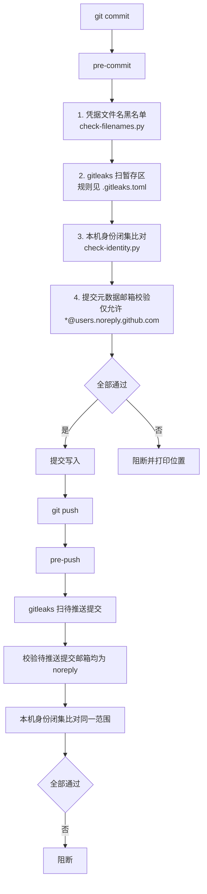

# 凭据与隐私防护

本仓库随版本控制分发一套钩子，在提交与推送两个环节拦截凭据、网络标识与联系方式。目的是让真实值在进入版本库之前就被挡住，并且在已经进入之后能被发现和清除。

## 一、安装

钩子随仓库分发，但 `core.hooksPath` 是本地配置，克隆之后需要执行一次（在 `runtime` 目录下执行，脚本以仓库根为基准工作）：

```sh
bash scripts/install-hooks.sh
```

脚本会设置 `core.hooksPath=.githooks`、给钩子加执行位，并检查依赖。缺依赖时钩子会拒绝执行，不会静默放行。

| 依赖 | 用途 | 缺失后果 |
|---|---|---|
| `gitleaks` | 规则扫描暂存内容与提交历史 | 钩子直接失败，提交被阻止 |
| `python3` | 文件名黑名单与本机身份比对 | 钩子直接失败，提交被阻止 |

这两项缺失都按失败处理。防护工具链不完整时放过提交，等于防护不存在。

## 二、四道闸门



**第一层，凭据文件名黑名单。** 只看路径不看内容，命中即拦。覆盖本地变量文件、命令行工具凭据、私钥证书、服务账号、基础设施状态文件，以及 Tailscale 状态导出。

**第二层，gitleaks 规则扫描。** 在官方默认规则集之上补充 23 条本项目规则，分四类。

| 类别 | 规则 |
|---|---|
| 凭据 | 供应商密钥、`sk-` 网关密钥、SendGrid、Mailgun、Bearer 令牌、连接串内嵌口令、GCP 服务账号、Azure 存储密钥、JWT、带凭据的 URL、聊天平台 webhook、高熵 base64 赋值、短口令赋值 |
| 网络标识 | Tailscale IPv4 网段 `100.64.0.0/10`、Tailscale IPv6 前缀 `fd7a:115c:a1e0::/48`、真实 tailnet 域名 `*.ts.net`、私有域名后缀、RFC1918 内网地址 |
| 联系方式 | 电子邮箱、中国大陆手机号、国际电话号码、中国大陆身份证号 |
| 个人标识 | 中文姓名（紧邻「姓名」「联系人」等提示词时判定） |

**第三层，本机身份闭集比对。** 把本机 git 用户名、git 邮箱及前缀、主机名与短主机名、tailnet 后缀、家目录名组成闭集，逐一在待提交内容里查找。这一层补 gitleaks 覆盖不到的类别：姓名、账号名、主机名这类没有固定形状的值。

闭集来自本机，仓库里不含任何真实值。换一台机器使用时，闭集自动换成那台机器的身份，不需要改配置。

**第四层，提交元数据邮箱校验。** 校验 `GIT_AUTHOR_EMAIL`、`GIT_COMMITTER_EMAIL` 与 `git config user.email` 必须为 `*@users.noreply.github.com`，防止个人邮箱进入提交元数据。

**推送前闸门。** 提交前闸门只看暂存区，已经进入历史的泄露只能在推送前拦住。`pre-push` 对远端没有的全部提交重跑第二层、第三层与提交元数据邮箱校验，首次推送或历史重写后自动扫描该引用完整历史。

## 三、占位约定

文档与示例里的真实值一律改成下列占位，钩子按这些形状放行。

| 类别 | 占位写法 |
|---|---|
| tailnet 名 | `example.ts.net` |
| 主机名 | `node-a`、`host-a`、`sub-a` |
| 设备名 | `win-a`、`node-b` |
| 公网域名 | `chatdsh.example.com` |
| 网络地址 | RFC5737 文档专用网段：`192.0.2.0/24`、`198.51.100.0/24`、`203.0.113.0/24` |
| 身份 | `user`、`someone` |

两处例外按标准值放行，因为它们不含本机特有信息：`host.docker.internal` 是 Docker 访问宿主机的固定域名，`172.17.0.1` 是 Docker 出厂默认的 docker0 网关。

## 四、误报处理

三种情形，从轻到重。

**行内放行。** 测试夹具里的假值，在该行末尾加注释 `gitleaks:allow`。

**登记指纹。** 属于误报时，把报告里的 Fingerprint 逐条写进 `.gitleaksignore`，格式为 `文件路径:规则id:行号`。登记即留痕，评审时能看到为什么放行。

**路径放行。** 整类文件不该被扫描时，把路径片段写进 `.secret-guard-allow`，每行一条，`#` 开头为注释。写 `data/` 即放行整个目录。

放行要留理由。`.gitleaksignore` 与 `.secret-guard-allow` 都可以写注释，说明这个值为什么不是秘密，否则下次评审无法判断。

## 五、历史泄露

提交前闸门的拦截发生在提交写入之前，问题只出现在暂存区。一旦真实值已经进入某个提交，处理方式完全不同：新提交覆盖不了旧提交里的内容，必须重写历史。

重写之后还有一步容易漏。被丢弃的旧提交仍以悬空对象留在对象库里，`git fsck --unreachable` 能找回来，`git cat-file` 能读出内容。只重建提交而没回收对象库，等于没清除。

完整步骤：

```sh
# 1. 确认当前内容是最终状态
git status --short

# 2. 重建分支，让旧提交不成为祖先
git checkout --orphan clean-main
git add -A
git commit -F <提交信息文件>

# 3. 替换原分支
git branch -D main
git branch -m clean-main main

# 4. 清掉 reflog 与悬空对象
git reflog expire --expire=now --all
git gc --prune=now

# 5. 验收
git fsck --unreachable --dangling
git cat-file -t <旧提交哈希>       # 应当报 Not a valid object name
```

验收要看到三件事同时成立：`fsck` 无输出、旧提交哈希取不到、遍历全部 blob 搜不到真实值。仓库有远端时先做这些再推送，推送之后还要吊销对应凭据，因为远端可能已经收下。

## 六、扩展规则

新增一类拦截对象时，优先加到 `.gitleaks.toml`，因为它同时被提交前与推送前两个闸门使用。规则按 gitleaks 的 TOML 格式书写，注意三点：

**正则引擎是 Go RE2。** 不支持前后环视。需要数字边界时用 `(?:^|[^\d])(...)(?:[^\d]|$)` 的写法，gitleaks 取第一个捕获组作为被检出的值。

**默认规则集已覆盖的不要重复。** AWS、Stripe、GitHub、Slack、Google 等有固定前缀的供应商密钥已在默认规则里。新增规则之前先确认默认规则是否漏报，避免同一条内容被两条规则重复报告。

**加规则后必须跑两个方向的验证。** 用一个含各类真实形状的探针文件确认能命中，再用 `runtime/docs/` 全量扫描确认零误报。只测命中不测误报，规则一上线就会拦住正常提交。gitleaks 配置在仓库根，下面两条命令从仓库根执行：

```sh
# 命中验证
gitleaks dir <探针目录> -c .gitleaks.toml --no-banner -f json -r out.json

# 误报验证
gitleaks dir runtime/docs -c .gitleaks.toml --no-banner -f json -r out.json
```

## 七、已知边界

**本机身份闭集只覆盖本机。** 它拦的是本机用户名、邮箱、主机名、tailnet 后缀。协作者在别的机器上提交时，闭集是那台机器的，不会覆盖本机身份。多人协作场景下，这一层需要各自机器上跑各自的闭集。

**gitleaks 只认形状。** 它不认识语义。一个真实口令如果形状普通（纯小写英文单词、短串、无数字），可能漏过。这类值靠第三层的身份闭集拦不住，只能靠代码评审。

**图片与二进制不扫描。** 钩子按二进制跳过。截图里的敏感信息不在拦截范围。
