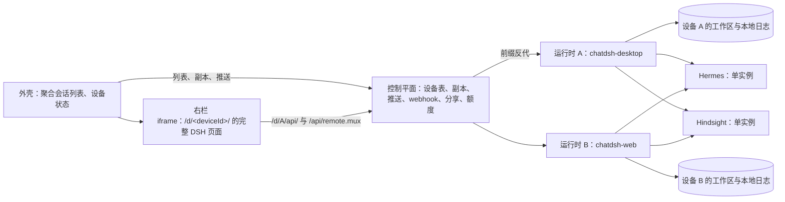
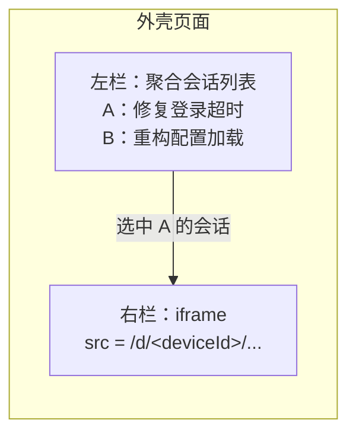

# 目标形态

本文件规定 ChatDSH 的单用户、多设备、设备权威日志与客户端载体形态。完整系统细节使用[系统完成设计](<system-completion-design.md>)，客户端页面与状态使用[完整交互规格](<client-complete-spec.md>)和[完整设计稿](<ui-design/complete.html>)，实施验收使用[工作包](<implementation-work-packages.md>)。上述完整设计规定离线仅保留草稿、单用户访问认证、连续副本与 Hermes 全历史运行桥接的最终契约；本文件现状表继续记录实际实现程度。

## 一、形态

单账号、多形态、多设备。每台设备跑一个运行时进程，客户端是窗口。

| 角色 | 数量 | 说明 |
|---|---|---|
| 账号 | 1 | 没有账号体系，没有账号表，没有身份头部 |
| 设备 | N | 每台一个运行时进程，各自装一份，按用途选 profile |
| 控制平面 | 1 | 跨设备中枢：设备表、会话副本、推送、webhook、分享、额度、运行时编排 |
| Hermes | 1 | 承载聊天，地址可配置，控制平面可选托管 |
| Hindsight | 1 | 记忆存储，用户自行部署，地址可配置 |
| 客户端 | 任意 | 外壳加单 iframe 轮换：左栏聚合全部设备的会话，右栏按选中会话指向那台设备；移动端是同一份外壳的 PWA |



### 1.1 与官方路线图的边界

官方 v0.2 公告把「个性化长期记忆」「支持远程与移动端使用」「探索会话分享与多人协作」写入公开路线图，与本项目现有的记忆接入、移动端、分享三处重叠。本项目的取舍是继续自建，但全部做成可装卸的独立插件，不并入宿主平面：

| 方向 | 本项目的做法 | 与官方的关系 |
|---|---|---|
| 记忆 | `@chatdsh/host-memory` 加 `bundle-memory-*` 组合包，只在 `memoryBackend` 非 `none` 时加载；实现走 `MemoryBackend` 契约，Hindsight 只是其中一个实现 | 官方若推出内置记忆，替换的是这一个实现与两处挂接点（`agent/pre-step`、`turn/end`），业务代码与聊天后端不动 |
| 远程访问与移动端 | 移动端做 PWA，复用官方发布的前端产物与同一套外壳，加移动布局与配对接入 | 官方出移动端后，替换的是外壳这一层，控制平面的设备归属、`/ws/mobile` 通道与会话副本不动 |
| 分享 | 只做控制平面的只读快照（签名令牌、匿名可访问、`upToSeq` 固定） | 多人协作不做 |

判断依据是分层而不是猜测官方覆盖哪一层。聊天与记忆在本项目里已经是两个独立开关（`chatBackend` 与 `memoryBackend`），四种组合都成立；聊天会话读写 `acct`、有工作区时召回 `ws:<memoryGroupId>`，bank 名由 `runtime/packages/host/memory/src/rules.ts` 的 `banksFor` 一处算出。官方最终只做项目记忆或只做对话记忆，落到这个设计里都是 bank 覆盖范围的差异，不需要两套实现。

插件化的具体界线：三项能力各自成仓内独立包，声明标准 `dsh.bundle.patch`，在本项目自己的 profile 里可装卸开关；不发布到公共登记处，不承诺外部 dsh 用户使用。

## 二、数据位置

| 数据 | 权威位置 | 说明 |
|---|---|---|
| 会话日志 | 设备本地 | JSONL 在设备 `$DSH_HOME`。设备离线仍可读写自己的会话 |
| 会话副本 | 控制平面 | 只读镜像，按 `seq` 追加，记水位。用于跨设备浏览、导入、设备损毁恢复 |
| 工作区 | 设备本地 | 绑定 `deviceId`，工具在那台设备上执行 |
| 记忆 | Hindsight | bank 名不含设备与账号维度，天然跨设备共享 |
| 聊天（Hermes 承载） | Hermes 的 `state.db` | 会话键是 ChatDSH 会话编号 |
| 聊天（DSH 承载） | 设备本地 | 与工作会话同一套存储 |
| 设备与订阅 | 控制平面 | 设备令牌、送达档位 |
| 用量账本、分享、webhook | 控制平面 | |
| 定时任务 | 设备本地 `$DSH_HOME` | `ctx.schedule`，与会话同处；详见第七章 |

## 三、会话与执行

会话创建时确定 `cwd` 与 `deviceId`，之后不可修改。`SessionOwnership` 的两个字段已经声明了这条约束。

**客户端的形态：外壳加单 iframe 轮换。**

外壳是一个自建页面，负责三件事：聚合会话列表、设备状态、右栏容器。右栏是一个 iframe，`src` 按当前选中的会话决定指向哪台设备。



左栏不变，右栏按需指向 A 或 B。非当前设备的 iframe 卸载，内存只占一份。

| 数据 | 通道 |
|---|---|
| 聚合会话列表、设备状态、推送 | 控制平面的 HTTP 与 SSE |
| 会话内容、面板、审批应答、发消息 | iframe 里那棵树的 Remote，经 `/d/<deviceId>/api/` 转到对应运行时 |
| 会话副本上报 | 运行时到控制平面的 HTTP（`packages/host/push` 现有实现） |

**外壳由控制平面托管。** 外壳是控制平面提供的静态页面，不与任何设备的运行时绑定。设备全部离线时外壳仍能打开，左栏照常列出会话并标出离线状态。控制平面除了 `/d/<deviceId>/` 之外还提供根路径的静态资源。

**四种载体的落点。**

| 载体 | 外壳 | 右栏 | 说明 |
|---|---|---|---|
| Web | 控制平面提供的静态页面 | iframe | 基准形态 |
| 桌面 | Electron 加载同一个外壳 | 窗口内的 iframe | 与 Web 同构，差别只在窗口载体与原生能力 |
| 移动端 | PWA 加载同一套外壳（与 Web 同一份产物，加移动布局） | 页面内的 iframe | 与 Web 同构；安装到主屏后与浏览器访问共用同一份 Service Worker 与推送权限 |
| 命令行 | 无外壳 | 无 | `dsh-tui` 只连本机运行时，看不到跨设备会话 |

命令行这条是有意的限制。终端没有浏览器引擎，iframe 无从谈起。如果将来要在终端里看跨设备会话，只能读控制平面的副本，没有写入能力。

**为什么用 iframe。** iframe 里就是一个完整的 `dsh --profile web` 页面，每棵树天然隔离在自己的 window 里，DSH 的页面结构不需要改。控制平面用 `/d/<deviceId>/` 前缀把 `/static/`、`/plugins/`、`/api/` 一起反代到对应运行时，外壳与 iframe 同源（都来自控制平面），没有跨源问题。

备选的全树常驻方案（每台设备一棵 Client tree 常驻，外壳从各树取会话面板组件）需要自制多树宿主。`ClientModuleLoaderTarget.create` 的注释是「Create the module system exactly once」，一个 target 只能建一个树；多树要自建 target 实现，还要处理每棵树的 CSS 注入与 React root。这两件事 DSH 的页面外壳已经做过一遍，自建要重做。

代价是跨设备切换会话时右栏 iframe 换 `src`、重载。左栏与外壳状态保留。同一台设备内切换会话可以通过 postMessage 通知 iframe 内页面切会话，不需要重载；不做 postMessage 就也重载。

**跨设备写的两个选项。** 在设备 B 打开设备 A 的会话，给用户两个动作：

| 选项 | 行为 | 结果 |
|---|---|---|
| 在远程继续 | 右栏 iframe 指向 `/d/A/`，写落到 A 的运行时 | 同一条会话，`deviceId` 仍是 A |
| 在本机继续 | `packages/host/import` 的 fork | 新会话，`cwd` 与 `deviceId` 是 B，`parentSession` 指向源会话 |

`import` 因此保留，用途从「唯一接续方式」变成「本机继续」这一支。

**跨设备写失败。** 执行节点离线时写操作明确失败并报设备离线，不改路由、不排队、不回退到宿主机执行。

**左栏只标记设备离线。** 不显示同步状态。副本落后不影响右栏：右栏的 iframe 连的是目标设备本身，读的是它的权威日志，不经过副本。所以副本水位落后时右栏内容仍然最新，不需要挡住发消息。

| 左栏看到 | 含义 | 右栏 |
|---|---|---|
| 设备名 | 设备在线，副本与权威一致 | 正常读写 |
| 设备名 + 离线 | 设备不可达 | 显示离线，输入框禁用 |

因此不需要设备上报日志末端与待推队列。架构设计里推送与送达的四态不实现，`syncScope` 与 `syncOverride` 一并删除。副本水位仍存在于 `replica_watermarks` 表，但只用于内部补推判断，不进界面。

**新建会话时选设备与目录。** 外壳的「新建会话」先让用户选设备，再选那台设备上的目录，然后由控制平面发起创建。这与架构设计 7.5 节「新建会话选设备与目录」是同一形态：聊天转工作时用户选择目标设备与其上的目录，控制平面记成工作区并把 `deviceId` 指向那台设备。

如果目标设备离线，创建请求明确失败，不排队等待。

**工作区列表按名字合并。** 两台设备上有同一个仓库的两份克隆时，`cwd` 不同、DSH 的 `Workspace` 记录也不同。左栏按工作区显示名合并成一条，点开时列出该名字下的全部设备与路径，由用户选一个。

这条与记忆组的关联是同一件事的两种表达：记忆组决定召回与写入用哪个 bank，工作区合并只影响列表的呈现。两者独立设置。

**设备加入统一走配对码。** 移动端 PWA 已经有配对码流程（`gateway/src/mobile-http.ts` 与 `mobile-channel.ts`）。桌面与 Linux 执行节点复用同一套：控制宿主生成配对码，新设备输入后换取节点令牌，之后以节点令牌建立长连接。不区分平台。

**移动端只做 PWA。** 客户端是控制平面托管外壳的同一份产物，加移动布局；安装到主屏后与浏览器访问共用同一份 Service Worker 与推送权限。`BarcodeDetector` 承担扫码，WebCrypto 加密后存设备令牌，Service Worker 加 Web Push 承担后台通知。原 Android 原生客户端（`mobile/base`、`mobile/overlay`、`mobile/android` 三层与构建脚本、APK 分发服务）删除，保留控制平面的配对与 `/ws/mobile` 接口给 PWA 使用。

通知的能力边界要写清：Web Push 由服务端经推送服务下发，浏览器收到后唤起 Service Worker 展示，应用无法保证系统回收后立即送达，这一点与原生前台服务不同。三档送达里 PWA 支撑「前台长连接」与「后台本地通知」两档，「系统回收后的强送达」依赖推送服务。iOS 不纳入范围。

**去掉的东西。** 跨设备会话「只读且没有输入框」这条限制取消，改为上面两个显式选项。

## 四、Hermes 承载聊天

`chatBackend: hermes` 时聊天由 Hermes 执行。分支在运行时内做，不切换 profile，不需要热重载，不需要重启。

**每次发送的判定与全历史运行桥接。**

发送时由原会话所属设备判定执行体，完整运行契约见[系统完整设计](<system-completion-design.md>)第六、七节：

1. 验证目标设备在线、会话写入权限与业务操作标识。目标设备离线时明确失败并保留客户端草稿，不转交其他设备，不建立自动重发任务。
2. 在本次发送时判断 Hermes 是否可用；不轮询，不建立周期性健康探测。仅在确定 Hermes 尚未受理且不可达时，在同一会话运行一轮 DSH，并持久记录该会话后续需要完整历史输入。
3. Hermes 已经受理时继续观察同一个运行；超时或断线导致受理结果不确定时，按操作标识查询实际状态。禁止向 DSH 或 Hermes 重放同一条未确认请求，禁止切换执行体重复运行。
4. Hermes 可用时通过完整历史运行桥接发起当前回合。桥接必须同时支持历史输入、实时事件、稳定运行标识、精确审批关联和取消，事件到达即更新会话，审批在运行结束前可见并可应答；取消等待真实执行体确认。所需能力缺失时明确拒绝执行。

**完整历史的持久语义。**

DSH 承载过的轮次以设备权威会话日志为依据。会话持久保存“后续每轮使用完整历史”的标记及必要的历史基准，随 resume 与 fork 继承；即使格式迁移丢弃可忽略插件记录，也必须能从权威历史重新判定。该标记不能因一次 Hermes 请求成功而清除。

存在该标记后，后续每个 Hermes 回合都提交完整有效 `messages`，不带 `X-Hermes-Session-Id`；保持需要延续的 `system` 与第一条 user 文本逐字一致。第十一节已验证：请求体历史仅供当前请求使用，不能通过一次补齐把 DSH 的助手历史写入 Hermes 数据库。运行桥接须满足这一输入语义，并保留实时审批和取消能力；单独一次文本补全不能作为完整运行桥接的验收证据。

**跨执行体历史的形式。** 完整历史从权威日志按有效回合构造，只继承支持的用户与助手文本，明确处理撤销、压缩和分页。DSH 工具记录保留为可阅读的业务记录，工具调用不在 Hermes 重放；跨执行体的原生重放数据仅在双方适配器明确支持时使用，限制见[聊天后端与记忆接入](<hermes-integration.md>)第六节。当前回合产生的有效回复正常写入同一会话，禁止额外运行一轮用于虚构历史补齐成功。

**Hermes 的位置与单实例。** 一个控制平面只对应一个 Hermes 实例，地址可配置（同机、另一台机器、容器均可）。控制平面托管进程是可选的：托管时自己拉起并分配端口，不托管时用配置地址并只做探活。`docs/bundle-chat-hermes/cordis.patch.yml` 里的 `baseUrl` 由环境变量下发，与 `llm-pi-ai` 的 `process.env.CHATDSH_PROVIDER_URL` 同一模式。

**profile 的变化。** 回退是运行期判断，Hermes 支持不能绑在 profile 上：`dsh.profile.bundles` 在启动期读一次，改它要重启或热重载，与「每次发送探测」冲突。

| 现在 | 之后 |
|---|---|
| `bundle-chat-hermes` 由 `chatdsh-hermes` profile 选择 | 并入 `bundle-hosted`，由配置行的 `enabled` 与 `baseUrl` 控制 |
| `chatdsh-hermes` 是独立 profile | 删除 |
| `chatdsh-worker` 是独立 profile | 删除，代码一并删除；设计意图保留在第五节 |
| 审批的 `takeOver` 随 profile 切换 | 恒为 `true`，两种承载的审批都由自建卡片呈现 |

`profiles/` 的目标是三个：`chatdsh-web`、`chatdsh-desktop`、`chatdsh-cli`。现状是四个，`chatdsh-hermes` 仍在，因为 `chatBackend` 目前还是 profile 级选择，尚未改成运行期分支。

`chatdsh-hermes` 与 `chatdsh-web` 的行集合高度重叠：12 条客户端行完全一致，`chatdsh-web` 多一条主题行。并进 `bundle-hosted` 之后不再需要单独一份。

**DSH 承载那一轮的界面标记。** Hermes 不可达时由 DSH 跑的那几轮，在界面上标一条「本地执行」。

实现方式是自建组件挂在 `ui-conversation` 席位，读当前会话最近一轮 `assistant/message` 的 `source.provider`，不是 `hermes` 就显示标记。不往会话日志插消息。

不插消息的理由：`agent/pre-step` 返回的 `messages` 会被 `session.append` 写进持久化日志，模型也会读到「local-execution」这个字符串。标识只在界面上需要，不应该成为模型输入。

代价是这个标记只在当前设备的界面上显示。不过每条消息的 `source.provider` 都在日志里，任何设备打开都能算出同一结论，只是不显示。

上游已经有一个同类组件的先例：`dsh-client-ui-chat/lib/client.js:4967` 的 `ContextInjectionRow` 渲染注入消息并带 `producer.label`，它的标签来自 `contextProducer`（`:7742-7770`）对 `source.kind` 的映射。自建组件读 `source.provider`，需要区分的是执行体。

## 五、进程形态与缓存前缀

**一个运行时进程承载全部会话。** 不做每会话一进程，也不做按工作区或按会话类型的多进程。依据是 DSH 的两个官方界面都选择了这个形态：`dsh --profile web` 一个进程承载全部会话，`dsh-tui` 一个终端窗口一个进程、会话在其内「停放」继续跑。

跨进程时同一会话只能被一个进程写。TUI 的处理方式是在界面上如实标注 `占用 pid <pid>`，等对方退出。这套语义继续用于多设备：同一会话同一时刻只有一个执行节点持有写租约（`dsh-session-persistence-jsonl/lib/types/lease.d.ts` 描述的内核文件锁）。

长程任务在同一进程内用 `goal`（同窗口多轮）与 `ralph`（每轮新子代理，只传有界报告）承载，不引入第二个进程。

**专门跑长程任务的设备暂时不做。** 原来有一个 `chatdsh-worker` profile 与 `bundle-worker` 组合包，把 `spill-policy` 的 `maxInlineTokens` 从 12500 降到 4000、把 `tool-result-pruner` 的阈值从 8192/4096/1024 放宽到 32768/16384，为的是让上下文压力更大的长会话更早落盘。

这两行配置是进程级的，无法按会话切换（`spill-policy` 的 `apply` 只接受一个 `config`，挂在 `tools/post-execute` 上，全局与预设级的监听器都会触发并瀑布串联）。所以要让某些会话用激进阈值，只能给它们单独的进程。

当前不做这件事：`goal` 与 `ralph` 已经能承载长程任务，追加一个专用 profile 的收益不足以抵掉它的维护成本。设计意图留在这里，将来确实需要时再实现，做法是恢复 `bundle-worker` 的两行覆盖与 `chatdsh-worker` profile，并让外壳在「新建会话」时允许选 profile。

**缓存前缀的构成与失效范围。** 请求由 `header.config`、`deriveMessages()`、`header.tools` 三部分组成（`dsh-agent-loop/README.md:120`）。DeepSeek 的 context caching 按 64 token 块做前缀匹配，任何改动都让该块及其之后的全部块不命中。

| 变化 | 失效范围 |
|---|---|
| messages 末尾追加 | 只有新增部分未命中 |
| messages 中间改写（表面 `replace`） | 从改写点开始全部失效 |
| `header.tools` 变化 | 工具部分及其后全部失效 |
| system prompt 内容变化 | 从第一个 token 开始全部失效 |

**保持前缀稳定的三条约束。**

- 记忆召回不进 system prompt，改成在 `agent/pre-step` 里追加一条 `UserMessage`。详见第六节。
- preset 在会话内不可改。DSH 已有的规则是 `openTurnStartSeq !== null || lastTurn > 0` 时切换抛 `agent-preset/locked`，所以 `header.tools` 在线性历史里保持不变。
- 模型与 provider 在会话内不变。

**切进程本身不影响缓存。** 缓存是服务端的，按请求的 token 前缀匹配，与客户端进程无关。Epoch 接力（用 `buildForkSeed` 在回合边界切分）只需要新进程发出的请求前缀与旧进程逐字节相同。当前没有接力的需求，这条留作将来扩展时的依据。

**fork 的三处预设变化。** 聊天转工作、跨设备继续、本机继续都会换 preset，`header.tools` 随之改变，那次请求是冷启动。这三处本来就是新会话，`parentSession` 记血缘，冷启动是它们的固有代价。

**`buildForkSeed` 的切点。** 切点落在回合中间、有未闭合的工具调用时，`openTurnClosers` 会补合成的 `tool/result`（`dsh-session/lib/index.js` 的 `openTurnClosers`）。那是表面事件，会进入请求，前缀因此改变。切点取在 `turn/end` 之后可以避免。

## 六、Hindsight、bank 命名与记忆召回

bank 名去掉账号维度：

| 会话场景 | 召回 | 写入 |
|---|---|---|
| 聊天 | `acct` | `acct` |
| 工作区 | `ws:<memoryGroupId>`、`acct` | `acct` |
| 关联成记忆组的多个工作区 | 共用 `ws:<memoryGroupId>`、`acct` | `acct` |

`memoryGroupId` 默认等于 `workspaceId`。显式关联记忆组之后，同一个仓库在不同设备上的两份克隆共用一份记忆。这个能力与账号无关，与设备无关，与多形态无关。

`packages/host/memory/src/rules.ts` 的 `banksFor` 直接算出这两个名字，没有账号或租户字段参与。

Hindsight 的地址与凭据同样由环境变量下发。它由用户自行部署，可以同机或分机，分机时真的会独立离线，因此「召回返回空、回合继续」的降级保留。

**召回的时机。** 每个回合开始时查一次，目标是补齐用户没有写进消息里的已知事实。工具调用期间不再召回：查询文本不变时，Hindsight 返回的是同一批结果，没有信息增量。

判据取 payload 的结构。`agent/pre-step` 的 payload 带 `turn` 与 `step`：回合开始的 `step === 1`；工具调用之后的 step 里 `messages` 只有工具结果。用户中途插话时 `messages` 里会出现新的 user 消息，那种情况也要召回。

```
step === 1   或   messages 里有 user 消息   → 召回
其余                                       → 跳过
```

现在实现在 `packages/host/memory/src/index.ts:296-299` 用五秒时间窗口界定同一回合，改成上面的结构判据之后这个窗口可以删掉。

**注入方式。** 追加一条 `UserMessage`，不用 system prompt 席位，不用 developer 角色。

```
this.ctx.on(AGENT_EVENTS.preStep, async (payload, next) => {
  const decision = await next();
  if (decision.kind === 'reject') return decision;
  if (payload.step !== 1 && noUserMessage(payload.messages)) return decision;
  const hits = await this.recallFor(payload.agent, lastUserText(payload.messages));
  if (hits.length === 0) return decision;
  return { ...decision, messages: [...decision.messages, createRecallMessage(hits)] };
});
```

`createRecallMessage` 用 `createUserMessage({ content: [...], source: { kind: 'memory-recall' } })`。`MessageSourceMap` 是可合并接口，注释写明「each producer declares its own `kind` in its own module」；`spill-policy` 用 `{ kind: 'ptc-mode' }` 是同一模式。在 `@chatdsh/core-contracts` 里声明 `memory-recall`。

不用 `developer` 角色的原因：`dsh-llm-pi-ai/lib/index.js` 的 `appendDeveloper`（`:1297-1316`）把它压成 `role: "system"` 并 push 到 messages 的当前位置，也就是历史中间的 system 消息。`supportsMidConvoSystemMessages` 在所有 wire protocol 的 `COMPAT_GATES` 里都是 `withhold`（`:422`、`:437`、`:466`），`assertOfferedCompatFields`（`:540-548`）对 withhold 字段直接报错，部署侧无法打开。user 角色没有 provider 依赖。

**历史的增长。** 追加的召回消息进入持久化转录，每回合多一条。选择不清理：召回内容通常只有几条 bullet，增长慢，而旧记忆在后续轮次仍然相关。备选是每轮用表面 `replace` 覆盖上一条，历史恒定但从改写点开始缓存失效，放弃缓存收益。

**可见性。** 追加的是表面事件，界面显示为「相关记忆」一段。用户能看到模型依据了什么背景。要做到「入上下文但不进转录」在现在的接口里做不到：`agent/pre-step` 的 `messages` 会写入日志，`additionalContexts` 只在 `tools/post-execute` 上出现。

**结果比较。** 召回结果带稳定的 `id` 与 `text`（`packages/host/memory/src/rules.ts:10-16`），`dedupeHits` 按 `text` 去重（`:33-43`）。新结果的 id 序列与上一次相同就不追加，避免同一批记忆重复进入历史。这一条在「工具结果变化」尚未触发的当前实现里不会生效，但与上面的结构判据一起写下来，避免将来加触发方式时忘记。

## 七、设置与插件

**设置的白名单同步。** 单用户下设置分两类：必须按设备不同的（路径、超时、平台能力、电源策略），应该一致的（模型选择、语言、视图偏好）。只同步后者。

| 同步 | 不同步 |
|---|---|
| `agent-default-model` 的 `provider`、`model`、`reasoningEffort` | `bash-local` 的 `cwd`、`timeoutMs`、`maxTimeoutMs`、`maxOutputBytes`、`maxSpillBytes`、`graceMs` |
| `client-locale` 的语言偏好 | `spill-policy` 的 `maxInlineTokens` |
| `client-ui-chat` 的 `transcriptView`、`collapseTiming` | 电源策略、托盘、沙箱路径 |
| `client-product-analytics` 的 `enabled` | 工作区路径 |
| `agent-preset-registry` 的 `selectedDefault` | 与平台相关的行 |

白名单是几个命名空间，不做通用合并。

**分层。** DSH 的补丁层顺序是 bundle 层 → profile 的 `cordis.patch.yml` → `$DSH_HOME/cordis.patch.yml` → `--patch`。后面的层胜出。

| 层 | 承载 | 属主 |
|---|---|---|
| profile 的 `cordis.patch.yml` | 设备自己的组合：启用了哪些客户端行、哪些 profile 专属配置、白名单之外的设置 | 设备 |
| `$DSH_HOME/cordis.patch.yml` | 从控制平面同步来的白名单设置 | 同步插件写入 |

设置页写入经 `ctx.configEditor.edit()`（`dsh-config-editor`）落在 profile 层。同步插件监听 `loader/config-update`，按命名空间过滤出白名单内的变化，上报控制平面；控制平面合并后推给其他设备，各设备写入自己的 home 层。读取时两层叠加，home 层的白名单设置覆盖 profile 层。

**冲突用最后写入者胜。** 时间取控制平面的接收时刻，不用设备时钟。白名单里都是用户偏好，覆盖没有损失。设置表单有 `revision` 字段拒绝过期写入（`SettingsConflictError`），跨设备同步时另一台的写入会让本地 `revision` 变化，用户下次提交会被拒。提示文案要能说明「另一台设备改过」，并给出重新读取的入口。

**插件按设备，外壳现取。** `dsh.profile.bundles` 与补丁层的行留在设备本地。外壳选中某台设备时，经控制平面向那台设备取 `ctx.pluginManager.listBundles`，据此决定菜单项。不缓存，每次选中都取，避免设备的插件变更后外壳显示陈旧。

**为什么需要这条。** 新设备加入时自动继承白名单设置，不用重新配一遍。这是同步的主要价值；「改一处同步到其他设备」是次要的，因为设备数少时手动设一次也不麻烦。

## 八、定时任务与推送

### 8.1 设备运行时定时任务

定时任务统一使用原会话所属运行时的 `ctx.schedule`。任务、会话日志与写入所有权保存在同一设备，控制平面只提供设备路由、只读状态和通知，不维护第二套定时任务表或调度器。

**`ctx.schedule` 已经完整实现了定时任务。** `dsh-schedule` 的 README：

> Schedule delivers one-shot, fixed-rate, daily, weekly, and cron wall-clock reminders as follow-up messages in their original Session. Tasks remain available after Host restart, and each recurring task contributes only its latest missed occurrence. The Host restores a cold Session when delivery is due.

持久化、冷会话恢复、重复任务只补最近一次漏掉的那一次，全都有。`dsh-tool-schedule` 另外提供 `schedule_create`、`schedule_list`、`schedule_update`、`schedule_delete` 四个工具，会话里的模型可以自己建任务；`tool-schedule` 按架构设计 4.5 节的档位表挂在全量档。

**客户端入口。** 创建、列举、更新和删除任务均经目标设备调用原会话的调度服务；表单覆盖单次、固定间隔、每日、每周与 cron 时间方式，互斥参数、IANA 时区和下次发生时间按[完整客户端规格](<client-complete-spec.md>)S14 校验。目标设备离线时提交明确失败，草稿保留，恢复后由用户手动处理。

**执行归属。** 任务到期向原会话投递消息，执行需要持有该会话写入所有权。`ctx.schedule` 的任务表位于设备的 `$DSH_HOME`，随运行时重启恢复，冷会话在到期时恢复；会话的 `deviceId` 与 `cwd` 保持不变。跨设备 fork 创建新会话，定时任务不自动复制；原设备任务继续关联原会话。

**控制平面边界。** 控制平面不注册会话定时任务表、`wake` 动作、独立定时调度器及对应创建路由。设备上的调度工具负责持久化与到期投递，客户端入口和验收任务见[实施工作包](<implementation-work-packages.md>)WP17、WP18。

**通知链路。** 定时任务到期向原会话投递消息，agent 执行回合，事件经[会话上报插件](<../packages/host/push/src/index.ts>)形成控制平面副本。副本事务提交后发布通知，送达和撤回使用通知中枢；连续性和通知契约见[系统完成设计](<system-completion-design.md>)第四、八节。

**设备离线期间。** 设备关机时任务无法执行，到期消息等待原设备启动后由宿主恢复投递，重复任务只补最近一次遗漏。页面显示原设备状态与下一次发生时间，不承诺设备关机期间完成执行或立即通知。

### 8.2 推送

控制平面仍是唯一推送中枢，`gateway/src/push.ts` 的分级、离线队列、升级时刻都已实现，继续使用。三处补充的现状：

- 审批提醒。已实现：副本上报里出现 `approval/asked` 时控制平面推一条 `kind: approval` 的提醒，用户没打开那个会话的设备也能知道有人在等回答。用户在右栏打开那个会话时，审批卡片在那台设备的 iframe 里自然出现与作答，不需要推送参与。
- 撤回。已实现：`approval/decided` 进副本后撤回尚未投递的同一会话同一关联键的提醒，重连后不再补发。
- 移动端后台通知。仍未实现。PWA 上走 Web Push 加 Service Worker：控制平面经推送服务下发，Service Worker 收到后唤起展示；应用被系统回收后能否立即送达由推送服务决定，应用侧无法保证。这一条与原生前台服务的语义不同，界面要如实交代。

单账号下「该账号全部在线设备」就是「全部在线设备」，`all-at-once` 与 `two-stage` 两档的含义不变。`two-stage-with-phone` 在单账号下等价于 `two-stage`，不做。

## 九、删除项

去掉多账号与「会话权威在设备、客户端只读」这两条前提之后，以下内容删除。

| 内容 | 位置 |
|---|---|
| 身份头部体系（5 个头部、`ChatdshIdentity`、`resolveIdentity`） | `packages/core/contracts/src/identity.ts` |
| 身份服务 | `packages/core/identity/` |
| 反代时的身份头部注入 | `gateway/src/server.ts:113`、代理路径 |
| 账号表、会话归属的账号列 | `gateway/src/store.ts:45-52`、`:53-63` |
| 按账号查分派表 | `gateway/src/store.ts:97-106`、`server.ts:992`、`:1102` |
| 跨设备会话只读这条限制 | 架构设计 7.6 节与其验收项；改为第三节的两个显式选项 |
| `syncScope` 三档与 `syncOverride` 三档 | 架构设计的推送与送达一节；单用户部署下没有不同步的理由，全部会话都同步 |
| `chatdshIdentity` 的唯一消费者 | `packages/host/llm-router/src/index.ts:207-208`，额度键改用常量 |
| Hermes 的 `health` 探测 | `hermes-adapter/src/client.ts:196-207`、`packages/host/chat-hermes/src/index.ts:95-98`；同机部署下它的返回值与整体可用性高度相关，回退判定已经表达同一件事 |
| 记忆召回的 system prompt 席位 | `packages/host/memory/src/index.ts:156-162` 的 `systemPromptOf(agent.ctx).context(...)`；它是缓存从头失效的根源，改成第六节的追加消息 |
| 召回的五秒时间窗口 | `packages/host/memory/src/index.ts:296-299`；改成按 `step` 与 `messages` 角色判定的结构判据 |
| 控制平面的定时任务 | `gateway/src/store.ts:655-770` 的 `TaskRecord`、`TaskInput`、`TaskAction`、`ScheduleStore` 与 `scheduled_tasks` 表；`gateway/src/scheduler.ts` 整个文件；`server.ts` 的 `/chatdsh/gateway/schedule` 路由；`main.ts` 的 `createScheduler` 与启停；`scripts/verify-schedule.mjs`；`acceptance.md` 第十一节 |
| `chatdsh-worker` profile 与 `bundle-worker` | `profiles/chatdsh-worker/`、`packages/bundle/worker/`；设计意图保留在第五节，代码删除 |
| Android 原生客户端 | `mobile/base`、`mobile/overlay`、`mobile/android` 三层与 `scripts/build-android.mjs`、`scripts/serve-apk.mjs`；移动端改为 PWA，保留控制平面的配对与 `/ws/mobile` 接口 |

保留：会话副本与水位（只在内部补推判断里用，不进界面）、副本回收（默认 90 天，做成配置项）、`packages/host/import`（改为「在本机继续」这一支的实现）、控制平面的移动端配对与 `/ws/mobile` 通道（PWA 复用）。

## 十、已消解的取舍

原来列在待定里的三项，结论都已并入正文，留一段说明各自的落点。

| 项 | 结论 | 落在 |
|---|---|---|
| 同步状态的显示粒度 | 不显示同步状态，左栏只标记设备离线 | 第三节 |
| DSH 承载那一轮的界面标注 | 自建 `ui-conversation` 组件读 `source.provider`，不往日志插消息 | 第四节 |
| 审批的跨设备通知 | iframe 模型下审批卡片在对应设备的右栏出现与作答，不需要特殊通道；剩下的是「用户没打开那个会话时要不要提醒」 | 第八节 8.2 |

## 十一、Hermes 补齐的实测结论

两项实测在 `deploy/compose.yaml` 起的测试容器上完成（Hermes 0.22.2，`127.0.0.1:50011`），探针是 `deploy/scripts/hermes-probe.mjs`，可重复执行：

```sh
HERMES_URL=http://127.0.0.1:50011 HERMES_API_KEY=... node deploy/scripts/hermes-probe.mjs
```

**补齐不写入 `state.db`。** 不带 `X-Hermes-Session-Id` 走 `/v1/chat/completions` 并传完整 `messages` 时，请求体历史作为 `conversation_history` 交给 agent，不落库：会话的 `messages` 表里查不到合成历史标记，只有这一轮的用户消息与助手回复。补齐因此只对当次请求有效，不能靠一轮补齐把缺口写进 Hermes，之后回到增量发送。

**fingerprint 对 `system` 与第一条 user 同时敏感。** 同一 `system` 与同一 first user 的两次请求落到同一个会话标识；改动 `system` 或改动第一条 user 消息都落到另一个会话。补齐请求必须逐字保持原来的 `system` 与第一条 user 消息。

**每一次不带会话头的请求都会把当轮用户消息追加进 `state.db`，但不含请求体里的助手侧历史。** 所以同一会话里会出现内容重复的用户消息，`GET /api/sessions/{id}/messages` 也不反映 DSH 承载期间的助手回复。

**实现影响。** 「缺口」不能一次性补齐：DSH 承载过的轮次在 Hermes 侧永远缺，只要那段对话还要继续交给 Hermes，每一轮都必须带完整历史（不带会话头）。模型的上下文来自请求体，所以对话本身仍然正确；代价是每轮请求的全量历史都要过一遍，以及 `state.db` 只反映 Hermes 自己跑过的轮次。

## 十二、待补的能力

| 事项 | 现状 | 所在节 |
|---|---|---|
| 设备出站长连接 | 已实现：设备用节点令牌升级 `/chatdsh/gateway/device-link`，控制平面沿连接下发请求 | 三 |
| 按 `deviceId` 路由 | 部分实现：`/d/<deviceId>/` 前缀按设备转发普通 HTTP 请求，长连接上的帧多路复用未做 | 三 |
| `/d/<deviceId>/` 前缀反代 | 已实现（HTTP）；带前缀的 WebSocket 升级回 501，不落到宿主机运行时 | 三 |
| 控制平面托管的静态外壳 | 已实现：根路径返回自建页面，脚本在 `/shell/shell.js`，左栏聚合会话与设备状态，右栏 iframe 指向 `/d/<deviceId>/` | 三 |
| 聚合会话列表的 HTTP 端点 | 已实现：`GET /chatdsh/gateway/sessions` 按设备分组，标题取副本的标题事件，缺失时用 `cwd` 末段 | 三 |
| 工作区按名字合并的列表 | 已实现：外壳按 `workspaceName`（`cwd` 末段）跨设备合并，同名节点下列出各设备与路径 | 三 |
| 新建会话选设备与目录 | 已实现：外壳先选设备再填目录，调 `POST /chatdsh/gateway/ownership` 登记归属并在该设备的 `session/create` 上建会话；目录在本形态下手动输入 | 三 |
| 配对码复用到桌面与 Linux 节点 | 已实现：`POST /chatdsh/gateway/devices/pair` 签发节点令牌，与移动端共用配对码 | 三 |
| 设备在线状态的上报与展示 | 已实现：`GET /chatdsh/gateway/devices` 的 `online` 由长连接表判定 | 三 |
| 会话创建时写入 `deviceId` 的来源 | 已实现：`POST /chatdsh/gateway/ownership` 写入归属，之后不可改 | 三 |
| 设备表与节点令牌 | 已实现：`node_devices` 表与 `registerNode`、`nodeByTokenHash`、`nodeById`、`listNodes`、`touchNode` | 三 |
| 设备离线时写操作明确失败 | 已实现：`/d/` 前缀与归属写入在设备离线时回 409 `device-offline` | 三 |
| `postMessage` 的会话切换通道 | 未实现；不做则同一设备内切换会话也要 iframe 重载 | 三 |
| Hermes 地址与 Hindsight 地址的环境变量下发 | 未实现，补丁层写死常量 | 四、六 |
| Hermes 的发送时探测与回退 | 未实现，`chatBackend` 现在是 profile 级选择 | 四 |
| `ui-conversation` 的「本地执行」标记组件 | 未实现，要读 `assistant/message` 的 `source.provider` | 四 |
| 审批投递、撤回、移动端后台通知 | 部分实现：审批提醒与撤回已接入推送中枢；移动端后台通知仍未实现，PWA 上走 Web Push 加 Service Worker | 七 |
| 移动端 PWA | 未实现：现有外壳与官方前端产物可复用，需加移动布局、`manifest` 安装入口、Service Worker 与 Web Push 订阅 | 三 |
| 记忆与移动端拆成独立包 | 未实现：`@chatdsh/host-memory` 与移动端接入目前挂在 `bundle-hosted` 与 profile 补丁层，需各自成 `bundle-memory-*` 与独立客户端包，按开关加载 | 一 |
| 记忆召回的注入方式改造 | 已实现：`agent/pre-step` 追加一条 `UserMessage`，结构判据取代时间窗口 | 六 |
| 记忆组关联入口 | 未实现，`memoryGroupId` 从 `cwd` 算出 | 六 |
| `memory-recall` 的 source 登记 | 已实现：`@chatdsh/core-contracts` 的 `message-sources.ts` 声明该 kind | 六 |
| 设置同步插件 | 已实现：`@chatdsh/host-settings-sync` 监听设置变更与易变字段，按白名单命名空间上报，接收推送写本机 home 层 | 七 |
| 控制平面的设置存储 | 已实现：`settings` 表按命名空间存值与控制平面接收时刻，`GET`/`POST /chatdsh/gateway/settings` | 七 |
| 外壳按设备现取插件清单 | 已实现：`GET /chatdsh/gateway/devices/<id>/plugins` 沿长连接调 `pluginManager/listBundles` 与 `pluginManager/listPlugins` | 七 |
