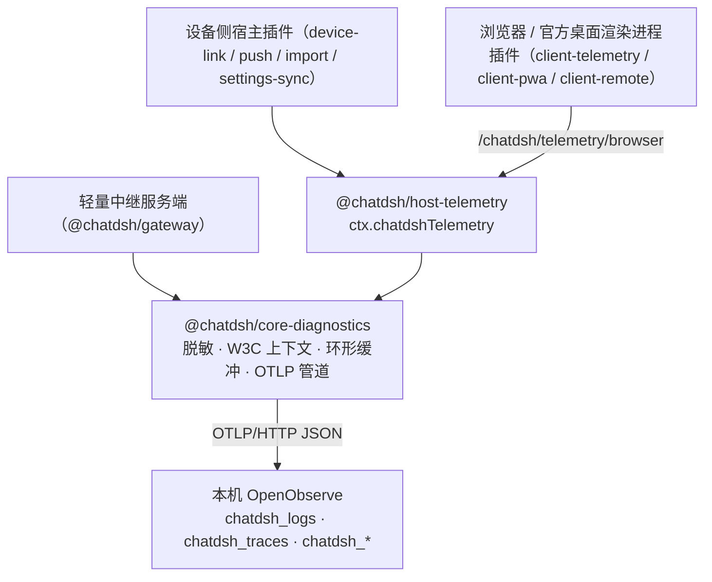

# 遥测与调试接口

本机部署了 OpenObserve，遥测是项目的常设调试设施。本文件规定遥测信号范围、接口清单、命名规范、上下文传播、关闭开关、内容边界与验收方式。每个功能交付必须在同一次提交中完成对应遥测接入，规则见 [`AGENTS.md`](../../AGENTS.md)。

## 一、目标与边界

目标包括四项：定位单次请求经过的组件路径；按 `trace_id` 串联浏览器、中继服务端与设备端插件；按指标趋势发现性能回归；按 `error.code` 聚合全部失败分支。

边界包括四项：遥测数据留在本机 OpenObserve；遥测不替代会话日志与进程崩溃证据；遥测不参与业务判定，导出失败不向业务代码抛异常；关闭开关在全部形态可用且即时生效。

## 二、事实基线

本机 OpenObserve 地址为 `http://127.0.0.1:5080`，组织为 `default`，OTLP/HTTP 路径为 `/api/default/v1/logs`、`/api/default/v1/traces`、`/api/default/v1/metrics`，认证使用 HTTP Basic 并从环境变量读取凭据。日志与追踪通过请求头 `stream-name` 路由至 `chatdsh_logs` 与 `chatdsh_traces`，指标流名由指标名派生。

DSH 环境变量 `DSH_TELEMETRY_DISABLED` 取任何非空值时，本项目的全部遥测同步关闭。

## 三、总体结构

- `@chatdsh/core-diagnostics`：中继服务端、设备端插件与浏览器侧共用的纯诊断库，负责开关判定、属性脱敏、W3C 链路上下文、有界环形缓冲与进程内 OTLP/HTTP 导出管道。
- `@chatdsh/host-telemetry`：宿主平面唯一出口，注册 `ctx.chatdshTelemetry`，提供状态、自检、诊断导出、运行期开关切换以及同源浏览器上报中继端点 `POST /chatdsh/telemetry/browser`。
- 业务代码只调用 `ctx.chatdshTelemetry` 或 `@chatdsh/core-diagnostics` 客户端同名方法，禁止自行构造 exporter 或直接引入 `@opentelemetry/sdk-*`。

## 四、统一服务契约

| 方法 | 语义 |
|---|---|
| `enabled` / `reason` | 只读开关状态与关闭原因（`env`、`settings`、`flag`、`platform`） |
| `event(name, attributes?, body?)` | 记录结构化事件日志，非阻塞入队 |
| `log(level, message, attributes?)` | 记录诊断日志（`debug`、`info`、`warn`、`error`） |
| `counter` / `histogram` / `gauge` | 取得对应指标句柄 |
| `startSpan` / `runSpan` / `runSpanSync` | 创建并自动收尾追踪 span |
| `inject` / `extract` / `withContext` / `currentTraceId` | W3C `traceparent` 与 `tracestate` 注入与还原 |
| `flush` / `shutdown` / `status` / `diagnostics` / `reload` / `setEnabled` | 有界刷新、释放资源、状态查询、脱敏诊断导出与运行期热切换 |

## 五、命名与属性规范

| 形态 | `service.name` | `chatdsh.surface` |
|---|---|---|
| 轻量中继服务端 | `chatdsh-gateway` | `gateway` |
| 设备端 DSH 运行时 | `chatdsh-runtime` | `runtime` |
| 浏览器与官方桌面客户端插件 | `chatdsh-browser` | `browser` |

命名统一为三段式：日志事件 `chatdsh.<domain>.<fact>`，span `chatdsh.<domain>.<operation>`，指标 `chatdsh_<domain>_<measure><后缀>`（计数器 `_total`，直方图 `_seconds` 或 `_bytes`）。

必需资源属性：`chatdsh.surface`、`chatdsh.component`、`chatdsh.instance.id`、`chatdsh.version`、`deployment.environment`。指标属性只取有界枚举（取值上限 32），禁止将 `session.id`、`deviceId`、`request.id`、路径或原文写入指标属性。

## 六、接口清单

构建检查脚本 `runtime/scripts/check-telemetry.mjs` 强制比对三处一致：包内源码调用、包内 `package.json` 的 `chatdsh.telemetry` 声明、本节登记表。

### 6.1 轻量中继服务端（`@chatdsh/gateway`）

| 信号 | 名称 | 触发点 | 必需属性 |
|---|---|---|---|
| span | `chatdsh.gateway.http` | 入站 HTTP 请求 | `http.route`、`http.method`、`http.status_code` |
| span | `chatdsh.gateway.replica.append` | 会话副本追加 | `session.id`、`seq`、`bytes`、`outcome` |
| span | `chatdsh.gateway.device.pair` | 节点配对并签发令牌 | `platform`、`outcome`、`error.type`、`error.code` |
| span | `chatdsh.gateway.device.link` | 设备出站长连接生命周期 | `role`、`platform`、`outcome` |
| span | `chatdsh.gateway.device.request` | 沿设备连接转发请求 | `deviceId`、`outcome`、`http.status_code`、`error.type`、`error.code` |
| span | `chatdsh.gateway.device.proxy` | `/d/<deviceId>/` 前缀转发与 WebSocket 升级 | `deviceId`、`http.method`、`http.status_code`、`outcome`、`error.type`、`error.code` |
| span | `chatdsh.gateway.device.plugins` | 按设备读取插件清单 | `deviceId`、`bundle.count`、`plugin.count`、`outcome`、`error.type`、`error.code` |
| span | `chatdsh.gateway.sessions.list` | 多设备聚合会话列表读取 | `device.count`、`session.count`、`outcome` |
| span | `chatdsh.gateway.ownership.write` | 会话归属写入与设备绑定 | `outcome`、`error.type`、`error.code` |
| span | `chatdsh.gateway.settings.read` | 读取白名单设置快照 | `namespace.count`、`outcome` |
| span | `chatdsh.gateway.settings.write` | 写入白名单设置并推送至在线设备 | `outcome`、`error.type`、`error.code` |
| span | `chatdsh.gateway.client.request` | 私有客户端会话分页读取 | `outcome`、`error.type`、`error.code` |
| span | `chatdsh.gateway.mobile.telemetry` | 移动端遥测批次中转 | `action`、`outcome`、`count`、`error.type`、`error.code` |
| span | `chatdsh.gateway.mobile.devices` | 客户端设备列举与吊销 | `action`、`outcome`、`error.type`、`error.code` |
| span | `chatdsh.gateway.notification.record` | 通知记录写入 | `kind`、`session.id`、`outcome` |
| span | `chatdsh.gateway.notification.list` | 通知中心分页 | `count`、`outcome` |
| span | `chatdsh.gateway.notification.read` | 已读标记 | `count`、`outcome` |
| span | `chatdsh.gateway.notification.handled` | 已处理标记 | `count`、`outcome` |
| span | `chatdsh.gateway.notification.settings` | 通知设置读写 | `action`、`outcome`、`error.type`、`error.code` |
| span | `chatdsh.gateway.notification.subscription` | Web Push 订阅管理 | `action`、`outcome`、`error.type`、`error.code` |
| span | `chatdsh.gateway.notification.probe` | 验证通知发送与回执 | `stage`、`outcome`、`error.type`、`error.code` |
| span | `chatdsh.push.dispatch` | 通知批次投递 | `stage`、`mode`、`count`、`outcome` |
| span | `chatdsh.push.send` | 单次 Web Push 发送 | `outcome`、`http.status_code`、`error.type`、`error.code` |
| event | `chatdsh.gateway.device.rejected` | 配对、长连接升级、协议或前缀转发拒绝 | `action`、`outcome`、`error.type`、`error.code` |
| event | `chatdsh.gateway.device.disconnected` | 设备长连接断开 | `role`、`platform`、`reason` |
| event | `chatdsh.gateway.ownership.rejected` | 会话归属写入拒绝 | `action`、`outcome`、`error.type`、`error.code` |
| event | `chatdsh.gateway.settings.rejected` | 设置同步写入拒绝 | `outcome`、`error.type`、`error.code` |
| event | `chatdsh.gateway.client.rejected` | 私有客户端读取拒绝或失败 | `outcome`、`error.type`、`error.code` |
| event | `chatdsh.gateway.mobile.rejected` | 客户端设备管理拒绝 | `action`、`outcome`、`error.type`、`error.code` |
| event | `chatdsh.gateway.mobile.telemetry.rejected` | 移动端遥测批次拒绝 | `action`、`outcome`、`error.type`、`error.code` |
| event | `chatdsh.gateway.push.failed` | Web Push 发送失败 | `http.status_code`、`error.type`、`error.code`、`outcome` |
| event | `chatdsh.gateway.push.withdrawn` | 审批决定撤回同键提醒 | `count`、`outcome`、`session.id` |
| event | `chatdsh.gateway.push.subscription.expired` | 过期订阅清理 | `count`、`outcome` |
| event | `chatdsh.gateway.notification.rejected` | 通知接口请求拒绝 | `action`、`outcome`、`error.type`、`error.code` |
| metric | `chatdsh_http_requests_total` | 入站 HTTP 请求计数 | `route`、`method`、`status_class` |
| metric | `chatdsh_http_request_duration_seconds` | 入站 HTTP 请求耗时 | `route`、`method` |
| metric | `chatdsh_gateway_device_pairs_total` | 节点配对计数 | `outcome` |
| metric | `chatdsh_gateway_device_links_total` | 设备长连接计数 | `outcome` |
| metric | `chatdsh_gateway_device_requests_total` | 设备连接转发请求计数 | `outcome` |
| metric | `chatdsh_gateway_device_proxies_total` | 前缀路由转发计数 | `outcome` |
| metric | `chatdsh_gateway_device_plugins_total` | 按设备读取插件清单计数 | `outcome` |
| metric | `chatdsh_gateway_ownership_writes_total` | 会话归属写入计数 | `outcome` |
| metric | `chatdsh_gateway_settings_writes_total` | 设置同步写入计数 | `outcome` |
| metric | `chatdsh_gateway_client_requests_total` | 私有客户端读取计数 | `outcome` |
| metric | `chatdsh_mobile_devices_total` | 客户端设备管理操作计数 | `action`、`outcome` |
| metric | `chatdsh_mobile_telemetry_batches_total` | 移动端遥测批次计数 | `outcome`、`error.code` |
| metric | `chatdsh_mobile_telemetry_records_total` | 移动端遥测记录计数 | `signal`、`outcome` |
| metric | `chatdsh_push_deliveries_total` | 推送投递计数 | `device_kind`、`outcome` |
| metric | `chatdsh_push_sends_total` | Web Push 发送计数 | `outcome` |
| metric | `chatdsh_push_subscriptions_total` | 推送订阅状态变更计数 | `action`、`outcome` |
| metric | `chatdsh_gateway_notifications_total` | 通知记录结果计数 | `outcome` |
| metric | `chatdsh_gateway_notification_settings_total` | 通知设置变更计数 | `outcome` |

### 6.2 设备端宿主插件（`@chatdsh/host-*`）

| 信号 | 名称 | 触发点 | 必需属性 |
|---|---|---|---|
| span | `chatdsh.runtime.device.link` | 设备出站长连接生命周期 | `outcome` |
| span | `chatdsh.runtime.device.forward` | 将中继转发请求交给本地运行时 | `method`、`http.status_code`、`outcome`、`error.type`、`error.code` |
| event | `chatdsh.runtime.device.rejected` | 设备出站长连接拒绝或协议违规 | `action`、`outcome`、`error.type`、`error.code` |
| event | `chatdsh.runtime.device.forward.failed` | 转发到本地运行时失败 | `outcome`、`error.type`、`error.code` |
| metric | `chatdsh_runtime_device_links_total` | 设备长连接结果计数 | `outcome` |
| metric | `chatdsh_runtime_device_forwards_total` | 本地转发结果计数 | `outcome` |
| span | `chatdsh.sync.event.push` | 会话事件批次上报中继 | `session.id`、`seq`、`outcome` |
| event | `chatdsh.sync.watermark` | 副本同步水位推进 | `session.id`、`lag.events` |
| metric | `chatdsh_replica_lag_sessions` | 副本落后会话数 | 无 |
| span | `chatdsh.import.seed` | 副本记录构造为会话种子 | `records.count`、`seed.count`、`outcome` |
| span | `chatdsh.sync.import` | 在本机恢复或分叉会话 | `mode`、`events` |
| event | `chatdsh.import.seed.failed` | 副本形状非法导致种子构造失败 | `error.type`、`records.count` |
| metric | `chatdsh_import_seed_total` | 会话种子构造结果计数 | `outcome` |
| span | `chatdsh.sync.settings.push` | 本机白名单设置变更上报中继 | `namespace`、`key`、`outcome` |
| span | `chatdsh.sync.settings.apply` | 接收中继推送写入本机 home 层 | `namespace`、`key`、`outcome` |
| event | `chatdsh.sync.settings.rejected` | 设置同步上报或应用拒绝 | `outcome`、`error.code` |
| event | `chatdsh.sync.settings.failed` | 设置同步通信失败 | `outcome`、`error.type` |
| metric | `chatdsh_sync_settings_pushes_total` | 设置上报结果计数 | `outcome` |
| metric | `chatdsh_sync_settings_applies_total` | 设置应用结果计数 | `outcome` |

### 6.3 浏览器与官方桌面客户端插件（`@chatdsh/client-*`）

| 信号 | 名称 | 触发点 | 必需属性 |
|---|---|---|---|
| span | `chatdsh.client.boot` | 客户端插件引导初始化 | `module.count`、`outcome` |
| span | `chatdsh.client.module.load` | 客户端模块加载 | `module.id`、`outcome` |
| span | `chatdsh.client.remote.call` | 浏览器发起 Remote 或中继请求 | `rpc.method`、`outcome` |
| event | `chatdsh.client.error` | 未捕获前端异常 | `error.type`、`error.code` |
| event | `chatdsh.client.ui.action` | 关键界面动作（切换设备、本机继续、安装 PWA） | `action`、`outcome` |
| metric | `chatdsh_client_errors_total` | 前端错误计数 | `error_type` |

### 6.4 移动端遥测中转允许名与遥测自监控

| 信号 | 名称 | 触发点 | 必需属性 |
|---|---|---|---|
| span | `chatdsh.mobile.startup` | 移动客户端启动 | `outcome` |
| span | `chatdsh.mobile.connect` | 移动客户端连接中继 | `attempt`、`outcome` |
| span | `chatdsh.mobile.push.deliver` | 移动本地通知展示 | `kind`、`outcome` |
| event | `chatdsh.mobile.queue.replay` | 离线草稿或队列处理 | `count`、`outcome` |
| event | `chatdsh.mobile.keystore` | 安全凭据读写 | `action`、`outcome` |
| metric | `chatdsh_mobile_connect_seconds` | 移动端连接耗时 | 无 |
| metric | `chatdsh_mobile_offline_queue_depth` | 移动端待处理队列深度 | 无 |
| event | `chatdsh.telemetry.dropped` | 队列满或未登记属性丢弃 | `signal`、`reason` |
| event | `chatdsh.telemetry.invalid` | 非法 `traceparent` 丢弃 | `carrier`、`reason` |
| event | `chatdsh.telemetry.enabled` | 运行期开启遥测 | `reason` |
| event | `chatdsh.telemetry.disabled` | 运行期关闭遥测 | `reason` |
| event | `chatdsh.telemetry.export.failed` | 导出失败 | `signal`、`error.code` |
| span | `chatdsh.telemetry.probe` | 自检探针写入 | `probe.id` |
| metric | `chatdsh_telemetry_queue_depth` | 导出队列深度 | `signal` |
| metric | `chatdsh_telemetry_dropped_total` | 丢弃计数 | `signal`、`reason` |
| metric | `chatdsh_telemetry_export_failures_total` | 导出失败计数 | `signal`、`status` |
| metric | `chatdsh_telemetry_export_duration_seconds` | 导出耗时 | `signal` |
| metric | `chatdsh_telemetry_self_test_total` | 自检次数 | `probe.id` |

## 七、上下文传播边界

| 边界 | 载体 | 说明 |
|---|---|---|
| 浏览器 / PWA 到中继服务端 | HTTP 头 `traceparent`、`tracestate` | 客户端插件注入 |
| 中继服务端到设备出站长连接 | 通道打开帧 `headers.traceparent`、`headers.tracestate` | 设备侧还原父上下文并新建子 span |
| 设备侧 `host-device-link` 到本地运行时 | HTTP 头 `traceparent`、`tracestate` | 转发时透传 |
| 设备侧副本上报与设置同步到中继 | HTTP 头 `traceparent`、`tracestate` | 上报与下发双向传播 |

## 八、关闭开关与内容边界

- **任一来源关闭即关闭**：`CHATDSH_TELEMETRY=off`、`DSH_TELEMETRY_DISABLED` 非空、设置文件 `telemetry.enabled: false`、`--no-telemetry`、设置页开关或 `POST /chatdsh/telemetry/state`。关闭后零 SDK 对象构造、零出站连接、上报端点返回 404、停止生成与传播 `traceparent`，切换不要求重启进程。
- **内容边界**：严禁记录提示词、模型输出、工具参数与结果原文、文件内容、节点令牌、配对码、Cookie、`Authorization` 头、请求体原文、邮箱、手机号、真实姓名、主机名与内网地址。未登记属性键在非调试模式下丢弃并计入 `chatdsh_telemetry_dropped_total`。
