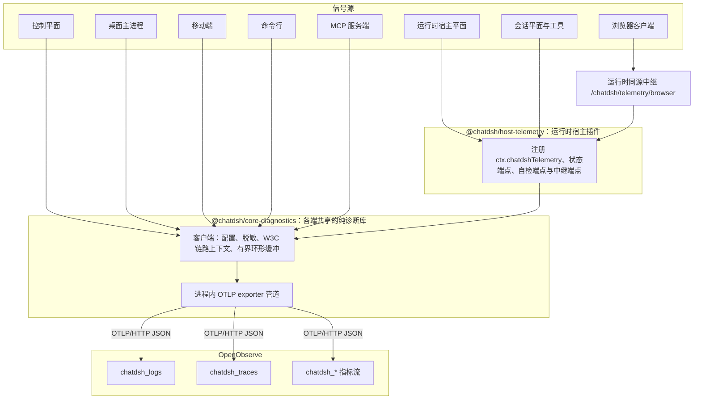

# 遥测与调试接口

本机部署了 OpenObserve，遥测是这个项目的常设调试设施。本文件定下遥测的信号范围、接口清单、命名规范、上下文传播、关闭开关、内容边界与验收方式。任何能力的实现都在同一个提交里交付对应的遥测接入，规则见 [`AGENTS.md`](../AGENTS.md) 的「遥测」一节。

## 一、目标与边界

目标有四项：本地开发时能看清一次请求经过哪些组件；线上（自托管）出问题时能按 `trace_id` 串联客户端、控制平面、运行时与工具；性能回归能按指标趋势发现；每一条失败分支都能在 OpenObserve 里按错误码聚合。

边界同样有四条。遥测数据只留在本机 OpenObserve，不引入任何云服务。遥测不替代会话日志、进程日志与崩溃证据，它们各自承担不同的取证职责。遥测不参与业务判定，导出结果不改变控制流。遥测必须能整体关闭，关闭的操作入口在每个形态里都存在。

## 二、事实基线

以下结果在本机实测，OpenObserve 为 `v1.1.1`，DSH 为 `0.2.1-rc.2`，日期为 2026-10-19。

| 项目 | 实测结果 |
|---|---|
| 服务地址 | `http://127.0.0.1:5080`，`GET /healthz` 返回 200 |
| 组织 | `default` 与 `_meta` 两个组织，本设计使用 `default` |
| OTLP/HTTP 路径 | `/api/default/v1/logs`、`/api/default/v1/traces`、`/api/default/v1/metrics`，三者均返回 200 |
| 认证 | HTTP Basic；凭据错误返回 401。凭据只从环境变量读取 |
| 压缩 | `Content-Encoding: gzip` 被接受 |
| 日志流路由 | 请求头 `stream-name` 决定日志与追踪的流名；缺省写入 `default` 流 |
| 指标流命名 | `stream-name` 对指标不生效；流名由指标名派生，点号换成下划线。`chatdsh.probe.dots` 落在 `chatdsh_probe_dots`，计数器 `chatdsh_sdk_probe_total` 落在同名流，直方图展开为 `_bucket`、`_count`、`_sum`、`_max`、`_min` |
| 属性到列名 | 属性键里的点号在列名里换成下划线：`service.name` 变成 `service_name`，`chatdsh.surface` 变成 `chatdsh_surface` |
| 追踪关联 | 在活动 span 上下文里发出的日志会带 `trace_id` 与 `span_id` 列 |
| 查询接口 | `POST /api/default/_search?type=logs&stream=<流名>`，请求体为 `{"query":{"sql":…,"start_time":<微秒>,"end_time":<微秒>}}` |
| 查询时间窗 | 时间单位为微秒，`start_time` 为 0 会返回 400 `invalid time range` |
| 流清单 | `GET /api/default/streams?type=logs|traces|metrics`，字段结构见 `GET /api/default/streams/<流名>/schema` |
| 随 DSH 分发的 OpenTelemetry 包 | `@opentelemetry/api` 1.9.1，`sdk-logs` 0.222.0，`sdk-trace` 2.11.0，`sdk-metrics` 2.11.0，`otlp-exporter-base` 0.222.0，`otlp-transformer` 0.222.0，`resources` 2.11.0 |

DSH 自带的 `@deepseek-ai/dsh-otel` 只提供两条日志通道：`createEventReporter` 与 `createSessionLogReporter`。追踪与指标需要自建 SDK 管道，管道复用 DSH 安装里已有的 OpenTelemetry 包，不额外安装第二份 SDK。

DSH 上游有两个遥测行。`session-telemetry-otel`（行 id 同名）只在用户提交反馈时上送会话日志，`DSH_TELEMETRY_DISABLED` 取任何非空值都会由启动器把该行禁用。`desktop-product-telemetry` 只在 profile 名为 `desktop` 时启用，端点读 `DSH_PRODUCT_ANALYTICS_OTLP_URL`。ChatDSH 不复用这两行的采集语义，只继承它们的关闭语义：`DSH_TELEMETRY_DISABLED` 非空时，本设计的全部遥测一并关闭。

## 三、总体结构

遥测分三类信号、两条出口。`@chatdsh/core-diagnostics` 是各端共享的纯诊断库，提供客户端、配置、脱敏、自建 W3C 链路上下文、有界环形缓冲与进程内 exporter 管道；`@chatdsh/host-telemetry` 是运行时宿主插件，只负责宿主注册 `ctx.chatdshTelemetry`、状态端点、自检端点与浏览器、移动端中继端点。宿主进程、桌面主进程、命令行、移动端复用 `@chatdsh/core-diagnostics` 的客户端，在各自进程内建立 exporter 直发 OTLP/HTTP；浏览器不持有 OpenObserve 凭据，经运行时同源端点上报，由运行时转发。



三类信号的分工固定下来。日志承载离散事实与失败原因，按严重级别过滤。追踪承载一次操作的调用链与耗时，用 span 表达阶段。指标承载可聚合的计数、耗时分布与当前量，供看板与告警使用。同一个事实可以在三类信号里各出现一次，名称与属性必须一致。

## 四、统一服务契约

通用实现位于 `@chatdsh/core-diagnostics`，提供客户端、配置、脱敏、自建 W3C 链路上下文、有界环形缓冲与三条导出管道；宿主插件位于 `@chatdsh/host-telemetry`，注册 `ctx.chatdshTelemetry`、状态端点、自检端点与浏览器、移动端中继端点。业务代码只调用宿主平面注册的 `ctx.chatdshTelemetry`，每端的等价客户端由 `@chatdsh/core-diagnostics` 提供同名方法。业务包禁止自行构造 OTLP exporter，禁止在业务路径上直接 import `@opentelemetry/sdk-*` 建立第二条管道。

| 方法 | 语义 |
|---|---|
| `enabled` | 只读布尔值，反映当前开关状态 |
| `reason` | 关闭原因，取 `env`、`settings`、`flag`、`platform` 之一；开启时为 `undefined` |
| `event(name, attributes?, body?)` | 记录一条结构化事件日志，非阻塞入队 |
| `log(level, message, attributes?)` | 记录一条诊断日志，`level` 取 `debug`、`info`、`warn`、`error` |
| `counter(name, options?)` | 取得计数器句柄，`add(delta, attributes?)` |
| `histogram(name, options?)` | 取得耗时或尺寸分布句柄，`record(value, attributes?)` |
| `gauge(name, options?)` | 取得当前量句柄，`record(value, attributes?)` |
| `startSpan(name, attributes?)` | 开始一个 span，返回带 `setAttribute`、`recordException`、`end` 的句柄 |
| `runSpan(name, attributes, fn)` | 异步执行 `fn` 并把结果或错误记入 span，自动结束 span |
| `runSpanSync(name, attributes, fn)` | 同步版本 |
| `inject(carrier)` | 把当前上下文写成 W3C `traceparent` 与 `tracestate` |
| `extract(carrier)` | 从 `traceparent` 还原父上下文，非法值记一条日志并返回空上下文 |
| `withContext(carrier, fn)` | 在还原出的上下文里执行 `fn` |
| `currentTraceId()` | 当前 span 的 `trace_id`，没有活动 span 时返回 `undefined` |
| `flush(deadlineMs)` | 有界刷新，超时后返回，不抛出 |
| `shutdown()` | 释放 exporter 与 HTTP 代理，由所属 fiber 的销毁路径调用 |

三个约束在实现里固定。入队不等待网络，业务路径不 `await` 导出。关闭状态下全部方法退化为空操作，不构造 SDK 对象，不创建 socket。入队失败与导出失败只在 `@chatdsh/core-diagnostics` 内部计数，业务代码不捕获遥测异常。

语义化包装器优先于直接调用。一次工具执行写成一个 `runSpan('chatdsh.tool.execute', …)`，内部依次记录开始事件、结果事件与耗时直方图，失败时设置 `error.code` 与 `outcome=failure` 并让 span 状态为 `ERROR`。

## 五、命名与属性规范

`service.name` 按进程形态固定为下表的值，插件不得改写。

| 形态 | service.name | instrumentation scope |
|---|---|---|
| 控制平面 | `chatdsh-gateway` | 包名，例如 `@chatdsh/gateway` |
| 运行时 | `chatdsh-runtime` | 包名 |
| 浏览器客户端 | `chatdsh-browser` | 客户端插件包名 |
| 桌面主进程 | `chatdsh-desktop` | `@chatdsh/desktop` |
| 命令行 | `chatdsh-cli` | 全局 `dsh-tui`，不另设包 |
| 长任务 | `chatdsh-worker` | 包名 |

名称形状统一为三段式：日志事件 `chatdsh.<domain>.<fact>`，span `chatdsh.<domain>.<operation>`，指标 `chatdsh_<domain>_<measure><后缀>`。`domain` 取 `gateway`、`runtime`、`session`、`tool`、`llm`、`memory`、`mcp`、`client`、`desktop`、`mobile`、`cli`、`sync`、`share`、`push`、`schedule`、`telemetry`。

指标后缀按类型固定：计数器加 `_total`，直方图用 `_seconds` 或 `_bytes`，当前量用裸名并带单位后缀。单位遵循 OpenTelemetry 约定：时间用秒，尺寸用字节，比例用 0 到 1 的小数。

必需属性如下表，所有信号都要带。

| 属性 | 含义 | 取值 |
|---|---|---|
| `chatdsh.surface` | 形态 | 上表 `service.name` 的后缀，例如 `runtime` |
| `chatdsh.component` | 产生信号的包或子系统 | 包名或固定的子系统名 |
| `chatdsh.instance.id` | 进程实例标识 | 启动时生成的 UUID，写入资源属性 |
| `chatdsh.version` | 产品版本 | 版本号 |
| `deployment.environment` | 部署环境 | `local`、`dev`、`staging`、`prod` |

上下文属性按可用性附加：`session.id`、`workspace.id`、`account.id`、`turn`、`step`、`tool.name`、`mcp.method`、`provider`、`model`、`request.id`、`error.type`、`error.code`、`outcome`。`account.id` 是控制平面生成的 UUID，不使用邮箱、登录名或设备名。

基数有硬上限。指标属性只能取有界集合，每个属性的取值上限为 32；`session.id`、`workspace.id`、`account.id`、`request.id`、文件路径、工具参数一律不进指标属性，它们只出现在日志与 span 上。这条限制保证指标流的列数与内存不随使用量增长。

## 六、接口清单

清单按形态分组。每一行是一个必须在实现里出现的信号；新增能力时在同一张表里登记，未登记的信号不算交付完成。

### 6.1 控制平面

| 信号 | 名称 | 触发点 | 必需属性 |
|---|---|---|---|
| span | `chatdsh.gateway.http` | 每个入站 HTTP 请求 | `http.route`、`http.method`、`http.status_code` |
| span | `chatdsh.gateway.proxy` | 反代到运行时的转发 | `runtime.id`、`http.status_code` |
| span | `chatdsh.gateway.identity` | 身份头解析与账号匹配 | `auth.mode`、`outcome` |
| span | `chatdsh.gateway.access` | 会话归属判定 | `session.id`、`workspace.id`、`outcome` |
| span | `chatdsh.gateway.runtime.lifecycle` | 运行时启动、就绪、停止、回收 | `action`、`runtime.id`、`outcome` |
| span | `chatdsh.gateway.replica.append` | 会话副本追加 | `session.id`、`seq`、`bytes`、`outcome` |
| span | `chatdsh.gateway.share.render` | 分享快照渲染 | `share.id`、`up_to_seq` |
| span | `chatdsh.gateway.push.deliver` | 推送投递 | `device.kind`、`outcome` |
| span | `chatdsh.gateway.schedule.run` | 定时任务执行 | `task.id`、`action`、`outcome` |
| span | `chatdsh.gateway.power.policy` | 电源策略下发与生效 | `power.mode`、`outcome` |
| event | `chatdsh.gateway.auth.failed` | 认证失败 | `auth.mode`、`error.code` |
| event | `chatdsh.gateway.power.failed` | 阻止睡眠失败或被执行环境拒绝 | `power.mode`、`error.code` |
| metric | `chatdsh_http_requests_total` | 全部入站请求 | `route`、`method`、`status_class` |
| metric | `chatdsh_http_request_duration_seconds` | 全部入站请求 | `route`、`method` |
| metric | `chatdsh_replica_lag_sessions` | 副本落后会话数 | 无 |
| metric | `chatdsh_push_deliveries_total` | 推送投递 | `device.kind`、`outcome` |
| metric | `chatdsh_schedule_runs_total` | 定时任务 | `action`、`outcome` |
| metric | `chatdsh_power_policy_active` | 当前生效的保活与阻止睡眠档位 | `power.mode` |

### 6.2 运行时宿主平面

| 信号 | 名称 | 触发点 | 必需属性 |
|---|---|---|---|
| span | `chatdsh.runtime.boot` | 进程启动到就绪 | 无 |
| span | `chatdsh.runtime.plugin.activate` | 单个插件激活 | `plugin.name`、`outcome` |
| span | `chatdsh.runtime.plugin.patch` | 补丁层应用 | `patch.id`、`matched` |
| span | `chatdsh.runtime.session.create` | 会话创建 | `session.kind` |
| span | `chatdsh.runtime.session.append` | 会话事件追加 | `event.type`、`seq`、`bytes` |
| span | `chatdsh.runtime.session.fork` | 会话分叉 | `parent.session.id`、`boundary` |
| span | `chatdsh.runtime.chat.dispatch` | 聊天回合按后端分派 | `chat.backend`、`outcome` |
| span | `chatdsh.runtime.remote.call` | Remote 方法调用 | `rpc.method`、`outcome` |
| span | `chatdsh.runtime.tool.execute` | 工具执行 | `tool.name`、`outcome` |
| span | `chatdsh.runtime.approval.wait` | 审批等待 | `approval.kind`、`decision` |
| span | `chatdsh.runtime.storage.write` | 结构化存储写入 | `storage.domain`、`outcome` |
| event | `chatdsh.runtime.boot.failed` | 启动失败 | `stage`、`error.type`、`error.code` |
| event | `chatdsh.runtime.plugin.conflict` | 服务注册冲突或席位冲突 | `plugin.name`、`conflict.kind` |
| event | `chatdsh.runtime.approval.decided` | 审批应答 | `decision`、`decided_by` |
| metric | `chatdsh_runtime_boot_seconds` | 启动耗时 | `stage` |
| metric | `chatdsh_sessions_live` | 存活会话数 | `session.kind` |
| metric | `chatdsh_session_events_total` | 会话事件数 | `event.type` |
| metric | `chatdsh_remote_calls_total` | Remote 调用数 | `method`、`outcome`、`error_code` |
| metric | `chatdsh_remote_call_duration_seconds` | Remote 调用耗时 | `method` |
| metric | `chatdsh_process_resident_memory_bytes` | 常驻内存 | 无 |
| metric | `chatdsh_process_cpu_seconds_total` | CPU 时间 | 无 |

### 6.3 会话平面与工具

| 信号 | 名称 | 触发点 | 必需属性 |
|---|---|---|---|
| span | `chatdsh.tool.execute` | 每个工具调用 | `tool.name`、`outcome`、`duration` |
| span | `chatdsh.tool.sandbox` | 沙箱策略判定 | `policy.mode`、`outcome` |
| span | `chatdsh.tool.browser` | 浏览器操作工具 | `method`、`outcome` |
| span | `chatdsh.tool.research` | 深度检索子任务 | `subagent.count`、`outcome` |
| event | `chatdsh.tool.completed` | 工具返回 | `tool.name`、`outcome`、`result.bytes` |
| event | `chatdsh.tool.denied` | 工具被拒绝 | `tool.name`、`error.code` |
| metric | `chatdsh_tool_calls_total` | 工具调用 | `tool`、`outcome` |
| metric | `chatdsh_tool_call_duration_seconds` | 工具耗时 | `tool` |
| metric | `chatdsh_tool_result_bytes` | 结果尺寸 | `tool` |
| metric | `chatdsh_approvals_total` | 审批结果 | `kind`、`decision` |

工具参数、命令文本、文件内容与模型输出不进入任何信号。需要区分调用规模时记录参数字节数、结果字节数与条目数。

### 6.4 模型调用

| 信号 | 名称 | 触发点 | 必需属性 |
|---|---|---|---|
| span | `chatdsh.llm.stream` | 一次模型请求 | `provider`、`model`、`outcome` |
| span | `chatdsh.llm.retry` | 重试 | `attempt`、`error.code` |
| event | `chatdsh.llm.request.completed` | 请求结束 | `provider`、`model`、`prompt.tokens`、`completion.tokens`、`outcome` |
| event | `chatdsh.llm.quota.rejected` | 额度拒绝 | `account.id`、`error.code` |
| metric | `chatdsh_llm_requests_total` | 请求数 | `provider`、`model`、`outcome` |
| metric | `chatdsh_llm_request_duration_seconds` | 请求耗时 | `provider` |
| metric | `chatdsh_llm_first_token_seconds` | 首 token 延迟 | `provider` |
| metric | `chatdsh_llm_tokens_total` | token 计数 | `provider`、`model`、`kind` |

### 6.5 浏览器客户端

| 信号 | 名称 | 触发点 | 必需属性 |
|---|---|---|---|
| span | `chatdsh.client.boot` | 页面加载到界面激活 | `module.count`、`outcome` |
| span | `chatdsh.client.module.load` | 单个客户端模块实例化 | `module.id`、`outcome` |
| span | `chatdsh.client.remote.call` | 浏览器发起 Remote 调用 | `rpc.method`、`outcome` |
| span | `chatdsh.client.stream.reconnect` | 实时通道重连 | `attempt`、`outcome` |
| event | `chatdsh.client.error` | `window.onerror` 与 `unhandledrejection` | `error.type`、`error.code` |
| event | `chatdsh.client.ui.action` | 关键界面动作 | `action`、`outcome` |
| metric | `chatdsh_client_module_load_seconds` | 模块加载耗时 | `module` |
| metric | `chatdsh_client_reconnects_total` | 重连次数 | `outcome` |
| metric | `chatdsh_client_errors_total` | 前端错误 | `error_type` |

浏览器侧的上报走同源端点 `POST /chatdsh/telemetry/browser`。端点接受批量记录，限制单批 64 条与 256 KB，按来源地址限流，校验 `Origin` 与 CSRF 令牌，转发时补上 `chatdsh.surface=browser`。凭据不下发到浏览器。

### 6.6 桌面壳

| 信号 | 名称 | 触发点 | 必需属性 |
|---|---|---|---|
| span | `chatdsh.desktop.startup.<stage>` | 启动五阶段各自一个 span | `stage`、`outcome` |
| span | `chatdsh.desktop.runtime.orchestrate` | 拉起运行时并等待就绪 | `runtime.id`、`outcome` |
| span | `chatdsh.desktop.update.check` | 更新检查与下载 | `channel`、`outcome` |
| span | `chatdsh.desktop.computeruse.lease` | 桌面控制租约 | `action`、`outcome` |
| span | `chatdsh.desktop.power.block` | 电源阻止启动与释放 | `power.mode`、`action`、`outcome` |
| event | `chatdsh.desktop.crash.evidence` | 崩溃证据采集 | `exit.code`、`uptime.seconds` |
| event | `chatdsh.desktop.notification` | 系统通知 | `kind`、`outcome` |
| metric | `chatdsh_desktop_startup_seconds` | 启动阶段耗时 | `stage` |
| metric | `chatdsh_desktop_crashes_total` | 崩溃次数 | `reason` |
| metric | `chatdsh_desktop_power_blockers` | 活动电源阻止器数量 | `power.mode` |

### 6.7 移动端

| 信号 | 名称 | 触发点 | 必需属性 |
|---|---|---|---|
| span | `chatdsh.mobile.startup` | 应用启动 | `outcome` |
| span | `chatdsh.mobile.connect` | 连接控制平面 | `attempt`、`outcome` |
| span | `chatdsh.mobile.push.deliver` | 本地通知投递 | `kind`、`outcome` |
| event | `chatdsh.mobile.queue.replay` | 离线队列重放 | `count`、`outcome` |
| event | `chatdsh.mobile.keystore` | 凭据存储读写 | `action`、`outcome` |
| metric | `chatdsh_mobile_connect_seconds` | 连接耗时 | 无 |
| metric | `chatdsh_mobile_offline_queue_depth` | 离线队列深度 | 无 |

移动端不持有 OpenObserve 凭据，上报经控制平面端点 `POST /chatdsh/telemetry/mobile`，鉴权用设备令牌，属性里带 `device.kind=mobile`。

### 6.8 命令行

| 信号 | 名称 | 触发点 | 必需属性 |
|---|---|---|---|
| span | `chatdsh.cli.command` | 单条命令执行 | `command`、`outcome`、`exit.code` |
| span | `chatdsh.cli.channel.open` | 渠道建立 | `outcome` |
| span | `chatdsh.cli.scene.open` | 场景打开 | `scene` |
| event | `chatdsh.cli.noninteractive.exit` | 非交互模式退出 | `exit.code`、`reason` |
| metric | `chatdsh_cli_commands_total` | 命令执行 | `command`、`outcome` |

### 6.9 MCP 服务端

| 信号 | 名称 | 触发点 | 必需属性 |
|---|---|---|---|
| span | `chatdsh.mcp.session.initialize` | 协议会话初始化 | `protocol.version`、`outcome` |
| span | `chatdsh.mcp.tools.list` | 工具目录列举 | `tool.count` |
| span | `chatdsh.mcp.tools.call` | 工具调用 | `tool.name`、`outcome` |
| event | `chatdsh.mcp.auth.rejected` | 鉴权拒绝 | `error.code` |
| metric | `chatdsh_mcp_calls_total` | 调用数 | `method`、`outcome` |
| metric | `chatdsh_mcp_call_duration_seconds` | 调用耗时 | `method` |

### 6.10 记忆与外部依赖

| 信号 | 名称 | 触发点 | 必需属性 |
|---|---|---|---|
| span | `chatdsh.memory.recall` | 记忆召回（Hindsight 或 Hermes 内置） | `bank.kind`、`hits`、`outcome` |
| span | `chatdsh.memory.write` | 记忆写入（Hindsight 或 Hermes 内置） | `bank.kind`、`outcome` |
| span | `chatdsh.dependency.probe` | Hermes、Hindsight 探活 | `dependency`、`outcome` |
| event | `chatdsh.memory.degraded` | 记忆降级 | `reason` |
| metric | `chatdsh_memory_recall_seconds` | 召回耗时 | `bank_kind` |
| metric | `chatdsh_dependency_probe_failures_total` | 探活失败 | `dependency` |
| span | `chatdsh.import.seed` | 把会话副本还原成会话种子 | `records.count`、`seed.count`、`outcome` |
| event | `chatdsh.import.seed.failed` | 副本形状不合法 | `error.type`、`records.count` |
| metric | `chatdsh_import_seed_total` | 种子构造次数 | `outcome` |
| span | `chatdsh.connectors.sync` | 把连接器记录同步成加载器行 | `connectors.count`、`create.count`、`update.count`、`remove.count`、`outcome` |
| event | `chatdsh.connectors.sync.failed` | 同步失败 | `error.type` |
| metric | `chatdsh_connectors_sync_total` | 同步次数 | `outcome` |

### 6.11 同步、分享与遥测自监控

| 信号 | 名称 | 触发点 | 必需属性 |
|---|---|---|---|
| span | `chatdsh.sync.event.push` | 事件推送到控制平面 | `session.id`、`seq`、`outcome` |
| span | `chatdsh.sync.import` | 会话导入 | `mode`、`events` |
| event | `chatdsh.sync.watermark` | 同步水位变化 | `session.id`、`lag.events` |
| event | `chatdsh.telemetry.dropped` | 队列满丢弃 | `signal`、`reason` |
| event | `chatdsh.telemetry.invalid` | `traceparent` 非法被丢弃 | `carrier`、`reason` |
| event | `chatdsh.telemetry.enabled` | 遥测在进程内开启 | `reason` |
| event | `chatdsh.telemetry.export.failed` | 导出失败 | `signal`、`error.code` |
| span | `chatdsh.telemetry.probe` | 自检探针写一条日志、一个 span 与一个计数器 | `probe.id` |
| metric | `chatdsh_telemetry_queue_depth` | 队列深度 | `signal` |
| metric | `chatdsh_telemetry_dropped_total` | 丢弃计数 | `signal`、`reason` |
| metric | `chatdsh_telemetry_export_failures_total` | 导出失败 | `signal`、`status` |
| metric | `chatdsh_telemetry_export_duration_seconds` | 导出耗时 | `signal` |
| metric | `chatdsh_telemetry_self_test_total` | 自检次数 | `probe.id` |

## 七、上下文传播

跨组件边界逐项固定，缺一项就会出现断链。

| 边界 | 载体 | 说明 |
|---|---|---|
| 浏览器到控制平面 | HTTP 头 `traceparent`、`tracestate` | 浏览器侧由客户端插件注入 |
| 控制平面到运行时 | HTTP 头 `traceparent`、`tracestate` | 反代时透传，不重写 |
| 运行时到工具子进程 | 环境变量 `TRACEPARENT` | 子进程退出后由父 span 收尾 |
| Remote 调用 | 消息信封字段 `traceparent` | 请求与响应各带一次 |
| SSE 与 WebSocket | 首帧与每批事件的 `traceparent` 字段 | 断线重连从游标补齐时新建 span 并链接原 trace |
| 定时任务 | 任务表列 `traceparent` | 延迟执行时还原，跨进程仍能串联 |
| MCP | `params._meta.traceparent` | 客户端与服务端双向传播 |
| 桌面进程间通信 | 消息字段 `traceparent` | 主进程与渲染进程共享 trace |
| 移动端到控制平面 | HTTP 头 `traceparent` | 设备令牌与 trace 分开 |
| 命令行到控制平面 | HTTP 头 `traceparent` | 同浏览器 |

没有父上下文时新建一条 trace，并在资源属性里带 `chatdsh.instance.id`。`traceparent` 格式非法时丢弃该值、新开 trace，并记一条 `chatdsh.telemetry.invalid` 事件，不把非法值写进属性。

## 八、关闭开关

关闭是硬要求，操作入口在每个形态里都要出现，判定采用「任一来源关闭即关闭」。

| 来源 | 写法 | 生效范围 |
|---|---|---|
| 环境变量 | `CHATDSH_TELEMETRY=off` | 当前进程及其子进程 |
| 上游开关 | `DSH_TELEMETRY_DISABLED` 取非空值 | 当前进程，同时关闭上游遥测行 |
| 设置文件 | `$DSH_HOME/settings.yaml` 的 `telemetry.enabled: false` | 运行时与由它拉起的控制平面连接 |
| 启动参数 | `--no-telemetry` | 本次进程 |
| 桌面设置 | 桌面设置的 `telemetry.enabled` | 桌面主进程与渲染进程 |
| 移动端设置 | 移动端设置的 `telemetry.enabled` | 移动应用 |
| 设置页 | 设置页的「遥测」开关 | 运行时与全部客户端，立即生效 |
| 命令行 | `chatdsh telemetry off` 与 `chatdsh telemetry on` | 写入设置文件，等价于设置页操作 |

关闭之后的行为逐项固定。

- 不构造 `@chatdsh/core-diagnostics` 的管道，不创建 `LoggerProvider`、`TracerProvider`、`MeterProvider`，不创建 exporter 与 HTTP 代理。
- 不注册浏览器与移动端上报端点，请求返回 404。
- 不生成、不注入、不校验 `traceparent`。
- 状态端点报告 `enabled: false` 与关闭原因，界面显示「遥测已关闭」。
- 进程在观测窗口内没有任何到 OpenObserve 的出站连接。

运行时切换由 `@chatdsh/host-telemetry` 的控制器承担。关闭时先停止新记录，再以 3 秒为界刷新并销毁 provider；开启时重建 provider 并立即写一条 `chatdsh.telemetry.enabled` 事件。切换不重启进程，不影响进行中的会话与工具调用。

`--no-telemetry` 与 `CHATDSH_TELEMETRY=off` 落在启动器解析阶段，先于任何插件加载生效。设置文件与设置页的切换落在 `@chatdsh/host-telemetry` 的配置重载路径。

## 九、内容边界与脱敏

遥测里禁止出现下列内容：提示词与系统指令、模型输出、工具参数与工具结果原文、文件内容与附件字节、凭据与密钥、Cookie 与 `Authorization` 头、请求体原文、完整 URL 的查询串、邮箱、手机号、真实姓名、主机名、内网地址。

允许记录的是长度、数量、类型、状态、耗时、枚举值与登记过的标识。错误只记 `error.type` 与 `error.code`；`error.message` 默认不记，调试模式下可以记录，但必须经过 `redactMessage` 处理：截断到 200 字符，替换绝对路径、URL 查询串、形似凭据的片段。

脱敏在唯一的出口做。`@chatdsh/core-diagnostics` 提供 `createRedactor(rules)`，规则按属性键与值的形状匹配；业务侧只传登记过的键，未登记的键在关闭调试模式时被丢弃并计数。这条限制让「忘记脱敏」变成一个可观测的丢弃计数，不依赖评审记忆。

凭据读取只记录 `credential.name` 与 `outcome`，值不进入任何信号。模型请求只记录 token 计数与耗时，消息内容不进入遥测。

## 十、采样、批量与容量

采样只作用于追踪。默认 `CHATDSH_TELEMETRY_TRACE_SAMPLE_RATIO=1`，自托管单机下保留全部追踪；资源紧张时按 0.2 到 0.5 配置。日志按级别过滤，默认 `info`；`CHATDSH_TELEMETRY_DEBUG=1` 时记录 `debug` 并放开 `error.message`。指标不采样，按 15 秒周期导出。

队列与批量取值如下，任何一项被调整都要同步更新本表。

| 信号 | 批量条数 | 队列长度 | 导出间隔 | 超时 |
|---|---|---|---|---|
| 日志 | 512 | 2048 | 5 秒 | 3 秒 |
| 追踪 | 512 | 2048 | 5 秒 | 3 秒 |
| 指标 | 不适用 | 不适用 | 15 秒 | 3 秒 |

队列满时丢弃新记录并累加 `chatdsh_telemetry_dropped_total`，不阻塞业务路径。导出失败按 429、502、503、504 重试，上限 5 次，其余状态直接计数。关闭与进程退出时以 3 秒为界刷新，超时后放弃剩余记录并计数。

`@chatdsh/core-diagnostics` 维护一个容量为 32 条的自建有界环形缓冲，只保存最近导出失败与丢弃记录的元数据，字段为 `signal`、`reason` 或 `status`、`at`，不保存日志正文、属性值、载荷与任何原文。缓冲未满时顺序写入；写满后覆盖最旧记录，并把覆盖次数计入 `chatdsh_telemetry_dropped_total`。状态端点的 `recentDiagnostics` 字段返回这个缓冲的有界快照。

容量按单用户自托管估算：一次回合大约产生 40 条日志、12 个 span 与 30 个指标数据点；一天 200 个回合约 8 千条日志与 6 千个 span。建议日志流保留 14 天、追踪流保留 7 天、指标流保留 90 天；OpenObserve 容器的全局压缩保留期为 90 天，高流量调试流在流级设置更短的保留期。

## 十一、调试工作流

OpenObserve 的查询接口统一为 `POST /api/<组织>/_search?type=<信号>&stream=<流名>`，时间窗用微秒。

按错误聚合日志：

```sql
select _timestamp, service_name, severity, body, trace_id, span_id, error_code
from chatdsh_logs
where severity_number >= 13
order by _timestamp desc
limit 100
```

按 `trace_id` 串联一次工具调用：

```sql
select _timestamp, service_name, operation_name, duration, span_status, outcome, tool_name
from chatdsh_traces
where trace_id = '<trace_id>'
order by _timestamp asc
```

```sql
select _timestamp, service_name, body, outcome, error_code, span_id
from chatdsh_logs
where trace_id = '<trace_id>'
order by _timestamp asc
```

查看工具失败趋势：

```sql
select _timestamp, __name__, value, tool, outcome
from chatdsh_tool_calls_total
where outcome = 'failure'
order by _timestamp desc
limit 200
```

自检有两处。运行时开启遥测时提供 `GET /chatdsh/telemetry/status` 与 `POST /chatdsh/telemetry/self-test`：前者返回开关状态、端点、信号列表、队列深度与最近一次导出时间；后者写一条日志、一个 span、一个计数器并返回 `probe_id`，随后可以用 `probe_id` 在三个信号里核对。关闭时 status 返回 `enabled: false` 与原因，self-test 返回 409 `telemetry-disabled`。端点只绑回环，校验 `Origin` 与 CSRF 令牌。

仓库自带 `scripts/telemetry-probe.mjs`，它用 DSH 安装里的 OpenTelemetry 包向本机 OpenObserve 发三类信号，再查询回来核对，退出码表示核对结果；全局关闭状态下它直接退出，不写入数据。用法见脚本头部注释。

## 十二、实现要求

`@chatdsh/core-diagnostics` 提供可复用的客户端、配置、脱敏、自建 W3C 链路上下文与有界环形缓冲，并建立三条进程内导出管道；它不依赖 DSH 适配层。`@chatdsh/host-telemetry` 是宿主平面的唯一出口，注册 `ctx.chatdshTelemetry`、状态端点、自检端点与浏览器、移动端中继端点，负责运行时开关切换与配置重载。它声明 `inject: ["otel", "webServer", "settings"]`，缺少任一服务时启动失败并给出缺失项。

每个新增包在 `package.json` 里声明遥测面，供评审与构建检查比对：

```json
{
  "chatdsh": {
    "telemetry": {
      "events": ["chatdsh.tool.completed", "chatdsh.tool.denied"],
      "spans": ["chatdsh.tool.execute"],
      "metrics": ["chatdsh_tool_calls_total", "chatdsh_tool_call_duration_seconds"]
    }
  }
}
```

构建检查比对三处：包内源码出现的每个 `chatdsh.` 事件名与 `chatdsh_` 指标名都必须在本包的 `chatdsh.telemetry` 里声明；声明里的每个名称都必须在本包源码里出现；声明里的每个名称都必须登记在第六节的清单里。第五节登记的属性键在比对时排除。任一条不满足按构建失败处理；`packages` 目录还不存在时，校验器打印提示并通过。

各端接入位置固定如下。

| 端 | 接入点 | 说明 |
|---|---|---|
| 控制平面 | 进程入口注入 `traceparent` 中间件，HTTP 路由统一包装 | 反代透传上游上下文 |
| 运行时 | 宿主平面插件在 fiber 启动时创建 provider，销毁时 `shutdown` | 工具与 Remote 走语义化包装器 |
| 浏览器 | 客户端插件在启动早期安装错误钩子与上报队列 | 上报走同源端点 |
| 桌面 | 主进程在单实例锁之后创建 provider | 启动五阶段各自一个 span |
| 移动端 | 应用启动时创建 provider，经控制平面端点上报 | 不持有 OpenObserve 凭据 |
| 命令行 | 进程入口创建 provider，退出前有界刷新 | 每条命令一个 span |
| MCP 服务端 | 协议会话建立时创建 provider | 每个方法一个 span |

## 十三、验收

开启状态：启动运行时后执行 `node scripts/telemetry-probe.mjs`，日志、追踪、指标三类信号都能查询到，退出码为 0。

串联状态：调用一次工具，用返回的 `trace_id` 查询日志与追踪，控制平面、运行时与工具的 span 属于同一条 trace，日志带同一个 `trace_id`。

关闭状态：设置 `CHATDSH_TELEMETRY=off` 启动运行时，`GET /chatdsh/telemetry/status` 返回 `enabled: false` 且 `reason` 为 `env`，浏览器上报端点返回 404，OpenObserve 对应流在 5 分钟窗口内文档数不增加，`ss -tnp` 看不到到 5080 的连接。

设置页状态：在设置页关闭遥测，同一进程内状态端点立即转为关闭，进行中的会话不受影响；再次开启后新事件重新出现在流里。

脱敏状态：构造一次带 `Authorization` 头与文件内容的调用，查询全部三个信号，`authorization`、文件内容与提示词都查不到；丢弃计数出现在 `chatdsh_telemetry_dropped_total`。

容量状态：连续执行 200 次工具调用，业务耗时没有随遥测队列增长而线性上升，`chatdsh_telemetry_queue_depth` 回到基线，没有未被计数的丢弃。

构建状态：`node scripts/check-telemetry.mjs` 通过，声明与代码里的名称一致；新增信号同时出现在 [`docs/telemetry.md`](telemetry.md) 的清单里。
