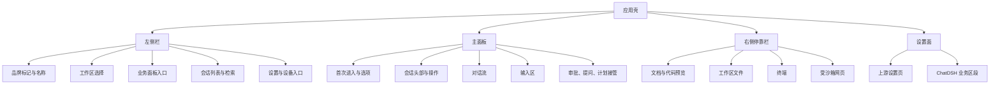

# 客户端界面功能清单

本文件记录功能清单与实现程度，目标交互使用[完整客户端规格](<client-complete-spec.md>)，产品设计入口为[完整设计稿](<ui-design/complete.html>)，实施与验收使用[工作包](<implementation-work-packages.md>)。下表中的实现状态只表示实际已有能力，设计稿交付不改变产品实现状态。

实现程度取四种值：

- **已完成**：数据接口与界面入口都已存在。
- **部分完成**：数据接口与界面入口存在，但只覆盖该功能点列出的部分能力，缺项在同一行写明。
- **接口完成**：宿主侧数据接口或控制平面接口已存在，界面只实现了其中一部分。
- **设计目标**：架构文档已经确定，界面与接口尚未实现。

「已完成」与「部分完成」都表示数据接口与最简界面入口已经存在，视觉、布局与完整交互仍属于本次界面基础设计的范围。

## 一、界面骨架与席位

Web、PWA、桌面渲染进程复用 `dsh-client-ui-*` 内容层，外壳聚合设备会话，当前窗口只保留一个设备 iframe。命令行使用 `dsh-tui` 贡献点，仅连接本机运行时。ChatDSH 自建能力以客户端插件接入既有席位。目标中的设备归属、访问认证、离线草稿、只读副本与继续动作统一遵循[完整客户端规格](<client-complete-spec.md>)第二节；本清单的现状字段与目标界面分别注明。

### 1.1 可注册席位

| 席位 | 基数 | 用途 | 当前注册者 |
|---|---|---|---|
| `main` | `keyed` | 主面板切换，按面板标识区分 | 上游 `ui-layout` |
| `sidebar` | `single` | 左侧栏整体 | 上游 `ui-layout` |
| `sidebar.brand.mark` | `single` | 品牌标记 | 上游 `ui-brand-official` |
| `sidebar.brand.name` | `single` | 品牌名称 | 上游 `ui-brand-official` |
| `sidebar.panellist` | `list` | 左侧栏业务面板入口 | `client-projects`、`client-context-insights` |
| `sidebar.workspaces` | `single` | 工作区切换 | 上游 `ui-workspace` |
| `sidebar.settings` | `single` | 设置入口 | 上游 `ui-settings` |
| `sidebar.footer.action` | `list` | 左侧栏底部动作 | 上游插件 |
| `settings.section` | `list` | 设置页区段 | 上游各设置页与十个 ChatDSH 业务区段 |
| `settings.general.item` | `list` | 通用设置条目 | 上游 `ui-settings-general` |
| `settings.plugins.tab` | `list` | 插件设置页签 | 上游 `ui-settings-plugins` |
| `conversation.composer` | `chain` | 输入区接管链 | 上游审批、提问、计划按优先级接管 |
| `conversation.view` | `list` | 对话流视图扩展 | 上游 |
| `conversation.session.header.actions` | `list` | 会话头部动作 | 上游 |
| `conversation.hero.options` | `list` | 首次进入选项 | 上游 |
| `conversation.input.dock` | `list` | 输入区停靠动作 | 上游 |
| `sidebar.right.pane.tab` | `keyed` | 右侧栏页签类型 | 上游文档预览、文件、终端、网页 |

自建业务区段当前注册顺序：

| 顺序 | 区段标识 | 包 |
|---|---|---|
| 40 | `chatdsh-artifacts` | `@chatdsh/client-artifacts` |
| 45 | `chatdsh-assistants` | `@chatdsh/client-assistants` |
| 46 | `chatdsh-model-provider` | `@chatdsh/client-model-provider` |
| 47 | `chatdsh-skills` | `@chatdsh/client-skills` |
| 48 | `chatdsh-automation` | `@chatdsh/client-automation` |
| 50 | `chatdsh-share` | `@chatdsh/client-share` |
| 55 | `chatdsh-devices` | `@chatdsh/client-account` |
| 60 | `chatdsh-memory` | `@chatdsh/client-memory` |
| 65 | `chatdsh-approval` | `@chatdsh/client-approval` |
| 70 | `chatdsh-connectors` | `@chatdsh/client-connectors` |

### 1.2 全局状态

所有页面与面板统一覆盖以下状态。基础设计需要为每一种状态给出稳定的容器尺寸与版式，避免加载完成时页面跳动。

| 状态 | 界面要求 |
|---|---|
| 加载中 | 骨架屏或尺寸稳定的占位，保留标题与入口 |
| 空 | 说明当前没有什么，给出下一步动作 |
| 失败 | 说明哪一项读取失败，给出重试入口，不隐藏其他可用区域 |
| 只读 | 保留内容与元数据，输入区换成明确说明，不显示可编辑控件 |
| 离线 | 分别显示客户端连接与目标设备状态；保留可编辑草稿，发送和审批提交明确失败，不自动重发 |
| 待处理 | 审批、提问、导入及在线队列暂停后的待处理项目给出计数与入口 |
| 权限不足 | 说明缺少的系统权限、访问认证或执行授权，给出处理方式 |
| 已停用 | 控件保留在页面上并标注原因，避免用户误以为功能消失 |
| 危险动作 | 删除、撤销、清理、撤销分享使用确认弹窗，写明影响范围 |
| 降级 | 后端不可达时保留最近一次读数与降级时间，不伪造成功 |

主题颜色统一使用[主题契约](<theme-plugin-contract.md>)定义的语义令牌，目标取值与可访问性要求见[完整客户端规格](<client-complete-spec.md>)和[完整设计稿](<ui-design/complete.html>)，不在业务组件里写死颜色。

## 二、共享内容层功能清单

Web、移动端、桌面渲染进程共用这一层。命令行不复用 React 组件，但功能点按同一份清单在终端里重建。

### 2.1 左侧栏与全局导航

| 编号 | 功能点 | 界面元素 | 数据与动作 | 必须覆盖的状态 |
|---|---|---|---|---|
| UI-01 | 品牌标记与名称 | 标记、产品名 | 上游 `ui-brand-official` | 窄屏折叠 |
| UI-02 | 工作区选择 | 当前工作区名称、切换列表、工作区类型标记 | 上游 `ui-workspace`，工作区记录带设备绑定 | 无工作区、设备离线、只读 |
| UI-03 | 新建会话 | 主按钮或图标按钮 | 创建聊天会话或工作会话，选择目录与 agent preset | 无可用目录、preset 锁定、运行时未就绪 |
| UI-04 | 会话检索 | 搜索框、结果列表 | 上游 `session-query`，按标题、内容、工作区过滤 | 无结果、检索不可用、索引未就绪 |
| UI-05 | 会话列表 | 标题、最后活动时间、未读计数、会话类型、设备在线状态、来源设备 | 会话索引与控制平面归属表 | 空列表、加载失败、设备离线、只读副本、已删除 |
| UI-06 | 会话分组 | 按工作区、时间或来源设备分组 | 客户端本地分组 | 分组为空 |
| UI-07 | 业务面板入口 | 项目、上下文占用等条目 | `sidebar.panellist` 注册项 | 面板不可用、加载失败 |
| UI-08 | 设置入口 | 设置按钮 | 上游 `sidebar.settings` | 未登录、只读形态 |
| UI-09 | 底部动作 | 设备、访问、帮助与状态 | `sidebar.footer.action` | 离线、访问会话失效 |
| UI-10 | 连接状态 | 控制平面连接、目标设备在线或离线 | WebSocket 与 SSE 状态 | 断线重连、重连失败 |
| UI-11 | 命令面板 | 快捷键唤起的命令搜索 | 上游 `shortcuts` 与 `commands` | 无匹配命令 |

### 2.2 主面板与对话

| 编号 | 功能点 | 界面元素 | 数据与动作 | 必须覆盖的状态 |
|---|---|---|---|---|
| UI-12 | 首次进入 | 欢迎语、选项卡片、工作区与模型选择 | `conversation.hero.options` | 未配置模型、未选择工作区、欢迎提示已读 |
| UI-13 | 会话头部 | 标题、工作区、来源设备、模型、权限档位、agent preset、操作按钮 | 会话头字段与 `session.header.actions` | 只读、设备离线、preset 锁定 |
| UI-14 | 消息流 | 用户、助手、系统、开发者消息，Markdown、代码块、引用 | 会话事件流 | 空会话、流式输出、历史分页、解析失败 |
| UI-15 | 流式输出 | 增量文本、停止按钮、等待首字 | SSE 与 `ui-chat` | 首字等待、长文本、连接中断 |
| UI-16 | 回合状态 | 回合进度、步骤、当前工具 | `ui-trajectory`、`ui-chat` | 执行中、已停止、失败、等待审批 |
| UI-17 | 工具调用树 | 调用名、参数摘要、结果、耗时、错误 | `ui-tool` | 运行中、成功、失败、结果被截断 |
| UI-18 | 附件 | 图片、文件、上传进度、来源 | `ui-attachment` | 上传中、失败、需源设备在线、不可预览 |
| UI-19 | 回合尾卡片 | 产出文件、变更摘要、后续动作 | `ui-deliverables` | 无产出、部分产出、生成中 |
| UI-20 | 消息反馈 | 赞、踩、反馈原因 | `ui-message-feedback` | 已提交、提交失败、不可用 |
| UI-21 | 外部打开 | 在编辑器、文件管理器或浏览器打开 | `ui-open-in-app` | 桌面可用、Web 不可用、目标不存在 |
| UI-22 | 轨迹视图 | 事件台账、工具调用、步骤时间线 | `ui-trajectory` | 长会话折叠、过滤无结果 |
| UI-23 | 审批接管 | 审批卡片、工具名、原因、允许一次、拒绝、本会话允许、始终允许 | `ui-approval` 与 `conversation.composer` 接管链 | 等待中、已作答、超时、另一端已处理、离线 |
| UI-24 | 提问接管 | 问题、选项、自由输入、超时 | `ui-user-questions` | 等待回答、已回答、已过期、上下文已变化 |
| UI-25 | 计划模式 | 计划面板、步骤状态、退出计划模式 | `ui-plan` | 计划生成中、执行中、被中断 |
| UI-26 | 目标条 | 当前目标、进度、清除目标 | `ui-goal` | 无目标、已完成、已放弃 |
| UI-27 | 子代理会话 | 子会话目录、状态、跳转 | `ui-subagent` | 运行中、完成、失败 |
| UI-28 | 工作流节点 | 工作流运行状态与节点 | `ui-workflow-run` | 排队、运行、失败、完成 |
| UI-29 | 审批记录 | 设置页待处理列表与最近结果 | ChatDSH `client-approval` | 无待处理、加载失败、作答忙 |
| UI-30 | 会话分享 | 生成快照链接、复制链接、撤销 | ChatDSH `client-share` 与 `share` 工具 | 副本缺失、已撤销、已过期、无访问记录 |

### 2.3 输入区

| 编号 | 功能点 | 界面元素 | 数据与动作 | 必须覆盖的状态 |
|---|---|---|---|---|
| UI-31 | 文本输入 | 多行输入、发送、换行、快捷键 | 会话控制器 | 空输入、超长输入、输入法组合中 |
| UI-32 | 附件 | 文件选择、拖放、粘贴图片、拍照入口 | 附件服务 | 上传中、失败、大小超限 |
| UI-33 | 斜杠命令 | `/` 触发的命令面 | `ui-input-trigger`、`ui-commands` | 无匹配、命令不可用 |
| UI-34 | 引用与技能 | `@` 触发的引用源、技能、子代理 | `ui-reference`、`ui-skill`、`ui-subagent` | 无匹配、权限不足 |
| UI-35 | 模型选择 | 当前模型、模型列表、能力标记 | `ui-model-selection` | 无模型、额度不足、提供方不可达 |
| UI-36 | 权限档位 | 只读、询问、允许等档位 | `ui-permission-presets` | 会话中不可改、策略由宿主决定 |
| UI-37 | agent preset | 聊天档、工作档、全量档 | `ui-agent-preset` | 会话已开始后锁定、档位装配失败 |
| UI-38 | 计划模式开关 | 进入或退出计划模式 | `ui-plan` | 当前回合不可切换 |
| UI-39 | 在线消息队列 | 排队消息、编辑、删除、立即发送 | `ui-conversation` 队列，仅用于在线执行中的回合 | 回合执行中、队列满、失联暂停、恢复后手动处理、发送失败 |
| UI-40 | 停止与中断 | 停止当前回合 | 会话控制器 | 停止中、已停止、停止失败 |

### 2.4 右侧停靠栏

右侧栏按页签类型注册，同一类型只有一个页签实例。

| 编号 | 功能点 | 界面元素 | 数据与动作 | 必须覆盖的状态 |
|---|---|---|---|---|
| UI-41 | 文档与代码预览 | 文件路径、语法高亮、行号、只读标记 | `ui-sidebar-documentpreview` | 文件不存在、二进制、内容过大 |
| UI-42 | 工作区文件树 | 目录树、刷新、新建、重命名、删除 | `ui-sidebar-files` | 无工作区、权限不足、设备离线 |
| UI-43 | 交互终端 | 终端标签、输入、复制、清屏 | `ui-sidebar-terminal` | 连接中、断开、命令失败 |
| UI-44 | 受沙箱网页 | 地址栏、页面视图、前进后退 | `ui-sidebar-browser` | Web 形态关闭、桌面补回、页面加载失败 |
| UI-45 | 页签管理 | 打开、关闭、切换、固定 | `SidebarRightTabRegistry` | 页签已存在、页签类型不可用 |

### 2.5 设置面

上游设置页保留原有归属，ChatDSH 只追加业务区段。

| 编号 | 功能点 | 页面 | 必须覆盖的状态 |
|---|---|---|---|
| UI-46 | 通用设置 | `ui-settings-general` | 欢迎提示、语言、主题、启动行为 |
| UI-47 | 模型设置 | `ui-settings-models` | 提供方、模型、凭据、连通性 |
| UI-48 | 插件设置 | `ui-settings-plugins`、`ui-settings-plugin-inventory` | 启用、停用、安装、组合、冲突 |
| UI-49 | 外壳设置 | `ui-settings-shell` | 终端、编辑器、外部程序 |
| UI-50 | Agent 循环设置 | `ui-settings-agent-loop` | 超时、重试、压缩 |
| UI-51 | 子代理设置 | `ui-settings-subagent` | 并发、模型、工具范围 |
| UI-52 | 网页检索设置 | `ui-settings-web-search` | 提供方、密钥、超时 |
| UI-53 | 会话日志设置 | `ui-settings-session-log` | 存储位置、保留期、导出 |
| UI-54 | 插件管理页 | `ui-plugin-manager` | 安装中、启用失败、版本不兼容 |
| UI-55 | 插件市场 | `ui-plugin-market` | 索引不可达、无结果、安装确认 |
| UI-57 | 任务面板 | `ui-jobs` | 运行中、完成、失败、日志 |
| UI-58 | 上游账号设置 | `ui-settings-account` | 单用户部署关闭；目标设备管理与可选访问认证见 S17、S18，不建立账号表 |

### 2.6 触发管线与快捷操作

| 编号 | 功能点 | 触发方式 | 必须覆盖的状态 |
|---|---|---|---|
| UI-59 | 命令搜索 | `/` 或快捷键 | 无匹配、命令执行失败 |
| UI-60 | 引用源 | `@` | 无结果、引用失效 |
| UI-61 | 技能选择 | `@` 或技能目录 | 技能停用、加载失败 |
| UI-62 | 子代理选择 | `@` 或会话操作 | 并发已满、模型不可用 |
| UI-63 | 目录选择 | 新建工作会话时 | 原生选择器、浏览式选择器、远程列举加手输 |
| UI-64 | 快捷键 | 全局与局部快捷键 | 冲突提示、可重置 |

## 三、Web 端功能清单

Web 端的运行形态是控制平面反向代理加 `dsh-web-frontend` 外壳。浏览器只与控制平面通信，运行时不对外监听。

### 3.1 进入与访问认证

| 编号 | 功能点 | 界面元素 | 数据与动作 | 状态 |
|---|---|---|---|---|
| WEB-01 | 首次访问 | 欢迎页、接入说明、进入按钮 | 控制平面接入与现有欢迎流程；目标使用受信任网络及可选单用户访问认证，不读取身份头部 | 已完成 |
| WEB-02 | 应用登录 | 密码输入、通行密钥按钮、错误提示 | `authMode` 为 `local` 或 `tailscale+local` | 设计目标 |
| WEB-03 | 两步验证 | TOTP 输入、恢复码、通行密钥确认 | `twoFactor` 为 `totp` 或 `webauthn` | 设计目标 |
| WEB-04 | 设备会话 | 当前设备、登录时间、有效期、续期窗口、退出其他设备 | 设备会话记录 | 设计目标 |
| WEB-05 | 首次配置 | 工作区选择、模型凭据、欢迎提示 | 上游欢迎页与设置页 | 已完成 |
| WEB-06 | 连接状态 | 在线、重连、离线提示 | SSE 与 API 状态 | 接口完成 |

### 3.2 页面清单

| 编号 | 页面 | 主要内容 | 状态 |
|---|---|---|---|
| WEB-07 | 主对话页 | 三栏骨架、会话、输入区、右栏 | 已完成 |
| WEB-08 | 设置页 | 上游设置页与十个 ChatDSH 业务区段 | 部分完成 |
| WEB-09 | 分享快照页 | 当前已有只读事件页；目标显示固定内容范围、建立时间和只读声明，内部序号不进入界面 | 已完成 |
| WEB-10 | 诊断页 | 遥测状态、连接状态、插件清单、运行版本 | 设计目标 |
| WEB-11 | 工作区文件页 | 文件树、预览、下载 | 上游能力，随工作区可用 |
| WEB-12 | 插件管理页 | 安装、启用、停用、组合、市场发现 | 上游能力 |

Web 形态不提供受沙箱网页页签，浏览器操作由会话工具承担。目录选择使用浏览式后端。桌面控制两行不加载。

## 四、移动端功能清单

移动端目标是 PWA：外壳与控制平面同源，右栏 iframe 加载 `/d/<deviceId>/` 的完整页面，左栏聚合全部设备的会话。当前仓库仍有 Android 原生宿主承载 WebView 的实现，其实际验收记录见[验收状态](<acceptance.md>)移动端章节；目标安装、通知、权限和离线交互使用[完整客户端规格](<client-complete-spec.md>)S26、S27。以下状态列保留现有 PWA 能力的实现程度。

### 4.1 外壳侧功能

| 编号 | 功能点 | 界面表现 | 状态 |
|---|---|---|---|
| MOB-01 | 访问接入 | 受信任网络或可选单用户访问认证 | 设计目标 |
| MOB-02 | 设备注册 | 设备名称、平台、角色、最后在线和推送权限/订阅状态 | 设计目标 |
| MOB-03 | 通知投递 | 前台长连接、后台本地通知、通知撤回 | 设计目标 |
| MOB-04 | 附件上传 | 拍照、相册、文件选择、上传进度 | 设计目标 |
| MOB-05 | 语音上传 | 录音、上传、转写状态 | 设计目标 |
| MOB-06 | 目录选择 | 远程列举目录、手输路径 | 设计目标 |
| MOB-07 | 文件打开 | 下载后交给系统打开方式 | 设计目标 |
| MOB-08 | 安全区与缩放 | 系统栏、输入法内边距、字体缩放 | 设计目标 |
| MOB-09 | 离线草稿 | 保留编辑内容、明确发送失败、恢复后手动发送 | 设计目标 |

### 4.2 浏览器侧功能

| 编号 | 功能点 | 界面表现 | 状态 |
|---|---|---|---|
| MOB-10 | 窄屏骨架 | 左侧栏改抽屉，中栏占满，右栏全屏滑出 | 设计目标 |
| MOB-11 | 会话列表 | 全宽列表、未读、来源设备与离线标记 | 设计目标 |
| MOB-12 | 对话页 | 顶部会话与执行设备、消息流、工具卡片、审批卡片、底部输入 | 设计目标 |
| MOB-13 | 审批与提问 | 全屏或底部抽屉形式 | 设计目标 |
| MOB-14 | 跨设备会话 | 打开别的设备的会话时给「在远程继续」与「在本机继续」两个动作，目标是设备离线时给出离线遮罩 | 设计目标 |
| MOB-15 | 设置页 | 上游设置页与 ChatDSH 业务区段重排 | 设计目标 |
| MOB-16 | 分享页 | 只读快照的窄屏版式 | 设计目标 |

所有客户端离线时只保留可编辑草稿，发送与审批提交明确失败，恢复后需要用户手动处理。在线回合中的消息队列在失联时暂停，不自动重发。跨设备会话按「在远程继续」与「在本机继续」两个显式动作处理。

## 五、桌面端功能清单

桌面端是 Electron 主进程、控制平面、运行时、渲染进程四者相互独立。渲染进程加载与 Web 相同的前端产物，差异集中在原生能力与补回的上游席位上。

### 5.1 渲染进程功能

与 Web 端完全相同，额外补回受沙箱网页页签，并使用原生目录选择器。桌面控制的状态与权限提示由宿主侧提供数据，界面需要专用的确认弹窗与运行指示。

| 编号 | 功能点 | 界面表现 | 状态 |
|---|---|---|---|
| DESK-01 | 与 Web 相同的对话、设置、业务区段 | 同一套界面 | 已完成 |
| DESK-02 | 受沙箱网页页签 | 右栏网页页签 | 上游能力，桌面补回 |
| DESK-03 | 原生目录选择 | 系统目录选择器 | 设计目标 |
| DESK-04 | 桌面控制开启确认 | 能力说明、平台限制、屏幕采集说明、确认按钮 | 设计目标 |
| DESK-05 | 桌面控制运行指示 | 持续指示条、当前目标应用、一键中断 | 设计目标 |
| DESK-06 | 桌面控制审计 | 每次操作的应用身份、动作、结果、不可重试标记 | 设计目标 |
| DESK-07 | 权限检查 | 辅助功能、屏幕录制、系统版本、缺失项说明 | 设计目标 |

### 5.2 主进程原生界面

| 编号 | 功能点 | 界面表现 | 状态 |
|---|---|---|---|
| DESK-08 | 原生菜单 | 文件、编辑、视图、帮助 | 设计目标 |
| DESK-09 | 窗口状态恢复 | 位置、尺寸、最大化状态 | 设计目标 |
| DESK-10 | 托盘 | 打开窗口、状态、退出 | 设计目标 |
| DESK-11 | 系统通知 | 回合结束、待审批、通知撤回 | 设计目标 |
| DESK-12 | 保活与电源 | 阻止睡眠与屏幕关闭的开关与状态 | 设计目标 |
| DESK-13 | 应用更新 | 检查、下载进度、重启安装、通道与版本 | 设计目标 |
| DESK-14 | 安全模式 | 安全模式启动说明、恢复入口 | 设计目标 |
| DESK-15 | 启动失败恢复 | 失败阶段、原始原因、重试、导出诊断 | 设计目标 |
| DESK-16 | 崩溃证据 | 退出码、存活时长、stderr 尾部、导出 | 设计目标 |

首期目标平台是 Windows x64。macOS 随 macOS 桌面壳提供。Linux 节点只装命令行组件，不加载桌面控制两行。

## 六、命令行功能清单

命令行目标是 `dsh-tui` 插件，复用准入协议与贡献点，仅连接本机运行时，业务能力通过命令提供。当前仓库只有 `chatdsh-cli` profile 挂载 `dsh-tui`，自建命令行插件包尚未建立。目标交互与范围见[完整客户端规格](<client-complete-spec.md>)S32。

| 编号 | 功能点 | 终端表现 | 数据与动作 | 状态 |
|---|---|---|---|---|
| CLI-01 | 渠道接入 | 连接状态、重连提示 | 实现 `Channel` 的 `open`、`subscribe`、`invoke`、`close` | 设计目标 |
| CLI-02 | 会话列表 | 命令树或列表 | 本机运行时会话索引 | 设计目标 |
| CLI-03 | 打开会话 | 全屏场景 | `Scenes` 注册 | 设计目标 |
| CLI-04 | 发消息与流式事件 | 增量文本、工具调用、回合状态 | `MessageObserver` | 设计目标 |
| CLI-05 | 审批应答 | 审批卡片与选项 | `DecisionEvents` 与审批链路 | 设计目标 |
| CLI-06 | 工作区选择 | 本机工作区列表、目录浏览与手动输入路径 | `WorkspaceProvider` | 设计目标 |
| CLI-07 | 设置页 | 模型、供应方、登录状态 | `SettingsSections` | 设计目标 |
| CLI-08 | 侧栏面板 | 面板列表、徽标、紧凑模式 | `Panels` | 设计目标 |
| CLI-09 | 命令树 | 命令补全与执行 | `CommandTrees` | 设计目标 |
| CLI-10 | 非交互模式 | 按行输出 JSON | `dsh --profile headless "<任务>"` | 设计目标 |
| CLI-11 | ACP 接入 | 外部编辑器中的会话 | `dsh --profile acp` | 设计目标 |
| CLI-12 | 状态栏 | 连接、模型、审批、任务状态 | `Extensions` 状态栏 | 设计目标 |

命令行不建立制品、记忆、分享的独立面板。这些能力以命令形式暴露。命令行不声明桌面控制能力。

## 七、自建客户端插件功能清单

十个插件注册设置页区段，两个插件注册左侧栏面板，一个插件没有可见界面。

### 7.1 `@chatdsh/client-projects`

席位：`sidebar.panellist`，面板标识 `panel.chatdsh.projects`。当前界面只显示项目数量与读取状态。

| 编号 | 功能点 | 界面元素 | 数据与动作 | 必须覆盖的状态 | 状态 |
|---|---|---|---|---|---|
| PROJ-01 | 项目入口 | 左侧栏条目、项目数量 | `chatdshProjects/list` | 加载中、失败、空、数量 | 接口完成 |
| PROJ-02 | 项目列表 | 项目名称、目录路径、最后修改时间 | `list` 返回 `path`、`title`、`instructions`、`defaultModel`、`updatedAt` | 空列表、无标题时显示目录末段 | 接口完成 |
| PROJ-03 | 项目详情 | 标题、目录、项目说明、默认模型 | `chatdshProjects/get` | 记录不存在、路径不可访问 | 接口完成 |
| PROJ-04 | 新建项目 | 目录选择、标题输入、说明编辑、默认模型选择 | `chatdshProjects/set` | 目录重复、路径为空、保存失败 | 接口完成 |
| PROJ-05 | 编辑项目 | 同上，带原值 | `set` | 未保存离开提示、保存冲突 | 接口完成 |
| PROJ-06 | 删除项目 | 删除确认 | `chatdshProjects/delete` | 确认弹窗、删除失败 | 接口完成 |
| PROJ-07 | 从项目开始会话 | 新建会话按钮、默认模型与说明带入 | 创建会话时读取项目记录 | 目录不可用、模型不可用 | 设计目标 |

项目说明会作为操作上下文注入该目录下的会话，不作为普通消息出现在对话流里。项目记录按绝对路径存放，同一目录在不同设备上各自一份。

### 7.2 `@chatdsh/client-context-insights`

席位：`sidebar.panellist`，面板标识 `panel.chatdsh.context-insights`。当前界面显示当前会话的占用比例。

| 编号 | 功能点 | 界面元素 | 数据与动作 | 必须覆盖的状态 | 状态 |
|---|---|---|---|---|---|
| CTX-01 | 会话占用条 | 百分比、进度条、等级颜色 | `chatdshContextInsights/insight(sessionId)` 返回 `usedRatio`、`level`、`remainingTokens` | 无当前会话、会话不存在、加载失败 | 已完成 |
| CTX-02 | 阈值文案 | 正常、建议压缩、接近上限 | 低于 0.7 正常，0.7 到 0.9 提醒，0.9 以上告警 | 等级颜色与文案一致 | 已完成 |
| CTX-03 | 全部会话占用 | 会话列表与占用排行 | `chatdshContextInsights/all` | 无会话、部分会话读取失败 | 接口完成 |

占用比例由会话事件规模与 token 用量投影计算，窗口大小由部署配置给出。界面不自行推断窗口大小。

### 7.3 `@chatdsh/client-artifacts`

席位：`settings.section`，顺序 40。当前界面只显示制品列表。架构文档把制品预览列为右侧停靠能力，界面基础设计需要为制品文件预览预留右栏页签容器。

| 编号 | 功能点 | 界面元素 | 数据与动作 | 必须覆盖的状态 | 状态 |
|---|---|---|---|---|---|
| ART-01 | 制品列表 | 标题、种类、媒体类型、版本、大小、更新时间 | `chatdshArtifacts/list(sessionId?)` | 加载中、失败、空 | 已完成 |
| ART-02 | 会话过滤 | 按会话筛选 | `list(sessionId)` | 无当前会话、无制品 | 接口完成 |
| ART-03 | 版本列表 | 版本号、大小、建立时间、当前版本标记 | `chatdshArtifacts/versions(id)` | 单版本、版本读取失败 | 接口完成 |
| ART-04 | 内容预览 | 文本、Markdown、HTML、图片、PDF、二进制提示 | `chatdshArtifacts/read(id, version)` 返回 base64 | 不支持预览、内容过大、读取失败 | 接口完成 |
| ART-05 | 下载与外部打开 | 下载按钮、打开方式 | 读取内容后交给浏览器或系统 | Web 下载、桌面外部打开、移动端原生打开 | 接口完成 |
| ART-06 | 删除制品 | 删除确认，写明全部版本都会删除 | `chatdshArtifacts/delete(id)` | 确认弹窗、删除失败 | 接口完成 |
| ART-07 | 写入与追加版本 | 由会话工具写入，界面给出入口说明 | `artifact_write` 工具与 `put` | 会话只读、工具不可用 | 已完成 |

制品内容以版本保存。更新已有制品会递增版本，旧版本保留。图片生成工具的结果同样进入制品。

### 7.4 `@chatdsh/client-assistants`

席位：`settings.section`，顺序 45。当前界面只显示助手列表与档位副标题。

| 编号 | 功能点 | 界面元素 | 数据与动作 | 必须覆盖的状态 | 状态 |
|---|---|---|---|---|---|
| AST-01 | 助手目录 | 名称、档位、说明摘要 | `chatdshAssistants/list` | 加载中、失败、空 | 已完成 |
| AST-02 | 助手详情 | 名称、说明、指令全文、档位、附加工具行、创建与修改时间 | 列表记录与 `update` 返回 | 记录不存在、指令过长 | 接口完成 |
| AST-03 | 新建助手 | 名称、说明、指令编辑器、档位选择、附加工具多选 | `chatdshAssistants/create` | 名称重复、名称为空、保存失败 | 接口完成 |
| AST-04 | 编辑助手 | 同上，重新装配 preset | `chatdshAssistants/update` | 未保存离开提示、装配失败 | 接口完成 |
| AST-05 | 删除助手 | 删除确认 | `chatdshAssistants/delete` | 确认弹窗、删除失败 | 接口完成 |
| AST-06 | 档位说明 | 聊天档、工作档、全量档的名称与工具范围 | `TIER_LABEL` 与工具档位契约 | 档位装配失败 | 已完成 |
| AST-07 | 在会话中选择助手 | 会话创建时选择 preset | agent preset 注册表 | 会话开始后锁定 | 上游能力 |

助手记录同时是 agent preset 定义。修改助手会卸载并重新装配 preset。会话开始过第一轮之后，preset 不能再切换，界面在已有回合的会话里不显示换档入口。

### 7.5 `@chatdsh/client-model-provider`

席位：`settings.section`，顺序 46。面板只读，不修改注册信息。

| 编号 | 功能点 | 界面元素 | 数据与动作 | 必须覆盖的状态 | 状态 |
|---|---|---|---|---|---|
| MP-01 | 提供方列表 | 展示名、路由名、基础地址 | `chatdshModelProviders/list` 返回 `provider`、`displayName`、`baseUrl` | 加载中、失败、空 | 已完成 |
| MP-02 | 服务状态 | 已注册提供方数量、是否可用 | `chatdshModelProviders/status` 返回 `available`、`providers` | 可用、不可用 | 已完成 |
| MP-03 | 配置说明 | 说明增删提供方需要控制平面写入配置并重启运行时 | 静态文案 | 无 | 已完成 |
| MP-04 | 模型清单 | 按提供方展示可用模型 | 上游模型选择器提供，当前接口未提供模型列表 | 模型为空、提供方不可达 | 设计目标 |

提供方配置与模型选择是两件事。该面板只呈现提供方注册，模型选择由输入区的 `ui-model-selection` 承担。

### 7.6 `@chatdsh/client-skills`

席位：`settings.section`，顺序 47。当前界面显示汇总与技能列表，启停动作的接口已经存在。

| 编号 | 功能点 | 界面元素 | 数据与动作 | 必须覆盖的状态 | 状态 |
|---|---|---|---|---|---|
| SKL-01 | 技能统计 | 总数、已启用数量 | `chatdshSkills/catalog` | 空目录、加载失败 | 已完成 |
| SKL-02 | 技能列表 | 名称、来源、说明 | `chatdshSkills/list` 返回 `id`、`name`、`description`、`source` | 按来源分组、长说明折叠 | 已完成 |
| SKL-03 | 来源标记 | 内置、工作区、用户 | `source` 三种取值 | 未知来源按用户处理 | 已完成 |
| SKL-04 | 启停技能 | 开关或按钮 | `chatdshSkills/toggle(id, enabled)` | 切换中、切换失败、停用后列表状态 | 接口完成 |
| SKL-05 | 技能搜索 | 名称与说明过滤 | 客户端本地过滤 | 无匹配 | 设计目标 |

技能目录在运行时启动时扫描一次，运行期只改启用状态，不重新扫描。停用只影响本项目的目录视图与 `skill_manage` 工具。

### 7.7 `@chatdsh/client-automation`

席位：`settings.section`，顺序 48。数据来自控制平面的自动化接口。

| 编号 | 功能点 | 界面元素 | 数据与动作 | 必须覆盖的状态 | 状态 |
|---|---|---|---|---|---|
| AUT-01 | 自动化统计 | 已启用数量、总数 | `formatAutomationSummary` | 空列表 | 已完成 |
| AUT-02 | 自动化列表 | 名称、启用状态 | 客户端直接读取 `GET /chatdsh/gateway/automations` | 加载中、失败、空 | 已完成 |
| AUT-03 | 启停自动化 | 启用或停用按钮 | 客户端调用 `PATCH /chatdsh/gateway/automations`，提交 `id`、`enabled` 与 CSRF 头 | 切换中、失败提示、界面动作遥测 | 已完成 |
| AUT-04 | 触发条件 | 目标自动化使用 webhook；设备定时任务另设入口 | 现有 `trigger` 类型含 webhook/schedule，当前客户端只读取名称与启用状态；目标定时操作使用原运行时 `ctx.schedule` | 密钥环境变量未配置、原设备离线 | 接口完成 |
| AUT-05 | 动作说明 | 启动会话、目标工作区、提示词 | 记录字段 `action`，当前客户端只读取名称与启用状态 | 工作区不存在 | 接口完成 |
| AUT-06 | webhook 地址 | 完整投递地址与复制按钮 | `/chatdsh/gateway/webhook/<id>` | 自动化停用、密钥未配置 | 设计目标 |
| AUT-07 | 创建与编辑 | 新建自动化表单 | 当前控制平面只提供列表，没有创建与编辑接口 | 无 | 设计目标 |
| AUT-08 | 投递记录 | 最近投递、去重结果、失败原因 | 当前没有对应接口 | 无 | 设计目标 |

当前客户端主要呈现名称与启用状态。目标触发条件、动作、投递记录和原会话定时任务入口见[完整客户端规格](<client-complete-spec.md>)S14；自动化目标设备离线时明确失败，控制平面不建立第二套定时调度器。

### 7.8 `@chatdsh/client-account`

席位：`settings.section`，顺序 55。当前界面读取控制平面的设备列表。

| 编号 | 功能点 | 界面元素 | 数据与动作 | 必须覆盖的状态 | 状态 |
|---|---|---|---|---|---|
| ACC-01 | 设备列表 | 平台、来源地址、最后在线时间 | `/chatdsh/gateway/devices` | 加载中、失败、无设备 | 已完成 |
| ACC-02 | 当前设备标记 | 标记本机设备 | 需要设备标识，当前接口未返回当前设备标记 | 无法标记 | 设计目标 |
| ACC-03 | 设备撤销 | 撤销按钮、确认弹窗 | 当前没有撤销接口 | 无 | 设计目标 |
| ACC-04 | 访问认证 | 访问密码或通行密钥、错误提示 | `authMode` 为 `local` 或 `tailscale+local`；无账号输入 | 锁定、错误次数、访问会话失效 | 设计目标 |
| ACC-05 | 两步验证 | TOTP 输入、恢复码、通行密钥 | `twoFactor` 设置 | 验证失败、恢复码已用 | 设计目标 |
| ACC-06 | 访问会话 | 建立时间、有效期、续期窗口、退出 | 单用户访问会话记录 | 即将到期、已失效 | 设计目标 |
| ACC-07 | 访问策略信息 | 认证方式、配置状态、当前客户端 | 部署级访问配置，无账号记录 | 未认证、配置只读 | 设计目标 |

单用户部署不建立账号表或身份头部体系。访问认证、访问客户端和执行节点分别管理，设备归属由节点令牌与会话归属决定。密码、通行密钥、双因素和恢复流程遵循[完整客户端规格](<client-complete-spec.md>)S18。

### 7.9 `@chatdsh/client-share`

席位：`settings.section`，顺序 50。分享记录属于控制平面，只读快照由控制平面渲染。

| 编号 | 功能点 | 界面元素 | 数据与动作 | 必须覆盖的状态 | 状态 |
|---|---|---|---|---|---|
| SHR-01 | 分享列表 | 目标显示会话、固定内容范围、状态、访问次数、建立时间、过期时间 | `/chatdsh/gateway/shares`；现有返回含内部 `upToSeq`，目标不直接展示 | 加载中、失败、空 | 已完成 |
| SHR-02 | 状态标记 | 有效、已撤销、已过期 | `revokedAt`、`expiresAt`、`visits` | 三种状态颜色与文案 | 已完成 |
| SHR-03 | 撤销分享 | 撤销按钮、确认后刷新 | `DELETE /chatdsh/gateway/share?token=` | 撤销中、撤销失败 | 已完成 |
| SHR-04 | 创建分享 | 选择会话、完整回合内容范围、有效期、生成按钮 | 现有 `POST /chatdsh/gateway/share` 带 `sessionId`、`upToSeq`、`ttlMs`；目标由服务端将内容范围转换为内部边界 | 副本缺失、访问权限不足、生成失败 | 接口完成 |
| SHR-05 | 复制链接 | 复制 `/s/<token>` | 写剪贴板 | 剪贴板不可用 | 接口完成 |
| SHR-06 | 快照页面 | 现有为事件列表；目标显示经筛选的公开文本、时间、附件和只读声明，不显示内部序号 | `GET /s/<token>`，完整目标见 S15 | 404、410、空内容、长内容换行 | 已完成 |
| SHR-07 | 分享用量 | 访问次数、剩余有效期、占用空间 | 当前只有访问次数 | 无 | 设计目标 |

快照是建立时刻的内容，源会话之后的新内容不会出现。快照不经过运行时，不提供交互，也不受审批影响。

### 7.10 `@chatdsh/client-approval`

席位：`settings.section`，顺序 65。面板展示全部会话里等待回答的审批，作答走单次决定。

| 编号 | 功能点 | 界面元素 | 数据与动作 | 必须覆盖的状态 | 状态 |
|---|---|---|---|---|---|
| APR-01 | 待处理列表 | 工具名、提出时间、原因、会话来源 | `chatdshApprovals/pending` | 加载中、失败、空 | 已完成 |
| APR-02 | 单次允许 | 「本次允许」按钮 | `chatdshApprovals/answer(callId, "allowed-once")` | 作答中、作答失败、另一端已处理 | 已完成 |
| APR-03 | 拒绝 | 「拒绝」按钮 | `answer(callId, "rejected")` | 同上 | 已完成 |
| APR-04 | 推送刷新 | 审批、已读、副本事件到达时刷新 | `GET /chatdsh/gateway/events` | EventSource 不可用、连接断开 | 已完成 |
| APR-05 | 等待键列表 | 当前等待应答的关联键 | `chatdshApprovals/waiting` | 空、大量 | 接口完成 |
| APR-06 | 会话审批统计 | 累计提出数、最近结果、最近时间 | `chatdshApprovals/stats(sessionId)` | 无会话、无记录 | 接口完成 |
| APR-07 | 会话内审批卡片 | 允许一次、本会话允许、始终允许、拒绝 | 上游 `ui-approval` 接管输入区 | 等待、超时、离线、已处理 | 已完成 |
| APR-08 | 策略调整入口 | 说明「本会话」与「始终」要在会话内用命令调整 | 静态说明与命令入口 | 无 | 已完成 |

审批详情面板与输入区的审批卡片是两条链路。面板只做单次决定，不修改会话审批策略。审批关联键取工具调用标识 `callId`。

### 7.11 `@chatdsh/client-memory`

席位：`settings.section`，顺序 60。当前界面读取记忆后端状态。

| 编号 | 功能点 | 界面元素 | 数据与动作 | 必须覆盖的状态 | 状态 |
|---|---|---|---|---|---|
| MEM-01 | 后端状态 | 可用、不可达、未启用 | `chatdshMemory/status` 返回 `available`、`endpoint`、`maxTokens`、`extraBanks` | 加载中、失败、未启用 | 已完成 |
| MEM-02 | 未启用说明 | 启用方式说明 | `memoryBackend` 为 `none` 或服务缺失 | 给出启用入口 | 已完成 |
| MEM-03 | 连接参数 | 地址、召回上限、额外召回 bank | `status` | 地址不可达、bank 为空 | 已完成 |
| MEM-04 | bank 浏览 | bank 列表、每个 bank 的条目数 | 当前没有对应接口 | 无 | 设计目标 |
| MEM-05 | 记忆检索 | 搜索框、召回结果、来源与时间 | 当前没有对应接口 | 无结果、后端不可达 | 设计目标 |
| MEM-06 | 工作区关联 | 两个工作区关联为记忆组、解除关联 | 当前没有对应接口 | 记忆未启用时隐藏入口 | 设计目标 |
| MEM-07 | 降级与废弃上报 | 写入失败、待写队列、废弃项目上报 | 当前只有遥测事件，没有界面接口 | 无 | 设计目标 |

记忆数据由外部 Hindsight 或 Hermes 内置存储承担。界面只呈现状态与查询结果，不把记忆内容缓存到本地。

### 7.12 `@chatdsh/client-connectors`

席位：`settings.section`，顺序 70。当前界面显示连接器列表与启停，新增、编辑、测试、工具列表尚未接入界面。

| 编号 | 功能点 | 界面元素 | 数据与动作 | 必须覆盖的状态 | 状态 |
|---|---|---|---|---|---|
| CON-01 | 连接器列表 | 名称、传输方式、目标、凭据环境变量名、启用状态 | `chatdshConnectors/list` | 加载中、失败、空 | 已完成 |
| CON-02 | 目标描述 | stdio 显示命令与参数，http 显示地址 | `command`、`args`、`url` | 字段缺失时给出明确占位 | 已完成 |
| CON-03 | 启停连接器 | 启用或停用按钮 | `setEnabled(id, enabled)` 后必须调用 `syncMcpRows()` | 切换中、记录已更新但同步失败 | 已完成 |
| CON-04 | 新建连接器 | 名称、传输方式、命令或地址、参数、凭据环境变量、启用状态 | `chatdshConnectors/save` | 名称重复、必填缺失、保存失败 | 接口完成 |
| CON-05 | 编辑连接器 | 同上，带原值 | `save` | 未保存离开提示 | 接口完成 |
| CON-06 | 删除连接器 | 删除确认 | `chatdshConnectors/delete(id)` 后同步加载器行 | 确认弹窗、删除失败 | 接口完成 |
| CON-07 | MCP 接入状态 | 全局服务器数、本机端点数、生成的加载器行 | `mcpStatus` | 目标在控制平面不可达时显示读取失败或最近读数与时间，不伪造零值 | 接口完成 |
| CON-08 | MCP 工具列表 | 按服务器分组的工具名 | `mcpTools` | 尚未连接、工具为空 | 接口完成 |
| CON-09 | 刷新注册表 | 刷新按钮、刷新结果 | `refreshMcpRegistry` | 刷新中、失败、无变化 | 接口完成 |
| CON-10 | 调用测试 | 选择工具、填写 JSON 参数、执行、显示结果 | `callMcpTool(name, args)` | 参数非法、执行失败、结果过长 | 接口完成 |
| CON-11 | 凭据配置与授权 | 环境变量配置说明，或连接器实际支持的授权入口 | 当前只保存环境变量名，凭据值由运行环境提供；目标不在普通表单保存凭据原文 | 未配置、授权中、授权失败 | 设计目标 |

连接器记录只保存凭据所在的环境变量名，不保存凭据值。停用连接器之后必须同步加载器行，否则已经挂载的 MCP 行不会消失。

### 7.13 `@chatdsh/client-telemetry`

没有可见界面。浏览器侧安装未捕获错误与未处理 Promise 拒绝的采集钩子，按批发送到同源中继端点 `/chatdsh/telemetry/browser`，请求带 `x-chatdsh-csrf` 头。界面基础设计只需要在全局错误边界与诊断页留出遥测状态的读取位置，不需要为该插件建立独立面板。

## 八、控制平面独占页面与能力

这些能力不注册在运行时的客户端插件里，界面入口由客户端直接访问控制平面接口。

| 编号 | 功能点 | 界面元素 | 数据与动作 | 状态 |
|---|---|---|---|---|
| CP-01 | 会话归属 | 会话列表、工作区、执行设备、类型、建立时间与父会话 | `GET /chatdsh/gateway/ownership` | 已完成 |
| CP-02 | 会话设备状态 | 在线、离线与只读副本入口 | 设备连接状态；内部副本水位不进入界面 | 部分完成 |
| CP-03 | 会话用量 | 按会话、工作区、设备聚合的副本占用 | 副本追加时累计字节数 | 接口完成 |
| CP-04 | 副本清理 | 清理入口、可释放空间、影响说明 | 清理只删副本，不影响权威日志 | 接口完成 |
| CP-05 | 跨设备导入 | 源会话、目标设备与目录、完整回合范围、导入方式、事件/字符预估、读取时间、损失确认 | `POST /chatdsh/gateway/import`；内部副本水位不进入界面，目标见 S03、S24 | 接口完成 |
| CP-06 | 导入链 | `parentSession` 来源链 | 会话记录 | 设计目标 |
| CP-07 | 删除收件箱 | 删除时间、剩余保留天数、副本占用、撤销 | 软删除记录 | 设计目标 |
| CP-08 | 附件保存与可用状态 | 已保存范围、空间成本、缺失附件和需源设备在线说明 | 目标按明确附件保存配置呈现，不提供会话同步档位 | 设计目标 |
| CP-09 | 设备管理 | 名称、平台、角色、能力、在线状态、最后在线、配对和撤销 | `/chatdsh/gateway/devices`，目标见 S17 | 部分完成 |
| CP-10 | 未读与已读 | 未读计数、已读上报、跨端同步 | `POST /chatdsh/gateway/receipt` | 接口完成 |
| CP-11 | 通知设置 | `all-at-once`、`two-stage`、第一级与第二级时长 | `notifyMode` 与阈值配置 | 设计目标 |
| CP-12 | 通知撤回 | 处理一端后关闭其他端的通知 | 推送事件 | 设计目标 |
| CP-14 | 自动化 | 列表、启停、webhook 地址、投递记录 | `/chatdsh/gateway/automations` 与 `/webhook/<id>` | 部分完成 |
| CP-15 | MCP 注册表 | 按设备维护的服务器端点 | `GET/PUT/DELETE /chatdsh/gateway/mcp` | 接口完成 |
| CP-16 | 模型入口额度 | 额度上限、已用、拒绝原因、上游错误说明 | `CHATDSH_LLM_QUOTA_LIMIT`、`chatdsh/gateway/llm` | 接口完成 |
| CP-17 | 分享快照 | 只读事件页 | `GET /s/<token>` | 已完成 |
| CP-18 | 登录与两步验证 | 登录页、TOTP、通行密钥、恢复码、设备会话 | `authMode`、`twoFactor` | 设计目标 |
| CP-19 | 状态与诊断 | 健康检查、遥测开关、插件清单、版本 | `/healthz` 与诊断端点 | 部分完成 |

## 九、四端目标能力矩阵

本表说明目标能力分配，实际实现程度由前述各功能状态与[验收状态](<acceptance.md>)记录。移动端列表示 PWA，命令行列仅表示本机运行时能力；跨设备动作通过图形客户端提供。

| 能力 | Web | PWA | 桌面端 | 命令行 |
|---|---|---|---|---|
| 会话与流式对话 | 有 | 有 | 有 | 有 |
| 会话列表与检索 | 有 | 有 | 有 | 命令树 |
| 左侧业务面板 | 有 | 有 | 有 | 面板贡献点 |
| 设置页业务区段 | 有 | 有 | 有 | 设置分段 |
| Projects | 有 | 有 | 有 | 命令形式 |
| Artifacts | 有 | 有 | 有 | 命令形式 |
| 记忆 | 有 | 有 | 有 | 命令形式 |
| 助手 | 有 | 有 | 有 | 命令形式 |
| 连接器 | 有 | 有 | 有 | 命令形式 |
| 设备与访问认证 | 有 | 有 | 有 | 本机设置分段 |
| 分享 | 有 | 有 | 有 | 命令形式 |
| 审批卡片 | 有 | 有 | 有 | 审批应答方 |
| 自动化 | 有 | 有 | 有 | 命令形式 |
| 模型提供方 | 有 | 有 | 有 | 设置分段 |
| 技能 | 有 | 有 | 有 | 命令形式 |
| 上下文占用 | 有 | 有 | 有 | 状态栏可呈现 |
| 跨设备远程继续 | 有，写入源设备 | 有，写入源设备 | 有，写入源设备 | 无 |
| 本机 fork 继续 | 需要已登记的本机运行时 | 需要已登记的本机运行时 | 有，选择本机目录 | 仅本机 fork |
| 离线只读副本 | 有 | 有 | 有 | 无跨设备列表 |
| 未读与通知 | 有 | 有 | 有 | 状态栏 |
| 离线保留草稿 | 有 | 有 | 有 | 依宿主草稿能力 |
| 离线审批 | 拒绝并保留卡片 | 拒绝并保留卡片 | 拒绝并保留卡片 | 拒绝 |
| 受沙箱网页页签 | 关闭 | 关闭 | 有 | 无 |
| 桌面控制 | 无 | 无 | 宿主平面 | 无 |
| 目录选择 | 目标设备列举与手动输入 | 目标设备列举与手动输入 | 本机原生选择，远程列举与手动输入 | 本机目录浏览与手动输入 |
| 系统通知 | 浏览器允许时可用 | Service Worker 与 Web Push | 原生通知 | 无 |
| 托盘与保活 | 无 | 无 | 有 | 无 |
| 主题与本地化 | 有 | 有 | 有 | 终端主题 |

## 十、界面基础设计需要覆盖的页面与状态

### 10.1 页面清单

| 分组 | 页面 | 主要容器 |
|---|---|---|
| 进入 | 登录页、两步验证页、首次配置页、工作区选择页 | 单列居中容器、错误提示区、主按钮区 |
| 主框架 | 三栏外壳、抽屉骨架、右侧停靠栏 | 左侧栏、主面板、右侧栏、状态条 |
| 会话 | 会话列表、会话详情、首次进入、只读会话、导入对话框、删除收件箱 | 列表、对话流、输入区、确认弹窗 |
| 对话组件 | 消息、工具调用、审批卡片、提问卡片、计划面板、目标条、附件、产出卡片、轨迹 | 卡片、折叠面板、状态徽标、进度条 |
| 右栏 | 文档预览、文件树、终端、网页、制品预览 | 页签、工具栏、内容区 |
| 设置 | 通用、模型、插件、插件清单、外壳、Agent 循环、子代理、网页检索、会话日志、设备与访问 | 设置导航、表单、开关、保存栏 |
| 业务面板 | Projects、Artifacts、Memory、Assistants、Connectors、Devices、Share、Approval、Automation、Model Provider、Skills、Context Insights | 列表、详情、表单、空状态、错误状态 |
| 控制平面 | 设备状态、用量、导入、分享、自动化、MCP 注册表、模型额度、诊断 | 表格、详情抽屉、确认弹窗、图表 |
| PWA | 抽屉导航、会话全宽、全屏审批、底部输入、Web Push 系统通知 | 安全区、触控尺寸、输入法内边距 |
| 桌面原生 | 托盘菜单、更新弹窗、安全模式、恢复窗口、权限向导、桌面控制指示条 | 原生窗口、系统对话框、常驻指示条 |
| 命令行 | 会话场景、审批场景、设置页、面板、命令树、状态栏 | 终端全屏场景、列表、输入行 |

### 10.2 状态矩阵

| 状态 | 列表页 | 详情页 | 表单页 | 对话页 |
|---|---|---|---|---|
| 加载中 | 骨架行 | 骨架块 | 禁用控件 | 增量占位 |
| 空 | 空状态与下一步 | 不存在说明 | 默认值 | 欢迎与建议 |
| 失败 | 重试按钮 | 重试与返回 | 保留输入、错误摘要 | 错误卡片与重试 |
| 只读 | 不显示编辑入口 | 只读标记 | 不适用 | 输入区替换为说明 |
| 离线 | 已允许保存的数据与读取时间 | 只读副本及读取时间，缺失内容明确说明 | 禁止提交并保留可编辑输入 | 发送明确失败，保留草稿，不自动重发 |
| 待处理 | 计数徽标 | 处理按钮 | 不适用 | 审批或提问卡片 |
| 权限不足 | 说明与申请入口 | 说明 | 禁用并说明 | 工具失败卡片 |
| 已停用 | 状态标记 | 状态标记与原因 | 禁用 | 能力不可见并说明 |
| 危险动作 | 确认弹窗 | 确认弹窗 | 二次确认 | 审批卡片 |
| 降级 | 降级徽标与时间 | 最近读数 | 禁用保存 | 系统提示 |
| 长任务 | 进度与取消 | 步骤时间线 | 不适用 | 回合进度与停止 |

### 10.3 组件清单

基础设计至少需要以下组件，并与上游 `dsh-client-ui-primitives` 的既有原子控件保持一致：

- 导航：左侧栏、抽屉、设置导航、页签、面包屑、返回。
- 列表：普通列表、分组列表、虚拟滚动列表、表格、会话列表项。
- 表单：文本框、多行编辑器、选择器、开关、分段控件、标签输入、路径选择、JSON 编辑器。
- 反馈：加载骨架、空状态、错误状态、提示条、Toast、确认弹窗、行内错误。
- 数据展示：状态徽标、计数徽标、进度条、占用仪表、时间、相对时间、文件大小、版本号。
- 内容：Markdown、代码块、文件预览、图片、PDF、二进制占位。
- 会话：消息气泡、工具卡片、审批卡片、提问卡片、计划步骤、队列项、流式光标。
- 控制平面：设备卡片与在线状态、分享记录行、用量条、导入预估块、通知设置。
- 终端：命令面板、状态栏、场景容器、审批行、输入行。

### 10.4 基础设计的固定约束

- 输入区与审批卡片的接管关系由 `conversation.composer` 的优先级决定，界面不并列显示两个接管卡片。
- agent preset 只能在空白会话里切换，已有回合的会话不显示换档入口。
- 业务设置区段按注册顺序排列，新增区段不覆盖上游设置页。
- 右侧栏页签按类型唯一，同一类型再次打开时切换到已有页签。
- 所有颜色引用主题令牌，不在业务组件里写死颜色值。
- 图形客户端操作目标至少 44×44 CSS 像素，移动端输入区避让系统栏与输入法。
- 只读快照不显示输入框；跨设备提供在远程继续和通过 fork 在本机继续。
- 审批在离线时明确拒绝并保留卡片，不进入队列。
- 分享快照是固定内容，界面不提供继续对话或编辑入口。
- 敏感信息只显示环境变量名、掩码或状态，不显示凭据原文。
